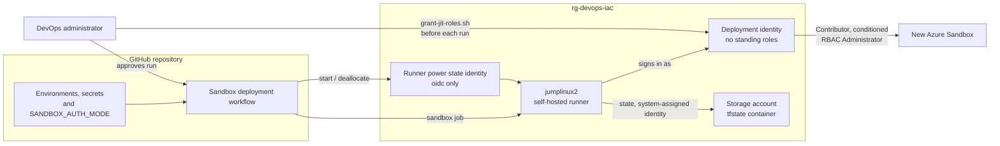
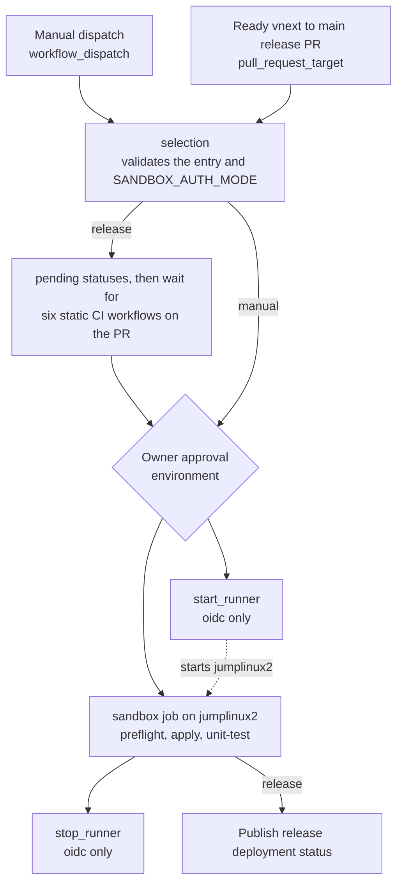

# Contributing to AzureSandbox

Thanks for helping improve Azure Sandbox. This guide explains how to get a change merged. Maintainer-only procedures are in [For maintainers](#for-maintainers) at the end.

## TL;DR

1. Branch from **`vnext`** (fork the repo if you don't have write access). Never target `main`.
2. Run `./scripts/Invoke-CIChecks.sh` locally and fix anything it reports as `FAILED`.
3. Open a **draft** pull request against `vnext`, then mark it **Ready for review** to start CI.
4. Once CI passes and a repository owner approves, the PR is **squash-merged**.
5. The first time, sign the Microsoft CLA when the bot asks.

## Before you start

- **Code of Conduct:** this project follows the [Microsoft Open Source Code of Conduct](.github/CODE_OF_CONDUCT.md).
- **Contributor License Agreement:** most contributions require you to agree to a [CLA](https://cla.opensource.microsoft.com). A bot comments on your first PR with instructions. You only sign once for all Microsoft repositories that use it.
- **License:** contributions are accepted under the repository [license](LICENSE.md).
- **This is a public repository.** Never put secrets, subscription or tenant IDs, internal policy names, or other environment-specific details in code, issues, PRs, or commit messages.

## Questions, issues, and security reports

| You want to… | Do this |
| --- | --- |
| Ask a question or discuss an idea | Start a thread in [Discussions](https://github.com/Azure-Samples/azuresandbox/discussions). |
| Report a bug or documentation mistake | [Search existing issues](https://github.com/Azure-Samples/azuresandbox/issues?q=is%3Aissue), then [open an issue](https://github.com/Azure-Samples/azuresandbox/issues/new) and complete the [issue template](.github/ISSUE_TEMPLATE.md). |
| Propose a feature | Open an issue describing it **before** building anything substantial, so we can confirm it fits. Small changes can go straight to a PR. |
| Report a security vulnerability | **Don't open a public issue.** Follow [SECURITY.md](.github/SECURITY.md). |

## Making a change

`vnext` is the development branch where all work lands. `main` holds released code and is updated only by [release PRs](#releasing-to-main).

```bash
git switch vnext && git pull
git switch -c feature/my-change      # or work in your fork
# ...edit...
./scripts/Invoke-CIChecks.sh         # run all checks, or name some: markdown links bash
git add -A && git commit -m "Describe the change"
git push -u origin feature/my-change
gh pr create --base vnext --draft --fill
gh pr ready                          # starts CI
```

Complete the [pull request template](.github/PULL_REQUEST_TEMPLATE.md). To address review feedback, push more commits. There's no need to rebase or force-push, because the PR is squashed on merge.

### CI checks

CI runs on ready (non-draft) PRs to `vnext` or `main` and on every push to `vnext`. It's static analysis only: nothing is deployed and no credentials are used. Each workflow runs only when files it covers change. All ten checks below are required on `vnext`; on `main`, the [release gate](#release-deployment-gate) requires them through `release-static-ci`.

| Workflow | Required checks | Config | `Invoke-CIChecks.sh` name |
| --- | --- | --- | --- |
| [`ci-docs`](.github/workflows/ci-docs.yml) | `markdownlint`, `lychee (internal links)` | [`.markdownlint.jsonc`](.markdownlint.jsonc), [`lychee.toml`](lychee.toml) | `markdown`, `links` |
| [`ci-terraform`](.github/workflows/ci-terraform.yml) | `terraform fmt`, `tflint`, `terraform validate (.)`, `terraform validate (extras/configurations/rg-devops-iac)` | [`.tflint.hcl`](.tflint.hcl) | `terraform` (fmt and tflint only) |
| [`ci-powershell`](.github/workflows/ci-powershell.yml) | `PSScriptAnalyzer` | [`PSScriptAnalyzerSettings.psd1`](PSScriptAnalyzerSettings.psd1) | `powershell` |
| [`ci-bash`](.github/workflows/ci-bash.yml) | `ShellCheck` | [`.shellcheckrc`](.shellcheckrc) | `bash` |
| [`ci-actions`](.github/workflows/ci-actions.yml) | `actionlint` | [`.github/actionlint.yaml`](.github/actionlint.yaml) | `actions` |
| [`ci-secrets`](.github/workflows/ci-secrets.yml) | `gitleaks` | — | `secrets` |

[`scripts/Invoke-CIChecks.sh`](scripts/Invoke-CIChecks.sh) runs the same tools at the same pinned versions with the same config files. Its header lists the versions and install hints. A tool that isn't installed is reported as `SKIPPED`, which means only CI will verify that check. Rule exclusions are explained inline in each config file.

For PRs from external contributors (for example, from forks), a maintainer must approve the workflow runs before CI starts.

### Architecture diagrams

Diagrams are draw.io editable SVGs (`*.drawio.svg`). The root diagram, [`images/azuresandbox.drawio.svg`](images/azuresandbox.drawio.svg), is the source of truth. Every `modules/<module>/images/` diagram is generated from it, so never hand-edit a module diagram:

1. Edit the root diagram in draw.io or the VS Code draw.io extension.
2. Run `./scripts/build-module-diagrams.py build`, then `./scripts/build-module-diagrams.py verify`.
3. Commit the root and regenerated diagrams together.

Prerequisites and the shape-to-module map are documented in the headers of [`build-module-diagrams.py`](scripts/build-module-diagrams.py) and [`render-drawio-svg.js`](scripts/render-drawio-svg.js).

## Review and merge

A PR into `vnext` can be merged when **all** of these are true:

- Every required CI check passes on the latest commit, and the branch is up to date with `vnext`.
- A repository owner approves after the latest commit, and the approver isn't the person who pushed it. Owners are requested automatically through [`CODEOWNERS`](.github/CODEOWNERS).
- All review conversations are resolved.

### Who can do what

| Role | How it's granted | Can |
| --- | --- | --- |
| Anyone | A GitHub account | Fork the repo and open PRs to `vnext`; open issues and discussions |
| Triage | Invitation from an admin | Label, assign, and close issues and PRs. No commits or merges. |
| Write | Azure-Samples organization teams | Push branches to this repo, and merge an approved PR into `vnext` once CI passes |
| Owner | The `azuresandbox-owners` team | Give the required code-owner approval, merge [release PRs](#releasing-to-main) into `main`, approve release deployments, and use [emergency bypasses](#emergency-merges) |

Nobody can push directly to `vnext` or `main`, force-push to them, delete them, or bypass merge conflicts or unresolved review conversations.

### Merge strategy

| PR | Merge method | Why |
| --- | --- | --- |
| Topic or contributor PR → `vnext` | **Squash** | Each PR lands as one commit. |
| Release PR `vnext` → `main` | **Merge commit** (never squash) | Keeps the individual `vnext` commits and branch history on `main`. |

This is a project convention. GitHub allows all three merge methods, so pick the right one when you merge.

## For maintainers

### Releasing to `main`

Only owners open and merge the `vnext` → `main` release PR:

1. Open the release PR as a draft, then mark it ready.
2. The [CI checks](#ci-checks) run on the PR, and the [deployment workflow](.github/workflows/sandbox-deployment.yml) waits for them to pass on the release head commit.
3. The deployment waits in the `sandbox-release-gate` environment until an owner approves it. Admins can't skip this approval. To merge without a deployment, see [Emergency merges](#emergency-merges).
4. A fresh sandbox is deployed and the unit and integration tests run.
5. If everything passes, merge with a **merge commit**.

Every push, and every time the PR is marked ready again, starts a fresh run; results from an earlier commit are never reused. **Re-run failed jobs** isn't supported. To retry, convert the PR to a draft and mark it ready again, or close and reopen it. The workflow's design and configuration are in [Sandbox deployment workflow](#sandbox-deployment-workflow).

#### Release deployment gate

The release PR's required statuses are all published by GitHub-hosted jobs in the [deployment workflow](.github/workflows/sandbox-deployment.yml) or the [source policy workflow](.github/workflows/main-source-policy.yml):

| Status | Success when |
| --- | --- |
| `main-source-eligibility` | The PR's source is this repo's `vnext` branch. |
| `release-static-ci` | Each of `ci-bash`, `ci-powershell`, `ci-docs`, `ci-actions`, `ci-secrets` and `ci-terraform` reports `pass` or `not-applicable`, and a live recheck finds the PR open, ready, and unchanged in head, base and source. |
| `sandbox-deployment-gate` and `Publish release deployment status` | Preflight, apply, unit-test and stage reporting all succeed, and the JSON evidence on the runner reports exit code 0, `result = "pass"`, passing counts above zero, and no failed tests or suites. The redacted evidence is also uploaded as a workflow artifact, but an upload failure (for example, a GitHub outage) only adds a warning; the results stay on the runner. |

- **Triggers.** Opening, reopening, marking ready, pushing to, or retargeting the PR to `main` starts a fresh run. Drafts and title or description edits run nothing and don't overwrite statuses.
- **Static CI.** The six workflows run on the release PR as ordinary `pull_request` CI, read-only, with no secrets, write tokens or caches. Their workflow definitions come from the release candidate, which reached `vnext` through a reviewed PR. Path filters apply to the PR's full file list, which is the release diff from `main`. The deployment workflow waits up to 30 minutes for each workflow's run on the exact head SHA from this repository's `vnext` branch, and never checks out the candidate itself to run them. `not-applicable` means change detection succeeded and found no relevant files; `gitleaks` and both `terraform validate` checks always run. Results from topic-PR, push or manual runs are never reused, and the CLA check isn't part of it.
- **Pending first.** Both release statuses are published as pending on the head SHA before static CI starts. Missing evidence, skipped stages, failures and cancellations never produce success; an API outage can leave a status pending.
- **Recheck after approval.** Before checkout or any Azure access, the deployment job confirms the PR is unchanged and this attempt owns a passing `release-static-ci`.
- **No overwrites.** Status writers use a per-SHA lock and attempt-specific run links, so an older attempt can't overwrite a newer one. No workflow closes or merges a PR.

### Sandbox deployment workflow

The [deployment workflow](.github/workflows/sandbox-deployment.yml) deploys a new sandbox and runs its unit and integration tests. It runs on `jumplinux2`, the [rg-devops-iac](extras/configurations/rg-devops-iac/README.md) virtual machine registered as a GitHub self-hosted runner. It has two uses:

- **Release gate:** deploys and tests the release candidate on every [release PR](#releasing-to-main).
- **On-demand deployment:** deploys up to 20 sandboxes in parallel from `main` or `vnext`, for example for testing or a class.

The runner and the runner power state identity are created by the rg-devops-iac [github-runner module](extras/configurations/rg-devops-iac/modules/github-runner/README.md), and the deployment identity by rg-devops-iac itself (see [Optional: Deployment Identity](extras/configurations/rg-devops-iac/README.md#optional-deployment-identity)). This section covers the workflow and its configuration.

- [Workflow overview](#workflow-overview)
- [Workflow prerequisites](#workflow-prerequisites)
- [Workflow configuration](#workflow-configuration)
- [Workflow setup](#workflow-setup)
- [Workflow runs](#workflow-runs)
- [Deploying several sandboxes](#deploying-several-sandboxes)
- [Runner power state jobs](#runner-power-state-jobs)
- [Runner records](#runner-records)

#### Workflow overview



| Component | Provided by | Purpose |
| --- | --- | --- |
| `jumplinux2` runner | rg-devops-iac (`enable_github_runner = true`) | Runs the `sandbox` job with the pre-installed IaC toolchain, inside the private network. |
| Deployment identity | rg-devops-iac (`deployment_identity`) | The identity the Azure Sandbox providers authenticate as. No standing Azure RBAC roles, only time-bound deployment roles granted per run. |
| Runner power state identity | rg-devops-iac, `oidc` only | Starts and deallocates `jumplinux2` around a run, from GitHub-hosted jobs. |
| Storage account | rg-devops-iac | Holds each sandbox's Terraform state, reached with `jumplinux2`'s system-assigned identity. |
| Environments, secrets and variables | GitHub repository settings | Supply the sandbox's `backend.tf` and `terraform.tfvars`, require owner approval, and select the authentication mode. |

The workflow supports the two [deployment identity options](extras/configurations/rg-devops-iac/README.md#deployment-identity-options) that need no secret, `managed_identity` and `oidc`. The personas involved are the rg-devops-iac **devops administrator** and **entra administrator**. See [Personas and Role Assignments](extras/configurations/rg-devops-iac/README.md#personas-and-role-assignments).

#### Workflow prerequisites

Arrange these **before** provisioning rg-devops-iac. Some need privileged roles the **devops administrator** may not hold.

| Requirement | Needed for | Modes | When |
| --- | --- | --- | --- |
| GitHub repository administrator | Runner registration token; environments, secrets and variables | Both | Before the rg-devops-iac apply |
| GitHub repository administrator | OIDC subject claim template, unless the repository already uses it | `oidc` | Once, after the federated credentials exist |
| Microsoft Entra Privileged Role Administrator (**entra administrator**) | Microsoft Graph permissions. The least privileged role that can grant them; Global Administrator also works. `Owner`, Cloud Application Administrator and Global Reader can't. | Both, `mssql` only | Once, after the identity is created |
| Microsoft Entra ID P2 or Microsoft Entra ID Governance | Time-bound role assignments | Both | Before the first run |
| Subscription `Contributor` (**devops administrator**), ideally PIM eligible | Applying rg-devops-iac | Both | Each apply |
| Subscription `Role Based Access Control Administrator` without a condition (**devops administrator**), ideally PIM eligible | Applying rg-devops-iac, and granting the time-bound roles | Both | Each apply and each run |

#### Workflow configuration

rg-devops-iac `terraform.tfvars` (see [Optional: GitHub Self-Hosted Runner Configuration](extras/configurations/rg-devops-iac/README.md#optional-github-self-hosted-runner-configuration)):

| Variable | `managed_identity` | `oidc` |
| --- | --- | --- |
| `enable_github_runner` | `true` | `true` |
| `deployment_identity` | `"managed_identity"` | `"oidc"` |
| `deployment_identity_github_environments` | Not used | Default |
| `github_runner_power_state_environment` | Not used | Default |
| `github_repository_id`, `github_repository_owner_id` | Not used | Set for a private repository |
| `github_runner_url`, `github_runner_labels` | Default | Default |

GitHub repository settings. The environments' protection rules are in [Deployment environments and identities](#deployment-environments-and-identities):

| Setting | Type | Value | Modes |
| --- | --- | --- | --- |
| `SANDBOX_AUTH_MODE` | Repository variable | `managed_identity` or `oidc`. Must match `auth_mode` in `SANDBOX_TFVARS_HCL`. Runs fail without it, and the [runner power state jobs](#runner-power-state-jobs) run only with `oidc`. | Both |
| `SANDBOX_JOB_TIMEOUT_MINUTES` | Repository variable, optional | Timeout of the `sandbox` job, which runs preflight, apply and unit tests. Preflight also requires the just-in-time grant to have at least this many minutes left. Default `360`, range `60`-`1440`. | Both |
| `SANDBOX_RETAINED_DEPLOYMENTS` | Repository or environment variable, optional | Previous runs whose private records stay on the runner, besides the current run. Default `3`, range `1`-`10`. Preflight purges older runs' records and state blobs; see [Runner records](#runner-records). | Both |
| `SANDBOX_BACKEND_HCL` | Secret in `sandbox-deployment` and `sandbox-release-gate` | Azure Sandbox `backend.tf`, as below | Both |
| `SANDBOX_TFVARS_HCL` | Secret in `sandbox-deployment` and `sandbox-release-gate` | Azure Sandbox `terraform.tfvars`, as below | Both |
| `RUNNER_POWER_STATE_CLIENT_ID`, `AZURE_TENANT_ID`, `RUNNER_VM_ID` | Secrets in `sandbox-runner-power-state` | See [Runner power state jobs](#runner-power-state-jobs) | `oidc` |
| OIDC subject claim template | Repository setting | `use_default: false`, `include_claim_keys` `repository_owner_id`, `repository_id`, `context`. See [OIDC Subject Claim Template](extras/configurations/rg-devops-iac/modules/github-runner/README.md#oidc-subject-claim-template) | `oidc` |

`SANDBOX_BACKEND_HCL` uses the rg-devops-iac storage account and `jumplinux2`'s system-assigned identity (see [Terraform State](extras/configurations/rg-devops-iac/modules/github-runner/README.md#terraform-state)). Preflight requires each value as a literal, and rejects `key` and any credential, because each run sets its own state key:

```hcl
terraform {
  backend "azurerm" {
    use_azuread_auth     = true
    use_msi              = true
    tenant_id            = "YOUR-ENTRA-TENANT-ID-HERE"
    subscription_id      = "YOUR-AZURE-SUBSCRIPTION-ID-HERE"
    storage_account_name = "YOUR-STORAGE-ACCOUNT-NAME-HERE"
    container_name       = "tfstate"
  }
}
```

`SANDBOX_TFVARS_HCL` is a normal Azure Sandbox `terraform.tfvars` with:

| Setting | Value |
| --- | --- |
| `auth_mode` | `"managed_identity"` or `"oidc"`, matching `SANDBOX_AUTH_MODE` |
| `client_id` | `client_id` from the rg-devops-iac `deployment_identity` output |
| `entra_tenant_id`, `subscription_id` | The same values as in `SANDBOX_BACKEND_HCL` |
| `operator_object_id` | The sandbox's [operator](README.md#personas-and-role-assignments), who is granted data-plane roles on the sandbox's key vault and storage account |
| `enable_module_*` (base) | Release runs: all six `true`. Manual runs: any, with `enable_module_vnet_app = true`. |
| `enable_module_*` (extras) | All disabled |

#### Workflow setup

| Step | Task | Who | Modes | Details |
| --- | --- | --- | --- | --- |
| 1 | Create a runner registration token | DevOps administrator, as a repository administrator | Both | [Self-Hosted Runner Registration](extras/configurations/rg-devops-iac/modules/github-runner/README.md#self-hosted-runner-registration) |
| 2 | Apply rg-devops-iac with the [workflow configuration](#workflow-configuration) | DevOps administrator, with `Contributor` and `Role Based Access Control Administrator` | Both | [Getting Started](extras/configurations/rg-devops-iac/README.md#getting-started) |
| 3 | Grant Microsoft Graph permissions | Entra administrator, with Privileged Role Administrator | Both, `mssql` only | [Microsoft Graph Permissions](extras/configurations/rg-devops-iac/README.md#microsoft-graph-permissions) |
| 4 | Check or set the OIDC subject claim template | Repository administrator | `oidc` | [OIDC Subject Claim Template](extras/configurations/rg-devops-iac/modules/github-runner/README.md#oidc-subject-claim-template) |
| 5 | Add the power state secrets to `sandbox-runner-power-state` | Repository administrator | `oidc` | [Runner power state jobs](#runner-power-state-jobs) |
| 6 | Set `SANDBOX_BACKEND_HCL`, `SANDBOX_TFVARS_HCL` and `SANDBOX_AUTH_MODE` | Repository administrator | Both | [Workflow configuration](#workflow-configuration) |
| 7 | Before each run, grant the time-bound roles | DevOps administrator, with `Role Based Access Control Administrator` | Both | [Deployment Roles](extras/configurations/rg-devops-iac/README.md#deployment-roles) |
| 8 | Start a manual run or mark a release PR ready, then approve | Repository owner (environment reviewer) | Both | [Workflow runs](#workflow-runs) |

#### Workflow runs



| Entry path | Manual dispatch | Release PR |
| --- | --- | --- |
| Trigger | `workflow_dispatch` | `pull_request_target` for a ready, same-repository `vnext` → `main` PR |
| Environment | `sandbox-deployment` | `sandbox-release-gate` |
| Source | Tip of `source_branch`: `main` (default) or `vnext` | Exact PR head SHA |
| Stages | `run_through`: `preflight`, `apply` (default) or `unit-test` | All three |
| Sandboxes | `sandbox_count`: 1 (default) to 20, deployed in parallel; above 1, `preflight` or `apply` only. See [Deploying several sandboxes](#deploying-several-sandboxes) | 1 |
| Base modules | Any, with `vnet_app` enabled | All six |
| Static CI | Not run | The six static CI workflows run on the PR as `pull_request` CI and must pass on the exact head SHA before approval is requested |
| PR statuses | Not published | `release-static-ci` and `sandbox-deployment-gate`; see [Release deployment gate](#release-deployment-gate) |

| Stage | What it does |
| --- | --- |
| `preflight` | Confirms the trusted `main` workflow context and `jumplinux2`. Checks the backend and tfvars secrets, that `auth_mode` matches `SANDBOX_AUTH_MODE`, the module scope, and that the run's state key is unused. Installs a Terraform version that satisfies the deployed `required_version` if the runner's doesn't (see [Terraform Version on the Runner](extras/configurations/rg-devops-iac/modules/github-runner/README.md#terraform-version-on-the-runner)). Purges runs older than `SANDBOX_RETAINED_DEPLOYMENTS` from the runner and the state backend. Signs in as the deployment identity, waits up to 5 minutes for the time-bound roles to take effect, and checks that the grant outlasts `SANDBOX_JOB_TIMEOUT_MINUTES`. |
| `apply` | Rechecks the roles, then applies the saved plan from preflight. |
| `unit-test` | Rechecks the roles, starts every sandbox VM, runs the unit and integration tests, and publishes the full JSON results, redacted the same way as the job log, as a workflow artifact, pass or fail. A failed upload doesn't fail the job; the results stay on the runner. |

Things to know:

- **New sandboxes only.** Each run uses its own state key, `sandboxes/<deployment id>/terraform.tfstate`. The workflow never updates, recovers or destroys a sandbox. Tear down manually.
- **One run at a time.** Runs share a concurrency group, and an active apply isn't cancelled.
- **Private logs.** Raw logs and plans stay on the runner. The job summary shows the stage results, the deployed commit and the sandbox resource group name after a successful apply. When `preflight` or `apply` fails with a Terraform error, each `Error:` block is also shown in full, in red in the job log, as an error annotation and in a caution alert in the job summary. Everything the runner publishes (status messages, progress, errors, annotations, the job summary and the unit-test evidence artifact) is redacted the same way: Microsoft Entra ID ids (tenant, client and object ids) and subscription ids are redacted, along with any other GUID. All tag values are redacted, and so are tag names other than the `project`, `costcenter` and `environment` names in the root `tags` design. Resource names and other details are kept for troubleshooting.
- **Runner records.** Older runs are purged at preflight; see [Runner records](#runner-records).
- **Retry.** **Re-run failed jobs** isn't supported for release PRs. Start a new manual run, or mark the release PR as a draft and ready again.

#### Deploying several sandboxes

For a class or hackathon, set `sandbox_count` on a manual run to deploy up to 20 identical sandboxes in parallel, with one approval. Each sandbox is independent, with its own deployment id `sandbox-<run id>-<n>`, state key `sandboxes/sandbox-<run id>-<n>/terraform.tfstate`, resource group and private records on the runner. All of them use the same `SANDBOX_TFVARS_HCL`. With a count of 1 the run works as described in [Workflow runs](#workflow-runs), with deployment id `sandbox-<run id>`.

How it works:

- **Preflight or apply only.** The tests use host-wide network state on the runner, such as the Virtual WAN point-to-site test's VPN tunnel and routes, so `unit-test` needs a count of 1. Release PRs always deploy one sandbox.
- **Parallel processes in one job.** The `preflight` step checks the Terraform version and downloads the providers once, into a cache shared by the run. It then runs each sandbox's preflight in its own process, from its own copy of the source (a git worktree), starting one every 10 seconds. The `apply` step then applies every sandbox. The `Report stage results` step removes the source copies and the provider cache. A single-sandbox run uses the same kind of provider cache.
- **Failures.** If any sandbox fails preflight, no sandbox is applied. During apply, a failed sandbox doesn't stop the others, but the job fails. Each failed sandbox gets an error annotation.
- **Reporting.** The job log shows each sandbox's status lines prefixed with its deployment id, and a run-wide heartbeat every 2 minutes. The job summary has a table of every sandbox's resource group and stage results, with a details section per sandbox, including any Terraform errors.
- **Shared limits.** All sandboxes share the job's timeout (`SANDBOX_JOB_TIMEOUT_MINUTES`, default 360 minutes), the just-in-time grant and the deployment identity's [Azure Resource Manager request limits](https://learn.microsoft.com/azure/azure-resource-manager/management/request-limits-and-throttling). Throttled requests are retried, so a larger run takes longer than a single sandbox.

Plan capacity before the event. Figures are per sandbox with all base modules; fewer modules need less.

| Resource | Per sandbox | Notes |
| --- | --- | --- |
| Runner memory | Up to 1.5 GB during plan and apply | The runner itself uses about 1 GB. A measured run with `vnet_app` and `mssql` used about 0.9 GB per sandbox, rising slowly during apply. |
| Runner CPU | About 1 vCPU during preflight | `terraform init` and `plan` keep the CPU busy for about 5 minutes. Apply mostly waits on Azure and uses under 10%. Fewer vCPUs than sandboxes only slows preflight. |
| Runner disk | About 40 MB kept per sandbox, plus a provider cache of about 730 MB removed at the end of the run. Records of runs older than `SANDBOX_RETAINED_DEPLOYMENTS` are purged at preflight | The default 30 GB Standard SSD is enough. Its bandwidth peaks briefly while the cache fills, which only slows preflight. |
| Regional vCPUs | 10: 2 each for `adds1`, `jumpwin1` and `jumplinux1`, and 4 for `mssqlwin1` | 200 for 20 sandboxes. Check *Total Regional vCPUs* and the VM family quotas under the subscription's *Usage + quotas*, and request an increase if needed. |
| Public IP addresses | 2 Standard | For Azure Firewall and Bastion. |
| Cost | Dominated by Azure Firewall, the Virtual WAN hub and point-to-site gateway, and Bastion | Billed hourly whether or not the sandbox is used. Disable modules the event doesn't need, such as `vwan`, and tear down promptly. |

Size the runner with the rg-devops-iac `vm_jumpbox_linux_size` variable before the event, apply rg-devops-iac, and size it back down afterwards:

| Sandboxes | Runner size |
| --- | --- |
| Up to 2 | `Standard_D2ls_v6` (2 vCPUs, 4 GiB), the default |
| Up to 8 | `Standard_D4s_v6` (4 vCPUs, 16 GiB) |
| Up to 20 | `Standard_D8s_v6` (8 vCPUs, 32 GiB) |

The sandbox VMs keep running after the run, unless an Azure Policy in the subscription shuts them down.

To tear down, delete each sandbox's resource group, listed in the job summary, and its state blob. Once the run is older than `SANDBOX_RETAINED_DEPLOYMENTS` allows, preflight has already deleted its state blobs; only the resource groups remain. Run this on `jumplinux2`, from the `extras/configurations/rg-devops-iac` directory, signed in to Azure CLI with access to both:

```bash
RUN_ID=YOUR-RUN-ID-HERE
COUNT=YOUR-SANDBOX-COUNT-HERE
for rg in YOUR-RESOURCE-GROUP-NAMES-HERE; do az group delete --name "$rg" --yes --no-wait; done
for n in $(seq 1 "$COUNT"); do ./scripts/delete-tfstate.sh --yes "sandboxes/sandbox-$RUN_ID-$n/terraform.tfstate"; done
```

With `mssql` enabled, also delete each sandbox's `grp-sql-admins-*` Microsoft Entra group. The group name ends with the same suffix as the sandbox's resource group.

#### Runner power state jobs

With `SANDBOX_AUTH_MODE` set to `oidc`, two GitHub-hosted jobs start `jumplinux2` after a deployment is approved and deallocate it afterwards. They sign in as the rg-devops-iac [runner power state identity](extras/configurations/rg-devops-iac/modules/github-runner/README.md#runner-power-state-identity) through the `sandbox-runner-power-state` environment.

Add these secrets to `sandbox-runner-power-state`. They're secrets so they're masked in public run logs. Run the commands from the `extras/configurations/rg-devops-iac` directory:

| Secret | Value |
| --- | --- |
| `RUNNER_POWER_STATE_CLIENT_ID` | `terraform output -json github_runner \| jq -r .power_state_identity_client_id` |
| `AZURE_TENANT_ID` | The Microsoft Entra tenant id |
| `RUNNER_VM_ID` | `terraform output -json resource_ids \| jq -r .virtual_machine_jumplinux2` |

| Job | Runs when | Behavior |
| --- | --- | --- |
| `start_runner` | `SANDBOX_AUTH_MODE` is `oidc`, alongside the `sandbox` job | Waits up to 60 minutes for the deployment's approval; ends without starting anything if it's rejected, and cancels the run on timeout. Then starts `jumplinux2` if it's stopped or deallocated, and waits up to 20 minutes for the runner to pick up the `sandbox` job, cancelling the run if it doesn't. |
| `stop_runner` | After the `sandbox` job, however it ended | Deallocates `jumplinux2` only if `start_runner` started it. A VM that was already running stays running. |

Both jobs run [Invoke-RunnerPowerState.sh](extras/configurations/rg-devops-iac/modules/github-runner/scripts/Invoke-RunnerPowerState.sh) from the trusted workflow commit, never from the deployed branch. With `managed_identity`, the identity isn't created and both jobs are skipped; keep `jumplinux2` running. The environment and its secrets can stay in place for a later switch to `oidc`.

#### Runner records

Each deployment's private records (logs, plan, receipts and Terraform data) stay on `jumplinux2` in `~/.local/state/azuresandbox/deployments/<deployment id>/`. Terraform data links each provider to a per-run cache of about 730 MB, which the `Report stage results` step removes, so a deployment keeps about 40 MB. A run cancelled before that step leaves its cache behind until the run is purged.

At preflight, the runner keeps the current run plus the `SANDBOX_RETAINED_DEPLOYMENTS` most recent previous runs (default `3`, range `1`-`10`), ordered by run id, and purges every older run:

- A run is purged as a whole, including every sandbox of a multi-sandbox run.
- Each purged deployment's state blob, `sandboxes/<deployment id>/terraform.tfstate`, is deleted from the backend first, breaking any leftover state lock. Only then are its records deleted, so a failure leaves them to retry on the next run. The `tfstate` container has no versioning or soft delete, so this is permanent.
- Purging doesn't touch Azure resources. A sandbox that wasn't torn down keeps running; delete its resource group as described in [Deploying several sandboxes](#deploying-several-sandboxes).
- Deployments recorded against another storage account or container are purged from the runner only, and reported, so their state blobs can be deleted manually with `delete-tfstate.sh`.
- Entries in the folder that aren't deployment records are left in place, and reported.
- Any error fails preflight.

Preflight reports the result in the job log and the job summary, for example:

```text
preflight: runner records: kept the current run and 3 previous runs (SANDBOX_RETAINED_DEPLOYMENTS = 3); purged 2 runs: 3 deployments, 2 state blobs deleted, 2.3 GB freed.
```

### Branch protection

The branches are protected by [rulesets](https://docs.github.com/repositories/configuring-branches-and-merges-in-your-repository/managing-rulesets/about-rulesets) (**Settings → Rules**). Every applicable ruleset must pass, and each ruleset's bypass applies only to that ruleset. The only bypass actor is `azuresandbox-owners`, in **pull requests only** mode.

| Branch | Ruleset | Enforces | Bypass |
| --- | --- | --- | --- |
| `vnext` | `vnext-baseline` | Requires a PR, resolved conversations, and no force pushes or deletion | None |
| `vnext` | `vnext-required-checks` | The ten [CI checks](#ci-checks), with the branch up to date | Owners |
| `vnext` | `vnext-require-review` | One code-owner approval after the latest push, from someone other than the pusher | Owners |
| `main` | `main-baseline` | Requires a PR, and no force pushes or deletion | None |
| `main` | `main-release-source` | `main-source-eligibility`: the source must be this repo's `vnext` branch ([workflow](.github/workflows/main-source-policy.yml)) | Owners |
| `main` | `main-release-static-ci` | `release-static-ci` | Owners |
| `main` | `main-release-deployment` | `sandbox-deployment-gate` and `Publish release deployment status` | Owners |

Each kind of bypass has its own ruleset, so **Settings → Rules → Insights** shows which one was used. `main` also has a classic branch protection rule that restricts pushes to `azuresandbox-owners`, enforced for admins. That's how owners merge release PRs that pass every check without needing a bypass. The CLA check (`license/cla`) is managed by the Azure-Samples organization, and no ruleset here requires it.

### Deployment environments and identities

The [deployment workflow](.github/workflows/sandbox-deployment.yml) signs in to Azure as a deployment identity. With `auth_mode = "managed_identity"`, the identity is attached to the self-hosted runner virtual machine. With `auth_mode = "oidc"`, the workflow uses GitHub OIDC, through federated credentials on the deployment identity that trust this repository's two deployment environments, and on a separate runner power state identity that trusts a third environment. Because the credentials don't name a workflow file, these settings (**Settings → Environments** and **Settings → Actions**) are what restrict those identities to workflows on `main` that an owner approves or an admin starts. They're separate from the [branch protection](#branch-protection) bypasses, which control merges, not deployments:

| Setting | Required value |
| --- | --- |
| `sandbox-deployment`, `sandbox-release-gate` and `sandbox-runner-power-state` deployment branches | `main` only |
| Required reviewers | Owners, in `sandbox-deployment` and `sandbox-release-gate`. None in `sandbox-runner-power-state` |
| **Allow administrators to bypass configured protection rules** | Off in `sandbox-release-gate`, so admins can't skip release deployment approval. On in `sandbox-deployment`, so an admin can start a manual deployment without approval |
| Actions event policies | One per workflow file: `pull_request_target` and `workflow_dispatch` for `.github/workflows/sandbox-deployment.yml`, and `pull_request_target` for `.github/workflows/main-source-policy.yml`. No other workflow can use `pull_request_target`; see [`pull_request_target` security](#pull_request_target-security) |
| OIDC subject claim template | `use_default: false` with `include_claim_keys` `repository_owner_id`, `repository_id` and `context` |

The environments' variables and secrets are listed in [Workflow configuration](#workflow-configuration).

`sandbox-runner-power-state` is used by the [runner power state jobs](#runner-power-state-jobs), which start the self-hosted runner virtual machine after a deployment is approved and deallocate it afterwards. It has no reviewers because `start_runner` waits for the deployment's own approval before it starts anything, and its identity can only read, start and deallocate that one virtual machine. Don't add it to `deployment_identity_github_environments`, and don't use it for any other job. See [Runner Power State Identity](extras/configurations/rg-devops-iac/modules/github-runner/README.md#runner-power-state-identity).

Don't change the OIDC subject claim template. It changes the subject of every OIDC token the repository issues, and the federated credentials only accept this format. Check it with `gh api repos/Azure-Samples/azuresandbox/actions/oidc/customization/sub`. A new environment can't federate to the deployment identity until its name is added to `deployment_identity_github_environments` in rg-devops-iac. See the [rg-devops-iac deployment guide](extras/configurations/rg-devops-iac/README.md#optional-deployment-identity).

### `pull_request_target` security

Two workflows use the `pull_request_target` trigger: [`main-source-policy.yml`](.github/workflows/main-source-policy.yml) and [`sandbox-deployment.yml`](.github/workflows/sandbox-deployment.yml). GitHub [blocks this trigger by default](https://github.blog/changelog/2026-11-02-pull_request_target-blocked-by-default-december-2/) in public repositories unless an Actions event policy allows it, and each of these workflows has its own policy (see [Deployment environments and identities](#deployment-environments-and-identities)). This section records how both workflows apply the mitigations in GitHub Security Lab's [Keeping your GitHub Actions and workflows secure Part 1: Preventing pwn requests](https://securitylab.github.com/resources/github-actions-preventing-pwn-requests/) and GitHub's guidance on [securely using `pull_request_target`](https://docs.github.com/en/actions/reference/security/securely-using-pull_request_target), and the follow-up patterns in [Part 4](#part-4-new-patterns-and-mitigations) of the same series. It was last reviewed on 2026-11-04 ([#964](https://github.com/Azure-Samples/azuresandbox/issues/964)). Review it again whenever either workflow, the rulesets or the deployment environments change.

**Why not `pull_request`.** Both workflows need privileges that `pull_request` doesn't provide, and both must run trusted code. `pull_request_target` always runs the workflow definition from `main`, so a PR can't rewrite the check that judges it. `main-source-policy.yml` publishes the required `main-source-eligibility` status. `sandbox-deployment.yml` publishes the release statuses and requests the `sandbox-release-gate` environment, whose secrets and OIDC federation are limited to `main`. Under `pull_request`, the workflow would run from the PR's merge ref, so that restriction would have to be relaxed and every PR's own workflow code could request the environment.

| Article guidance | How this repository applies it |
| --- | --- |
| Use `pull_request_target` only when the workflow needs write permissions or secrets. | Both workflows need them (see above). Each event policy targets only its own workflow file. |
| Don't check out or run PR code in a `pull_request_target` workflow. | `main-source-policy.yml` never checks out code; it reads only the event payload. In `sandbox-deployment.yml`, the selection, status and static CI jobs don't check out anything, and `start_runner` and `stop_runner` check out one script from the trusted workflow commit (`github.sha`). Only the `sandbox` job checks out and runs the release candidate, by design. See [Running release candidate code](#running-release-candidate-code). |
| Run untrusted code in an unprivileged `pull_request` workflow and keep the privileged step separate (the `pull_request` and `workflow_run` pattern). | Release static CI (the six `ci-*.yml` workflows) runs as ordinary read-only `pull_request` CI, with no secrets, write tokens or caches. The privileged workflow never runs them. A job with only `actions: read` reads their results through the API for the exact head SHA, without downloading artifacts. |
| Use a "safe to test" label gate only as a temporary fix, because a push can land between labeling and the run. | There's no label gate. An owner must approve the `sandbox-release-gate` environment, and the job is pinned to the head SHA recorded when the run started and rechecks the live PR after approval, which closes that race. |
| Set `persist-credentials: false` on `actions/checkout`. | Set on every checkout in both workflows and in the six release static CI workflows. |
| Don't leave a write token where PR code can read it. | The repository's default `GITHUB_TOKEN` is read-only and can't approve PRs. `sandbox-deployment.yml` defaults to `contents: read` and grants more per job; `statuses: write` is granted only to the GitHub-hosted status jobs, which never run candidate code. `main-source-policy.yml` has only `statuses: write`. |
| PRs opened before a fix can still use the vulnerable workflow. | Only same-repository `vnext` → `main` PRs are eligible. Fork PRs were never eligible under any version of either workflow. |
| Use CodeQL to find these patterns. | CodeQL code scanning, including the `actions` language, runs on `main` and on PRs. The untrusted-checkout (critical, high, medium and TOCTOU) and cache-poisoning queries report no findings. All earlier alerts were closed as fixed, not dismissed. See [CodeQL verification](#codeql-verification). |

#### Running release candidate code

The `sandbox` job checks out the release candidate and runs its deployment scripts with environment secrets and an Azure deployment identity. The article calls checking out and running PR code in a privileged workflow dangerous. Here it's required, because the release gate exists to deploy and test the exact code that will be merged into `main`. These controls limit who can supply that code, when it runs and what it can reach:

1. **Same-repository `vnext` only.** The `selection` job rejects any event unless the PR's base is `main`, its head is this repository's `vnext` branch, and both SHAs are well formed. The `sandbox` job's `if:` repeats the same-repository check declaratively, so CodeQL recognizes it as a control check. Fork PRs can't reach any job that has secrets.
2. **Code on `vnext` is reviewed.** `vnext` accepts changes only through PRs (`vnext-baseline`). Each PR needs one code-owner approval after the latest push, from someone other than the pusher (`vnext-require-review`), and the ten [CI checks](#ci-checks) (`vnext-required-checks`). Owners can bypass the last two, in pull-request mode only, and **Rules → Insights** records each bypass. See [Branch protection](#branch-protection).
3. **Trusted workflow code.** `pull_request_target` runs the workflow definition from `main`, and `selection` fails unless the run's ref is `refs/heads/main`. The release candidate supplies the deployment scripts, but it can't change the workflow's jobs, permissions or gates.
4. **Unprivileged checks first.** Static CI runs in unprivileged `pull_request` workflows and must pass on the exact head SHA before deployment approval is requested.
5. **Owner approval that admins can't skip.** The `sandbox` job requests the `sandbox-release-gate` environment, which requires approval from `azuresandbox-owners`, admits only `main`, and doesn't let administrators bypass its protection rules. Its secrets are released, and its OIDC token can be requested, only after approval.
6. **Pinned SHA and recheck after approval.** The job checks out the head SHA recorded when the run started, never a branch name. Before checkout, it confirms that the PR is still open and ready, its head and base SHAs haven't changed, and this attempt still owns a passing `release-static-ci`. A push after approval stops the run before checkout, and the new commit starts a new run that needs its own approval.
7. **No stored credentials and a limited token.** Checkout uses `persist-credentials: false`. The job's `GITHUB_TOKEN` has only `contents: read`, `pull-requests: read` and `statuses: read`, plus `id-token: write` for OIDC. It can't push, change PRs or publish statuses.
8. **Statuses published separately.** Required statuses are published only by separate GitHub-hosted jobs that never run candidate code. They report success only when every stage succeeded and the JSON evidence passed. Anything missing, skipped or cancelled is reported as a failure.
9. **Limited Azure access.** The deployment identity holds no standing Azure RBAC roles. The devops administrator grants time-bound roles before each run ([deployment roles](extras/configurations/rg-devops-iac/README.md#deployment-roles)). A condition limits its role assignments to the sandbox's own roles, and its Microsoft Graph permissions are limited to those listed in [Microsoft Graph permissions](extras/configurations/rg-devops-iac/README.md#microsoft-graph-permissions). The workflow signs in with GitHub OIDC, and the identity's federated credentials trust only this repository's deployment environments, which admit only `main`.
10. **One deployment at a time.** The `sandbox` job uses a single concurrency group, so deployments run one after another on the self-hosted runner.

#### Part 4: new patterns and mitigations

GitHub Security Lab's [Keeping your GitHub Actions and workflows secure Part 4: New vulnerability patterns and mitigation strategies](https://securitylab.github.com/resources/github-actions-new-patterns-and-mitigations/) describes patterns found with CodeQL for Actions in three areas: misuse of `pull_request_target`, the `workflow_run` trigger, and `issue_comment` (IssueOps) workflows. Only the first applies here. No workflow on any branch uses `workflow_run` or `issue_comment`.

| Article guidance | How this repository applies it |
| --- | --- |
| Don't run code from untrusted sources, such as an `actions/checkout` of the PR head. | Fork PRs are rejected. Only the `sandbox` job runs PR code, and only from this repository's reviewed `vnext` branch after owner approval. See [Running release candidate code](#running-release-candidate-code). |
| Prevent time-of-check to time-of-use (TOCTOU) attacks by checking out `head.sha`, never the mutable `head.ref`. | The `sandbox` job checks out the `head.sha` recorded when the run started. After approval and before checkout, it confirms that the PR's head and base SHAs haven't changed. |
| Watch for vulnerable copies of a workflow left in non-default branches. | Every branch's copy of both workflows limits `pull_request_target` to PRs targeting `main` (`branches: [main]`). As a second layer, the `selection` job fails unless the run's ref is `refs/heads/main`, and the deployment environments admit only `main`. |
| Prevent cache poisoning; removing permissions with `permissions: {}` doesn't stop it. | Neither workflow, nor the release static CI workflows, restores or saves an Actions cache. CodeQL's cache-poisoning queries report no findings. |
| Harden with repository checks that allow only PRs from the base repository. | Both workflows check that the PR's head repository is this repository. In `sandbox-deployment.yml`, the job-level `if:` of the `sandbox` job repeats the check. |
| Harden with actor checks against the author's permissions, never a hard-coded list of user names. | There's no explicit actor check in the workflows. Equivalent controls apply: only users with write access can push to `vnext`, every `vnext` PR needs a code-owner approval, and deployment approval comes from the `azuresandbox-owners` team rather than named users. |
| Split work into an unprivileged `pull_request` workflow and a privileged workflow. | Release static CI runs in unprivileged `pull_request` workflows. The deployment can't be split, because it needs both the release candidate and the deployment credentials; the controls in [Running release candidate code](#running-release-candidate-code) apply instead. |
| Treat data that crosses the privilege boundary as untrusted: validate output variables, and don't define environment variables from untrusted data. | Neither workflow writes to `GITHUB_ENV` or `GITHUB_PATH`. No `run:` script embeds a `${{ }}` expression; values reach scripts only through step `env:` settings. SHAs and PR numbers are validated against strict patterns before use, job outputs are only compared and never executed, and no workflow downloads artifacts. |
| Enable CodeQL for GitHub Actions. | Enabled. See the CodeQL row in the table above. |

#### Residual risks

These are accepted for now and reviewed with this section:

- **Self-approval.** **Prevent self-review** is off in `sandbox-release-gate`, so the owner who starts a release run (for example, by marking the release PR ready) can also approve its deployment. The code itself still needed a code-owner review to reach `vnext`.
- **Persistent self-hosted runner.** The runner is registered once rather than as an ephemeral runner. It keeps each run's private records (logs, plans and Terraform data) for troubleshooting. They're stored in the runner service account's home directory, so other users on the runner can't read them without `sudo`, and preflight purges runs older than `SANDBOX_RETAINED_DEPLOYMENTS` (default `3`); see [Runner records](#runner-records). Integration tests run without `sudo`, except the VPN test, which runs a root-owned wrapper through passwordless `sudo`. The runner service account's `sudo` grant covers only two root-owned wrappers: the VPN tunnel wrapper, which accepts only an allowlisted OpenVPN configuration and manages that one tunnel, and the wrapper that installs a validated Terraform version. See [Root access for the vwan integration test](README.md#root-access-for-the-vwan-integration-test).

#### CodeQL verification

This repository must have zero findings for [`actions/untrusted-checkout/critical`](https://codeql.github.com/codeql-query-help/actions/actions-untrusted-checkout-critical/), [`actions/untrusted-checkout/medium`](https://codeql.github.com/codeql-query-help/actions/actions-untrusted-checkout-medium/) and [`actions/untrusted-checkout-toctou/high`](https://codeql.github.com/codeql-query-help/actions/actions-untrusted-checkout-toctou-high/). Code scanning default setup uses the **Extended** query suite, because the **Default** suite doesn't run the medium query. Don't switch it back. Verified on 2026-11-04 with CodeQL 2.27.4:

- The code scanning analysis of `main` ran all three queries and reported no results, and there are no open alerts.
- A local CodeQL CLI scan (an `actions` database built from `.github`, analyzed with the untrusted-checkout and TOCTOU queries) reported no findings on `main` or `vnext`. The same scan of `main` before the [#964](https://github.com/Azure-Samples/azuresandbox/issues/964) fixes found 1 critical and 14 medium findings, which confirms the queries detect the pattern.

### Emergency merges

An owner can merge a PR whose CI or deployment checks haven't passed by recording the reason in the PR and selecting **Bypass rules and merge** (`gh pr merge <n> --admin`, plus `--squash` or `--merge` per the [merge strategy](#merge-strategy)). Use this only when waiting isn't practical. For example:

- A GitHub outage is blocking CI.
- A release can't be deployed because of time or cost, or it's documentation-only.
- An authorized maintenance PR to `main` doesn't come from `vnext`.
- There's only one owner, so they can't approve their own `vnext` PR. GitHub never lets authors approve their own PRs.

A bypass never creates a passing result, never approves or starts a deployment, never allows a direct push, and never overrides merge conflicts or unresolved conversations. It applies to the whole ruleset, not to specific files, so review the PR's full scope first.

### Granting access

Issues and PRs can be assigned only to users with triage access or higher, or to anyone who has commented on that item. Having commits in the repo grants no permissions. To let someone triage, invite them at the **triage** level. Then check the pending invitation's level, because an older, unaccepted invitation at a higher level isn't downgraded automatically. Access takes effect once they accept.

### CI tool versions

The tool versions pinned in the CI workflows and `Invoke-CIChecks.sh` aren't tracked by Dependabot. Each week, [`ci-tool-versions`](.github/workflows/ci-tool-versions.yml) runs [`scripts/Check-ToolVersionDrift.sh`](scripts/Check-ToolVersionDrift.sh). When any tool is behind, it opens or updates a single `tool-version-drift` issue listing every file to update. To bump a version, update every file listed, then rerun `./scripts/Invoke-CIChecks.sh`.

The Terraform CLI version isn't pinned in any workflow. [`ci-terraform`](.github/workflows/ci-terraform.yml) installs the `X.Y.Z` version from `required_version` in each configuration's `terraform.tf`, so a CLI bump only changes `terraform.tf` files. Release PRs then pass static CI without a separate update to `main`.
