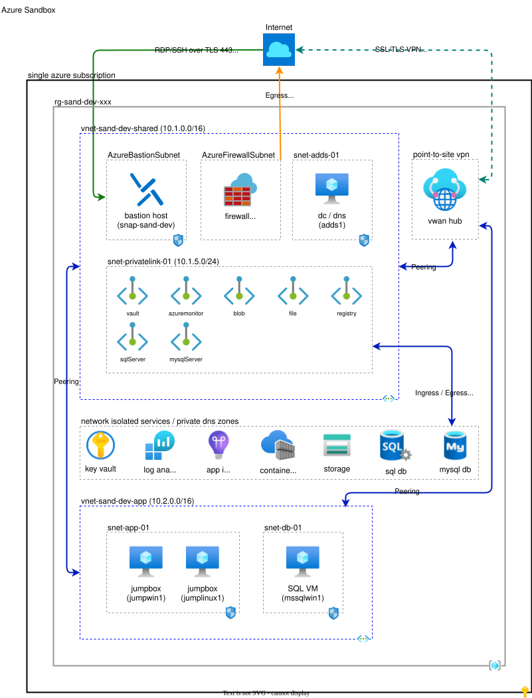

# Azure Sandbox

## Contents

* [Architecture](#architecture)
* [Overview](#overview)
* [Features](#features)
* [Prerequisites](#prerequisites)
* [Tutorial: Deploy a Sandbox Using Your Azure CLI Sign-In)](#tutorial-deploy-a-sandbox-using-your-azure-cli-sign-in)
* [Documentation](#documentation)

## Architecture



## Overview

Azure Sandbox is a Terraform-based project designed to simplify the deployment of sandbox environments in Microsoft Azure. It provides a modular and reusable framework for implementing foundational infrastructure which can accelerate the development of innovative new solutions in Azure.

This project is ideal for developers, IT professionals, and organizations looking to explore Azure services, prototype solutions, or conduct training sessions. With its modular design, Azure Sandbox allows users to customize their deployments to suit specific use cases, such as virtual networks, virtual machines, AI services, and more.

Azure Sandbox is not intended for production use but serves as a powerful tool for learning and experimentation in Azure.

> [!TIP]
> **Looking for a different sandbox solution?**
>
> [**Azure Container Apps Sandboxes**](https://sandboxes.azure.com/) delivers production-grade isolation as a native Azure service — with default-deny egress control, sub-second provisioning, snapshots and more.

## Features

Azure Sandbox provides a comprehensive set of features to simplify the deployment and management of sandbox environments in Microsoft Azure.

* [Modular and Extensible Architecture](#modular-and-extensible-architecture)
* [Secure Networking and Connectivity](#secure-networking-and-connectivity)
* [Pre-configured Virtual Machines](#pre-configured-virtual-machines)
* [Pre-configured Storage Options](#pre-configured-storage-options)
* [Pre-configured Database Options](#pre-configured-sql-database-options)
* [Secure by Default, Secure by Design](#secure-by-default-secure-by-design)
* [Documentation and Videos](#documentation-and-videos)

### Modular and Extensible Architecture

Reusable Terraform modules for common Azure resources, such as:

* Virtual networks
* Virtual machines
* Storage services
* Database services

Enable only the modules you need for your specific sandbox environment. Disable the modules you don't need to reduce costs and complexity. Extend your sandbox environment with additional modules for specialized use cases, or create your own custom modules to meet specific requirements.

### Secure Networking and Connectivity

* **Virtual Networks**: Configures virtual networks for secure and isolated communication between resources.
  * Shared virtual network (vnet-shared) for hosting common services.
  * Application-specific virtual network (vnet-app) with pre-configured subnets.
  * Virtual network peering for seamless connectivity between networks.
  * Pre-configured network security groups (NSGs) for controlling inbound and outbound traffic.
* **Private DNS Server**: Pre-configured  private DNS server for name resolution within the sandbox environment, ensuring secure and isolated DNS queries.
* **Private DNS Zones**: Pre-configured private DNS zones for popular Azure services.
* **Private Endpoints**: Pre-configured network isolated endpoints for PaaS services.
* **Azure Firewall**: Pre-configured firewall for secure outbound internet access and threat intelligence.
* **Azure Bastion**: Pre-configured Bastion for secure and seamless RDP/SSH access to virtual machines without exposing them to the public internet.
* **Point-to-site VPN Gateway**: Opitional point-to-site VPN gateway for secure remote access to your sandbox environment.

### Pre-configured Virtual Machines

A variety of Windows and Linux virtual machines are included and are fully configured for use in the sandbox.

* **Domain Controller / DNS Server**: Active Directory Domain Services (AD DS) domain controller with a pre-configured local domain and integrated private DNS server.
* **Windows Jumpbox**: Domain-joined Windows server for remote administration, management and development within the sandbox environment with a full suite of pre-configured tools.
* **Linux Jumpbox**: Domain-joined Ubuntu server for open-source DevOps processes with a full suite of pre-configured tools.

### Pre-configured Storage Options

Two storage options are included and are fully configured for use in the sandbox.

* **Azure Blob Storage**: Container for startup configuration scripts with network isolated endpoints for secure access.
* **Azure Files**:  Azure Files share configured for integrated Active Directory Domain Services (AD DS) authentication and network isolated endpoints for secure file sharing.

### Pre-configured SQL Database Options

Multiple SQL database options are provided to suit various use cases and requirements. These options allow users to choose the database solution that best fits their needs, whether they require full control, a managed service, or compatibility with open-source technologies.

* **SQL Server Virtual Machine (IaaS)**:
  * Deploys a fully configured SQL Server instance on a domain-joined Windows virtual machine.
  * Ideal for scenarios requiring full control over the operating system and database configuration.
  * Supports custom configurations, such as SQL Server Agent jobs, linked servers, and advanced database settings.

* **Azure SQL Database (PaaS)**:
  * Deploys a fully managed Azure SQL Database instance.
  * Network isolated endpoints for secure access.
  * Simplifies database management by handling backups, scaling, and high availability.
  * Suitable for applications requiring a scalable and cost-effective relational database solution.

* **Azure Database for MySQL (PaaS)**:
  * Deploys a fully managed MySQL database instance.
  * Network isolated endpoints for secure access.
  * Provides high availability, automated backups, and scaling options.
  * Ideal for applications built on open-source technologies requiring MySQL as the backend database.

### Secure by Default, Secure by Design

Azure Sandbox demonstrates layered security controls across identity, authorization, networking, secrets, data protection, and monitoring. Key security features include:

* **Identity and Access Management (IAM)**:
  * **Authentication**:
    * Integration with Microsoft Entra ID for control-plane, data-plane and service-specific authentication (e.g. Azure SQL Database).
    * Integration with Active Directory Domain Services (AD DS) for domain-joining Windows and Linux servers and use of Windows integrated authentication (e.g. SQL Server).
  * **Authorization**:
    * Integration with Azure RBAC role assignments according to the principle of least privilege.
    * Integration with Azure ABAC conditions to restrict which roles can be assigned during deployment. See [Deployment Identity](#deployment-identity).
    * Uses operating-system and service-specific permissions to control access within workloads.

* **Network Isolation**:
  * Uses network segmentation, private endpoints, and access controls to restrict public exposure and connectivity between workloads.
  * Uses dependency barriers to keep public access available on selected shared services while Terraform completes required data-plane operations from outside the private network, then disables public access once those operations finish.

* **Azure Key Vault Integration**:
  * Protects shared secrets used by modules, such as administrator credentials and SSH/VPN certificate keys.
  * Encrypts secrets at rest and controls access through Microsoft Entra ID and Azure RBAC.
  * Isolates network access using Azure Private Link.

* **Data Encryption**:
  * Data at rest is encrypted using platform-managed keys, including encryption at host for VMs.
  * Data in transit is encrypted using TLS where supported.

* **Monitoring**:
  * Diagnostic logs and metrics are collected for auditing and troubleshooting.

### Documentation and Videos

This project includes valuable resources to help you get started quickly and easily. The content is designed to be user-friendly and accessible, making it easy for users of all skill levels to understand and utilize the features of Azure Sandbox.

* Comprehensive documentation for each module and configuration.
* Interactive smoke testing procedures and comprehensive automated unit testing procedures for validating deployments.
* Step-by-step video tutorials for setup, testing, and customization.

## Prerequisites

This section describes the prerequisites required to allow a **sandbox user** to manually provision an Azure Sandbox.

* [Microsoft Entra ID Tenant and Azure Subscription](#microsoft-entra-id-tenant-and-azure-subscription)
* [Other Prerequisites](#other-prerequisites)
* [Terraform Execution Environment](#terraform-execution-environment)
* [Personas and Role Assignments](#personas-and-role-assignments)

### Microsoft Entra ID Tenant and Azure Subscription

* Identify the [Microsoft Entra ID](https://learn.microsoft.com/en-us/entra/fundamentals/whatis) tenant to be used for identity and access management, or create a new tenant using [Quickstart: Set up a tenant](https://learn.microsoft.com/en-us/entra/identity-platform/quickstart-create-new-tenant).
* Identify a single Azure [subscription](https://learn.microsoft.com/azure/cloud-adoption-framework/ready/considerations/fundamental-concepts#azure-terminology) or create a new Azure subscription. See [Azure Offer Details](https://azure.microsoft.com/support/legal/offer-details/) and [Associate or add an Azure subscription to your Microsoft Entra tenant](https://learn.microsoft.com/entra/fundamentals/how-subscriptions-associated-directory) for more information.

### Other Prerequisites

* Some Azure subscriptions may have low quota limits for specific Azure resources which may cause sandbox deployments to fail. See [Resolve errors for resource quotas](https://learn.microsoft.com/azure/azure-resource-manager/templates/error-resource-quota) for more information.
* Some Azure subscriptions may not have the required resource providers registered. Terraform is configured to automatically register the required resource providers, but this may take some time on first use.
* Some Azure subscriptions may not have the required features enabled, such as host encryption for virtual machines. Monitor your plan application for errors related to specific subscription features and enable them as needed.
* Some organizations may institute [Azure policy](https://learn.microsoft.com/azure/governance/policy/overview) which may cause some sandbox deployments to fail. This can be addressed by using custom settings which pass the policy checks, using environment-specific tags which alter how policies are applied, or by disabling the policies on the Azure subscription being used for the configurations.

### Terraform Execution Environment

A variety of Terraform execution environments can be used to provision Azure Sandbox interactively, including:

* **Windows-Only Client**: A Windows-only client can be used to run Terraform. The following software should be installed:
  * git
  * Azure CLI
  * PowerShell 7.x
  * Az PowerShell Module
  * Terraform
  * Visual Studio Code

* **Windows Subsystem for Linux (WSL) Client**: WSL offers the best of Windows and Linux in the same client environment and was used to develop this project. The following software should be installed:
  * Linux (WSL) software
    * Linux Distro: Ubuntu 24.04 LTS (Noble Numbat)
    * pip3 Python library package manager and the PyJWT Python library (pre-installed on Ubuntu 24.04)
    * git (pre-installed on Ubuntu 24.04)
    * Azure CLI
    * PowerShell 7.x
    * Az PowerShell Module
    * Terraform
  * Windows software
    * Visual Studio Code configured for [Remote development in WSL](https://code.visualstudio.com/docs/remote/wsl-tutorial)

* **Linux / macOs Client**: A Linux or macOS client can be used to run Terraform. The following software should be installed:
  * git
  * Azure CLI
  * PowerShell 7.x
  * Az PowerShell Module
  * Terraform
  * Visual Studio Code

* **Azure Virtual Machine**: An Azure virtual machine (Windows or Linux) can be used to run Terraform. This may be your only option if your client device is managed by strict corporate security policies that restrict developer use cases. See [rg-devops-iac](./extras/configurations/rg-devops-iac/) in extras for a complete configuration that can be used as a Terraform execution environment, either interactive or automated as part of a DevOps pipeline. This configuration has been tested as a Linux Terraform execution environment for Azure Sandbox. If you build your own Azure Virtual Machine to use as a Terraform execution environment, the following software should be installed:
  * git
  * Azure CLI
  * PowerShell 7.x
  * Az PowerShell Module
  * Terraform

* **Azure Cloud Shell**: Azure Cloud Shell is not recommended but can be used. Most of the software dependencies are pre-installed.

### Personas and Role Assignments

There are four separate personas associated with sandboxes to support role separation when required. A single user can assume multiple personas if they have the appropriate role assignments. By default, the operator is also the deployment identity. All Azure role assignments should be scoped to a single subscription.

Persona | Intent | Minimum Entra Role Required | Minimum Azure Role Required
--- | --- | --- | ---
**entra administrator** | Assigns roles to other personas. | `Privileged Role Administrator` | `User Access Administrator` \*
**azure administrator** | Enables the deployment and use of sandboxes. | N/A | `Role Based Access Control Administrator` \*\*
**deployment identity** | Enables Terraform to deploy sandboxes. | `Groups Administrator` \*\*\* | `Contributor`, `Role Based Access Control Administrator` \*\*
**sandbox user** | Enables users to use and modify deployed sandboxes. The user the sandbox is deployed for is its **operator** \*\*\*\*. | N/A | `Contributor`

\* An Entra `Global Administrator` can get Azure `User Access Administrator` by enabling `Access management for Azure resources`. See [Elevate access to manage all Azure subscriptions and management groups](https://learn.microsoft.com/azure/role-based-access-control/elevate-access-global-admin) for more information.

\*\* Azure `Role Based Access Control Administrator` can be further constrained using Azure ABAC. See [A more secure method: Delegate role assignment management with conditions](https://learn.microsoft.com/azure/role-based-access-control/delegate-role-assignments-overview#a-more-secure-method-delegate-role-assignment-management-with-conditions) for more information.

\*\*\* Entra `Groups Administrator` may not be needed if `Users can create security groups in Azure portals, API or PowerShell` is enabled. See [Default user permissions](https://learn.microsoft.com/entra/fundamentals/users-default-permissions) for more information.

\*\*\*\* The operator gets data-plane access to the sandbox's Key Vault and storage account.

Either standing role assignments or PIM activated role assignments can be used depending on your requirements. See the following for more information:

* Entra Role Assignments
  * [Assign Microsoft Entra roles](https://learn.microsoft.com/entra/identity/role-based-access-control/manage-roles-portal)
  * [Assign Microsoft Entra roles in Privileged Identity Management](https://learn.microsoft.com/entra/id-governance/privileged-identity-management/pim-how-to-add-role-to-user)
  * [Activate a Microsoft Entra role in PIM](https://learn.microsoft.com/entra/id-governance/privileged-identity-management/pim-how-to-activate-role)
* Azure Role Assignments
  * [Steps to assign an Azure role](https://learn.microsoft.com/azure/role-based-access-control/role-assignments-steps)
  * [Assign Azure resource roles in Privileged Identity Management](https://learn.microsoft.com/entra/id-governance/privileged-identity-management/pim-resource-roles-assign-roles)
  * [Activate my Azure resource roles in Privileged Identity Management](https://learn.microsoft.com/entra/id-governance/privileged-identity-management/pim-resource-roles-activate-your-roles)

## Tutorial: Deploy a Sandbox Using Your Azure CLI Sign-In

There are several different ways to deploy a sandbox. This tutorial shows you how to do it interactively from a terminal using your Azure CLI sign-in credentials.

* [Step 1: Log In](#step-1-log-in)
* [Step 2: Clone the Repository](#step-2-clone-the-repository)
* [Step 3: Check Role Assignments](#step-3-check-role-assignments)
* [Step 4: Initialize Terraform](#step-4-initialize-terraform)
* [Step 5: Configure Variables](#step-5-configure-variables)
* [Step 6: Validate and Apply Configuration](#step-6-validate-and-apply-configuration)
* [Step 7: Complete Smoke Testing](#step-7-complete-smoke-testing)
* [Step 8: Use Your Sandbox](#step-8-use-your-sandbox)
* [Step 9: Clean Up](#step-9-clean-up)

### Step 1: Log In

Before you can provision an Azure Sandbox interactively, you need to log in to the Azure account you want to use to deploy the sandbox.

* Open a terminal window and run this Azure CLI command:

  ```bash
  az login --use-device-code
  ```

* Check the terminal for a message like this:

  ```text
  To sign in, use a web browser to open the page https://microsoft.com/devicelogin and enter the code XXXXXXXXX to authenticate.
  ```

* Open a browser and navigate to the URL provided in the terminal. Enter the code displayed in the terminal to authenticate your Azure account.
* Depending upon how your Entra ID tenant is configured, you may be prompted to enter your password and/or approve a sign-in request on your mobile device.
* Click **Continue** when asked if you are trying to sign in to Azure.
* Check the terminal for a prompt like this:

  ```text
  Retrieving tenants and subscriptions for the selection...

  [Tenant and subscription selection]

  No     Subscription name               Subscription ID                       Tenant
  -----  ------------------------------  ------------------------------------  ----------------
  [1] *  SUBSCRIPTION1-NAME-HERE         SUBSCRIPTION1-ID-HERE                 TENANT-NAME-HERE
  [2]    SUBSCRIPTION2-NAME-HERE         SUBSCRIPTION2-ID-HERE                 TENANT-NAME-HERE

  The default is marked with an *; the default tenant is 'TENANT-NAME-HERE' and subscription is 'SUBSCRIPTION1-NAME-HERE' (SUBSCRIPTION1-ID-HERE).

  Select a subscription and tenant (Type a number or Enter for no changes):
  ```

* Select the subscription you will be using to provision the sandbox by entering the number next to it. If you only have one subscription, just press Enter.

### Step 2: Clone the Repository

Clone the Azure Sandbox repository to your local machine using the following command:

```bash
git clone https://github.com/Azure-Samples/azuresandbox
```

### Step 3: Check Role Assignments

By default, Terraform deploys the sandbox using your Azure CLI sign-in, so you need `Contributor` and `Role Based Access Control Administrator` on the sandbox subscription. If either role is PIM eligible, activate it first. Then run these Azure CLI commands to check your role assignments:

```bash
SUBSCRIPTION_ID=$(az account show --query id -o tsv)
USER_ID=$(az ad signed-in-user show --query id -o tsv)

az role assignment list \
  --assignee "$USER_ID" \
  --scope "/subscriptions/$SUBSCRIPTION_ID" \
  --include-inherited \
  --include-groups \
  --query "[?roleDefinitionName=='Contributor' || roleDefinitionName=='Role Based Access Control Administrator'].{Role:roleDefinitionName, Scope:scope}" \
  --output table
```

If both roles aren't listed, see [Personas and Role Assignments](#personas-and-role-assignments).

Depending on the modules you choose to deploy, you may also need permission to create Microsoft Entra security groups. Run these Azure CLI commands to check:

```bash
# true if users can create security groups in your tenant
az rest --method get \
  --url "https://graph.microsoft.com/v1.0/policies/authorizationPolicy" \
  --query "defaultUserRolePermissions.allowedToCreateSecurityGroups"

# Your active Microsoft Entra roles
az rest --method get \
  --url "https://graph.microsoft.com/v1.0/me/transitiveMemberOf/microsoft.graph.directoryRole" \
  --query "value[].displayName" \
  --output tsv
```

If the first command doesn't return `true` and `Groups Administrator` isn't listed, see [Personas and Role Assignments](#personas-and-role-assignments).

### Step 4: Initialize Terraform

After cloning the repository, navigate to the `azuresandbox` directory and initialize Terraform. This step downloads the necessary provider plugins and modules.

```bash
cd azuresandbox
terraform init
```

**WARNING:** By default, Terraform state is stored in a local file that contains sensitive information. To use a remote state backend in Azure Storage instead, see [rg-devops-iac](./extras/configurations/rg-devops-iac/).

### Step 5: Configure Variables

You must configure the variables for your sandbox prior to deployment by creating a `terraform.tfvars` file. Helper scripts are provided to generate this file:

```bash
# Bash bootstrap script, run from the root directory of the repository
./scripts/bootstrap.sh
```

```pwsh
# PowerShell bootstrap script, run from the root directory of the repository
./scripts/bootstrap.ps1
```

Alternatively, you can create `terraform.tfvars` manually in the root directory of the repository. Here is an example of what the `terraform.tfvars` file might look like:

```hcl
# terraform.tfvars

entra_tenant_id    = "<entra-tenant-id-here>"
location           = "<azure-region-here>"
operator_object_id = "<operator-object-id-here>"
subscription_id    = "<azure-subscription-id-here>"

tags = {
  project     = "sand",
  costcenter  = "mycostcenter",
  environment = "dev"
}
```

By default only the `vnet-shared` module is enabled which isn't very useful on its own. You can enable additional modules by setting the `enable_module_*` variables in the `terraform.tfvars` file. At a minimum you should enable the application virtual network module (vnet-app) like this:

```hcl
# terraform.tfvars

entra_tenant_id    = "<entra-tenant-id-here>"
location           = "<azure-region-here>"
operator_object_id = "<operator-object-id-here>"
subscription_id    = "<azure-subscription-id-here>"

tags = {
  project     = "sand",
  costcenter  = "mycostcenter",
  environment = "dev"
}

# Enable modules here
enable_module_vnet_app = true
```

And here's how to enable all the modules:

```hcl
# terraform.tfvars

entra_tenant_id    = "<entra-tenant-id-here>"
location           = "<azure-region-here>"
operator_object_id = "<operator-object-id-here>"
subscription_id    = "<azure-subscription-id-here>"

tags = {
  project     = "sand",
  costcenter  = "mycostcenter",
  environment = "dev"
}

# Enable modules here
enable_module_vnet_app          = true
enable_module_vm_jumpbox_linux  = true
enable_module_vm_mssql_win      = true
enable_module_mssql             = true
enable_module_mysql             = true
enable_module_vwan              = true
```

### Step 6: Validate and Apply Configuration

This tutorial assumes you are deploying a new sandbox. Follow these steps to validate and apply the configuration:

* First, validate that the configuration is syntactically correct:

  ```bash
  terraform validate
  ```

* Next, create a plan to see what resources will be created:

  ```bash
  terraform plan -out=freshapply.tfplan
  ```

* Finally, apply the configuration to create the resources:

  ```bash
  terraform apply freshapply.tfplan
  ```

* Monitor the progress of the apply operation in the console. Errors may not appear in the terminal right away. Terraform will try to apply as much of the plan as possible first, then will show the errors when it is done. If everything goes well you should see a message like this:

  ```text
  Apply complete! Resources: XX added, XX changed, XX destroyed.
  ```

**Note:** If you are making changes to an existing sandbox, such as enabling an additional module, there are additional considerations. See [Changing An Existing Sandbox](#changing-an-existing-sandbox) for more information.

### Step 7: Complete Smoke Testing

After the sandbox has been provisioned, complete the smoke testing procedures specific to each module to familiarize yourself with how to use the sandbox. You can find smoke testing guidance in the *README.md* files in each module directory. Start with the *vnet-shared* module and work your way through the other modules as needed. See [Child Modules](#child-modules) for a list of modules included in the configuration.

### Step 8: Use Your Sandbox

You now have a fully provisioned Azure Sandbox environment! You can use it for experimentation, learning, development or testing purposes. Feel free to explore the additional resources and configurations available for your sandbox.

### Step 9: Clean Up

Don't forget to delete your sandbox when you're done. You don't want to have to explain to your boss why you left an unused sandbox lying around that costs your company money. The quickest way to clean up is to delete the sandbox resource group. Some modules create Entra ID groups and you should delete those as well.

**IMPORTANT:** Do this with care because data loss will occur.

## Documentation

This section documents the root module. See the README.md files in each module directory for more information about that module.

* [Root Module Structure](#root-module-structure)
* [Root Module Input Variables](#root-module-input-variables)
* [Root Module Resources](#root-module-resources)
* [Root Module Outputs](#root-module-outputs)
* [Child Modules](#child-modules)
* [Deployment Identity](#deployment-identity)
* [Virtual Network Design](#virtual-network-design)
* [Dependencies](#dependencies)
* [Custom images](#custom-images)
* [Patching](#patching)
* [Unit Testing](#unit-testing)
* [Changing An Existing Sandbox](#changing-an-existing-sandbox)
* [Additional Resources](#additional-resources)

### Root Module Structure

The root module is organized as follows.

```plaintext
├── extras/
│   ├── configurations/
│   └── modules/
├── images/
│   └── azuresandbox.drawio.svg # Architecture diagram
├── modules/
│   ├── mssql/                  # Azure SQL Database module
│   ├── mysql/                  # Azure Database for MySQL module
│   ├── vm-jumpbox-linux/       # Linux jumpbox virtual machine module
│   ├── vm-mssql-win/           # SQL Server virtual machine module
│   ├── vnet-app/               # Application virtual network module
│   ├── vnet-shared/            # Shared services virtual network module
│   └── vwan/                   # Point-to-site VPN module
├── scripts/                    # Partial list: user-facing scripts only
│   ├── bootstrap.ps1           # PowerShell helper script for generating terraform.tfvars
│   ├── bootstrap.sh            # Bash helper script for generating terraform.tfvars
│   ├── cleanterraformtemp.sh   # Destructive: Deletes .gitignored files including local .tfstate
│   ├── Create-AzSqlDbUser.ps1  # Creates Azure SQL Database user (run by Terraform)
│   ├── enable-public-access.sh # Warning: Enables public access so a sandbox can be changed
│   └── manage-vms.sh           # Starts or stops (deallocates) sandbox VMs
├── locals.tf                   # Local variables
├── main.tf                     # Resource configurations
├── outputs.tf                  # Output variables
├── providers.tf                # Provider configuration blocks
├── terraform.tf                # Terraform configuration block
└── variables.tf                # Variable definitions
```

### Root Module Input Variables

This section lists input variables used in the root module. Variables without a default are required. Override defaults in `terraform.tfvars`.

Variable | Default | Description
--- | --- | ---
additional_tags | `{}` | Extra tags merged over `tags`, e.g. tags required by your organization.
auth_mode | `azure_cli` | How Terraform authenticates: `azure_cli`, `client_secret`, `managed_identity` or `oidc`. See [Deployment Identity](#deployment-identity).
client_id | `null` | Client ID of the deployment identity. Required when `auth_mode` is `client_secret`, `managed_identity` or `oidc`; must not be set when `auth_mode` is `azure_cli`.
client_secret | `null` | Service principal secret. Required when `auth_mode` is `client_secret`. Set with `TF_VAR_client_secret`, never in a file.
enable_module_avd | `false` | Enables the `avd` extra module.
enable_module_mssql | `false` | Enables the `mssql` module.
enable_module_mysql | `false` | Enables the `mysql` module.
enable_module_petstore | `false` | Enables the `petstore` extra module.
enable_module_vm_jumpbox_linux | `false` | Enables the `vm-jumpbox-linux` module.
enable_module_vm_mssql_win | `false` | Enables the `vm-mssql-win` module.
enable_module_vnet_app | `false` | Enables the `vnet-app` module.
enable_module_vnet_onprem | `false` | Enables the `vnet-onprem` extra module.
enable_module_vwan | `false` | Enables the `vwan` module.
entra_tenant_id | | Microsoft Entra tenant ID.
location | | Azure region for sandbox resources, e.g. `southcentralus`.
operator_object_id | | Microsoft Entra object ID of the operator, granted data-plane access to sandbox resources. Must be the signed-in user when `auth_mode` is `azure_cli`. Set by the bootstrap scripts.
patch_schedule_duration | `03:55` | Patching window length (`HH:mm`, `01:30` to `03:55`). See [Patching](#patching).
patch_schedule_linux_classifications | `["Critical", "Security"]` | Linux update classifications: `Critical`, `Security`, `Other` (unused).
patch_schedule_reboot | `IfRequired` | Reboot setting: `IfRequired`, `Never` or `Always`.
patch_schedule_recurrence | `1Week Sunday` | Patching recurrence, e.g. `1Day` or `1Month Second Tuesday Offset4`.
patch_schedule_start_time | `03:00` | Patching start time (`HH:mm`, 24-hour) in `patch_schedule_time_zone`.
patch_schedule_time_zone | `UTC` | Windows time zone ID, e.g. `Pacific Standard Time`.
patch_schedule_windows_classifications | `["Critical", "Security", "UpdateRollup", "Definition", "Updates"]` | Windows update classifications: `Critical`, `Security`, `UpdateRollup`, `FeaturePack`, `ServicePack`, `Definition`, `Tools`, `Updates`.
subscription_id | | Azure subscription ID for sandbox resources.
tags | `{ costcenter = "mycostcenter", environment = "dev", project = "sand" }` | Tags applied to all sandbox resources. The `project` and `environment` keys are required and used in resource names.
vm_avd_size | `Standard_D4s_v6` | VM size for AVD session hosts `sessionhost1` and `sessionhost2`.
vm_image_gallery_id | `null` | Resource ID of an Azure Compute Gallery with custom images, in the sandbox subscription and region. `null` uses platform images. See [Custom images](#custom-images).
vm_jumpbox_size | `Standard_D2ls_v6` | VM size for `jumpwin1`, `jumplinux1` and `adds1`, plus `jumpwin2` and `adds2` with vnet-onprem.
vm_mssql_win_size | `Standard_D4ds_v6` | VM size for `mssqlwin1`. Must be a Ddsv6 or Edsv6 size with at least 4 vCPUs.
vm_mssql_win_zone | `2` | Availability zone for `mssqlwin1`, required by its Premium SSD v2 disks.

### Root Module Resources

The root module includes the following resources.

Address | Name | Notes
--- | --- | ---
azapi_update_resource.ampls_disable_public_access | ampls&#8209;sand&#8209;dev | Sets AMPLS ingestion and query access modes to `PrivateOnly`.
azapi_update_resource.app_insights_disable_public_access[0] | appisanddevxxx | Disables public ingestion and query on Application Insights.
azapi_update_resource.key_vault_disable_public_access | kv&#8209;sand&#8209;dev | Disables public network access on Key Vault.
azapi_update_resource.log_analytics_disable_public_ingestion | log&#8209;sand&#8209;dev&#8209;xxxx | Disables public ingestion and query on the Log Analytics workspace.
azapi_update_resource.storage_disable_public_access[0] | stsanddevxxxxxxxx | Disables public network access on the storage account.
azuread_group.sql_admins[0] | grp&#8209;sql&#8209;admins&#8209;sand&#8209;dev&#8209;xxxxxxxx | Entra ID group for Azure SQL Database admin authorization. Members are the operator and the SQL admin user-assigned identity.
azurerm_resource_group.this | rg&#8209;sand&#8209;dev&#8209;xxxxxxxx | Resource group for the sandbox environment.
azurerm_user_assigned_identity.sql_admin[0] | id&#8209;sand&#8209;dev&#8209;sqladmin | SQL admin user-assigned identity, attached to jumpwin1 and used by the CreateMssqlDbUser run command.
azurerm_virtual_machine_run_command.create_mssql_db_user[0] | vmx&#8209;sand&#8209;dev&#8209;jumpwin1&#8209;CreateMssqlDbUser | Signs in to Azure SQL Database as the SQL admin user-assigned identity and adds jumpwin1's system-assigned identity as `db_datareader` on the sandbox database.
terraform_data.ampls_access_barrier | | Waits for all enabled modules' Azure Monitor operations before AMPLS, Log Analytics and Application Insights are made private.
terraform_data.key_vault_access_barrier | | Waits for all enabled modules' Key Vault writes before Key Vault is made private.
terraform_data.storage_access_barrier[0] | | Waits for all enabled modules' storage writes before the storage account is made private.

### Root Module Outputs

This section includes a list of output values returned by the root module.

Name | Description
--- | ---
adds_domain_name | The domain name used to configure Active Directory Domain Services.
client_cert_pem | `vwan` only: The client certificate in PEM format for use with point-to-site VPN clients.
fqdns | A map of FQDNs for resources from enabled modules.
resource_ids | A map of resource IDs for all enabled modules.
resource_names | A map of resource names for all enabled modules.
root_cert_pem | `vwan` only: The root certificate in PEM format for use with point-to-site VPN clients.

### Child Modules

Enable optional [modules](./modules/) with `enable_module_<name>` in `terraform.tfvars`. See [extras](./extras/README.md) for additional modules.

Name | Required | Depends On | Description
--- | --- | --- | ---
[vnet-shared](./modules/vnet-shared/) | Yes | — | Shared services virtual network with Azure Bastion, Azure Firewall, Key Vault, Log Analytics workspace and an AD DS domain controller and DNS server VM.
[vnet-app](./modules/vnet-app/) | No | vnet-shared | Application virtual network with a network-isolated Azure Files share, Azure Container Registry, Application Insights and a Windows jumpbox VM.
[vm-jumpbox-linux](./modules/vm-jumpbox-linux/) | No | vnet-app | Linux jumpbox VM in the application virtual network.
[vm-mssql-win](./modules/vm-mssql-win/) | No | vnet-app | SQL Server VM in the application virtual network.
[mssql](./modules/mssql/) | No | vnet-app | Network-isolated Azure SQL Database.
[mysql](./modules/mysql/) | No | vnet-app | Network-isolated Azure Database for MySQL flexible server.
[vwan](./modules/vwan/) | No | vnet-app | Virtual WAN hub with a point-to-site VPN gateway for connecting to the sandbox from your local machine.

### Deployment Identity

Terraform authenticates the `azurerm`, `azapi` and `azuread` providers as the **deployment identity** (see [Personas and Role Assignments](#personas-and-role-assignments)). The `auth_mode` variable selects the deployment identity and applies the same settings to all three providers. The Terraform state backend, when one is configured, authenticates independently of `auth_mode`.

`auth_mode` | Principal type | Deployment identity | Credential | Used from | More information
--- | --- | --- | --- | --- | ---
`azure_cli` (default) | `User` | The user signed in to Azure CLI, who is also the [operator](#personas-and-role-assignments) | Azure CLI token cache (`az login`) | Any interactive Terraform execution environment with Azure CLI | [Azure CLI](#azure-cli)
`client_secret` | `ServicePrincipal` | Service principal that deploys for the operator | Service principal secret in the `TF_VAR_client_secret` environment variable | Any Terraform execution environment | [Service Principal](#service-principal)
`managed_identity` | `ServicePrincipal` | User-assigned managed identity that deploys for the operator | The host's managed identity endpoint (no secret) | An Azure VM with the identity attached, from a terminal or a GitHub Actions self-hosted runner | [Managed Identity and OIDC](#managed-identity-and-oidc)
`oidc` | `ServicePrincipal` | User-assigned managed identity with GitHub federated identity credentials that deploys for the operator | GitHub Actions OIDC token (no secret) | A GitHub Actions workflow | [Managed Identity and OIDC](#managed-identity-and-oidc)

#### Azure CLI

`azure_cli` is the default, so no authentication settings are needed in `terraform.tfvars`. Terraform uses the account you signed in with using `az login`, and the bootstrap scripts are designed for this mode. See [Tutorial: Deploy a Sandbox Using Your Azure CLI Sign-In](#tutorial-deploy-a-sandbox-using-your-azure-cli-sign-in).

* **One principal.** You are both the **deployment identity** and the **operator** (see [Personas and Role Assignments](#personas-and-role-assignments)), so `operator_object_id` must be your object ID. `terraform plan` fails if it isn't. The configuration skips the deployment identity role assignments that would duplicate the operator's.
* **Roles.** You need the deployment identity roles. Without a condition, `Role Based Access Control Administrator` plus `Contributor` is effectively `Owner`, so use PIM in shared subscriptions. Activate eligible roles for longer than the apply, which can take up to 3 hours depending on [patching](#patching) and the freshness of platform images or [Custom Images](#custom-images).
* **Microsoft Graph.** Terraform uses your delegated Microsoft Entra rights. Some modules need to create security groups, so either users must be allowed to create security groups in your tenant (the default) or you need `Groups Administrator`. See [Step 3: Check Role Assignments](#step-3-check-role-assignments) to check.
* **Windows.** Azure CLI is required. Terraform doesn't use an Az PowerShell `Connect-AzAccount` session.

#### Service Principal

With `client_secret`, the **azure administrator** (see [Personas and Role Assignments](#personas-and-role-assignments)) creates a service principal and shares its credentials with each **operator**, who then don't need the deployment identity roles themselves.

* Create the service principal with a `Contributor` role assignment on the sandbox subscription, using [Azure Cloud Shell](https://learn.microsoft.com/azure/cloud-shell/quickstart). See [Create an Azure service principal with Azure CLI](https://learn.microsoft.com/cli/azure/azure-cli-sp-tutorial-1) for more information:

  ```bash
  # Azure RBAC: Requires "Role Based Access Control Administrator" on the subscription.
  # Entra: Requires either the setting "Users can register applications" or the "Application Developer" role.

  SUBSCRIPTION_ID=$(az account show --query id -o tsv) # the signed-in subscription
  SPN_NAME="AzureSandboxSPN" # must be unique in the tenant; create-for-rbac resets the credentials of an existing app with this name

  # Create the service principal only if no app with this name exists
  if [ -n "$(az ad app list --display-name "$SPN_NAME" --query "[].appId" -o tsv)" ]; then
    echo "Error: '$SPN_NAME' already exists. Choose another SPN_NAME."
  else
    az ad sp create-for-rbac -n "$SPN_NAME" --role Contributor --scopes "/subscriptions/$SUBSCRIPTION_ID"
  fi
  ```

  Save the `appId` and `password` from the output in a secure location such as a password vault.

* Grant the service principal `Role Based Access Control Administrator` on the sandbox subscription, constrained by a condition. On its own, this role can assign any role, including `Owner`. The [Azure attribute-based access control (ABAC)](https://learn.microsoft.com/azure/role-based-access-control/conditions-overview) condition limits the service principal to assigning and removing only the roles the sandbox uses:

  ```bash
  # Azure RBAC: Requires "Role Based Access Control Administrator" on the subscription.

  SPN_APP_ID="<service-principal-app-id-here>"
  SUBSCRIPTION_ID=$(az account show --query id -o tsv) # the signed-in subscription
  SCOPE="/subscriptions/$SUBSCRIPTION_ID"

  # Roles the sandbox assigns, grouped by module.
  # Each role is listed once, under the first module that needs it.
  ROLES=(
    # vnet_shared
    "Key Vault Secrets Officer"

    # vnet_app
    "Key Vault Secrets User"
    "Monitoring Reader"
    "Storage Account Contributor"
    "Storage Blob Data Contributor"
    "Storage Blob Data Reader"
    "Storage File Data Privileged Contributor"

    # vm_jumpbox_linux, vm_mssql_win, mssql, mysql, vwan: no additional roles

    # avd (extra module)
    "Desktop Virtualization User"
    "Virtual Machine User Login"

    # petstore (extra module)
    "AcrPull"
    "AcrPush"
    "Monitoring Metrics Publisher"

    # vnet_onprem (extra module): no additional roles
  )

  # Look up each role's ID; the condition below needs IDs, not names
  ROLE_IDS=""
  for ROLE in "${ROLES[@]}"; do
    ROLE_ID=$(az role definition list --name "$ROLE" --query "[0].name" -o tsv)
    echo "$ROLE: $ROLE_ID"
    ROLE_IDS="$ROLE_IDS, $ROLE_ID"
  done
  ROLE_IDS="${ROLE_IDS#, }" # remove the leading ", "

  # Condition: the identity can create (write) or remove (delete) a role assignment only if the role is in ROLE_IDS.
  # This prevents it from assigning highly privileged roles such as Owner, User Access Administrator or
  # Role Based Access Control Administrator, including to itself, and from removing role assignments it doesn't manage.
  CONDITION="((NOT ActionMatches{'Microsoft.Authorization/roleAssignments/write'}) OR (@Request[Microsoft.Authorization/roleAssignments:RoleDefinitionId] ForAnyOfAnyValues:GuidEquals {$ROLE_IDS}))"
  CONDITION+=" AND ((NOT ActionMatches{'Microsoft.Authorization/roleAssignments/delete'}) OR (@Resource[Microsoft.Authorization/roleAssignments:RoleDefinitionId] ForAnyOfAnyValues:GuidEquals {$ROLE_IDS}))"

  # Role Based Access Control Administrator, limited by the condition
  az role assignment create --assignee "$SPN_APP_ID" --role "Role Based Access Control Administrator" --scope "$SCOPE" \
    --condition "$CONDITION" --condition-version "2.0"
  ```

  To add the condition in the Azure portal instead, use the **Constrain roles** template with every role in `ROLES`. See [Delegate Azure role assignment management to others with conditions](https://learn.microsoft.com/azure/role-based-access-control/delegate-role-assignments-portal) for more information.

* If you deploy modules that create security groups, the **entra administrator** must grant the service principal the Microsoft Graph application permissions it needs:

  ```bash
  # Entra: Requires "Privileged Role Administrator".
  # If you just activated the role through PIM, run az login again first.

  SPN_APP_ID="<service-principal-app-id-here>"
  GRAPH_APP_ID="00000003-0000-0000-c000-000000000000" # Microsoft Graph (the same in every tenant)

  # Microsoft Graph application permission (app role) IDs
  GROUP_CREATE_ID="bf7b1a76-6e77-406b-b258-bf5c7720e98f"          # Group.Create: create the group
  GROUP_MEMBER_READ_ALL_ID="98830695-27a2-44f7-8c18-0c3ebc9698f6" # GroupMember.Read.All: read the group's owners and members
  USER_READ_ALL_ID="df021288-bdef-4463-88db-98f22de89214"         # User.Read.All: add the operator (a user) as a member
  APPLICATION_READ_ALL_ID="9a5d68dd-52b0-4cc2-bd40-abcf44ac3a30"  # Application.Read.All: add a managed identity as a member

  SPN_OBJECT_ID=$(az ad sp show --id "$SPN_APP_ID" --query id -o tsv)
  GRAPH_OBJECT_ID=$(az ad sp show --id "$GRAPH_APP_ID" --query id -o tsv)

  for APP_ROLE_ID in "$GROUP_CREATE_ID" "$GROUP_MEMBER_READ_ALL_ID" "$USER_READ_ALL_ID" "$APPLICATION_READ_ALL_ID"; do
    az rest --method POST \
      --uri "https://graph.microsoft.com/v1.0/servicePrincipals/$SPN_OBJECT_ID/appRoleAssignments" \
      --headers "Content-Type=application/json" \
      --body "{\"principalId\": \"$SPN_OBJECT_ID\", \"resourceId\": \"$GRAPH_OBJECT_ID\", \"appRoleId\": \"$APP_ROLE_ID\"}"
  done
  ```

  See [Grant or revoke API permissions programmatically](https://learn.microsoft.com/graph/permissions-grant-via-msgraph) for more information.

* Each **operator** sets the secret in an environment variable, so it never lands in `terraform.tfvars`:

  ```bash
  export TF_VAR_client_secret="<service-principal-password-here>"
  ```

  On Windows, use PowerShell:

  ```pwsh
  $env:TF_VAR_client_secret = "<service-principal-password-here>"
  ```

* After running a bootstrap script, add these lines to `terraform.tfvars`:

  ```hcl
  auth_mode = "client_secret"
  client_id = "<service-principal-app-id-here>"
  ```

#### Managed Identity and OIDC

`managed_identity` and `oidc` are designed for automated deployments by the Sandbox deployment workflow. The [rg-devops-iac](./extras/configurations/rg-devops-iac/modules/github-runner/README.md#deployment-identity) configuration creates the user-assigned managed identity and its supporting resources.

* **No standing roles.** Before each run or manual apply, the **azure administrator** (see [Personas and Role Assignments](#personas-and-role-assignments)) grants time-bound `Contributor` and `Role Based Access Control Administrator` with `grant-jit-roles.sh`, which applies the same ABAC condition as [Service Principal](#service-principal). See [Just-in-Time Deployment Roles](./extras/configurations/rg-devops-iac/modules/github-runner/README.md#just-in-time-deployment-roles).
* **Microsoft Graph.** If you deploy modules that create security groups, the **entra administrator** grants the application permissions with `grant-graph-permissions.sh`.
* **`managed_identity`** works from a terminal on `jumplinux2` (the rg-devops-iac VM) or from the workflow on its self-hosted runner. `jumplinux2` must be running.
* **`oidc`** works only inside a GitHub Actions job, never from a terminal.
* For a manual apply with `managed_identity`, add these lines to `terraform.tfvars`, using `client_id` from the rg-devops-iac `deployment_identity` output:

  ```hcl
  auth_mode = "managed_identity"
  client_id = "<deployment-identity-client-id-here>"
  ```

### Virtual Network Design

The Azure Sandbox project uses a structured IPv4 address scheme to ensure proper segmentation and isolation of resources within the virtual networks and subnets. The following sections describe the IP address ranges and their usage in the *vnet-shared* and *vnet-app* virtual networks. Minimum prefix lengths are provided for each virtual network and subnet in case you adapt the address scheme. The address prefixes are child module variables, not root module variables, so change them in the module defaults rather than in `terraform.tfvars`. Note the default CIDR ranges used are intentionally large for readability and can easily be condensed. Network security groups (NSGs) are also configured for each subnet to control inbound and outbound traffic.

* [Shared Services Virtual Network](#shared-services-virtual-network)
* [Application Virtual Network](#application-virtual-network)
* [Virtual Network Peering](#virtual-network-peering)
* [Private Endpoints and Private DNS](#private-endpoints-and-private-dns)
* [Routing and Security](#routing-and-security)
* [Secure VPN Access](#secure-vpn-access)

#### Shared Services Virtual Network

The shared services virtual network (vnet-shared) is used to host common services that are shared across the sandbox environment, including the domain controller and DNS server VM (*adds1*), Azure Bastion and Azure Firewall.

Setting | Value | Notes
--- | --- | ---
Default CIDR | `10.1.0.0/16` | Min prefix length is `/24`
Primary DNS Server | `10.1.1.4` | *adds1* (domain controller)
Secondary DNS Server | `168.63.129.16` | Azure Recursive DNS Resolver

The following subnets are configured in *vnet-shared*:

Subnet Name | Default CIDR | Min prefix length | NSG | UDR | Purpose
--- | --- | --- | --- | --- | ---
AzureBastionSubnet | `10.1.0.0/26` | `/26` | Yes | No | Reserved for Azure Bastion to provide secure RDP/SSH access to virtual machines. `/26` is the minimum size required for the Bastion Standard SKU.
snet-adds-01 | `10.1.1.0/24` | `/27` | Yes | Yes | Hosts the Active Directory Domain Services (AD DS) domain controller and DNS server.
snet-misc-01 | `10.1.2.0/24` | `/27` | Yes | Yes | Reserved for optional configurations requiring connectivity in the shared virtual network.
snet-misc-02 | `10.1.3.0/24` | `/27` | Yes | Yes | Reserved for optional configurations requiring connectivity in the shared virtual network.
AzureFirewallSubnet | `10.1.4.0/26` | `/26` | No | No | Reserved for Azure Firewall to provide network security.
snet-privatelink-01 | `10.1.5.0/24` | `/27` | No | No | Hosts the private endpoints for every Azure PaaS service used by the sandbox, regardless of which module creates them.

The following private endpoints are configured in the *snet-privatelink-01* subnet to provide secure, network-isolated access to the following Azure PaaS services:

Service | Module
--- | ---
Key Vault | vnet-shared
Azure Monitor (AMPLS) | vnet-shared
Azure Blob Storage | vnet-app
Azure Files | vnet-app
Azure Container Registry | vnet-app
Azure SQL Database | mssql
Azure Database for MySQL | mysql
Azure Container Apps | petstore (extra module)

See [Private Endpoints and Private DNS](#private-endpoints-and-private-dns) for the rationale behind hosting them all here.

#### Application Virtual Network

The application virtual network (vnet-app) is used to host application-specific resources, such as virtual machines and databases. The virtual network is configured as follows:

Setting | Value | Notes
--- | --- | ---
Default CIDR | `10.2.0.0/16` | Min prefix length is `/24`
Primary DNS Server | `10.1.1.4` | *adds1* (domain controller) in vnet-shared

*vnet-app* deliberately has no secondary DNS server. See [Private Endpoints and Private DNS](#private-endpoints-and-private-dns).

The following subnets are configured in *vnet-app*:

Subnet Name | Default CIDR | Min prefix length | NSG | UDR | Purpose
--- | --- | --- | --- | --- | ---
snet-app-01 | `10.2.0.0/24` | `/27` | Yes | Yes | Reserved for web server, application server, and jumpbox VMs.
snet-db-01 | `10.2.1.0/24` | `/27` | Yes | Yes | Reserved for Database Server VMs.
snet-misc-03 | `10.2.3.0/24` | `/27` | Yes | Yes | Reserved for future use.
snet-appservice-01 | `10.2.4.0/24` | `/27` | Yes | Yes | Reserved for Azure App Service with delegation to `Microsoft.Web/serverFarms`.
snet-containerapps-01 | `10.2.5.0/24` | `/27` | Yes | Yes | Reserved for Azure Container Apps with delegation to `Microsoft.App/environments`.

#### Virtual Network Peering

Bi-directional virtual network peering is enabled between the virtual networks in *vnet-shared* and *vnet-app* to allow network connectivity between resources in both virtual networks.

#### Private Endpoints and Private DNS

Private endpoints and private DNS zones are centralized in *vnet-shared*, following the hub and spoke pattern described in [Private Link and DNS integration at scale](https://learn.microsoft.com/azure/cloud-adoption-framework/ready/azure-best-practices/private-link-and-dns-integration-at-scale) and [Azure Private Link in a hub-and-spoke network](https://learn.microsoft.com/azure/architecture/networking/guide/private-link-hub-spoke-network).

* **One private endpoint subnet.** Every private endpoint in the sandbox is provisioned in *snet-privatelink-01* (`10.1.5.0/24`) in *vnet-shared*, no matter which module creates it. Modules that need a private endpoint accept the subnet and the private DNS zone as inputs rather than creating their own.
* **All private DNS zones are created in *vnet-shared***, and each zone is linked to the *vnet-shared* virtual network only. There is one virtual network link per zone.
* **Every zone link has [fallback to internet](https://learn.microsoft.com/azure/dns/private-dns-fallback) enabled** (`NxDomainRedirect`). When a linked `privatelink.*` zone has no record for a name, such as a key vault or storage account in another deployment with no private endpoint in the sandbox, Azure DNS resolves it publicly instead of returning `NXDOMAIN`. Names that do have a private endpoint in the sandbox still resolve to its private IP address.
* **Resolution flows through *adds1***, the domain controller and DNS server in *vnet-shared*. It is the DNS server for both virtual networks and forwards queries it cannot answer to [168.63.129.16](https://learn.microsoft.com/azure/virtual-network/what-is-ip-address-168-63-129-16). Because the recursive lookup is performed by *adds1* inside *vnet-shared*, a zone link on *vnet-shared* alone is sufficient for clients in *vnet-app* to receive private endpoint IP addresses.
* **Spoke virtual networks do not list `168.63.129.16` as a secondary DNS server.** This is deliberate: a client that fell back to Azure DNS would resolve a private endpoint FQDN to its public IP address. A clean resolution failure is preferable to silently bypassing Private Link.

Because *adds1* is the only DNS server for both virtual networks, name resolution in *vnet-app* depends on it being running. Use `./scripts/manage-vms.sh start` to start all sandbox VMs (it starts *adds1* first and waits for it) before running tests or troubleshooting name resolution.

#### Routing and Security

* **Azure Firewall**: Configured in the dedicated *AzureFirewallSubnet* of *vnet-shared* to filter outbound internet traffic. Only ports 80, 443 and 1688 (Windows activation) are allowed, and threat intelligence is set to deny. [Default outbound access](https://learn.microsoft.com/azure/virtual-network/ip-services/default-outbound-access) is disabled on every subnet, so the firewall is the only path to the internet. Structured firewall logs and metrics are routed to the shared Log Analytics workspace for observability.
* **Route Tables**: A custom route table is used to direct traffic through the Azure Firewall for secure internet access. The route table sets the next hop for the default route to go to Azure Firewall for all sandbox subnets except those used for the Firewall itself and for Azure Bastion.
* **Network Security Groups (NSGs)**: Associated with each subnet to control inbound and outbound traffic based on security rules.

#### Secure VPN Access

The optional *vwan* module implements an Azure Virtual WAN point-to-site VPN gateway for secure remote connectivity to your sandbox environment from a remote computer. This is ideal for scenarios where access via Bastion is not sufficient, for example if you need to transfer data into your sandbox environment or use tools that are only available on a remote computer. A self-signed certificate is used for authentication. The virtual WAN hub is connected to both the *vnet-shared* and *vnet-app* virtual networks, allowing secure VPN access to resources in your sandbox environment. Gateway, IKE, and point-to-site diagnostic logs and metrics from the VPN gateway are routed to the shared Log Analytics workspace for observability.

The following address ranges are used for the point-to-site VPN gateway:

Name | Default CIDR | Min prefix length | Purpose
--- | --- | --- | ---
vwan_hub_address_prefix | `10.3.0.0/16` | `/24` | Address range for the Azure Virtual WAN Hub.
client_address_pool | `10.4.0.0/16` | `/27` | Address range for VPN clients connecting to the point-to-site VPN gateway.

### Dependencies

This section covers the dependencies in this configuration.

* [Source Control](#source-control)
* [Terraform](#terraform)
* [Scripting Technologies](#scripting-technologies)
* [Configuration Management Technologies](#configuration-management-technologies)
* [Operating Systems](#operating-systems)

#### Source Control

The configuration is hosted on GitHub. The *.gitignore* file keeps secrets, state and temporary files out of Git.

#### Terraform

Sandbox environments are built with Terraform. See *terraform.tf* for the pinned Terraform and provider versions.

* **Providers**:
  * **azapi**: Manages Azure resources and settings the azurerm provider doesn't support.
  * **azuread**: Manages Microsoft Entra ID objects, such as the *mssql* module's security group.
  * **azurerm**: Manages Azure resources.
  * **cloudinit**: Configures Linux virtual machines.
  * **random**: Generates random values for resource attributes.
  * **time**: Implements waits and other time-based operations.
  * **tls**: Generates keys and certificates.
* **Modules**:
  * **Azure/avm-utl-naming**: The Azure Verified Module naming utility, used to generate consistent and compliant Azure resource names from its `names` output.

#### Scripting Technologies

The following cross-platform scripting technologies are used in this project:

* **PowerShell**: Used for general-purpose scripting and to configure Windows VMs.
* **Az PowerShell Module**: Used to connect to and configure Azure resources from PowerShell scripts.
* **Bash**: Used for general-purpose scripting.
* **Azure CLI**: Used by Terraform to sign in by default (`auth_mode = "azure_cli"`) and to connect to Azure resources from Bash scripts.
* **Python 3** with **PyJWT**: Used by *bootstrap.sh* to look up the signed-in user's object ID.

#### Configuration Management Technologies

The following configuration management technologies are used in this project to configure virtual machines:

* **cloud-init**: Configures Linux virtual machines.
* **Azure VM run commands**: Run PowerShell scripts that configure Windows virtual machines.

#### Operating Systems

The following operating systems are used for the various virtual machines in the sandbox:

Virtual Machine | Role | Module | Operating System
--- | --- | --- | ---
adds1 | AD DS Domain Controller / DNS Server | vnet-shared | Windows Server 2025 Datacenter (Server Core)
jumpwin1 | Windows Jumpbox VM | vnet-app | Windows Server 2025 Datacenter
mssqlwin1 | Windows SQL Server VM | vm-mssql-win | Windows Server 2025 / SQL Server 2025 Enterprise Developer Edition
jumplinux1 | Linux Jumpbox VM | vm-jumpbox-linux | Ubuntu Server LTS 24.04 (Noble Numbat)

### Custom Images

By default the sandbox VMs (`adds1`, `jumpwin1`, `jumplinux1`, `mssqlwin1`) use **platform images** from Azure Marketplace and install their software and patches at deployment time. To shorten deployments, set `vm_image_gallery_id` in `terraform.tfvars` to an Azure Compute Gallery with **custom images** built by the [image-gallery](./extras/configurations/rg-devops-iac/modules/image-gallery/README.md) module of rg-devops-iac. Each enabled module then uses the latest version of its custom image: `adds` (vnet_shared), `jumpwin` (vnet_app), `jumplinux` (vm_jumpbox_linux) and `mssqlwin` (vm_mssql_win).

* The gallery must be in the same subscription and region as the sandbox, and each required image definition needs a version that is replicated to that region.
* Custom images come with their software preinstalled, so `jumpwin1` always has VS Code, SSMS and MySQL Workbench. Deployment-specific steps such as AD DS promotion, domain join and SQL Server configuration still run at deployment time.
* Patching, including deployment-time patching, works the same for platform images and custom images. See [Patching](#patching).

### Patching

After deployment, all sandbox VMs (Windows and Linux, platform images and custom images) are patched via [Azure Update Manager scheduled patching](https://learn.microsoft.com/azure/update-manager/scheduled-patching).

Behavior | Windows | Linux
--- | --- | ---
Patch orchestration | Patch mode `AutomaticByPlatform`, patched only during the sandbox's maintenance window ([Customer Managed Schedules](https://learn.microsoft.com/azure/update-manager/scheduled-patching)) | Same
Schedule | One maintenance configuration in the vnet-shared module, assigned to each VM as the last step of its deployment, so a scheduled window can't interrupt deployment. Default weekly on Sunday at 03:00 UTC, reboot if required; set with the `patch_schedule_*` variables | Same
Assessment | Every 24 hours (`AutomaticByPlatform`); results in Update Manager | Same
Deployment-time patching | `installPatches` action before any run command or extension, so an update reboot can't interrupt configuration. Fast on a recently patched custom image, slow on a stale platform image. | None. Updates wait for the first scheduled window
Product coverage | Microsoft Update enabled, so SQL Server and other Microsoft products are patched. Only Update Manager installs updates; Azure turns off Windows' own automatic updates | Configured apt repositories. Only Update Manager installs updates; Azure turns off Ubuntu's `unattended-upgrades`

Scheduled patching skips VMs that are deallocated during the window, so start the sandbox VMs (`./scripts/manage-vms.sh start`) for the window or patch them on demand from Update Manager. Scheduled reboots can restart the domain controller `adds1`.

**Trade-off:** Azure's [automatic VM guest patching](https://learn.microsoft.com/azure/virtual-machines/automatic-vm-guest-patching) doesn't support [custom images](https://learn.microsoft.com/azure/update-manager/manage-updates-customized-images), so the sandbox uses the schedule everywhere instead of only for custom images. For VMs that use supported platform images, this gives up catch-up patching after downtime, availability-first phased rollout, zero-configuration off-peak timing, and daily Ubuntu security updates. In return, every VM has one documented and tested behavior with control over the window, update types and reboots.

### Unit Testing

Automated tests are orchestrated by [Invoke-UnitTests.ps1](./scripts/Invoke-UnitTests.ps1):

* **Module unit tests** check a single module.
* **Integration tests** check functionality that spans modules.

Before running the tests, sign in with Azure PowerShell (`Connect-AzAccount`) and start the sandbox VMs with `./scripts/manage-vms.sh start`.

```bash
pwsh -File ./scripts/Invoke-UnitTests.ps1                                  # All deployed modules, including integration tests
pwsh -File ./scripts/Invoke-UnitTests.ps1 -Module vnet_app                 # One module's unit tests
pwsh -File ./scripts/Invoke-UnitTests.ps1 -Module vnet_app -Integration    # One module's unit and integration tests
```

* **Exit codes:** `0` if all tests pass, `1` if any test fails, or `2` if the harness itself fails (for example, missing Azure authentication or Terraform state).
* **JSON results:** add `-ResultsJsonPath ./test-results.json` for machine-readable results, for example in a CI/CD workflow. Results are sanitized by default; add `-VerboseResults` for full detail.

See the header comments in [Invoke-UnitTests.ps1](./scripts/Invoke-UnitTests.ps1) for valid module names and the JSON schema.

#### Root Access for the vwan Integration Test

On Linux (including WSL), the `vwan` integration test opens a point-to-site VPN tunnel, which needs root. It does this only through the [vwan-tunnel.sh](./scripts/vwan-tunnel.sh) wrapper. Windows doesn't need it, and macOS is untested.

* **As root:** no setup needed.
* **As a non-root user:** the test runs the wrapper with `sudo` and prompts for your password. For unattended runs, install a root-owned copy with passwordless `sudo`, and re-run the installer after `vwan-tunnel.sh` changes:

  ```bash
  sudo ./scripts/install-vwan-tunnel.sh --user "$USER"
  ```

### Changing An Existing Sandbox

To enable or disable modules after the first deployment, edit the `enable_module_*` flags in `terraform.tfvars` and apply again:

1. Start the sandbox VMs with `./scripts/manage-vms.sh start`. Modules configure VMs with run commands, which fail if a VM is deallocated.
1. Run `./scripts/enable-public-access.sh`. The last apply turned off public access to the key vault and storage account, and Terraform needs it to plan and apply. The apply turns it off again when it finishes.
1. Run `terraform plan` and review the changes, especially any resources that will be destroyed or replaced, then run `terraform apply`. If the first deployment used `-var` arguments such as `additional_tags`, pass them again, or Terraform removes those values.
1. Test the changed modules, e.g. `pwsh -File ./scripts/Invoke-UnitTests.ps1 -Module vm_mssql_win -Integration`.

Troubleshooting tips:

* **Resource deleted outside Terraform:** remove it from state with `terraform state rm <address>` or a `removed` block.
* **Resource created outside Terraform:** add it to state with `terraform import` or an `import` block. For example, a role assignment created outside Terraform fails the apply with `RoleAssignmentExists` until you import or delete it.
* **Resource broken in Azure but healthy in state:** re-create it with `terraform apply -replace=<address>`. A resource that failed during creation is already marked *tainted* and is re-created on the next apply.
* **Changes limited to one resource or module:** use [resource targeting](https://developer.hashicorp.com/terraform/cli/commands/plan#resource-targeting), e.g. `terraform plan -target=<address>`. Use it only for recovery; it skips the rest of the configuration.
* **Changes made outside Terraform (drift):** review them with `terraform plan -refresh-only`, and accept them into state with `terraform apply -refresh-only`.
* **State still locked after an interrupted apply:** run `terraform force-unlock <lock-id>`, but only if no other apply is running.
* **Resource address changed by a refactor:** use a `moved` block or `terraform state mv` to avoid destroying and re-creating the resource.

`import`, `removed` and `moved` blocks show their changes in `terraform plan` before anything is applied, so prefer them to the equivalent state commands.

### Additional Resources

See [extras](./extras/) for additional sandbox resources, including:

* **[rg-devops-iac](./extras/configurations/rg-devops-iac/)**: a secure Terraform execution environment that works for any Terraform project, not just the sandbox. It provides a Linux VM with no public IP, reached through Azure Bastion with Microsoft Entra ID sign-in, and a private Terraform state backend that the VM accesses with its managed identity. Optional sandbox extensions:
  * **[GitHub self-hosted runner](./extras/configurations/rg-devops-iac/modules/github-runner/)**: runs the Sandbox deployment workflow for two use cases, using a deployment identity with time-bound roles:
    * **Release gate:** deploys and tests the sandbox on each release pull request before it merges, for continuous delivery.
    * **Automated deployment:** deploys one or more sandboxes on demand.
  * **[Image Gallery](./extras/configurations/rg-devops-iac/modules/image-gallery/)**: an Azure Compute Gallery with patched sandbox VM images that shorten deployments. See [Custom Images](#custom-images).
* **Extra modules**: [avd](./extras/modules/avd/) (Azure Virtual Desktop), [petstore](./extras/modules/petstore/) (sample API on Azure Container Apps) and [vnet-onprem](./extras/modules/vnet-onprem/) (simulated on-premises network).
* **Demo videos** built with the sandbox.
