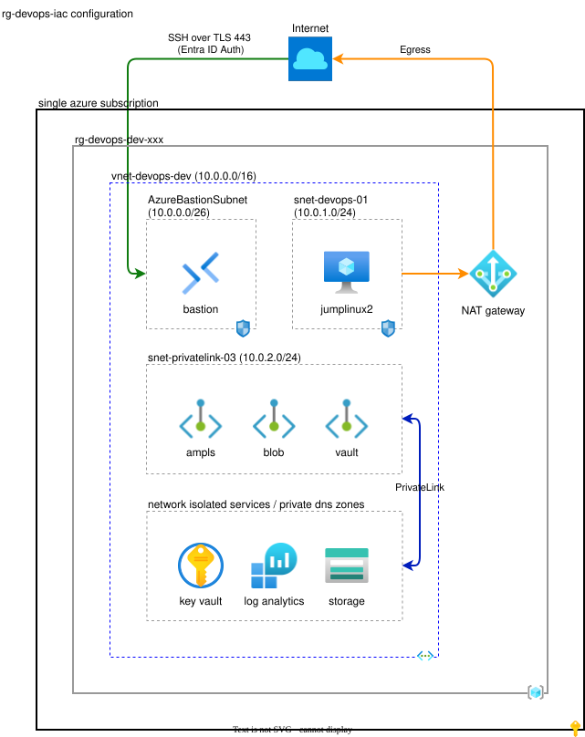

# DevOps IaC Configuration (rg-devops-iac)

## Contents

* [Architecture](#architecture)
* [Overview](#overview)
* [Features](#features)
* [Prerequisites](#prerequisites)
* [Getting Started](#getting-started)
* [Documentation](#documentation)

## Architecture



## Overview

This configuration provides a minimal set of resources to function as a Terraform execution environment, which is often a critical part of a DevOps pipeline. It is a useful starting point for DevOps / Infrastructure-As-Code (IaC) projects that require a secure and isolated environment for deploying and managing infrastructure using Terraform. The root module creates network, storage and security prerequisites. The virtual machine used as a Terraform execution environment is implemented in a child module which can be repurposed in other environments (such as a platform landing zone) where the resources defined in the root module already exist. The virtual machine has no public IP address: operators reach it only through Azure Bastion and sign in with their Microsoft Entra ID identity, so access is governed by Azure RBAC and Conditional Access rather than long-lived SSH keys.

## Features

* **Pre-configured DevOps VM for IaC** (Terraform)
  * Pre-installed and pre-configured environment for Terraform init / plan / apply operations.
  * Managed-identity access to a pre-configured Terraform state backend (Azure Blob Storage).
  * Pre-installed Azure CLI and PowerShell + Azure PowerShell for custom automation.
* **Network isolation**
  * Virtual network and subnets and NSGs for bastion, VMs, private endpoints and image builds.
  * NAT gateway for outbound internet access.
  * Private endpoints and private DNS zones for blob storage, key vault and Azure Monitor. Public network access is disabled.
* **Secure access**
  * Azure Bastion (Standard SKU) is the only inbound path to the virtual machine.
  * Microsoft Entra ID sign-in with Azure RBAC (passwordless).
  * Break-glass local admin credentials stored in Key Vault.
  * Role separation follows principle of least privilege for Azure RBAC role assignments.
* **Observability**
  * Log Analytics workspace reachable only through AMPLS.
  * AMA pre-configured on VM for logging syslog and performance counters.
  * Pre-configured diagnostic settings for security-sensitive resources (Bastion, Key Vault and Storage).
* **Optional features** (disabled by default)
  * GitHub Actions self-hosted runner on the virtual machine, and a deployment identity for sandbox applies, either attached to the virtual machine (`managed_identity`) or federated with GitHub Actions (`oidc`), with time-bound deployment roles granted before each apply. See [Optional: GitHub Self-Hosted Runner Configuration](#optional-github-self-hosted-runner-configuration).
  * Azure Compute Gallery and Azure VM Image Builder templates that pre-build fully patched Azure Sandbox VM images. See [Optional: Pre-built Images](#optional-pre-built-images).

## Prerequisites

This section describes the prerequisites required in order to provision this configuration.

* [Microsoft Entra ID Tenant and Azure Subscription](#microsoft-entra-id-tenant-and-azure-subscription)
* [Other Prerequisites](#other-prerequisites)
* [Terraform Execution Environment](#terraform-execution-environment)

### Microsoft Entra ID Tenant and Azure Subscription

* Identify the [Microsoft Entra ID](https://learn.microsoft.com/en-us/entra/fundamentals/whatis) tenant to be used for identity and access management, or create a new tenant using [Quickstart: Set up a tenant](https://learn.microsoft.com/en-us/entra/identity-platform/quickstart-create-new-tenant).
* Identify a single Azure [subscription](https://learn.microsoft.com/azure/cloud-adoption-framework/ready/considerations/fundamental-concepts#azure-terminology) or create a new Azure subscription. See [Azure Offer Details](https://azure.microsoft.com/support/legal/offer-details/) and [Associate or add an Azure subscription to your Microsoft Entra tenant](https://learn.microsoft.com/entra/fundamentals/how-subscriptions-associated-directory) for more information.
* Identify the operator who will provision this configuration. The operator needs the following Azure RBAC role assignments scoped to the subscription. See [Steps to assign an Azure role](https://learn.microsoft.com/azure/role-based-access-control/role-assignments-steps) for more information.
  * [Contributor](https://learn.microsoft.com/azure/role-based-access-control/built-in-roles#contributor).
  * [Role Based Access Control Administrator](https://learn.microsoft.com/en-us/azure/role-based-access-control/built-in-roles/privileged#role-based-access-control-administrator).

### Other Prerequisites

* Some Azure subscriptions may have low quota limits for specific Azure resources which may cause failures. See [Resolve errors for resource quotas](https://learn.microsoft.com/azure/azure-resource-manager/templates/error-resource-quota) for more information.
* Some Azure subscriptions may not have the required resource providers registered. Terraform is configured to automatically register the required resource providers, but this may take some time on first use.
* Some Azure subscriptions may not have the required features enabled which may cause failures. Monitor your plan application for errors related to specific subscription features and enable them as needed.
* Some organizations may institute [Azure policy](https://learn.microsoft.com/azure/governance/policy/overview) which may cause failures. This can be addressed by using custom settings which pass the policy checks, or by disabling the policies on the Azure subscription being used for the configurations.
* Additional prerequisites are required when using the [Optional: GitHub Self-Hosted Runner Configuration](#optional-github-self-hosted-runner-configuration).

### Terraform Execution Environment

A variety of Terraform execution environments can be used to provision this configuration interactively, including:

* **Windows-Only Client**: A Windows-only client can be used to run Terraform. The following software should be installed:
  * git
  * PowerShell 7.x
  * Azure CLI
  * Terraform
  * Visual Studio Code

* **Windows Subsystem for Linux (WSL) Client**: WSL offers the best of Windows and Linux in the same client environment and was used to develop this project. The following software should be installed:
  * Linux (WSL) software
    * Linux Distro: Ubuntu 24.04 LTS (Noble Numbat)
    * git
    * Azure CLI
    * Terraform
  * Windows software
    * Visual Studio Code configured for [Remote development in WSL](https://code.visualstudio.com/docs/remote/wsl-tutorial)

* **Linux / MacOs Client**: A Linux or MacOS client can be used to run Terraform. The following software should be installed:
  * git
  * Azure CLI
  * Terraform
  * Visual Studio Code

## Getting Started

This section covers the steps to get started with this configuration using an interactive Terraform execution environment.

* [Step 0: Login](#step-0-login)
* [Step 1: Clone the Repository](#step-1-clone-the-repository)
* [Step 2: Initialize Terraform](#step-2-initialize-terraform)
* [Step 3: Configure Variables](#step-3-configure-variables)
* [Step 4: Validate and Apply Configuration](#step-4-validate-and-apply-configuration)
* [Step 5: Complete Smoke Testing](#step-5-complete-smoke-testing)
* [Step 6: Use The Environment](#step-6-use-the-environment)
* [Step 7: Clean Up](#step-7-clean-up)

### Step 0: Login

Before you can provision this configuration interactively, you need to log in to your Azure account.

* Open a terminal window and run the following command to log in to Azure CLI:

  ```bash
  az login --use-device-code
  ```

  If you will use the PowerShell bootstrap script, also run:

  ```pwsh
  Connect-AzAccount -UseDeviceAuthentication
  ```

* Check the terminal for a message like this:

  ```text
  To sign in, use a web browser to open the page https://microsoft.com/devicelogin and enter the code XXXXXXXXX to authenticate.
  ```

* Open a browser and navigate to the URL provided in the terminal. Enter the code displayed in the terminal to authenticate your Azure account.
* Sign in with an account that has an Azure RBAC `Owner` role assignment on the subscription you will be using to provision this configuration.
* Depending upon how your Entra ID tenant is configured, you may be prompted to enter your password and/or approve a sign-in request on your mobile device.
* Click **Continue** when asked if you are trying to sign in to Azure.
* Check the terminal for a prompt like this:

  ```text
  Retrieving tenants and subscriptions for the selection...

  [Tenant and subscription selection]

  No     Subscription name               Subscription ID                       Tenant
  -----  ------------------------------  ------------------------------------  ----------------
  [1] *  SUBSCRIPTION1-NAME-HERE         SUBSCRIPTION1-ID-HERE                 TENANT-NAME-HERE
  [2]    SUBSCRIPTION2-NAME-HERE         SUBSCRIPTION2-ID-HERE                 TENANT-NAME-HERE

  The default is marked with an *; the default tenant is 'TENANT-NAME-HERE' and subscription is 'SUBSCRIPTION1-NAME-HERE' (SUBSCRIPTION1-ID-HERE).

  Select a subscription and tenant (Type a number or Enter for no changes):
  ```

* Select the subscription you will be using to provision this configuration by entering the number next to it. If you only have one subscription, just press Enter.

### Step 1: Clone the Repository

Clone the Azure Sandbox repository to the Terraform execution environment using the following command:

```bash
git clone https://github.com/Azure-Samples/azuresandbox
```

### Step 2: Initialize Terraform

After cloning the repository, navigate to the `rg-devops-iac` directory and initialize Terraform. This step downloads the necessary provider plugins and modules.

```bash
cd azuresandbox/extras/configurations/rg-devops-iac
terraform init
```

**WARNING:** By default this configuration assumes you will be using a local Terraform state file which includes sensitive information. This is by design since the configuration creates the storage account to be used as a Terraform state backend for other configurations.

### Step 3: Configure Variables

Follow these steps to configure the variables for this configuration:

* Create a `terraform.tfvars` file in the root directory of the project. This file should set the necessary variables for your deployment. Here is an example of what the `terraform.tfvars` file might look like:

  ```hcl
  entra_tenant_id = "<entra-tenant-id-here>"
  location        = "<azure-region-here>"
  subscription_id = "<subscription-id-here>"

  tags = {
    project     = "devops",
    costcenter  = "mycostcenter",
    environment = "dev"
  }
  ```

  Helper scripts are provided to generate the `terraform.tfvars` file:

  ```bash
  # Bash bootstrap script, run from the root directory of the project
  ./scripts/bootstrap.sh
  ```

  ```pwsh
  # PowerShell bootstrap script, run from the root directory of the project
  ./scripts/bootstrap.ps1
  ```

#### **Overriding Defaults**

The variable defaults set in this configuration can be overridden by customizing the `terraform.tfvars` file or modifying the module block in `main.tf`. For example, the default value for the `vm_jumpbox_linux_name` variable in the vm-jumpbox-linux module is `jumplinux2`. You can override this value by adding the following to the vnet-shared module block in `main.tf`:

```hcl
module "vm_jumpbox_linux" {
  source = "./modules/vm-jumpbox-linux"

  key_vault_id        = azurerm_key_vault.this.id
  location            = azurerm_resource_group.this.location
  resource_group_name = azurerm_resource_group.this.name
  storage_account_id  = azurerm_storage_account.this.id
  subnet_id           = azurerm_subnet.subnets[var.subnet_devops_name].id
  tags                = var.tags

  depends_on = [time_sleep.wait_for_roles]

  # Override defaults here
  vm_jumpbox_linux_name = "devopsagent1"
}
```

### Step 4: Validate and Apply Configuration

Follow these steps to validate and apply the configuration:

* First, validate that the configuration is syntactically correct:

  ```bash
  terraform validate
  ```

* Next, create a plan to see what resources will be created:

  ```bash
  terraform plan
  ```

* Finally, apply the configuration to create the resources:

  ```bash
  terraform apply
  ```

* Monitor the progress of the apply operation in the console. If errors occur, that may not be reflected in the console immediately. Terraform will try to apply as much of the plan as possible first, then will show the errors when it is done. It can take up to 15 minutes to provision this configuration. If everything goes well you should see a message like this:

  ```text
  Apply complete! Resources: XX added, XX changed, XX destroyed.
  ```

### Step 5: Complete Smoke Testing

See [Smoke Testing](./modules/vm-jumpbox-linux/README.md#smoke-testing) in the `vm-jumpbox-linux` module.

### Step 6: Use The Environment

You now have a fully provisioned Terraform execution environment you can use to interactively deploy the [Azure Sandbox](https://github.com/Azure-Samples/azuresandbox) Terraform configuration, or other Terraform configurations of your choosing.

If you are interested in enabling automated deployments of the Azure Sandbox configuration, see [Optional: GitHub Self-Hosted Runner Configuration](#optional-github-self-hosted-runner-configuration).

### Step 7: Clean Up

Don't forget to delete your DevOps IaC environment when you're done. You don't want to have to explain to your boss why you left an unused resources laying around that costs your company money. The quickest way to clean up is to delete the DevOps IaC resource group. Do this with care because data loss will occur, including any Terraform state files in the Azure Blob Storage container.

## Documentation

This section provides documentation regarding the overall structure of the root module for this configuration. See the README.md files in each module directory for more information about that module.

* [Root Module Structure](#root-module-structure)
* [Root Module Input Variables](#root-module-input-variables)
* [Root Module Resources](#root-module-resources)
* [Root Module Output Variables](#root-module-output-variables)
* [Child Modules](#child-modules)
* [Virtual Network Design](#virtual-network-design)
* [Dependencies](#dependencies)
* [Optional: GitHub Self-Hosted Runner Configuration](#optional-github-self-hosted-runner-configuration)
* [Optional: Pre-built Images](#optional-pre-built-images)

### Root Module Structure

This configuration is organized into the following structure:

```plaintext
├── images/                               # Diagrams
│   └── rg-devops-iac-diagram.drawio.svg  # Architecture diagram
├── modules/                              # Child modules
│   ├── github-runner/                    # GitHub Actions runner and deployment identity module (optional)
│   ├── image-gallery/                    # Compute gallery and image builder module (optional pre-built images)
│   └── vm-jumpbox-linux/                 # Linux jumpbox virtual machine module (jumplinux2)
├── scripts/                              # Helper scripts
│   ├── bootstrap.ps1                     # PowerShell: generates terraform.tfvars
│   ├── bootstrap.sh                      # Bash: generates terraform.tfvars
│   ├── cleanterraformtemp.sh             # Bash: removes Terraform temp/local files
│   ├── Connect-Jumplinux2.ps1            # PowerShell: connects to jumplinux2 through a Bastion tunnel with Entra ID
│   ├── connect-jumplinux2.sh             # Bash: connects to jumplinux2 through a Bastion tunnel with Entra ID
│   ├── delete-tfstate.sh                 # Bash: deletes Terraform state blob(s) from the storage backend
│   └── enable-public-access.sh           # Bash: re-enables public access on the key vault and storage account (not the AMPLS or workspace)
├── locals.tf                             # Local variables
├── main.tf                               # Resource configurations
├── network.tf                            # Network resource blocks
├── outputs.tf                            # Output variables
├── providers.tf                          # Provider configuration blocks
├── storage.tf                            # Storage resource blocks
├── terraform.tf                          # Terraform configuration block
└── variables.tf                          # Variable definitions
```

There are additional scripts used for optional use cases. See [Optional: GitHub Self-Hosted Runner Configuration](#optional-github-self-hosted-runner-configuration) and [Optional: Pre-built Images](#optional-pre-built-images).

### Root Module Input Variables

This section lists input variables used in the root module. Defaults can be overridden by specifying a different value in terraform.tfvars. This table lists input variables that are common to all the scenarios this configuration supports.

Variable | Default | Description
--- | --- | ---
entra_tenant_id | | The Microsoft Entra tenant id.
location | | The name of the Azure Region where resources will be provisioned.
log_analytics_workspace_retention_days | 30 | The retention period in days for the Log Analytics workspace. Must be one of 30, 31, 60, 90, 120, 180, 270, 365, 550 or 730.
storage_access_tier | Hot | The access tier for the storage account.
storage_container_name | tfstate | The name of the blob storage container used by Terraform state backend.
storage_replication_type | LRS | The type of replication for the storage account.
subnet_bastion_address_prefix | 10.0.0.0/26 | The address prefix for the `AzureBastionSubnet`.
subnet_devops_address_prefix | 10.0.1.0/29 | The address prefix for the devops subnet.
subnet_devops_name | snet-devops-01 | The name of the devops subnet, which hosts `jumplinux2`.
subnet_image_build_aci_address_prefix | 10.0.4.0/28 | The address prefix for the image build Container Instances subnet, used by the optional [image-gallery](./modules/image-gallery/) module.
subnet_image_build_aci_name | snet-imagebuild-aci-05 | The name of the image build Container Instances subnet.
subnet_image_build_address_prefix | 10.0.3.0/27 | The address prefix for the image build VM subnet, used by the optional [image-gallery](./modules/image-gallery/) module.
subnet_image_build_name | snet-imagebuild-04 | The name of the image build VM subnet.
subnet_privatelink_address_prefix | 10.0.2.0/27 | The address prefix for the private link subnet, which hosts the private endpoints.
subnet_privatelink_name | snet-privatelink-03 | The name of the private link subnet.
subscription_id | | The Azure subscription id used to provision resources.
tags | | The tags in map format to be used when creating new resources.
vm_jumpbox_linux_size | `Standard_D2ls_v6` | The size of the Linux virtual machine (`jumplinux2`).
vnet_address_space | 10.0.0.0/16 | The address space in CIDR notation for the virtual network.

There are additional input variables used for optional use cases. See [Optional: GitHub Self-Hosted Runner Configuration](#optional-github-self-hosted-runner-configuration) and [Optional: Pre-built Images](#optional-pre-built-images).

### Root Module Resources

The root module includes a resource group, key vault and storage account used by the child modules. It also grants the operator who runs Terraform data-plane roles on the key vault and storage account.

Address | Name | Notes
--- | --- | ---
azapi_update_resource.ampls_disable_public_access | | Sets the AMPLS ingestion and query access modes to `PrivateOnly` after the AMPLS barrier.
azapi_update_resource.key_vault_disable_public_access | | Disables key vault public network access after the key vault barrier.
azapi_update_resource.log_analytics_disable_public_access | | Disables public ingestion and query on the Log Analytics workspace after the AMPLS barrier.
azapi_update_resource.storage_disable_public_access | | Disables storage account public network access after the storage barrier.
azurerm_bastion_host.this | bas-devops-dev | Bastion host for secure remote access to `jumplinux2`.
azurerm_key_vault.this | kv-devops-dev-xxx | Key vault for secure secret storage.
azurerm_log_analytics_workspace.this | log-devops-dev-xxx | Azure Monitor LAW workspace for observability (diagnostic logs and metrics).
azurerm_monitor_data_collection_endpoint.this | dcedevopsdevxxx | Data collection endpoint used by the Azure Monitor Agent on `jumplinux2`.
azurerm_monitor_data_collection_rule.linux | dcrdevopsdev-linux | Linux data collection rule: syslog (`auth` and `authpriv` at `Info` and above, other facilities at `Warning` and above) and performance counters.
azurerm_monitor_diagnostic_setting.bastion | Diagnostic Logs | Sends `BastionAuditLogs` and metrics for the Bastion host to the workspace.
azurerm_monitor_diagnostic_setting.data_collection_rule_linux | Diagnostic Logs | Sends data collection errors (`allLogs`) and metrics for the Linux data collection rule to the workspace.
azurerm_monitor_diagnostic_setting.key_vault | Audit Logs | Sends key vault `audit` logs (including secret reads) and metrics to the workspace.
azurerm_monitor_diagnostic_setting.storage_account | Diagnostic Logs | Sends storage account `Transaction` metrics to the workspace.
azurerm_monitor_diagnostic_setting.storage_blob | Diagnostic Logs | Sends blob service `StorageRead`, `StorageWrite` and `StorageDelete` logs (Terraform state access) and `Transaction` metrics to the workspace.
azurerm_monitor_private_link_scope.this | ampls-devops-dev | Azure Monitor Private Link Scope. Starts in `Open` mode and is set to `PrivateOnly` by the AMPLS barrier.
azurerm_monitor_private_link_scoped_service.dce | ampls-scope-dce | Adds the data collection endpoint to the AMPLS.
azurerm_monitor_private_link_scoped_service.log_analytics | ampls-scope-log-analytics | Adds the Log Analytics workspace to the AMPLS.
azurerm_nat_gateway.this | ngdevopsdev | NAT gateway for outbound internet connectivity.
azurerm_nat_gateway_public_ip_association.this | | Associates the NAT gateway with the public IP address.
azurerm_network_security_group.groups[*] | | One NSG for each subnet in `local.subnets` that has NSG rules. The private link subnet has no NSG.
azurerm_network_security_rule.rules[*] | | NSG rules from `local.nsg_rules`. See [Virtual Network Design](#virtual-network-design).
azurerm_private_dns_zone.zones[*] | | Private DNS zones from `local.private_dns_zones`. See [Virtual Network Design](#virtual-network-design).
azurerm_private_dns_zone_virtual_network_link.zones[*] | | Links each private DNS zone to the virtual network. See [Virtual Network Design](#virtual-network-design).
azurerm_private_endpoint.ampls | pep-devops-dev-ampls | Private endpoint for the AMPLS (`azuremonitor` subresource)
azurerm_private_endpoint.key_vault | pep-devops-dev-key-vault | Private endpoint for Azure key vault
azurerm_private_endpoint.storage_blob | pep-devops-dev-storage-blob | Private endpoint for Azure blob storage
azurerm_public_ip.bastion | pip-devops-dev-bastion | Public IP address for the Bastion host.
azurerm_public_ip.this | pip-devops-dev-nat | Public IP address for the NAT gateway.
azurerm_resource_group.this | rg-devops-dev-xxx | Resource group for all resources in this configuration.
azurerm_role_assignment.key_vault_secrets_officer | | Assigns `Key Vault Secrets Officer` on the key vault to the operator signed in to Azure CLI.
azurerm_role_assignment.storage_blob_data_contributor | | Assigns `Storage Blob Data Contributor` on the storage account to the operator signed in to Azure CLI.
azurerm_storage_account.this | stdevopsdevxxx | Storage account for storing Terraform state files.
azurerm_storage_container.this | tfstate | Storage container for storing Terraform state files.
azurerm_subnet.subnets[*] | | Subnets from `local.subnets`. Each must be inside `vnet_address_space` and must not overlap another subnet. See [Virtual Network Design](#virtual-network-design).
azurerm_subnet_nat_gateway_association.associations[*] | | Associates the NAT gateway with the devops and image build subnets.
azurerm_subnet_network_security_group_association.associations[*] | | Associates each NSG with its subnet.
azurerm_virtual_network.this | vnet-devops-dev | Virtual network for the Linux virtual machine.

There are additional resources used for optional use cases. See [Optional: GitHub Self-Hosted Runner Configuration](#optional-github-self-hosted-runner-configuration) and [Optional: Pre-built Images](#optional-pre-built-images).

### Root Module Output Variables

This section includes a list of output variables returned by the root module.

Name | Comments
--- | ---
resource_ids | A map of resource IDs for key resources in the configuration.
resource_names | A map of resource names for key resources in the configuration.

There are additional output variables for optional use cases. See [Optional: GitHub Self-Hosted Runner Configuration](#optional-github-self-hosted-runner-configuration) and [Optional: Pre-built Images](#optional-pre-built-images).

### Child Modules

The following [modules](./modules/) are included in this configuration:

Name | Required | Depends On | Description
--- | --- | --- | ---
[github-runner](./modules/github-runner/) | No | Root module, vm-jumpbox-linux | Installs and registers the GitHub Actions self-hosted runner on `jumplinux2`, and creates the deployment identity and GitHub Actions federated identity credentials for the Sandbox deployment workflow. Enabled by `enable_github_runner` or `deployment_identity`.
[image-gallery](./modules/image-gallery/) | No | Root module | Creates an Azure Compute Gallery and Azure VM Image Builder templates for pre-built Azure Sandbox VM images. Enabled by `enable_image_gallery`.
[vm-jumpbox-linux](./modules/vm-jumpbox-linux/) | No | Root module | Creates a preconfigured Linux jumpbox VM in the DevOps virtual network.

### Virtual Network Design

This configuration implements a virtual network and network-isolated Azure services. A barrier pattern is used to ensure public access is disabled for key vault, blob storate and AMPLS when deployment completes. AMPLS is used to ensure Azure Monitor-related traffic is network isolated. Default address ranges are set artificially high for readability and can be overridden with smaller ranges to meet specific requirements.

VNet Property | Default Value | Notes
--- | --- | ---
Name | `vnet-devops-dev` | N/A
Address Space | `10.0.0.0/16` | Minimum /24 required (256 IP addresses) when subnets are contiguous.
DNS Server | `168.63.129.16` | Azure DNS with private DNS zones.

The virtual network contains the following subnets.

Subnet | Address Prefix | IP Addresses | Notes
--- | --- | :-: | ---
`AzureBastionSubnet` (name required) | `10.0.0.0/26` | 64 | Requires a `/26` minimum. NSG attached as per [Secure your Azure Bastion deployment](https://learn.microsoft.com/azure/bastion/secure-bastion#network-security).
`snet-devops-01` (default name) | `10.0.1.0/29` | 8 | Requires a `/29` minimum. NSG attached allowing inbound SSH only. Egress via NAT gateway.
`snet-privatelink-03` (default name) | `10.0.2.0/27` | 32 | Requires a `/27` minimum for AMPLS. No NSG is attached. Hosts private endpoints for key vault, blob storage and AMPLS.
`snet-imagebuild-04` (default name) | `10.0.3.0/27` | 32 | Temporary Azure VM Image Builder build VMs for the optional [image-gallery](./modules/image-gallery/) module. NSG allows only TCP 22 and 5986 from the image build Container Instances subnet and denies other virtual network inbound traffic. Egress via NAT gateway.
`snet-imagebuild-aci-05` (default name) | `10.0.4.0/28` | 16 | The Azure VM Image Builder container. Delegated to `Microsoft.ContainerInstance/containerGroups`. NSG denies virtual network inbound traffic. Egress via NAT gateway.

The following private DNS zones are linked to the virtual network and are configured for internet fallback (`NxDomainRedirect`).

Private DNS Zone | Notes
--- | ---
`privatelink.vaultcore.azure.net` | Configured with an A record for the key vault private endpoint.
`privatelink.blob.core.windows.net` | Configured with an A record for the blob storage private endpoint.
`privatelink.monitor.azure.com` | AMPLS: global Azure Monitor endpoints (Application Insights ingestion and live metrics, data collection endpoints, profiler).
`privatelink.oms.opinsights.azure.com` | AMPLS: Log Analytics workspace onboarding and configuration endpoints.
`privatelink.ods.opinsights.azure.com` | AMPLS: Log Analytics workspace data ingestion endpoints.
`privatelink.agentsvc.azure-automation.net` | AMPLS: Log Analytics agent service and automation endpoints.

### Dependencies

This section covers the dependencies in this configuration.

* [Source Control](#source-control)
* [Terraform](#terraform)
* [Scripting Technologies](#scripting-technologies)
* [Configuration Management Technologies](#configuration-management-technologies)
* [Operating Systems](#operating-systems)

#### **Source Control**

The configuration is hosted on GitHub and uses Git for source control. The repository is organized into configurations and modules, making it easy to navigate and understand the structure of the project. The [vm-jumpbox-linux] module can be repurposed for use in other configurations.

#### **Terraform**

This project is built built using Terraform, a cross platform, open-source Infrastructure as Code (IaC) tool that allows users to define, provision and version cloud infrastructure using a declarative configuration language called HCL (HashiCorp Configuration Language).

* **Providers**: The following Terraform providers are used in the project:
  * **azurerm**: Used to manage Azure resources.
  * **cloudinit**: Used to configure Linux virtual machines.
  * **random**: Used to generate random values for resource attributes.
  * **time**: Used to implement wait cycles and other time based operations.
  * **tls**: Used to generate the break-glass SSH key pair for the Linux virtual machine's local admin account.
* **Modules**: The following Terraform modules are used in this project:
  * **Azure/avm-utl-naming**: The Azure Verified Module naming utility, used to generate consistent and compliant Azure resource names from its `names` output (replaces the archived `Azure/naming/azurerm` module).

#### **Scripting Technologies**

The following cross-platform scripting technologies are used in this project:

* **PowerShell**:  Used for general purpose scripting and to implement Terraform provisioners and Azure custom script extensions.
* **Az PowerShell Module**: Used to connect to and configure Azure resources from PowerShell scripts.
* **Bash**: Used for general purpose scripting.
* **Azure CLI**: Used for connecting to Azure resources from Bash scripts.

#### **Configuration Management Technologies**

The following configuration management technologies are used in this project to configure virtual machines:

* **cloud-init**: Used to configure Linux virtual machines.

#### **Operating Systems**

The following operating systems are used for the various virtual machines in the sandbox:

Virtual Machine | Role | Module | Operating System
--- | --- | --- | ---
jumplinux2 | Jumpbox / DevOps agent | `vm-jumpbox-linux` | Ubuntu Server LTS 24.04 (Nobel Numbat)

### Optional: GitHub Self-Hosted Runner Configuration

`rg-devops-iac` can optionally be configured as a self-hosted runner for [Azure Sandbox](https://github.com/Azure-Samples/azuresandbox) GitHub Actions deployment workflows, with a deployment identity for Azure Sandbox applies. Set `enable_github_runner = true` and `deployment_identity` in `terraform.tfvars` to create them with the [github-runner](./modules/github-runner/README.md) module. Its README documents the [GitHub Actions Workflow Design](./modules/github-runner/README.md#github-actions-workflow-design), including the [Workflow Prerequisites](./modules/github-runner/README.md#workflow-prerequisites), [Workflow Setup](./modules/github-runner/README.md#workflow-setup), [Self-Hosted Runner Registration](./modules/github-runner/README.md#self-hosted-runner-registration), [Just-in-Time Deployment Roles](./modules/github-runner/README.md#just-in-time-deployment-roles) and [Removing the Runner](./modules/github-runner/README.md#removing-the-runner). Both are disabled by default, and the module isn't created unless one of them is enabled.

Variable | Default | Description
--- | --- | ---
deployment_identity | `none` | Deployment identity for Azure Sandbox applies: `none`, `managed_identity` (attached to `jumplinux2`) or `oidc` (federated with GitHub Actions). See [Deployment Identity](./modules/github-runner/README.md#deployment-identity).
deployment_identity_github_environments | `["sandbox-deployment", "sandbox-release-gate"]` | The GitHub Actions environments whose jobs can sign in as the deployment identity. One federated identity credential is created per environment. Only used when `deployment_identity` is `oidc`.
enable_github_runner | false | Set to true to install and register the GitHub Actions self-hosted runner agent on `jumplinux2`. See [Self-Hosted Runner Registration](./modules/github-runner/README.md#self-hosted-runner-registration).
github_repository_id | | The numeric id of the GitHub repository, e.g. from `gh api repos/OWNER/NAME --jq .id`. Only used when `deployment_identity` is `oidc`. When empty, it is looked up from the repository in `github_runner_url`, which works only for public repositories.
github_repository_owner_id | | The numeric id of the user or organization that owns the GitHub repository, e.g. from `gh api repos/OWNER/NAME --jq .owner.id`. Only used when `deployment_identity` is `oidc`. When empty, it is looked up from the repository in `github_runner_url`, which works only for public repositories.
github_runner_labels | `["azuresandbox"]` | Additional labels to apply to the GitHub Actions self-hosted runner. Only used when `enable_github_runner` is true.
github_runner_power_state_environment | `sandbox-runner-power-state` | The GitHub Actions environment whose jobs can sign in as the runner power state identity, which starts and deallocates `jumplinux2` for workflow runs. Must not be one of `deployment_identity_github_environments`. Only used when `deployment_identity` is `oidc`.
github_runner_token | | Ephemeral. The runner registration token used to register the self-hosted runner (expires after 1 hour), e.g. from `modules/github-runner/scripts/new-runner-registration-token.sh`. Set using the environment variable `TF_VAR_github_runner_token` for both `terraform plan` and `terraform apply`. Never stored in Terraform state or the saved plan. Required only when the runner is registered (on first deployment or when `github_runner_token_version` changes).
github_runner_token_version | 1 | Increment to send a new `github_runner_token` to the VM and re-run runner registration, e.g. after a failed registration. Only used when `enable_github_runner` is true.
github_runner_url | `https://github.com/Azure-Samples/azuresandbox` | The GitHub repository URL to register the self-hosted runner with. Defaults to the Azure Sandbox repository. Used when `enable_github_runner` is true, or when `deployment_identity` is `oidc` and the repository ids are not set.

When `deployment_identity` isn't `none`, the `resource_ids` and `resource_names` outputs also include `deployment_identity`, and `runner_power_state_identity` when it is `oidc`. These output variables are also returned:

Name | Comments
--- | ---
deployment_identity | The deployment identity, or `null` when `deployment_identity` is `none`. An object with `client_id` (used as `client_id` for Azure Sandbox applies with `auth_mode = "managed_identity"` or `"oidc"`), `github_subjects` (the GitHub OIDC subjects accepted by its federated identity credentials, keyed by environment, or an empty map unless `deployment_identity` is `oidc`), `jit_condition` (the condition, version 2.0, to apply to its time-bound `Role Based Access Control Administrator` assignment before each apply) and `principal_id` (the principal (object) id, used to grant Microsoft Graph application permissions).
github_runner | The GitHub Actions self-hosted runner, or `null` when `enable_github_runner` is false. An object with `name` (the name the runner is registered with), `power_state_identity_client_id` (the client id of the runner power state identity, which the Sandbox deployment workflow uses to start and deallocate `jumplinux2`, or `null` unless `deployment_identity` is `oidc`) and `power_state_identity_github_subject` (the GitHub OIDC subject accepted by the runner power state identity's federated identity credential, or `null` unless `deployment_identity` is `oidc`).

### Optional: Pre-built Images

`rg-devops-iac` can optionally host an Azure Compute Gallery and Azure VM Image Builder templates that pre-build fully patched images for the Azure Sandbox VMs. Set `enable_image_gallery = true` in `terraform.tfvars` to create them with the [image-gallery](./modules/image-gallery/README.md) module. Its README documents the image design, build networking, identity, prerequisites and costs, and how to [build images](./modules/image-gallery/README.md#building-images) and [disable the image gallery](./modules/image-gallery/README.md#disabling-the-image-gallery).

Variable | Default | Description
--- | --- | ---
enable_image_gallery | false | Set to true to create the compute gallery, image definitions, image templates and image builder identity, and to register the `Microsoft.VirtualMachineImages` resource provider. The image build subnets are always created; see [Virtual Network Design](#virtual-network-design).
image_build_vm_size | `Standard_D4s_v6` | The size of the temporary build VM AIB uses for every build. Independent of the size of VMs deployed from the images. See [Image Design](./modules/image-gallery/README.md#image-design).

When `enable_image_gallery` is true, the `resource_ids` and `resource_names` outputs also include `image_builder_identity`, `image_gallery`, and `image_definition_<image>` and `image_template_<image>` for each image.
