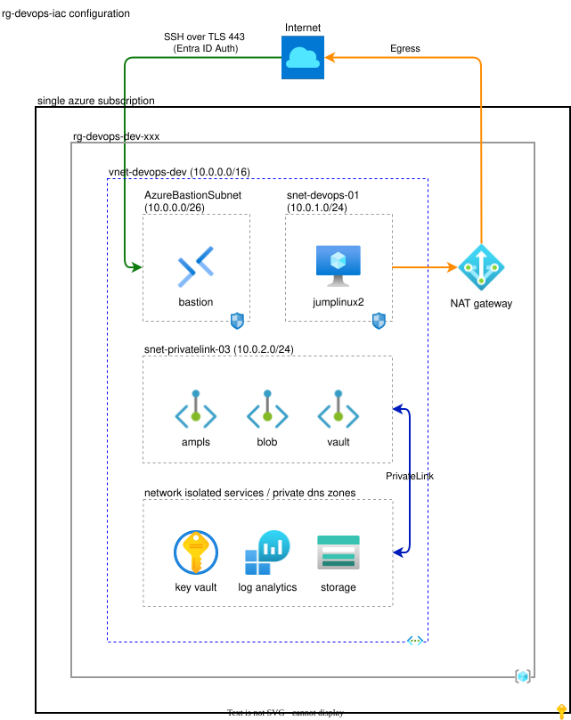

# DevOps IaC Configuration (rg-devops-iac)

## Contents

* [Architecture](#architecture)
* [Overview](#overview)
* [Features](#features)
* [Prerequisites](#prerequisites)
* [Getting Started](#getting-started)
* [Documentation](#documentation)

## Architecture



## Overview

This configuration provides a minimal set of resources to function as a Terraform execution environment, which is often a critical part of a DevOps pipeline. It is a useful starting point for DevOps / Infrastructure-As-Code (IaC) projects that require a secure and isolated environment for deploying and managing infrastructure using Terraform. The root module creates network, storage and security prerequisites. The virtual machine used as a Terraform execution environment is implemented in a child module which can be repurposed in other environments (such as a platform landing zone) where the resources defined in the root module already exist. The virtual machine has no public IP address: operators reach it only through Azure Bastion and sign in with their Microsoft Entra ID identity, so access is governed by Azure RBAC and Conditional Access rather than long-lived SSH keys.

## Features

* **Pre-configured DevOps VM for IaC** (Terraform)
  * Pre-installed and pre-configured environment for Terraform init / plan / apply operations.
  * Managed-identity access to a pre-configured Terraform state backend (Azure Blob Storage).
  * Pre-installed Azure CLI and PowerShell + Azure PowerShell for custom automation.
* **Network isolation**
  * Virtual network and subnets and NSGs for bastion, VMs and private endpoints.
  * NAT gateway for outbound internet access.
  * Private endpoints and private DNS zones for blob storage, key vault and Azure Monitor. Public network access is disabled.
* **Secure access**
  * Azure Bastion (Standard SKU) is the only inbound path to the virtual machine.
  * Microsoft Entra ID sign-in with Azure RBAC (passwordless).
  * Break-glass local admin credentials stored in Key Vault.
  * Role separation follows principle of least privilege for Azure RBAC role assignments.
* **Observability**
  * Log Analytics workspace reachable only through AMPLS.
  * AMA pre-configured on VM for logging syslog and performance counters.
  * Pre-configured diagnostic settings for security-sensitive resources (Bastion, Key Vault and Storage).
* **Optional features** (disabled by default)
  * Deployment identity for sandbox applies, either attached to the virtual machine (`managed_identity`) or federated with GitHub Actions (`oidc`), with time-bound deployment roles granted before each apply.
  * See [Optional: GitHub Self-Hosted Runner Configuration](#optional-github-self-hosted-runner-configuration)

## Prerequisites

This section describes the prerequisites required in order to provision this configuration.

* [Microsoft Entra ID Tenant and Azure Subscription](#microsoft-entra-id-tenant-and-azure-subscription)
* [Other Prerequisites](#other-prerequisites)
* [Terraform Execution Environment](#terraform-execution-environment)

### Microsoft Entra ID Tenant and Azure Subscription

* Identify the [Microsoft Entra ID](https://learn.microsoft.com/en-us/entra/fundamentals/whatis) tenant to be used for identity and access management, or create a new tenant using [Quickstart: Set up a tenant](https://learn.microsoft.com/en-us/entra/identity-platform/quickstart-create-new-tenant).
* Identify a single Azure [subscription](https://learn.microsoft.com/azure/cloud-adoption-framework/ready/considerations/fundamental-concepts#azure-terminology) or create a new Azure subscription. See [Azure Offer Details](https://azure.microsoft.com/support/legal/offer-details/) and [Associate or add an Azure subscription to your Microsoft Entra tenant](https://learn.microsoft.com/entra/fundamentals/how-subscriptions-associated-directory) for more information.
* Identify the operator who will provision this configuration. The operator needs the following Azure RBAC role assignments scoped to the subscription. See [Steps to assign an Azure role](https://learn.microsoft.com/azure/role-based-access-control/role-assignments-steps) for more information.
  * [Contributor](https://learn.microsoft.com/azure/role-based-access-control/built-in-roles#contributor).
  * [Role Based Access Control Administrator](https://learn.microsoft.com/en-us/azure/role-based-access-control/built-in-roles/privileged#role-based-access-control-administrator).

### Other Prerequisites

* Some Azure subscriptions may have low quota limits for specific Azure resources which may cause failures. See [Resolve errors for resource quotas](https://learn.microsoft.com/azure/azure-resource-manager/templates/error-resource-quota) for more information.
* Some Azure subscriptions may not have the required resource providers registered. Terraform is configured to automatically register the required resource providers, but this may take some time on first use.
* Some Azure subscriptions may not have the required features enabled which may cause failures. Monitor your plan application for errors related to specific subscription features and enable them as needed.
* Some organizations may institute [Azure policy](https://learn.microsoft.com/azure/governance/policy/overview) which may cause failures. This can be addressed by using custom settings which pass the policy checks, or by disabling the policies on the Azure subscription being used for the configurations.
* Additional prerequisites are required when using the [Optional: GitHub Self-Hosted Runner Configuration](#optional-github-self-hosted-runner-configuration).

### Terraform Execution Environment

A variety of Terraform execution environments can be used to provision this configuration interactively, including:

* **Windows-Only Client**: A Windows-only client can be used to run Terraform. The following software should be installed:
  * git
  * PowerShell 7.x
  * Azure CLI
  * Terraform
  * Visual Studio Code

* **Windows Subsystem for Linux (WSL) Client**: WSL offers the best of Windows and Linux in the same client environment and was used to develop this project. The following software should be installed:
  * Linux (WSL) software
    * Linux Distro: Ubuntu 24.04 LTS (Noble Numbat)
    * git
    * Azure CLI
    * Terraform
  * Windows software
    * Visual Studio Code configured for [Remote development in WSL](https://code.visualstudio.com/docs/remote/wsl-tutorial)

* **Linux / MacOs Client**: A Linux or MacOS client can be used to run Terraform. The following software should be installed:
  * git
  * Azure CLI
  * Terraform
  * Visual Studio Code

## Getting Started

This section covers the steps to get started with this configuration using an interactive Terraform execution environment.

* [Step 0: Login](#step-0-login)
* [Step 1: Clone the Repository](#step-1-clone-the-repository)
* [Step 2: Initialize Terraform](#step-2-initialize-terraform)
* [Step 3: Configure Variables](#step-3-configure-variables)
* [Step 4: Validate and Apply Configuration](#step-4-validate-and-apply-configuration)
* [Step 5: Complete Smoke Testing](#step-5-complete-smoke-testing)
* [Step 6: Use The Environment](#step-6-use-the-environment)
* [Step 7: Clean Up](#step-7-clean-up)

### Step 0: Login

Before you can provision this configuration interactively, you need to log in to your Azure account.

* Open a terminal window and run the following command to log in to Azure CLI:

  ```bash
  az login --use-device-code
  ```

  If you will use the PowerShell bootstrap script, also run:

  ```pwsh
  Connect-AzAccount -UseDeviceAuthentication
  ```

* Check the terminal for a message like this:

  ```text
  To sign in, use a web browser to open the page https://microsoft.com/devicelogin and enter the code XXXXXXXXX to authenticate.
  ```

* Open a browser and navigate to the URL provided in the terminal. Enter the code displayed in the terminal to authenticate your Azure account.
* Sign in with an account that has an Azure RBAC `Owner` role assignment on the subscription you will be using to provision this configuration.
* Depending upon how your Entra ID tenant is configured, you may be prompted to enter your password and/or approve a sign-in request on your mobile device.
* Click **Continue** when asked if you are trying to sign in to Azure.
* Check the terminal for a prompt like this:

  ```text
  Retrieving tenants and subscriptions for the selection...

  [Tenant and subscription selection]

  No     Subscription name               Subscription ID                       Tenant
  -----  ------------------------------  ------------------------------------  ----------------
  [1] *  SUBSCRIPTION1-NAME-HERE         SUBSCRIPTION1-ID-HERE                 TENANT-NAME-HERE
  [2]    SUBSCRIPTION2-NAME-HERE         SUBSCRIPTION2-ID-HERE                 TENANT-NAME-HERE

  The default is marked with an *; the default tenant is 'TENANT-NAME-HERE' and subscription is 'SUBSCRIPTION1-NAME-HERE' (SUBSCRIPTION1-ID-HERE).

  Select a subscription and tenant (Type a number or Enter for no changes):
  ```

* Select the subscription you will be using to provision this configuration by entering the number next to it. If you only have one subscription, just press Enter.

### Step 1: Clone the Repository

Clone the Azure Sandbox repository to the Terraform execution environment using the following command:

```bash
git clone https://github.com/Azure-Samples/azuresandbox
```

### Step 2: Initialize Terraform

After cloning the repository, navigate to the `rg-devops-iac` directory and initialize Terraform. This step downloads the necessary provider plugins and modules.

```bash
cd azuresandbox/extras/configurations/rg-devops-iac
terraform init
```

**WARNING:** By default this configuration assumes you will be using a local Terraform state file which includes sensitive information. This is by design since the configuration creates the storage account to be used as a Terraform state backend for other configurations.

### Step 3: Configure Variables

Follow these steps to configure the variables for this configuration:

* Create a `terraform.tfvars` file in the root directory of the project. This file should set the necessary variables for your deployment. Here is an example of what the `terraform.tfvars` file might look like:

  ```hcl
  entra_tenant_id = "<entra-tenant-id-here>"
  location        = "<azure-region-here>"
  subscription_id = "<subscription-id-here>"

  tags = {
    project     = "devops",
    costcenter  = "mycostcenter",
    environment = "dev"
  }
  ```

  Helper scripts are provided to generate the `terraform.tfvars` file:

  ```bash
  # Bash bootstrap script, run from the root directory of the project
  ./scripts/bootstrap.sh
  ```

  ```pwsh
  # PowerShell bootstrap script, run from the root directory of the project
  ./scripts/bootstrap.ps1
  ```

#### **Overriding Defaults**

The variable defaults set in this configuration can be overridden by customizing the `terraform.tfvars` file or modifying the module block in `main.tf`. For example, the default value for the `vm_jumpbox_linux_name` variable in the vm-jumpbox-linux module is `jumplinux2`. You can override this value by adding the following to the vnet-shared module block in `main.tf`:

```hcl
module "vm_jumpbox_linux" {
  source = "./modules/vm-jumpbox-linux"

  key_vault_id        = azurerm_key_vault.this.id
  location            = azurerm_resource_group.this.location
  resource_group_name = azurerm_resource_group.this.name
  storage_account_id  = azurerm_storage_account.this.id
  subnet_id           = azurerm_subnet.subnets[var.subnet_devops_name].id
  tags                = var.tags

  depends_on = [time_sleep.wait_for_roles]

  # Override defaults here
  vm_jumpbox_linux_name = "devopsagent1"
}
```

### Step 4: Validate and Apply Configuration

Follow these steps to validate and apply the configuration:

* First, validate that the configuration is syntactically correct:

  ```bash
  terraform validate
  ```

* Next, create a plan to see what resources will be created:

  ```bash
  terraform plan
  ```

* Finally, apply the configuration to create the resources:

  ```bash
  terraform apply
  ```

* Monitor the progress of the apply operation in the console. If errors occur, that may not be reflected in the console immediately. Terraform will try to apply as much of the plan as possible first, then will show the errors when it is done. It can take up to 15 minutes to provision this configuration. If everything goes well you should see a message like this:

  ```text
  Apply complete! Resources: XX added, XX changed, XX destroyed.
  ```

### Step 5: Complete Smoke Testing

See [Smoke Testing](./modules/vm-jumpbox-linux/README.md#smoke-testing) in the `vm-jumpbox-linux` module.

### Step 6: Use The Environment

You now have a fully provisioned Terraform execution environment you can use to interactively deploy the [Azure Sandbox](https://github.com/Azure-Samples/azuresandbox) Terraform configuration, or other Terraform configurations of your choosing.

If you are interested in enabling automated deployments of the Azure Sandbox configuration, see [Optional: GitHub Self-Hosted Runner Configuration](#optional-github-self-hosted-runner-configuration).

### Step 7: Clean Up

Don't forget to delete your DevOps IaC environment when you're done. You don't want to have to explain to your boss why you left an unused resources laying around that costs your company money. The quickest way to clean up is to delete the DevOps IaC resource group. Do this with care because data loss will occur, including any Terraform state files in the Azure Blob Storage container.

## Documentation

This section provides documentation regarding the overall structure of the root module for this configuration. See the README.md files in each module directory for more information about that module.

* [Root Module Structure](#root-module-structure)
* [Root Module Input Variables](#root-module-input-variables)
* [Root Module Resources](#root-module-resources)
* [Root Module Output Variables](#root-module-output-variables)
* [Child Modules](#child-modules)
* [Virtual Network Design](#virtual-network-design)
* [Dependencies](#dependencies)
* [Optional: GitHub Self-Hosted Runner Configuration](#optional-github-self-hosted-runner-configuration)

### Root Module Structure

This configuration is organized into the following structure:

```plaintext
├── images/                               # Diagrams
│   └── rg-devops-iac-diagram.drawio.svg  # Architecture diagram
├── modules/                              # Child modules
│   └── vm-jumpbox-linux/                 # Linux jumpbox virtual machine module (jumplinux2)
├── scripts/                              # Helper scripts
│   ├── bootstrap.ps1                     # PowerShell: generates terraform.tfvars
│   ├── bootstrap.sh                      # Bash: generates terraform.tfvars
│   ├── cleanterraformtemp.sh             # Bash: removes Terraform temp/local files
│   ├── Connect-Jumplinux2.ps1            # PowerShell: connects to jumplinux2 through a Bastion tunnel with Entra ID
│   ├── connect-jumplinux2.sh             # Bash: connects to jumplinux2 through a Bastion tunnel with Entra ID
│   ├── Connect-SandboxRunner.ps1         # Workflow: signs in as the deployment identity and runs the sandbox unit tests
│   ├── delete-tfstate.sh                 # Bash: deletes Terraform state blob(s) from the storage backend
│   ├── enable-public-access.sh           # Bash: re-enables public access on the key vault and storage account (not the AMPLS or workspace)
│   ├── grant-graph-permissions.sh        # Bash: grants Microsoft Graph permissions to a deployment identity
│   ├── grant-jit-roles.sh                # Bash: grants the deployment identity its time-bound deployment roles
│   ├── Invoke-RunnerPowerState.sh        # Workflow: starts and deallocates jumplinux2 for a workflow run
│   ├── Invoke-SandboxDeployment.ps1      # Workflow: runs the preflight, apply, unit-test and summary stages on the runner
│   ├── Invoke-SandboxDeployment.sh       # Workflow: Bash entry point for Invoke-SandboxDeployment.ps1
│   ├── new-runner-registration-token.sh  # Bash (sourced): sets TF_VAR_github_runner_token to a new runner registration token
│   ├── SandboxOidc.ps1                   # Workflow: shared GitHub Actions OIDC sign-in helpers
│   └── SandboxProgress.ps1               # Workflow: shared apply and unit test progress parsing helpers
├── locals.tf                             # Local variables
├── main.tf                               # Resource configurations
├── network.tf                            # Network resource blocks
├── outputs.tf                            # Output variables
├── providers.tf                          # Provider configuration blocks
├── storage.tf                            # Storage resource blocks
├── terraform.tf                          # Terraform configuration block
└── variables.tf                          # Variable definitions
```

### Root Module Input Variables

This section lists input variables used in the root module. Defaults can be overridden by specifying a different value in terraform.tfvars. This table lists input variables that are common to all the scenarios this configuration supports.

Variable | Default | Description
--- | --- | ---
entra_tenant_id | | The Microsoft Entra tenant id.
location | | The name of the Azure Region where resources will be provisioned.
log_analytics_workspace_retention_days | 30 | The retention period in days for the Log Analytics workspace. Must be one of 30, 31, 60, 90, 120, 180, 270, 365, 550 or 730.
storage_access_tier | Hot | The access tier for the storage account.
storage_container_name | tfstate | The name of the blob storage container used by Terraform state backend.
storage_replication_type | LRS | The type of replication for the storage account.
subnet_bastion_address_prefix | 10.0.0.0/26 | The address prefix for the `AzureBastionSubnet`.
subnet_devops_address_prefix | 10.0.1.0/29 | The address prefix for the devops subnet.
subnet_devops_name | snet-devops-01 | The name of the devops subnet, which hosts `jumplinux2`.
subnet_privatelink_address_prefix | 10.0.2.0/27 | The address prefix for the private link subnet, which hosts the private endpoints.
subnet_privatelink_name | snet-privatelink-03 | The name of the private link subnet.
subscription_id | | The Azure subscription id used to provision resources.
tags | | The tags in map format to be used when creating new resources.
vm_jumpbox_linux_size | `Standard_D2ls_v6` | The size of the Linux virtual machine (`jumplinux2`).
vnet_address_space | 10.0.0.0/16 | The address space in CIDR notation for the virtual network.

There are additional input variables used for optional use cases. See [Optional: GitHub Self-Hosted Runner Configuration](#optional-github-self-hosted-runner-configuration).

### Root Module Resources

The root module includes a resource group, key vault and storage account used by the child modules. It also grants the operator who runs Terraform data-plane roles on the key vault and storage account.

Address | Name | Notes
--- | --- | ---
azapi_update_resource.ampls_disable_public_access | | Sets the AMPLS ingestion and query access modes to `PrivateOnly` after the AMPLS barrier.
azapi_update_resource.key_vault_disable_public_access | | Disables key vault public network access after the key vault barrier.
azapi_update_resource.log_analytics_disable_public_access | | Disables public ingestion and query on the Log Analytics workspace after the AMPLS barrier.
azapi_update_resource.storage_disable_public_access | | Disables storage account public network access after the storage barrier.
azurerm_bastion_host.this | snap-devops-dev | Bastion host for secure remote access to `jumplinux2`.
azurerm_key_vault.this | kv-devops-dev-xxx | Key vault for secure secret storage.
azurerm_log_analytics_workspace.this | log-devops-dev-xxx | Azure Monitor LAW workspace for observability (diagnostic logs and metrics).
azurerm_monitor_data_collection_endpoint.this | dce-devops-dev-xxx | Data collection endpoint used by the Azure Monitor Agent on `jumplinux2`.
azurerm_monitor_data_collection_rule.linux | dcr-devops-dev-linux | Linux data collection rule: syslog (`auth` and `authpriv` at `Info` and above, other facilities at `Warning` and above) and performance counters.
azurerm_monitor_diagnostic_setting.bastion | Diagnostic Logs | Sends `BastionAuditLogs` and metrics for the Bastion host to the workspace.
azurerm_monitor_diagnostic_setting.data_collection_rule_linux | Diagnostic Logs | Sends data collection errors (`allLogs`) and metrics for the Linux data collection rule to the workspace.
azurerm_monitor_diagnostic_setting.key_vault | Audit Logs | Sends key vault `audit` logs (including secret reads) and metrics to the workspace.
azurerm_monitor_diagnostic_setting.storage_account | Diagnostic Logs | Sends storage account `Transaction` metrics to the workspace.
azurerm_monitor_diagnostic_setting.storage_blob | Diagnostic Logs | Sends blob service `StorageRead`, `StorageWrite` and `StorageDelete` logs (Terraform state access) and `Transaction` metrics to the workspace.
azurerm_monitor_private_link_scope.this | ampls-devops-dev | Azure Monitor Private Link Scope. Starts in `Open` mode and is set to `PrivateOnly` by the AMPLS barrier.
azurerm_monitor_private_link_scoped_service.dce | ampls-scope-dce | Adds the data collection endpoint to the AMPLS.
azurerm_monitor_private_link_scoped_service.log_analytics | ampls-scope-log-analytics | Adds the Log Analytics workspace to the AMPLS.
azurerm_nat_gateway.this | ng-devops-dev | NAT gateway for outbound internet connectivity.
azurerm_nat_gateway_public_ip_association.this | | Associates the NAT gateway with the public IP address.
azurerm_network_security_group.groups[*] | | One NSG for each subnet in `local.subnets` that has NSG rules. The private link subnet has no NSG.
azurerm_network_security_rule.rules[*] | | NSG rules from `local.nsg_rules`. See [Virtual Network Design](#virtual-network-design).
azurerm_private_dns_zone.zones[*] | | Private DNS zones from `local.private_dns_zones`. See [Virtual Network Design](#virtual-network-design).
azurerm_private_dns_zone_virtual_network_link.zones[*] | | Links each private DNS zone to the virtual network. See [Virtual Network Design](#virtual-network-design).
azurerm_private_endpoint.ampls | pe-devops-dev-ampls | Private endpoint for the AMPLS (`azuremonitor` subresource)
azurerm_private_endpoint.key_vault | pe-devops-dev-key-vault | Private endpoint for Azure key vault
azurerm_private_endpoint.storage_blob | pe-devops-dev-storage-blob | Private endpoint for Azure blob storage
azurerm_public_ip.bastion | pip-devops-dev-bastion | Public IP address for the Bastion host.
azurerm_public_ip.this | pip-devops-dev-nat | Public IP address for the NAT gateway.
azurerm_resource_group.this | rg-devops-dev-xxx | Resource group for all resources in this configuration.
azurerm_role_assignment.key_vault_secrets_officer | | Assigns `Key Vault Secrets Officer` on the key vault to the operator signed in to Azure CLI.
azurerm_role_assignment.storage_blob_data_contributor | | Assigns `Storage Blob Data Contributor` on the storage account to the operator signed in to Azure CLI.
azurerm_storage_account.this | stdevopsdevxxx | Storage account for storing Terraform state files.
azurerm_storage_container.this | tfstate | Storage container for storing Terraform state files.
azurerm_subnet.subnets[*] | | Subnets from `local.subnets`. See [Virtual Network Design](#virtual-network-design).
azurerm_subnet_nat_gateway_association.devops | | Associates the NAT gateway with the subnet.
azurerm_subnet_network_security_group_association.associations[*] | | Associates each NSG with its subnet.
azurerm_virtual_network.this | vnet-devops-dev | Virtual network for the Linux virtual machine.

There are additional resources used for optional use cases. See [Optional: GitHub Self-Hosted Runner Configuration](#optional-github-self-hosted-runner-configuration).

### Root Module Output Variables

This section includes a list of output variables returned by the root module.

Name | Comments
--- | ---
resource_ids | A map of resource IDs for key resources in the configuration.
resource_names | A map of resource names for key resources in the configuration.

There are additional output variables for optional use cases. See [Optional: GitHub Self-Hosted Runner Configuration](#optional-github-self-hosted-runner-configuration).

### Child Modules

The following [modules](./modules/) are included in this configuration:

Name | Required | Depends On | Description
--- | --- | --- | ---
[vm-jumpbox-linux](./modules/vm-jumpbox-linux/) | No | Root module | Creates a preconfigured Linux jumpbox VM in the DevOps virtual network.

### Virtual Network Design

This configuration implements a virtual network and network-isolated Azure services. A barrier pattern is used to ensure public access is disabled for key vault, blob storate and AMPLS when deployment completes. AMPLS is used to ensure Azure Monitor-related traffic is network isolated. Default address ranges are set artificially high for readability and can be overridden with smaller ranges to meet specific requirements.

VNet Property | Default Value | Notes
--- | --- | ---
Name | `vnet-devops-dev` | N/A
Address Space | `10.0.0.0/16` | Minimum /25 required (128 IP addresses) when subnets are contiguous.
DNS Server | `168.63.129.16` | Azure DNS with private DNS zones.

The virtual network contains the following subnets.

Subnet | Address Prefix | IP Addresses | Notes
--- | --- | :-: | ---
`AzureBastionSubnet` (name required) | `10.0.0.0/26` | 64 | Requires a `/26` minimum. NSG attached as per [Secure your Azure Bastion deployment](https://learn.microsoft.com/azure/bastion/secure-bastion#network-security).
`snet-devops-01` (default name) | `10.0.1.0/29` | 8 | Requires a `/29` minimum. NSG attached allowing inbound SSH only. Egress via NAT gateway.
`snet-privatelink-03` (default name) | `10.0.2.0/27` | 32 | Requires a `/27` minimum for AMPLS. No NSG is attached. Hosts private endpoints for key vault, blob storage and AMPLS.

The following private DNS zones are linked to the virtual network and are configured for internet fallback (`NxDomainRedirect`).

Private DNS Zone | Notes
--- | ---
`privatelink.vaultcore.azure.net` | Configured with an A record for the key vault private endpoint.
`privatelink.blob.core.windows.net` | Configured with an A record for the blob storage private endpoint.
`privatelink.monitor.azure.com` | AMPLS: global Azure Monitor endpoints (Application Insights ingestion and live metrics, data collection endpoints, profiler).
`privatelink.oms.opinsights.azure.com` | AMPLS: Log Analytics workspace onboarding and configuration endpoints.
`privatelink.ods.opinsights.azure.com` | AMPLS: Log Analytics workspace data ingestion endpoints.
`privatelink.agentsvc.azure-automation.net` | AMPLS: Log Analytics agent service and automation endpoints.

### Dependencies

This section covers the dependencies in this configuration.

* [Source Control](#source-control)
* [Terraform](#terraform)
* [Scripting Technologies](#scripting-technologies)
* [Configuration Management Technologies](#configuration-management-technologies)
* [Operating Systems](#operating-systems)

#### **Source Control**

The configuration is hosted on GitHub and uses Git for source control. The repository is organized into configurations and modules, making it easy to navigate and understand the structure of the project. The [vm-jumpbox-linux] module can be repurposed for use in other configurations.

#### **Terraform**

This project is built built using Terraform, a cross platform, open-source Infrastructure as Code (IaC) tool that allows users to define, provision and version cloud infrastructure using a declarative configuration language called HCL (HashiCorp Configuration Language).

* **Providers**: The following Terraform providers are used in the project:
  * **azurerm**: Used to manage Azure resources.
  * **cloudinit**: Used to configure Linux virtual machines.
  * **random**: Used to generate random values for resource attributes.
  * **time**: Used to implement wait cycles and other time based operations.
  * **tls**: Used to generate the break-glass SSH key pair for the Linux virtual machine's local admin account.
* **Modules**: The following Terraform modules are used in this project:
  * **Azure/naming**: A module for generating consistent and compliant Azure resource names.

#### **Scripting Technologies**

The following cross-platform scripting technologies are used in this project:

* **PowerShell**:  Used for general purpose scripting and to implement Terraform provisioners and Azure custom script extensions.
* **Az PowerShell Module**: Used to connect to and configure Azure resources from PowerShell scripts.
* **Bash**: Used for general purpose scripting.
* **Azure CLI**: Used for connecting to Azure resources from Bash scripts.

#### **Configuration Management Technologies**

The following configuration management technologies are used in this project to configure virtual machines:

* **cloud-init**: Used to configure Linux virtual machines.

#### **Operating Systems**

The following operating systems are used for the various virtual machines in the sandbox:

Virtual Machine | Role | Module | Operating System
--- | --- | --- | ---
jumplinux2 | Jumpbox / DevOps agent | `vm-jumpbox-linux` | Ubuntu Server LTS 24.04 (Nobel Numbat)

### Optional: GitHub Self-Hosted Runner Configuration

`rg-devops-iac` can optionally be configured a a self-hosted runner for [Azure Sandbox](https://github.com/Azure-Samples/azuresandbox) GitHub Actions deployment workflows. This section describes how to deploy `rg-devops-iac` as a self-hosted runner, and also documents the specific GitHub Actions deployment workflows that it supports.

* [Optional Root Module Input Variables](#optional-root-module-input-variables)
* [Optional Root Module Resources](#optional-root-module-resources)

#### Optional Root Module Input Variables

These variables apply only to self-hosted runner mode deployments.

Variable | Default | Description
--- | --- | ---
deployment_identity | `none` | Deployment identity for Azure Sandbox applies: `none`, [`managed_identity`](#optional-deployment-identity-for-managed-identity-sandbox-applies) (attached to `jumplinux2`) or [`oidc`](#optional-deployment-identity-for-oidc-workflow-applies) (federated with GitHub Actions). Both use [time-bound deployment roles](#just-in-time-deployment-roles).
deployment_identity_github_environments | `["sandbox-deployment", "sandbox-release-gate"]` | The GitHub Actions environments whose jobs can sign in as the deployment identity. One federated identity credential is created per environment. Only used when `deployment_identity` is `oidc`.
enable_github_runner | false | Set to true to install and register the GitHub Actions self-hosted runner agent on `jumplinux2`. See [vm-jumpbox-linux](./modules/vm-jumpbox-linux/README.md#optional-github-self-hosted-runner-configuration).
github_repository_id | | The numeric id of the GitHub repository, e.g. from `gh api repos/OWNER/NAME --jq .id`. Only used when `deployment_identity` is `oidc`. When empty, it is looked up from the repository in `github_runner_url`, which works only for public repositories.
github_repository_owner_id | | The numeric id of the user or organization that owns the GitHub repository, e.g. from `gh api repos/OWNER/NAME --jq .owner.id`. Only used when `deployment_identity` is `oidc`. When empty, it is looked up from the repository in `github_runner_url`, which works only for public repositories.
github_runner_labels | `["azuresandbox"]` | Additional labels to apply to the GitHub Actions self-hosted runner. Only used when `enable_github_runner` is true.
github_runner_power_state_environment | `sandbox-runner-power-state` | The GitHub Actions environment whose jobs can sign in as the runner power state identity, which starts and deallocates `jumplinux2` for workflow runs. Must not be one of `deployment_identity_github_environments`. Only used when `deployment_identity` is `oidc`.
github_runner_token | | Ephemeral. The runner registration token used to register the self-hosted runner (expires after 1 hour), e.g. from `scripts/new-runner-registration-token.sh`. Set using the environment variable `TF_VAR_github_runner_token` for both `terraform plan` and `terraform apply`. Never stored in Terraform state or the saved plan. Required only when the runner is registered (on first deployment or when `github_runner_token_version` changes).
github_runner_token_version | 1 | Increment to send a new `github_runner_token` to the VM and re-run runner registration, e.g. after a failed registration. Only used when `enable_github_runner` is true.
github_runner_url | `https://github.com/Azure-Samples/azuresandbox` | The GitHub repository URL to register the self-hosted runner with. Defaults to the Azure Sandbox repository. Used when `enable_github_runner` is true, or when `deployment_identity` is `oidc` and the repository ids are not set.

#### Optional Root Module Resources

These resources are created only when `deployment_identity` is `managed_identity` or `oidc`.

Address | Name | Notes
--- | --- | ---
azurerm_federated_identity_credential.deployment_identity_github[*] | github-sandbox-deployment, github-sandbox-release-gate | Trusts GitHub Actions OIDC tokens for the deployment identity, one per environment in `deployment_identity_github_environments`. Created only when `deployment_identity` is `oidc`.
azurerm_federated_identity_credential.runner_power_state_github[0] | github-sandbox-runner-power-state | Trusts GitHub Actions OIDC tokens for the runner power state identity from the `github_runner_power_state_environment` environment. Created only when `deployment_identity` is `oidc`.
azurerm_role_assignment.deployment_identity_rbac_admin[0] | | Assigns `Role Based Access Control Administrator` at the subscription scope to the deployment identity, with a condition that allows only the roles in `local.deployment_identity_assignable_roles`. Created only when `deployment_identity` is `managed_identity`.
azurerm_role_assignment.deployment_identity_reader[0] | | Assigns standing `Reader` at the subscription scope to the deployment identity.
azurerm_role_assignment.runner_power_state[0] | | Assigns `Desktop Virtualization Power On Off Contributor` on `jumplinux2` to the runner power state identity. Created only when `deployment_identity` is `oidc`.
azurerm_user_assigned_identity.deployment[0] | uai-devops-dev-deployment | Deployment identity for Azure Sandbox applies. Attached to `jumplinux2` when `deployment_identity` is `managed_identity`; unattached and federated with GitHub Actions when it is `oidc`. Not created when `deployment_identity` is `none`.
azurerm_user_assigned_identity.runner_power_state[0] | uai-devops-dev-runner | Runner power state identity that starts and deallocates `jumplinux2` for workflow runs. Unattached and federated with GitHub Actions. Created only when `deployment_identity` is `oidc`.

#### Output Variables

Name | Comments
--- | ---
deployment_identity | The deployment identity, or `null` when `deployment_identity` is `none`. An object with `client_id` (used as `client_id` for Azure Sandbox applies with `auth_mode = "managed_identity"` or `"oidc"`), `github_subjects` (the GitHub OIDC subjects accepted by its federated identity credentials, keyed by environment, or an empty map unless `deployment_identity` is `oidc`), `jit_condition` (the condition, version 2.0, to apply to its time-bound `Role Based Access Control Administrator` assignment before each apply) and `principal_id` (the principal (object) id, used to grant Microsoft Graph application permissions).
github_runner | The GitHub Actions self-hosted runner, or `null` when `enable_github_runner` is false. An object with `name` (the name the runner is registered with), `power_state_identity_client_id` (the client id of the runner power state identity, which the Sandbox deployment workflow uses to start and deallocate `jumplinux2`, or `null` unless `deployment_identity` is `oidc`) and `power_state_identity_github_subject` (the GitHub OIDC subject accepted by the runner power state identity's federated identity credential, or `null` unless `deployment_identity` is `oidc`).

#### Self-Hosted Runner and Managed Identity Prerequisites (Optional)

These prerequisites apply only if you plan to use this configuration as a self-hosted runner that deploys Azure Sandbox with a deployment identity (`enable_github_runner = true` and `deployment_identity = "managed_identity"` or `"oidc"`). Arrange them **before** provisioning, because some of them need privileged roles that the person running the deployment may not hold.

* **GitHub repository administrator.** Registering the runner needs a runner registration token, which only a repository administrator can create. The operator can create it with the GitHub CLI right before the apply, or a repository administrator can provide one. See [Optional: GitHub Actions Self-Hosted Runner](#optional-github-actions-self-hosted-runner).
* **Microsoft Entra Privileged Role Administrator.** Required only if the sandbox will be deployed with the `mssql` module enabled. The user-assigned managed identity then needs the Microsoft Graph `Group.Create`, `GroupMember.Read.All`, `User.Read.All` and `Application.Read.All` application permissions. Privileged Role Administrator is the least privileged Entra role that can grant them (Global Administrator also works, but has far broader rights). An Owner on the subscription, Cloud Application Administrator and read-only Entra roles such as Global Reader cannot grant them. If your organization uses [Privileged Identity Management](https://learn.microsoft.com/entra/id-governance/privileged-identity-management/pim-configure), activate an eligible assignment for the grant, or arrange for an administrator to run it. The grant is a one-time step after the identity is created. See [Optional: Deployment Identity for Managed Identity Sandbox Applies](#optional-deployment-identity-for-managed-identity-sandbox-applies).
* **OIDC deployment identity only (`deployment_identity = "oidc"`).**
  * Microsoft Entra ID P2 or Microsoft Entra ID Governance, for the time-bound role assignments the operator grants before each apply.
  * A subscription `Owner` (for example, the operator with `Owner` activated through PIM) to grant those assignments.
  * A GitHub repository administrator to set the repository's OIDC subject claim template once, unless the repository already uses the expected template (for example, from its organization).

  See [Optional: Deployment Identity for OIDC Workflow Applies](#optional-deployment-identity-for-oidc-workflow-applies).

#### **Optional: GitHub Actions Self-Hosted Runner**

The Linux virtual machine can optionally be registered as a [GitHub Actions self-hosted runner](./modules/vm-jumpbox-linux/README.md#optional-github-self-hosted-runner-configuration) so it can run CI/CD workflows using the pre-installed IaC toolchain and the VM managed identity. This is **disabled by default**.

To enable it:

* Add the following to the `terraform.tfvars` file:

  ```hcl
  enable_github_runner = true
  ```

  The runner is pre-configured for the [Azure Sandbox](https://github.com/Azure-Samples/azuresandbox) repository:

  * `github_runner_url` defaults to `https://github.com/Azure-Samples/azuresandbox`.
  * `github_runner_labels` defaults to `["azuresandbox"]`, the label the [Sandbox deployment workflow](../../../.github/workflows/sandbox-deployment.yml) targets.
  * Set either variable in `terraform.tfvars` only to override the default.

* Right before [Step 4](#step-4-validate-and-apply-configuration), create a runner registration token with the helper script, in the shell that will run Terraform. The script sets the `TF_VAR_github_runner_token` environment variable without displaying the token. It must be sourced, and refuses to print the token to a terminal. It uses the [GitHub CLI](https://cli.github.com) (`gh`), signed in as a repository administrator. It reads `github_runner_url` from `terraform.tfvars`, falling back to the default Azure Sandbox repository URL:

  ```bash
  source ./scripts/new-runner-registration-token.sh
  ```

  A registration token expires after one hour and can only register runners. Keep the environment variable set for both `terraform plan` and `terraform apply`, and run them within the hour.

`github_runner_token` is an ephemeral variable. Terraform passes it to a managed Run Command on the VM through a write-only argument, so it is never written to Terraform state, the saved plan, the VM custom data or Key Vault. When `enable_github_runner` is `false` no runner software is installed and the VM behaves exactly as it did before.

The token is needed only when the runner is registered. `github_runner_token_version` (default `1`) controls when it is sent: Terraform can't store an ephemeral value to detect changes, so the token is sent only when the Run Command is created or this number changes.

* **Later applies:** leave `github_runner_token_version` at `1` and don't set `TF_VAR_github_runner_token`. No token is sent, and the plan shows a `github_runner_token is empty` warning that can be ignored. If a change updates the Run Command's settings, such as the labels or the runner version, the script runs again without a token, finds the runner already registered and changes nothing. Changes to the runner's name or labels are therefore not applied to a registered runner; remove the runner and register it again to change them.
* **VM or Run Command replaced:** if the plan shows `module.vm_jumpbox_linux.azapi_resource.github_runner[0]` being created or replaced, for example because `jumplinux2` is replaced, the runner is registered again and needs a new token. Run `source ./scripts/new-runner-registration-token.sh` before `terraform plan`. You don't need to change `github_runner_token_version`.
* **Failed registration:** if registration fails, for example because the token expired before the Run Command ran, create a new token, increment `github_runner_token_version` and apply again. The VM is not replaced.

**Upgrading from an earlier version:** the runner is registered with a runner registration token only, and the token is no longer stored in Key Vault. `github_runner_token_type` is removed, so personal access tokens are no longer supported. `github_runner_token_secret_version` is renamed to `github_runner_token_version`. `github_runner_url` must be a repository URL; organization runners are no longer supported. An existing runner-enabled `jumplinux2` is replaced once, because the runner is no longer part of its cloud-init configuration.

The runner service account is granted command scoped passwordless `sudo` for the binaries used by the `vwan` point-to-site VPN integration tests; review [Elevated Permissions for Integration Tests](./modules/vm-jumpbox-linux/README.md#elevated-permissions-for-integration-tests). It is also granted passwordless `sudo` for a wrapper that installs a specific Terraform version; see [Terraform Version on the Runner](./modules/vm-jumpbox-linux/README.md#terraform-version-on-the-runner).

##### Terraform State for CD Workflows

Workflows running on this self-hosted runner should **always** use the `azurerm` backend hosted in the storage account provisioned by this configuration. A runner is disposable infrastructure, so a local state file on it is an anti-pattern:

* **Locking.** The `azurerm` backend takes a blob lease, so concurrent workflow runs - or a workflow run and an interactive `terraform apply` on the same VM - cannot corrupt state. A local state file has no lock beyond a single Terraform invocation.
* **Durability.** The VM is replaceable. Resizing, reimaging or recreating it destroys anything held only on the OS disk, including a local state file. Blob storage supports versioning and soft delete.
* **Secrets at rest.** Terraform state contains sensitive values. In the backend it is encrypted, scoped by Azure RBAC and reachable only over the storage account private endpoint. On the VM it is a plain file readable by the runner service account and by anything that compromises a workflow job.
* **Shared source of truth.** Interactive runs on the VM and CD runs operate on the same state instead of diverging.

The VM managed identity is already granted `Storage Blob Data Contributor` on the storage account, so no secrets are required:

```hcl
# backend.tf
terraform {
  backend "azurerm" {
    use_azuread_auth     = true
    use_msi              = true
    tenant_id            = "YOUR-ENTRA-TENANT-ID-HERE"
    subscription_id      = "YOUR-AZURE-SUBSCRIPTION-ID-HERE"
    storage_account_name = "YOUR-STORAGE-ACCOUNT-NAME-HERE"
    container_name       = "tfstate"
    key                  = "YOUR-STATE-FILE-NAME-HERE.tfstate"
  }
}
```

```yaml
- uses: actions/checkout@v5

- run: terraform init

- run: terraform apply -auto-approve
```

Because the runner always uses a remote backend, the `vm-jumpbox-linux` module deliberately does **not** provision a persistent local state directory on the VM. Nothing a workflow writes to the runner work directory is guaranteed to survive the next job, since `actions/checkout` cleans the workspace by default.

Local state is only used during the **bootstrap apply of this configuration**, which is a separate concern: that apply creates the storage account, so the backend does not exist yet and the state file has to live on the Terraform execution environment running the apply - a workstation or an existing Terraform execution environment, never this runner, which does not exist until that apply completes.

##### Removing the Runner

Deleting the virtual machine does not deregister the self-hosted runner from GitHub. Either remove the runner from the VM before deleting it:

```bash
# Run on jumplinux2
sudo /opt/actions-runner/svc.sh stop
sudo /opt/actions-runner/svc.sh uninstall
sudo -u githubrunner /opt/actions-runner/config.sh remove --token YOUR-REMOVAL-TOKEN-HERE
```

...or delete the stale offline runner afterwards from GitHub > *Settings* > *Actions* > *Runners*.

#### **Optional: Deployment Identity for Managed Identity Sandbox Applies**

The Azure Sandbox configuration can authenticate with a managed identity instead of a service principal secret (`auth_mode = "managed_identity"`; see [Authentication](#authentication)), either from a terminal on `jumplinux2` or from the [Sandbox deployment workflow](#sandbox-deployment-workflow) on its self-hosted runner. That mode requires a **user-assigned** managed identity attached to the Terraform execution environment. This configuration can create one for you. This is **disabled by default**.

To enable it, add the following to the `terraform.tfvars` file:

```hcl
deployment_identity = "managed_identity"
```

When enabled, the identity is:

* Created in the resource group provisioned by this configuration.
* Assigned standing `Reader` at the subscription scope. Before each apply, the operator grants it time-bound `Contributor` and `Role Based Access Control Administrator`, as described in [Just-in-time deployment roles](#just-in-time-deployment-roles) and [Deployment Identity Permissions](#deployment-identity-permissions).

  While a grant is active, anything running on `jumplinux2` can use this identity, including against this configuration's own resource group.
* Attached to `jumplinux2` **in addition to** the system-assigned identity. The system-assigned identity remains the VM's default identity, so cloud-init, `az login --identity` and the `azurerm` state backend (`ARM_USE_MSI`) keep using it. Use the user-assigned identity explicitly by its client id, e.g. `az login --identity --client-id <client-id>` or `Connect-AzAccount -Identity -AccountId <client-id>`.

Enabling or disabling the identity on an existing deployment updates the VM in place. It does not replace the VM.

After the apply, use `client_id` from the `deployment_identity` output as `client_id` in the Azure Sandbox `terraform.tfvars`, together with `auth_mode = "managed_identity"`. For the Sandbox deployment workflow, set these in `SANDBOX_TFVARS_HCL` in both the `sandbox-deployment` and `sandbox-release-gate` environments, and set the `SANDBOX_AUTH_MODE` repository variable to `managed_identity`.

If the sandbox will be deployed with the `mssql` module enabled, the identity also needs the Microsoft Graph `Group.Create`, `GroupMember.Read.All`, `User.Read.All` and `Application.Read.All` application permissions, which this configuration cannot grant. A Privileged Role Administrator (the least privileged Entra role that can grant them; Global Administrator also works) must grant them once, after the identity is created. If your organization uses PIM, activate Privileged Role Administrator for the grant and deactivate it afterward:

```bash
# Run from this configuration's directory, signed in to Azure CLI as a Privileged Role Administrator
./scripts/grant-graph-permissions.sh
```

The script reads the identity from `principal_id` in the `deployment_identity` output (which requires `jq`) (or takes a client id or object id as its first argument), and skips permissions that are already granted, so it is safe to re-run. It warns, and prints the removal command, if the identity still has `Group.ReadWrite.All` from an earlier setup. If you activated the Entra role just before running it, sign in again with `az login` so the new role is included in your token.

Managed identities have no app registration, so the Entra admin center **API permissions** steps used for a service principal do not apply. Use the script above instead. The grant is removed automatically if the identity is deleted.

#### **Optional: Deployment Identity for OIDC Workflow Applies**

The [Sandbox deployment workflow](../../../.github/workflows/sandbox-deployment.yml) authenticates the Azure Sandbox providers with GitHub OIDC (`auth_mode = "oidc"`; see [Authentication](#authentication)). It federates to a user-assigned managed identity that is **not** attached to any virtual machine, so code on `jumplinux2` can't get tokens for it from the managed identity endpoint. Only an approved workflow run in an allowed environment can. The identity holds standing `Reader` only. Before each run, the operator grants it time-bound deployment roles. This is **disabled by default**.

`deployment_identity` takes a single value, so this replaces the attached `managed_identity` identity. Switching an existing deployment from `managed_identity` to `oidc` keeps the same identity, client id and roles, and detaches it from `jumplinux2` in place.

To enable it, add the following to the `terraform.tfvars` file:

```hcl
deployment_identity = "oidc"
```

The federated credentials trust workflows in the repository in `github_runner_url` (default: the Azure Sandbox repository) in the environments in `deployment_identity_github_environments`. It defaults to the workflow's two environments, `sandbox-deployment` and `sandbox-release-gate`. The credentials identify the repository and its owner by numeric id, which doesn't change if either is renamed. Terraform looks the ids up from the GitHub API on each plan. The request is anonymous, because data source arguments are saved in state, so it works only for public repositories and is subject to GitHub's rate limit for unauthenticated requests. For a private repository, or to avoid the lookup, set both ids:

```hcl
github_repository_id       = "123456789" # gh api repos/OWNER/NAME --jq .id
github_repository_owner_id = "987654321" # gh api repos/OWNER/NAME --jq .owner.id
```

See [Root Module Input Variables](#root-module-input-variables).

When enabled, the identity is:

* Created in the resource group provisioned by this configuration.
* Assigned standing `Reader` at the subscription scope, so the workflow can sign in and check its own grant before it changes anything.
* Given one federated identity credential per environment, with issuer `https://token.actions.githubusercontent.com` and audience `api://AzureADTokenExchange`. Each subject combines the repository owner id, the repository id and the environment, for example `repository_owner_id:987654321:repository_id:123456789:environment:sandbox-deployment`. `github_subjects` in the `deployment_identity` output lists them.
* Not attached to `jumplinux2`. The state backend keeps using the virtual machine's system-assigned identity.

After the apply, complete these one-time steps:

1. If the sandbox will be deployed with the `mssql` module enabled, grant the Microsoft Graph application permissions with `./scripts/grant-graph-permissions.sh`, as described in [Optional: Deployment Identity for Managed Identity Sandbox Applies](#optional-deployment-identity-for-managed-identity-sandbox-applies). Microsoft Graph application permissions can't be time-bound, so they stay standing. Only approved workflow runs can use them.
1. Check the repository's OIDC subject claim template. The subjects above need a template with `include_claim_keys` set to `["repository_owner_id","repository_id","context"]`, which uses immutable ids instead of names:

   ```bash
   gh api repos/OWNER/NAME/actions/oidc/customization/sub
   ```

   If the response shows `"use_default":false` and those keys, the repository already uses the template, often because its organization requires it. Don't change it. If it shows `"use_default":true`, a repository administrator sets it once. Do this **after** the federated credentials exist, because it changes the subject of every OIDC token the repository issues:

   ```bash
   gh api --method PUT repos/OWNER/NAME/actions/oidc/customization/sub --input - <<'EOF'
   {"use_default":false,"include_claim_keys":["repository_owner_id","repository_id","context"]}
   EOF
   ```

   If the repository uses a different template, follow your organization's policy rather than overriding it. Any other workflow that federates to Azure from this repository must use subjects in the same format. If a sign-in fails with `AADSTS70021`, the error shows the subject GitHub presented. Compare it with `github_subjects` in the `deployment_identity` output.
1. In both the `sandbox-deployment` and `sandbox-release-gate` environments, update `SANDBOX_TFVARS_HCL` to set `auth_mode = "oidc"` and `client_id` to `client_id` from the `deployment_identity` output. Set the `SANDBOX_AUTH_MODE` repository variable to `oidc`.
1. Optionally, set the `SANDBOX_JIT_MIN_REMAINING_MINUTES` repository or environment variable (default `150`, range `0`-`1440`, where `0` skips the remaining-time check).

##### Just-in-time deployment roles

This applies to both `managed_identity` and `oidc`. Before each apply, either approving a workflow run or applying from a terminal on `jumplinux2`, grant the identity its deployment roles just in time. Run `./scripts/grant-jit-roles.sh` as the operator, from any directory, with Azure CLI signed in:

```bash
./scripts/grant-jit-roles.sh             # grant both roles for 8 hours
./scripts/grant-jit-roles.sh --hours 6   # grant a different window (1-24 hours)
./scripts/grant-jit-roles.sh --force     # replace assignments that are already active
./scripts/grant-jit-roles.sh --revoke    # remove both assignments after the run
```

The script:

1. Reads the identity, subscription and condition from this configuration's terraform outputs.
1. Activates your eligible subscription `Owner` assignment through PIM for 1 hour, unless `Owner` or `User Access Administrator` is already active. If PIM requires approval or multifactor authentication that Azure CLI can't satisfy, activate `Owner` in the portal and run the script again. See [Least-Privilege Operator Access with Privileged Identity Management](#least-privilege-operator-access-with-privileged-identity-management).
1. Assigns `Contributor`, and `Role Based Access Control Administrator` constrained by `jit_condition` from the `deployment_identity` output, as time-bound active assignments on the subscription. Without the condition the identity could assign any role, including `Owner`. Assignments that are already active are kept unless you pass `--force`.
1. Lists the assignments' end times, and warns if less than `SANDBOX_JIT_MIN_REMAINING_MINUTES` remains. For `Role Based Access Control Administrator`, it lists the actions the applied condition restricts and the roles the identity can assign and remove, and checks that the condition matches `jit_condition` from the `deployment_identity` output.

To grant the roles in the portal instead, activate `Owner`, then go to the subscription > *Access control (IAM)* > *Add* > *Add role assignment*. Assign `Contributor` to *Managed identity* > *User-assigned managed identity* > the deployment identity, with *Assignment type* set to *Active* and *Time bound* for 8 hours starting now. Repeat for `Role Based Access Control Administrator`, and on the *Conditions* tab paste the output of `terraform output -json deployment_identity | jq -r .jit_condition` into the advanced condition editor's code view.

Wait for the new assignments to appear in PIM's list of active assignments before you approve the run. This can take about 5 minutes after the grant, even though the assignments already show in the portal's *Access control (IAM)* blade. Preflight reads the end times from that list, and fails with "Could not find an active assignment" if the roles aren't listed yet. Check with the Azure CLI:

```bash
az rest --method get \
  --url "https://management.azure.com/subscriptions/$(az account show --query id -o tsv)/providers/Microsoft.Authorization/roleAssignmentScheduleInstances?api-version=2020-10-01&\$filter=principalId+eq+'$(terraform output -json deployment_identity | jq -r .principal_id)'" \
  --query "value[].properties.{role: expandedProperties.roleDefinition.displayName, end: endDateTime}" -o table
```

Approve when `Contributor` and `Role Based Access Control Administrator` are listed with end times. Preflight waits up to 5 minutes for the roles to take effect. It fails if either role isn't active, or if less than `SANDBOX_JIT_MIN_REMAINING_MINUTES` remains on either assignment. It accepts a permanent assignment with a warning. Apply and unit-test check that both roles are still active before they start. After the run, revoke the assignments or let them expire.

The 8-hour grant and 2.5-hour minimum cover preflight, a full apply and unit testing, with time left for a manual teardown while the grant is active. The workflow never destroys a sandbox. Tear down manually, from a terminal with your own access or while a grant is active.

Residual exposure:

* The subjects don't name a workflow file. Any workflow in the repository that runs in an allowed environment can federate to the identity. Restrict each environment to the `main` branch and require reviewers, so only reviewed workflows on `main` that an owner approves can use it.
* The identity's standing `Reader` role and Microsoft Graph permissions are usable by any approved run in the allowed environments.
* The time-bound roles belong to the identity, not to a single run. Another approved run during the same window can use them. The workflow's concurrency group runs one deployment at a time.
* During a run, the job's federated token is passed to Azure CLI on the runner's command line, where other processes on `jumplinux2` can see it.

##### Runner power state identity

With `deployment_identity = "oidc"`, this configuration also creates a second, separate user-assigned managed identity that starts `jumplinux2` before an approved workflow run and deallocates it afterwards, from jobs on GitHub-hosted runners. It is unrelated to the deployment identity and can't deploy anything. It is:

* Not attached to any virtual machine.
* Assigned the built-in `Desktop Virtualization Power On Off Contributor` role on `jumplinux2` only. Despite its name, it's the built-in role for starting and stopping virtual machines. Scoped to the virtual machine, it allows only reading it and changing its power state (start, deallocate, power off and restart). It can't run commands, change extensions or delete the virtual machine. `Virtual Machine Contributor` isn't used because it allows all of those.
* Given one federated identity credential for the `github_runner_power_state_environment` environment (default `sandbox-runner-power-state`), with a subject in the same format as the deployment identity's. `power_state_identity_github_subject` in the `github_runner` output shows it. The environment must differ from those in `deployment_identity_github_environments`, so a token issued to one identity's jobs is never accepted by the other identity.

With `deployment_identity = "managed_identity"`, this identity isn't created, and the workflow skips `start_runner` and `stop_runner` when the `SANDBOX_AUTH_MODE` repository variable is `managed_identity`. Keep `jumplinux2` running. The environment and its secrets aren't used, so they can stay in place for a later switch to `oidc`.

Create the `sandbox-runner-power-state` environment in the repository and restrict it to the `main` branch. Don't add required reviewers: the start job waits for the approval of the deployment environment before it starts the virtual machine, so a second approval isn't needed. The workflow uses this environment name, so keep `github_runner_power_state_environment` at its default unless you change the workflow too.

Add these secrets to the environment. They're secrets rather than variables so they're masked in the public run logs:

Secret | Value
--- | ---
`RUNNER_POWER_STATE_CLIENT_ID` | `terraform output -json github_runner \| jq -r .power_state_identity_client_id`
`AZURE_TENANT_ID` | The Microsoft Entra tenant id
`RUNNER_VM_ID` | `terraform output -json resource_ids \| jq -r .virtual_machine_jumplinux2`

How the workflow uses it, from two jobs on GitHub-hosted runners that run the script `scripts/Invoke-RunnerPowerState.sh` from the trusted workflow commit, never from the deployed branch:

* `start_runner` starts alongside the `sandbox` job and waits up to 60 minutes for its approval. If the deployment is rejected, it ends without starting the virtual machine. If no decision arrives in time, it cancels the run. Once the deployment is approved, it signs in as this identity and starts `jumplinux2` if it's deallocated or stopped. If it's already running, it's left alone and stays running after the run. It then waits up to 20 minutes for the runner to pick up the `sandbox` job, and cancels the run if that doesn't happen.
* `stop_runner` runs after the `sandbox` job, however it ended, and deallocates `jumplinux2` only if `start_runner` started it.

The jobs don't coordinate with other runs, because the deployment workflow doesn't support concurrent runs. Grant the deployment identity's time-bound roles before you approve, as usual. The window now also covers the virtual machine's boot and the runner reconnecting, which usually takes a few minutes.

#### Sandbox Deployment Workflow

The VM can serve as a GitHub Actions self-hosted runner for the
[Sandbox deployment workflow](../../../.github/workflows/sandbox-deployment.yml),
a deployment with post-deployment unit/integration testing in three stages:
`preflight`, `apply`, and `unit-test`. Release runs must enable every base
module. Manual runs may enable any base modules, as long as `vnet_app` is
enabled. Extra modules must stay disabled in both. Each deployment uses its own state key, and runner
logs stay private.
The unit-test stage publishes default-sanitized JSON evidence as
workflow artifacts on both test success and failure; raw logs and plans stay
on the runner.

After a successful apply, the helper reads `terraform output -json resource_names`
and records its actual `resource_group` value for the stage-results summary.
The exact resource group name is an operator-approved exception to public
deployment-name sanitization; other resource names, IDs, and raw outputs remain
private. The summary retains the name even if subsequent unit testing fails.
Preflight-only runs and runs without a verified post-apply name explicitly report
it as unavailable rather than guessing. Completed run summaries are not rewritten.

The updated workflow restricts automation to **new Sandboxes only**:
each workflow run derives a new ID/key, and every preflight attempt rejects an
existing state blob. Automated updates and recovery of existing Sandboxes are
not supported. Unit-test also finalizes evidence itself, leaving only Publish
and Report afterward.

The workflow also supports a release-PR entry path through
`pull_request_target` for same-repository `vnext` PRs targeting `main`.
The normal release flow is: open a draft `vnext` → `main` PR → mark it ready
for review → static CI runs → the deployment is queued awaiting approval →
the owner approves → deploy and unit/integration tests → if they pass, the PR
can be merged. A GitHub-hosted job validates the event without checkout or
environment secrets. Drafts and title/description-only edits run no static CI
and do not deploy; opening or reopening a ready PR, marking it ready, updating
its head, or retargeting it to `main` starts a fresh run.
PR runs use the separate `sandbox-release-gate` environment and always run
all stages with checkout pinned to the exact PR head SHA. Manual dispatch
retains `sandbox-deployment` and its stage selector (`run_through`, default
`apply`), and does not run or wait for static CI. Its `source_branch` input
chooses which branch of this repository to deploy: `main` (the default) for
released code or `vnext`. Both sources support every stage. The hosted selection job
rejects any other value before checkout or environment-secret access, then
checks out the branch tip as `refs/heads/<branch>`. The run name and summary
show the selected source, and the stage results report the deployed commit.
The input never affects release PR runs, and manual runs never publish or
satisfy the release statuses.
Both environments require `SANDBOX_BACKEND_HCL` and `SANDBOX_TFVARS_HCL`
and owner approval. Keep their deployment branch restrictions on `main`,
the trusted workflow context, and explicitly allow `pull_request_target`
and `workflow_dispatch` in an Actions event policy scoped only to
`.github/workflows/sandbox-deployment.yml`.

The workflow authenticates the sandbox providers with the deployment identity:
`SANDBOX_TFVARS_HCL` must set `auth_mode` to `managed_identity` or `oidc` and
`client_id` to the deployment identity's client id, and preflight rejects any
other mode. The `SANDBOX_AUTH_MODE` repository variable must name the same
mode: the hosted selection job fails the run if it isn't `managed_identity` or
`oidc`, uses it to decide whether to run the power state jobs, and preflight
stops if it differs from `auth_mode`. A repository variable is used because
job conditions can't read environment secrets or variables, and it keeps the
mode visible in the repository settings. With `oidc`, only the `sandbox` job can federate to the deployment
identity, and the jobs that start and deallocate the runner virtual machine use
a separate identity and environment; see
[Runner power state identity](#runner-power-state-identity). With
`managed_identity`, there is no power state identity, so the power state jobs
are skipped and `jumplinux2` must be running before the run. Before approving a run, the operator grants the
identity [time-bound deployment roles](#just-in-time-deployment-roles);
preflight waits for them and refuses to start unless enough of the grant
remains. The state backend still uses the virtual machine's system-assigned
identity.

Preflight also checks that the runner's Terraform CLI satisfies the
`required_version` in the deployed branch's root `terraform.tf`, using
Terraform's own constraint check. A compatible runner is used as-is, even if
it is newer than the version static CI uses. Otherwise preflight installs the
`X.Y.Z` version that `ci-terraform.yml` derives from the same constraint,
through a root-owned wrapper the runner service account may run with `sudo`,
and checks again before `terraform init`. The job summary records the
constraint, the version used, and whether it was installed. Runners
provisioned before the wrapper existed fail preflight with a request to
re-provision rg-devops-iac. See
[Terraform Version on the Runner](modules/vm-jumpbox-linux/README.md#terraform-version-on-the-runner).

Before any approval request, a release PR run calls the six static CI
workflows (`ci-bash`, `ci-powershell`, `ci-docs`, `ci-actions`, `ci-secrets`,
and `ci-terraform`) as reusable workflows from the trusted `main` revision.
Each checks out the exact PR head SHA read-only, with no secrets, write
tokens, or caches, and applies its usual path filters to the **full release
diff**: everything `vnext` adds since its merge base with `main`, not just the
last commit. Each ends with a no-logic `release report` job that passes back
its raw job results. The hosted `Release static CI` job applies one rule to all
six: `pass` when every applicable check succeeded, or `not-applicable` when
change detection succeeded, proved no relevant files changed, and the
path-gated checks were skipped (`gitleaks` and both `terraform validate`
contexts always run and must succeed). Anything else fails. It requires a
`pass` or `not-applicable` verdict from every workflow, then rereads the live
PR and requires it to be open, not a draft, and unchanged in head, base, and
source. Only then does it
publish `release-static-ci = success` and let the environment-protected
deployment job request approval. A failed, cancelled, missing, or unexpected
result publishes `release-static-ci = failure` and no deployment is requested.
Static CI never depends on deployment-produced checks, and the organization's
CLA check is not part of it. Results from earlier topic-PR, push, or manual
CI runs are never reused.

After approval, and after any wait for the serialized runner, the deployment
job's first step rechecks the live PR and confirms this attempt still owns a
passing `release-static-ci` status, before checking out candidate code or
touching Azure. A PR that changed, closed, became a draft, or was superseded
in the meantime stops there.

Both entry paths share the existing concurrency group with active-run
cancellation disabled. Advancing `vnext` does not change an already captured
PR candidate or interrupt an active apply. The workflow does not implement
cleanup/recovery. The existing run-ID state keys and unused-state requirement
still apply. **Re-run failed jobs** is not supported for release PRs: a re-run
attempt doesn't own the PR statuses, so it stops before static CI is accepted
or any deployment starts. To retry after any failure, mark the PR as a draft
and then ready again, or close and reopen it, to start a fresh run.

Eligible PR runs publish `release-static-ci` and `sandbox-deployment-gate` as
pending on the exact head SHA before static CI starts. A separate
GitHub-hosted reporter publishes `sandbox-deployment-gate = success` only after
Preflight, Apply, Unit-test, stage reporting, and JSON artifact upload all
succeed. The validated JSON must also report native exit code zero,
`result = "pass"`, positive passing counts, and no failed tests or failed
suites. Native test-scope/optional-suite skip behavior is unchanged. Missing
evidence, skipped required stages, failures, and cancellations cannot produce
success. If cancellation or an API outage prevents final reporting, the status
can remain pending rather than falsely passing.

The deployment job waits for successful pending-status publication and static
CI on PR runs; an API failure at either point does not schedule an Azure
deployment. Manual runs explicitly skip the PR-only jobs without losing their
deployment. Metadata-only validation does not share the status-writer lock, so
it cannot displace a queued reporter.

Status writers have a separate per-SHA lock and attempt-specific run links;
an older attempt cannot overwrite the pending result of a newer attempt on
the same SHA, or deploy on the strength of it. Only the hosted status jobs
have status-write permission. Manual dispatch does not publish these PR
statuses. Drafts and metadata-only edits do not overwrite them, and no
workflow closes or merges a PR. Three rulesets on `main` require these checks,
all from GitHub Actions: `main-release-source` requires
`main-source-eligibility`, `main-release-static-ci` requires
`release-static-ci`, and `main-release-deployment` requires
`sandbox-deployment-gate` and the hosted `Publish release deployment status`
check. Failed checks block ordinary release merges without closing the PR.
Release deployments are approved by the `azuresandbox-owners` team. The
owners' PR-only emergency bypass is described in
[CONTRIBUTING.md](../../../CONTRIBUTING.md#emergency-merges); it never creates
a passing result or approves a deployment.

The deployment/monitor helpers replace the Python implementation
with Bash entrypoints and PowerShell 7.3+ stage logic. The helper test sources
and their `scripts/tests` directory are removed at the operator's request;
existing Sandbox unit/integration tests remain unchanged. Validation uses
existing CI gates and real executions.

### Authentication

This section is the reference for how the Azure Sandbox configuration authenticates to Azure and Microsoft Entra ID. Most sandbox users deploy interactively with a service principal, as described in the Azure Sandbox README's [Service Principal](../../../README.md#service-principal) prerequisites. The managed identity and OIDC modes below support secretless deployments from this configuration's Linux virtual machine, from a terminal and from the Sandbox deployment workflow, respectively.

This configuration itself does not use these modes. It always authenticates as the operator signed in to Azure CLI; see [Operator](#operator).

#### Authentication Modes

The Azure Sandbox configuration's `auth_mode` variable selects how Terraform authenticates the `azurerm`, `azapi` and `azuread` providers. Every provider uses the same settings, derived once in the `provider_auth` local in the Azure Sandbox [`locals.tf`](../../../locals.tf).

`auth_mode` | Identity (`client_id`) | Credential | Typical use
--- | --- | --- | ---
`client_secret` (default) | Service principal `appId` | `client_secret`, supplied with the `TF_VAR_client_secret` environment variable | Interactive execution from any client. See [Service Principal](../../../README.md#service-principal) in the Azure Sandbox README.
`managed_identity` | Client id of a user-assigned managed identity attached to the Terraform execution host | Managed identity endpoint of the host. No secret. | Secretless execution on the rg-devops-iac Linux virtual machine, from a terminal or the [Sandbox deployment workflow](../../../.github/workflows/sandbox-deployment.yml) on its self-hosted runner.
`oidc` | Client id of an unattached user-assigned managed identity with GitHub Actions federated identity credentials | GitHub Actions OIDC token, requested by the providers from the job's `ACTIONS_ID_TOKEN_REQUEST_URL`. No secret. | The [Sandbox deployment workflow](../../../.github/workflows/sandbox-deployment.yml) on the self-hosted runner. Works only inside a GitHub Actions job with `id-token: write`.

Variable | Description
--- | ---
`auth_mode` | `client_secret`, `managed_identity` or `oidc`. Defaults to `client_secret`.
`client_id` | The client id of the identity Terraform authenticates as.
`client_secret` | The service principal secret. Required only when `auth_mode` is `client_secret`. Set it with `TF_VAR_client_secret`; never store it in a file.
`entra_tenant_id` | The Microsoft Entra tenant id.

#### Deployment Identity Permissions

The identity Terraform authenticates as needs the same permissions in every authentication mode. None of them is `Owner`. In `managed_identity` and `oidc` modes, the two Azure RBAC roles are time-bound grants the operator makes before each apply, on top of a standing `Reader` role. See [Just-in-time deployment roles](#just-in-time-deployment-roles).

Permission | Scope | Why
--- | --- | ---
`Contributor` Azure RBAC role | Sandbox subscription | Creates and manages the sandbox resources.
`Role Based Access Control Administrator` Azure RBAC role, with a condition | Sandbox subscription | Creates and removes the sandbox's role assignments. The condition allows only the roles listed in `ROLES` in the Azure Sandbox README's [Service Principal](../../../README.md#service-principal) commands, so the identity cannot grant `Owner`, `User Access Administrator` or `Role Based Access Control Administrator`.
`Group.Create`, `GroupMember.Read.All`, `User.Read.All` and `Application.Read.All` Microsoft Graph application permissions | Microsoft Entra tenant | Creates the SQL administrators security group, with a user and a managed identity as members. The identity becomes the group's owner, which lets it manage and delete the group. Required only when the mssql module is enabled.

When you add a module that assigns a new Azure RBAC role, add the role to the `ROLES` list in the Azure Sandbox README's [Service Principal](../../../README.md#service-principal) commands and to `deployment_identity_assignable_roles` in [`locals.tf`](./locals.tf). Then re-grant:

* **Service principal:** remove the existing assignment, then re-run the `Role Based Access Control Administrator` commands in [Service Principal](../../../README.md#service-principal):

  ```bash
  az role assignment delete --assignee "$SPN_APP_ID" --role "Role Based Access Control Administrator" --scope "$SCOPE"
  ```

* **Managed identity or OIDC:** re-apply this configuration, then use the updated `jit_condition` from the `deployment_identity` output for the next grant.

For `client_secret` mode, see [Service Principal](../../../README.md#service-principal) in the Azure Sandbox README. For `managed_identity` mode, set `deployment_identity = "managed_identity"` in this configuration. It creates the user-assigned managed identity, assigns it standing `Reader` on the subscription, and attaches the identity to its Linux virtual machine. Use `client_id` from the `deployment_identity` output as `client_id`, and grant the Microsoft Graph permissions with `scripts/grant-graph-permissions.sh`. See [Optional: Deployment Identity for Managed Identity Sandbox Applies](#optional-deployment-identity-for-managed-identity-sandbox-applies). For `oidc` mode, set `deployment_identity = "oidc"`. See [Optional: Deployment Identity for OIDC Workflow Applies](#optional-deployment-identity-for-oidc-workflow-applies).

#### Operator

The operator is the signed-in user who provisions a configuration. It is separate from the deployment identity.

* **This configuration:** Terraform authenticates as the operator signed in to Azure CLI (`use_cli = true` in [`providers.tf`](./providers.tf)), so the operator needs `Owner` on the subscription, or `Contributor` plus an unconditioned role-assignment role such as `User Access Administrator`, for the duration of the apply. The operator's identity is read from the Azure CLI sign-in and granted `Key Vault Secrets Officer` and `Storage Blob Data Contributor` on the resources this configuration creates, and `Virtual Machine Administrator Login` on `jumplinux2` for Microsoft Entra ID SSH sign-in.
* **Azure Sandbox:** `operator_object_id` is the Microsoft Entra object id of the operator. The operator is granted data-plane role assignments, such as Key Vault and Storage roles, on the sandbox resources. The Azure Sandbox bootstrap scripts default it to the signed-in Azure CLI or Azure PowerShell user.

##### Least-Privilege Operator Access with Privileged Identity Management

Day-to-day use of `jumplinux2` doesn't need `Owner`. Connecting through Bastion needs only `Reader` on the virtual machine, its network interface and the Bastion host, plus the `Virtual Machine Administrator Login` role this configuration assigns. Use [Microsoft Entra Privileged Identity Management](https://learn.microsoft.com/entra/id-governance/privileged-identity-management/pim-configure) (PIM) so the operator holds `Owner` only while running `terraform plan` or `terraform apply`. The recommended end state is:

Access | How it's granted
--- | ---
Azure RBAC `Reader` on the subscription | Standing (active, permanent)
Azure RBAC `Owner` on the subscription | PIM eligible, activated just in time for `terraform plan` and `terraform apply`
Microsoft Entra Privileged Role Administrator (only to grant Microsoft Graph permissions) | PIM eligible, activated just in time for `grant-graph-permissions.sh`
Other Microsoft Entra directory roles, such as Global Administrator | PIM eligible, activated only when needed
`User Access Administrator` at root scope (`/`) | Removed

Apply it in the Azure portal in this order, so you don't lock yourself out:

1. Confirm the prerequisites: Microsoft Entra ID P2, at least two multifactor authentication methods registered, and an [emergency access account](https://learn.microsoft.com/entra/identity/role-based-access-control/security-emergency-access) with permanent Global Administrator.
1. Go to *PIM* > *Azure resources* > your subscription > *Settings* > *Owner*. Set the activation duration to 4-8 hours, require multifactor authentication and a justification, don't require approval, and allow permanent eligible assignments.
1. Add an **eligible** `Owner` assignment for the operator on the subscription, and a standing `Reader` assignment.
1. Test activation and deactivation **before** removing any standing access.
1. Remove the operator's standing `Owner` assignment. Check inherited scopes too; it may be assigned on a management group such as the Tenant Root Group rather than on the subscription.
1. Remove the standing root-scope `User Access Administrator`: activate Global Administrator, then go to *Microsoft Entra ID* > *Properties* > *Access management for Azure resources* and select *No*. This grant persists after Global Administrator is deactivated, so it's easy to leave in place by accident.
1. Verify with read-only checks:

   ```bash
   OID=$(az ad signed-in-user show --query id -o tsv)
   SUB=$(az account show --query id -o tsv)
   az role assignment list --assignee "$OID" --scope "/subscriptions/$SUB" --include-inherited -o table
   az rest --method get --url "https://management.azure.com/subscriptions/$SUB/providers/Microsoft.Authorization/permissions?api-version=2022-04-01"
   ```

   With `Owner` active, the permissions output includes an `"actions": ["*"]` entry. With only standing access, the only entry is `*/read`.

Things to know:

* Activate Azure resource roles, such as subscription `Owner`, in the Azure portal under *PIM* > *My roles* > *Azure resources*. The Microsoft Entra admin center's PIM pages show only Microsoft Entra roles and groups.
* You don't need a new `az login` after activating an Azure RBAC role. Azure Resource Manager evaluates role assignments on each request, so allow about a minute for propagation. Microsoft Entra directory roles and PIM for Groups do need a new token.
* PIM may not prompt for multifactor authentication on activation if the portal session already has a multifactor authentication claim. Use a Conditional Access authentication context to require it on every activation.
* The *Check access* current view hides eligible assignments. Check the *Eligible assignments* tab.
* Recovery path: activate Global Administrator, turn on *Access management for Azure resources*, grant `Owner`, then turn it back off. The emergency access account is the last resort.
* A `managed_identity` or `oidc` deployment identity has only standing `Reader`, so the operator activates `Owner` to grant its time-bound roles before each apply.
* In managed tenants, provider automation may re-add standing assignments, so check again after a day.

#### State Backend Authentication

Provider authentication and state backend authentication are independent. Provider settings such as `auth_mode` affect only the providers. By default, Terraform state is stored locally. When an `azurerm` backend is configured in `backend.tf`, it authenticates with its own settings, for example the system-assigned managed identity of the rg-devops-iac Linux virtual machine (`use_msi = true` with `use_azuread_auth = true`).
