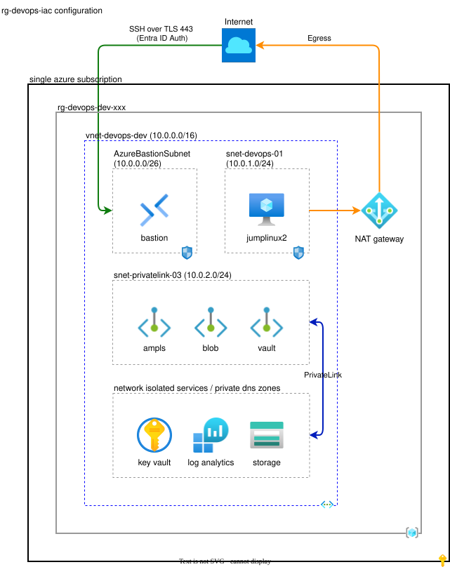

# DevOps IaC Configuration (rg-devops-iac)

## Contents

* [Architecture](#architecture)
* [Overview](#overview)
* [Features](#features)
* [Prerequisites](#prerequisites)
* [Getting Started](#getting-started)
* [Documentation](#documentation)

## Architecture



## Overview

This configuration provides a secure, isolated Terraform execution environment for DevOps and Infrastructure-as-Code (IaC) scenarios. It works for any Terraform project, not just Azure Sandbox. The root module creates network, storage and security prerequisites, including a private Terraform state backend. The virtual machine used as a Terraform execution environment, `jumplinux2`, is implemented in a child module that can be reused in other environments, such as a platform landing zone, where the root module's resources already exist. The virtual machine has no public IP address. Interactive access is only through Azure Bastion with Microsoft Entra ID sign-in, and automated workloads such as self-hosted runners authenticate with managed identities, so all access is governed by Microsoft Entra ID and Azure RBAC rather than long-lived SSH keys or secrets.

## Features

* **Pre-configured DevOps VM for IaC** (Terraform)
  * Pre-installed and pre-configured environment for Terraform init / plan / apply operations.
  * Managed identity access to a pre-configured Terraform state backend (Azure Blob Storage).
  * Pre-installed Azure CLI, PowerShell and Azure PowerShell for custom automation.
  * Optional deployment identity for secretless, least-privilege Terraform applies, such as Azure Sandbox. See [Optional: Deployment Identity](#optional-deployment-identity).
* **Network isolation**
  * Virtual network, subnets and NSGs for Bastion, VMs, private endpoints and image builds.
  * NAT gateway for outbound internet access.
  * Private endpoints and private DNS zones for blob storage, key vault and Azure Monitor / Log Analytics. Public network access is disabled.
* **Secure access**
  * Azure Bastion (Standard SKU) is the only inbound path to the virtual machine.
  * Microsoft Entra ID sign-in with Azure RBAC (passwordless).
  * Break-glass local administrator account (`devopsbootstrapadmin`), with its user name and SSH private key stored in Key Vault.
  * Role separation follows the principle of least privilege for Azure RBAC role assignments. See [Personas and Role Assignments](#personas-and-role-assignments).
* **Observability**
  * AMA pre-configured on the VM for logging syslog and performance counters.
  * Pre-configured diagnostic settings for Bastion, Key Vault and Storage.
* **Optional Azure Sandbox extensions**: (disabled by default)
  * **GitHub self-hosted runner:** provides the continuous delivery (CD) stage of the Azure Sandbox CI/CD pipeline (see [Releasing to main](../../../CONTRIBUTING.md#releasing-to-main)), running the Azure Sandbox deployment workflow on `jumplinux2` with a deployment identity that has time-bound roles. The workflow has two uses:
    * **Release gate:** after [static CI](../../../CONTRIBUTING.md#ci-checks) passes on a release PR to `main` and the deployment is approved, it deploys a sandbox and runs the unit tests, which must pass before the PR can be merged.
    * **On-demand deployment:** deploys up to 20 sandboxes in parallel from `main` or `vnext`.

    See [Optional: GitHub Self-Hosted Runner Configuration](#optional-github-self-hosted-runner-configuration).
  * **Image gallery:** an Azure Compute Gallery and Azure VM Image Builder templates that build patched **custom images** for the Azure Sandbox VMs, to shorten deployments. See [Optional: Custom Images](#optional-custom-images).

## Prerequisites

This section describes the prerequisites required to deploy this configuration. They're the same as the Azure Sandbox [Prerequisites](../../../README.md#prerequisites), except for the differences below.

* [Personas and Role Assignments](#personas-and-role-assignments)
* [Terraform Execution Environment](#terraform-execution-environment)

**Note:** There are additional prerequisites for the optional modules. See [Workflow prerequisites](../../../CONTRIBUTING.md#workflow-prerequisites) and [Image Build Prerequisites](./modules/image-gallery/README.md#image-build-prerequisites) for more information.

### Personas and Role Assignments

There are three separate personas associated with this configuration to support role separation when required. The **entra administrator** is needed only for the optional [deployment identity](#optional-deployment-identity). A single user can assume multiple personas if they have the appropriate role assignments.

Persona | Intent | Minimum Entra Role Required | Minimum Azure Role Required
--- | --- | --- | ---
**entra administrator** | Grants Microsoft Graph permissions to the deployment identity with `grant-graph-permissions.sh`. Needed only for sandboxes that enable `mssql`. | `Privileged Role Administrator` | N/A
**devops administrator** | Deploys this configuration and manages its optional features. | N/A | `Contributor` and `Role Based Access Control Administrator` on the subscription \*
**devops engineer** | Signs in to `jumplinux2` to run Terraform, optionally as the [deployment identity](#optional-deployment-identity). | N/A | `Reader` on the rg-devops-iac resource group and `Virtual Machine User Login` on `jumplinux2` \*\*

\* These role assignments can be standing or PIM activated. See [Assign Azure resource roles in Privileged Identity Management](https://learn.microsoft.com/entra/id-governance/privileged-identity-management/pim-resource-roles-assign-roles). Azure `Role Based Access Control Administrator` can be further constrained using Azure ABAC. See [A more secure method: Delegate role assignment management with conditions](https://learn.microsoft.com/azure/role-based-access-control/delegate-role-assignments-overview#a-more-secure-method-delegate-role-assignment-management-with-conditions).

\*\* If the Terraform configuration being deployed uses Azure CLI sign-in, such as Azure Sandbox with `auth_mode = "azure_cli"`, the **devops engineer** is its [deployment identity](../../../README.md#deployment-identity) and needs its roles. Otherwise, the deployment identity holds them instead.

The **devops administrator** who applies this configuration:

* Is granted these roles by the configuration:
  * `Key Vault Secrets Officer` on the key vault.
  * `Storage Blob Data Contributor` on the storage account.
  * `Virtual Machine Administrator Login` on `jumplinux2`.
* Grants the optional deployment identity its time-bound roles with `grant-jit-roles.sh` before each apply.
* Needs the GitHub **Admin** role on the target repository to register the optional GitHub runner.

### Terraform Execution Environment

Use any of the Azure Sandbox [Terraform Execution Environments](../../../README.md#terraform-execution-environment) to deploy this configuration. The bootstrap scripts and Terraform need git, Azure CLI and Terraform.

## Getting Started

Deploy this configuration from an interactive Terraform execution environment:

* [Step 1: Log In](#step-1-log-in)
* [Step 2: Clone the Repository](#step-2-clone-the-repository)
* [Step 3: Initialize Terraform](#step-3-initialize-terraform)
* [Step 4: Configure Variables](#step-4-configure-variables)
* [Step 5: Validate and Apply Configuration](#step-5-validate-and-apply-configuration)
* [Step 6: Complete Smoke Testing](#step-6-complete-smoke-testing)
* [Step 7: Use The Environment](#step-7-use-the-environment)
* [Step 8: Clean Up](#step-8-clean-up)

### Step 1: Log In

Sign in to Azure CLI as the **devops administrator** and select the subscription, as in the Azure Sandbox [Step 1: Log In](../../../README.md#step-1-log-in). If your roles are PIM eligible, activate them first. See [Personas and Role Assignments](#personas-and-role-assignments).

```bash
az login --use-device-code
```

### Step 2: Clone the Repository

Clone the Azure Sandbox repository to the Terraform execution environment using the following command:

```bash
git clone https://github.com/Azure-Samples/azuresandbox
```

### Step 3: Initialize Terraform

After cloning the repository, navigate to the `rg-devops-iac` directory and initialize Terraform. This step downloads the necessary provider plugins and modules.

```bash
cd azuresandbox/extras/configurations/rg-devops-iac
terraform init
```

**WARNING:** This configuration uses a local Terraform state file, which contains sensitive information. This avoids a chicken-and-egg problem, because the configuration creates the storage account used as the Terraform state backend.

### Step 4: Configure Variables

Configure the variables for this configuration by creating a `terraform.tfvars` file. Helper scripts are provided to generate this file:

```bash
# Bash bootstrap script, run from the rg-devops-iac directory
./scripts/bootstrap.sh
```

```pwsh
# PowerShell bootstrap script, run from the rg-devops-iac directory
./scripts/bootstrap.ps1
```

Alternatively, you can create `terraform.tfvars` manually in the rg-devops-iac directory. Here is an example of what the `terraform.tfvars` file might look like:

```hcl
# terraform.tfvars

entra_tenant_id = "<entra-tenant-id-here>"
location        = "<azure-region-here>"
subscription_id = "<subscription-id-here>"

tags = {
  project     = "devops",
  costcenter  = "mycostcenter",
  environment = "dev"
}
```

#### Overriding Defaults

Set root module variables in `terraform.tfvars`. To override a child module default that the root module doesn't expose, add the argument to the module block in `main.tf`.

### Step 5: Validate and Apply Configuration

Follow these steps to validate and apply the configuration:

* First, validate that the configuration is syntactically correct:

  ```bash
  terraform validate
  ```

* Next, create a plan to see what resources will be created:

  ```bash
  terraform plan -out=freshapply.tfplan
  ```

* Finally, apply the configuration to create the resources:

  ```bash
  terraform apply freshapply.tfplan
  ```

* Monitor the progress of the apply operation in the console. If errors occur, that may not be reflected in the console immediately. Terraform will try to apply as much of the plan as possible first, then will show the errors when it is done. It can take up to 15 minutes to provision this configuration. If everything goes well you should see a message like this:

  ```text
  Apply complete! Resources: XX added, XX changed, XX destroyed.
  ```

### Step 6: Complete Smoke Testing

See [Smoke Testing](./modules/vm-jumpbox-linux/README.md#smoke-testing) in the `vm-jumpbox-linux` module.

### Step 7: Use The Environment

You now have a Terraform execution environment you can use to deploy Azure Sandbox or other Terraform configurations of your choosing:

* **Interactive:** connect to `jumplinux2` through Azure Bastion with your Microsoft Entra ID credentials, then follow the Azure Sandbox [tutorial](../../../README.md#tutorial-deploy-a-sandbox-using-your-azure-cli-sign-in). Use this configuration's storage account as the state backend; see [Terraform State](./modules/github-runner/README.md#terraform-state).
* **Automated:** see [Optional: GitHub Self-Hosted Runner Configuration](#optional-github-self-hosted-runner-configuration).

### Step 8: Clean Up

Delete your DevOps IaC environment when you no longer need it, so unused resources don't keep costing money. Run `terraform destroy`, or delete the DevOps IaC resource group. Do this with care, because data loss will occur, including any Terraform state files in the storage container.

You can also reduce costs by stopping `jumplinux2` when you aren't using it, so you don't pay for compute while it's idle.

## Documentation

This section provides documentation regarding the overall structure of the root module for this configuration. See the README.md files in each module directory for more information about that module.

* [Root Module Structure](#root-module-structure)
* [Root Module Input Variables](#root-module-input-variables)
* [Root Module Resources](#root-module-resources)
* [Root Module Outputs](#root-module-outputs)
* [Child Modules](#child-modules)
* [Virtual Network Design](#virtual-network-design)
* [Dependencies](#dependencies)
* [Optional: Deployment Identity](#optional-deployment-identity)
* [Optional: GitHub Self-Hosted Runner Configuration](#optional-github-self-hosted-runner-configuration)
* [Optional: Custom Images](#optional-custom-images)

### Root Module Structure

This configuration is organized into the following structure:

```plaintext
├── images/
│   └── rg-devops-iac-diagram.drawio.svg  # Architecture diagram
├── modules/
│   ├── github-runner/                    # Optional: GitHub self-hosted runner
│   ├── image-gallery/                    # Optional: Compute gallery and custom image builder
│   └── vm-jumpbox-linux/                 # Linux jumpbox virtual machine module (jumplinux2)
├── scripts/                              # Partial list: user-facing scripts only
│   ├── bootstrap.ps1                     # PowerShell: generates terraform.tfvars
│   ├── bootstrap.sh                      # Bash: generates terraform.tfvars
│   ├── cleanterraformtemp.sh             # Bash: removes Terraform temp/local files
│   ├── delete-tfstate.sh                 # Bash: deletes Terraform state blob(s) from the storage backend
│   ├── enable-public-access.sh           # Bash: re-enables key vault and storage account public access
│   ├── grant-graph-permissions.sh        # Bash: entra administrator grants the deployment identity Graph permissions
│   └── grant-jit-roles.sh                # Bash: devops administrator grants the deployment identity JIT roles
├── locals.tf                             # Local variables
├── main.tf                               # Other service resource and module blocks
├── network.tf                            # Network resource blocks
├── outputs.tf                            # Output values
├── providers.tf                          # Provider configuration blocks
├── storage.tf                            # Storage resource blocks
├── terraform.tf                          # Terraform configuration block
└── variables.tf                          # Variable definitions
```

### Root Module Input Variables

Input variables for the root module. Override defaults in `terraform.tfvars`.

Variable | Default | Description
--- | --- | ---
entra_tenant_id | *(required)* | The Microsoft Entra tenant id.
location | *(required)* | The name of the Azure Region where resources will be provisioned.
log_analytics_workspace_retention_days | 30 | The retention period in days for the Log Analytics workspace. Must be one of 30, 31, 60, 90, 120, 180, 270, 365, 550 or 730.
storage_access_tier | Hot | The access tier for the storage account.
storage_container_name | tfstate | The name of the blob storage container used by Terraform state backend.
storage_replication_type | LRS | The type of replication for the storage account.
subnet_bastion_address_prefix | 10.0.0.0/26 | The address prefix for the `AzureBastionSubnet`.
subnet_devops_address_prefix | 10.0.1.0/28 | The address prefix for the devops subnet.
subnet_devops_name | snet-devops-01 | The name of the devops subnet, which hosts `jumplinux2`.
subnet_image_build_aci_address_prefix | 10.0.4.0/28 | The address prefix for the image build Container Instances subnet, which Azure VM Image Builder uses to reach the build and validation VMs. Used by the optional [image-gallery](./modules/image-gallery/) module.
subnet_image_build_aci_name | snet-imagebuild-aci-01 | The name of the image build Container Instances subnet. Used by the optional [image-gallery](./modules/image-gallery/) module.
subnet_privatelink_address_prefix | 10.0.2.0/27 | The address prefix for the private link subnet, which hosts the private endpoints.
subnet_privatelink_name | snet-privatelink-02 | The name of the private link subnet.
subscription_id | *(required)* | The Azure subscription id used to provision resources.
tags | { costcenter = "mycostcenter", environment = "dev", project = "devops" } | The tags in map format to be used when creating new resources. Must include `project` and `environment`, which are used in resource names.
vm_jumpbox_linux_size | Standard_D2ls_v6 | The size of the Linux virtual machine (`jumplinux2`). Must be a v6 D-series size (`Standard_D<vCPU>[a][l][d]s_v6`), which supports Trusted Launch, the NVMe disk controller and Accelerated Networking.
vnet_address_space | 10.0.0.0/16 | The address space in CIDR notation for the virtual network.

There are additional input variables used for optional use cases. See [Optional: Deployment Identity](#optional-deployment-identity), [Optional: GitHub Self-Hosted Runner Configuration](#optional-github-self-hosted-runner-configuration) and [Optional: Custom Images](#optional-custom-images).

### Root Module Resources

The root module creates the network, security, storage and monitoring resources that `jumplinux2` and the optional modules use. It also grants the devops administrator data-plane roles on the key vault and storage account.

Address | Name | Notes
--- | --- | ---
azapi_update_resource.ampls_disable_public_access | | Sets the AMPLS ingestion and query access modes to `PrivateOnly` after the AMPLS barrier.
azapi_update_resource.key_vault_disable_public_access | | Disables key vault public network access after the key vault barrier.
azapi_update_resource.log_analytics_disable_public_access | | Disables public ingestion and query on the Log Analytics workspace after the AMPLS barrier.
azapi_update_resource.storage_disable_public_access | | Disables storage account public network access after the storage barrier.
azurerm_bastion_host.this | bas-devops-dev | Bastion host for secure remote access to `jumplinux2`.
azurerm_key_vault.this | kv-devops-dev-xxx | Key vault that stores the `jumplinux2` break-glass admin user name and SSH private key.
azurerm_log_analytics_workspace.this | log-devops-dev-xxx | Log Analytics workspace for observability (diagnostic logs and metrics).
azurerm_monitor_data_collection_endpoint.this | dcedevopsdevxxx | Data collection endpoint used by the Azure Monitor Agent on `jumplinux2`.
azurerm_monitor_data_collection_rule.linux | dcrdevopsdev-linux | Linux data collection rule: syslog (`auth` and `authpriv` at `Info` and above, other facilities at `Warning` and above) and performance counters.
azurerm_monitor_diagnostic_setting.bastion | Diagnostic Logs | Sends `BastionAuditLogs` and metrics for the Bastion host to the workspace.
azurerm_monitor_diagnostic_setting.data_collection_rule_linux | Diagnostic Logs | Sends data collection errors (`allLogs`) and metrics for the Linux data collection rule to the workspace.
azurerm_monitor_diagnostic_setting.key_vault | Audit Logs | Sends key vault `audit` logs (including secret reads) and metrics to the workspace.
azurerm_monitor_diagnostic_setting.storage_account | Diagnostic Logs | Sends storage account `Transaction` metrics to the workspace.
azurerm_monitor_diagnostic_setting.storage_blob | Diagnostic Logs | Sends blob service `StorageRead`, `StorageWrite` and `StorageDelete` logs (Terraform state access) and `Transaction` metrics to the workspace.
azurerm_monitor_private_link_scope.this | ampls-devops-dev | Azure Monitor Private Link Scope. Starts in `Open` mode and is set to `PrivateOnly` by the AMPLS barrier.
azurerm_monitor_private_link_scoped_service.dce | ampls-scope-dce | Adds the data collection endpoint to the AMPLS.
azurerm_monitor_private_link_scoped_service.log_analytics | ampls-scope-log-analytics | Adds the Log Analytics workspace to the AMPLS.
azurerm_nat_gateway.this | ngdevopsdev | NAT gateway for outbound internet connectivity.
azurerm_nat_gateway_public_ip_association.this | | Associates the NAT gateway with the public IP address.
azurerm_network_security_group.groups[*] | nsg-devops-dev.\<subnet\> | One NSG for each subnet in `local.subnets` that has NSG rules. The private link subnet has no NSG.
azurerm_network_security_rule.rules[*] | | NSG rules from `local.nsg_rules`. See [Virtual Network Design](#virtual-network-design).
azurerm_private_dns_zone.zones[*] | | Private DNS zones from `local.private_dns_zones`. See [Virtual Network Design](#virtual-network-design).
azurerm_private_dns_zone_virtual_network_link.zones[*] | | Links each private DNS zone to the virtual network. See [Virtual Network Design](#virtual-network-design).
azurerm_private_endpoint.ampls | pep-devops-dev-ampls | Private endpoint for the AMPLS (`azuremonitor` subresource).
azurerm_private_endpoint.key_vault | pep-devops-dev-key-vault | Private endpoint for the key vault.
azurerm_private_endpoint.storage_blob | pep-devops-dev-storage-blob | Private endpoint for the storage account (`blob` subresource).
azurerm_public_ip.bastion | pip-devops-dev-bastion | Public IP address for the Bastion host.
azurerm_public_ip.this | pip-devops-dev-nat | Public IP address for the NAT gateway.
azurerm_resource_group.this | rg-devops-dev-xxx | Resource group for all resources in this configuration.
azurerm_role_assignment.key_vault_secrets_officer | | Assigns `Key Vault Secrets Officer` on the key vault to the devops administrator signed in to Azure CLI.
azurerm_role_assignment.storage_blob_data_contributor | | Assigns `Storage Blob Data Contributor` on the storage account to the devops administrator signed in to Azure CLI.
azurerm_storage_account.this | stdevopsdevxxx | Storage account for storing Terraform state files.
azurerm_storage_container.this | tfstate | Storage container for storing Terraform state files.
azurerm_subnet.subnets[*] | | Subnets from `local.subnets`. See [Virtual Network Design](#virtual-network-design).
azurerm_subnet_nat_gateway_association.associations[*] | | Associates the NAT gateway with each subnet in `local.subnets` that needs outbound internet access. See [Virtual Network Design](#virtual-network-design).
azurerm_subnet_network_security_group_association.associations[*] | | Associates each NSG with its subnet.
azurerm_virtual_network.this | vnet-devops-dev | Virtual network for `jumplinux2`, Bastion, the private endpoints and the optional image builds.
terraform_data.ampls_access_barrier | | Waits for all Azure Monitor operations and private DNS zone links before AMPLS and the Log Analytics workspace are made private.
terraform_data.key_vault_access_barrier | | Waits for all key vault writes before the key vault is made private.
terraform_data.private_dns_zone_links_complete | | Waits for every private DNS zone virtual network link before the private endpoints are created.
terraform_data.storage_access_barrier | | Waits for all storage writes before the storage account is made private.
time_sleep.wait_for_roles | | Waits 2 minutes for the `Key Vault Secrets Officer` role assignment to propagate before the `jumplinux2` module writes its key vault secrets.

The optional features add more resources. See [Optional: Deployment Identity](#optional-deployment-identity), [Optional: GitHub Self-Hosted Runner Configuration](#optional-github-self-hosted-runner-configuration) and [Optional: Custom Images](#optional-custom-images).

### Root Module Outputs

This section includes a list of output values returned by the root module.

Name | Comments
--- | ---
resource_ids | A map of resource IDs for key resources in the configuration.
resource_names | A map of resource names for key resources in the configuration.

There are additional output values for optional use cases. See [Optional: Deployment Identity](#optional-deployment-identity), [Optional: GitHub Self-Hosted Runner Configuration](#optional-github-self-hosted-runner-configuration) and [Optional: Custom Images](#optional-custom-images).

### Child Modules

The following [modules](./modules/) are included in this configuration:

Name | Optional | Depends On | Description
--- | --- | --- | ---
[vm-jumpbox-linux](./modules/vm-jumpbox-linux/) | No | Root module | Creates `jumplinux2`, a preconfigured Linux jumpbox VM in the DevOps virtual network, used as the Terraform execution environment.
[github-runner](./modules/github-runner/) | Yes | Root module, vm-jumpbox-linux | Installs and registers the GitHub Actions self-hosted runner on `jumplinux2`, and with `deployment_identity = "oidc"`, adds GitHub Actions federated identity credentials to the deployment identity and creates the runner power state identity. Enabled by `enable_github_runner`.
[image-gallery](./modules/image-gallery/) | Yes | Root module | Creates an Azure Compute Gallery and Azure VM Image Builder templates that build custom images for the Azure Sandbox VMs. Enabled by `enable_image_gallery`.

### Virtual Network Design

This configuration implements a dedicated virtual network and network-isolated Azure services. A barrier pattern is used to ensure public access is disabled for key vault, blob storage and AMPLS when deployment completes. AMPLS is used to ensure Azure Monitor-related traffic is network isolated. Default address ranges are set artificially high for readability and can be overridden with smaller ranges to meet specific requirements. Each subnet must be inside the virtual network address space and must not overlap another subnet.

VNet Property | Default Value | Notes
--- | --- | ---
Name | `vnet-devops-dev` | N/A
Address Space | `10.0.0.0/16` | Minimum /24 (256 IP addresses) for the default subnet prefixes.
DNS Server | `168.63.129.16` | Azure DNS with private DNS zones.

The virtual network contains the following subnets.

Subnet | Address Prefix | IP Addresses | Notes
--- | --- | :-: | ---
`AzureBastionSubnet` (name required) | `10.0.0.0/26` | 64 | Requires a `/26` minimum. NSG attached as per [Secure your Azure Bastion deployment](https://learn.microsoft.com/azure/bastion/secure-bastion#network-security).
`snet-devops-01` (default name) | `10.0.1.0/28` | 16 | Requires a `/28` minimum: `jumplinux2` plus four simultaneous builds of the optional [image-gallery](./modules/image-gallery/) module (a build VM and a validation VM per build). Hosts `jumplinux2` and the temporary Azure VM Image Builder build and validation VMs. NSG attached allowing inbound SSH from the `AzureBastionSubnet` and TCP 22 and 5986 from the image build Container Instances subnet. Egress via NAT gateway.
`snet-privatelink-02` (default name) | `10.0.2.0/27` | 32 | Requires a `/27` minimum for AMPLS. No NSG is attached. Hosts private endpoints for key vault, blob storage and AMPLS.
`snet-imagebuild-aci-01` (default name) | `10.0.4.0/28` | 16 | Requires a `/28` minimum for four simultaneous builds (one container group per build). The Azure VM Image Builder container. Delegated to `Microsoft.ContainerInstance/containerGroups`. NSG denies virtual network inbound traffic. Egress via NAT gateway.

The following private DNS zones are linked to the virtual network and are configured for internet fallback (`NxDomainRedirect`).

Private DNS Zone | Notes
--- | ---
`privatelink.vaultcore.azure.net` | Configured with an A record for the key vault private endpoint.
`privatelink.blob.core.windows.net` | Configured with an A record for the blob storage private endpoint.
`privatelink.monitor.azure.com` | AMPLS: global Azure Monitor endpoints (Application Insights ingestion and live metrics, data collection endpoints, profiler).
`privatelink.oms.opinsights.azure.com` | AMPLS: Log Analytics workspace onboarding and configuration endpoints.
`privatelink.ods.opinsights.azure.com` | AMPLS: Log Analytics workspace data ingestion endpoints.
`privatelink.agentsvc.azure-automation.net` | AMPLS: Log Analytics agent service and automation endpoints.

### Dependencies

* **Source control:** GitHub. *.gitignore* keeps secrets, state and temporary files out of Git.
* **Terraform:** see *terraform.tf* for pinned versions.
  * Providers: `azapi` (AIB image templates, Run Commands and other settings `azurerm` doesn't support), `azurerm`, `cloudinit`, `http` (GitHub repository ids for the `oidc` [federated identity credentials](./modules/github-runner/README.md#oidc-federated-identity-credentials)), `random`, `time` and `tls` (break-glass SSH key pair).
  * Modules: `Azure/avm-utl-naming` for resource names.
* **Scripting:** Bash and Azure CLI; PowerShell and the Az PowerShell module for *bootstrap.ps1*, the optional workflow scripts and Windows custom image builds.
* **Configuration management:** cloud-init and Azure VM run commands for `jumplinux2`; Azure VM Image Builder for the optional custom images.
* **Operating system:** `jumplinux2` runs Ubuntu Server 26.04 LTS (Resolute Raccoon).

### Optional: Deployment Identity

The optional deployment identity lets you apply Terraform configurations from `jumplinux2`, in a terminal or a GitHub Actions workflow, with:

* **No secrets:** there is no service principal password to create, store or rotate.
* **No standing privileged access:** the identity holds its Azure roles only for the time a devops administrator grants before each apply.
* **Least privilege:** it can assign only the roles the configuration needs. See [Deployment Identity Permissions](#deployment-identity-permissions).

When enabled, this feature adds the following:

* **Variable:** `deployment_identity`, which defaults to `none`. See [Deployment Identity Options](#deployment-identity-options).
  * `none`: no deployment identity.
  * `managed_identity`: attached to `jumplinux2`.
  * `oidc`: federated with GitHub Actions. Requires `enable_github_runner = true`.
* **Resource:** `azurerm_user_assigned_identity.deployment[0]` (`id-devops-dev-deployment`).
  * With `managed_identity`, it's attached to `jumplinux2`.
  * With `oidc`, it's unattached and federated with GitHub Actions by the [github-runner](./modules/github-runner/README.md#oidc-federated-identity-credentials) module.
* **Outputs:**
  * `deployment_identity`: the identity's `client_id`, `principal_id` and GitHub OIDC subjects, or `null` when it isn't enabled.
  * `resource_ids` and `resource_names` also include `deployment_identity`.

#### Deployment Identity Options

`deployment_identity` supports two options (`managed_identity` and `oidc`). Terraform configurations sign in as the deployment identity using its `client_id`. For example, Azure Sandbox sets its `client_id` to this value, with its [`auth_mode`](../../../README.md#deployment-identity) aligned to the same option.

Aspect | `managed_identity` | `oidc`
--- | --- | ---
Identity | User-assigned managed identity attached to `jumplinux2` \* | Not attached to a VM. Federated with GitHub Actions by the [github-runner](./modules/github-runner/README.md#oidc-federated-identity-credentials) module
Who can use it | A **devops engineer** signed in to `jumplinux2` \*\* | Only workflow jobs in `deployment_identity_github_environments`
Extra GitHub setup | None | [OIDC subject claim template](./modules/github-runner/README.md#oidc-subject-claim-template) and [GitHub environments](../../../CONTRIBUTING.md#deployment-environments-and-identities)

\* `jumplinux2` sets `ARM_USE_MSI=true`, so a configuration with no `client_id` uses `jumplinux2`'s system-assigned identity, which can only access Terraform state by default. The **devops engineer** must set `client_id` to the deployment identity's.

\*\* Also any job on the optional [GitHub self-hosted runner](#optional-github-self-hosted-runner-configuration).

#### Deployment Identity Permissions

The deployment identity needs the permissions of the Terraform configurations it applies:

* **Azure roles:** standing or just in time. For example, Azure Sandbox uses `Contributor` and `Role Based Access Control Administrator`, granted just in time. See [Deployment Roles](#deployment-roles).
  * A condition can limit role assignments to specific roles. For example, Azure Sandbox limits them to the roles in [`scripts/deployment-identity-roles.yaml`](../../../scripts/deployment-identity-roles.yaml).
* **Microsoft Graph:** needed only by configurations that use the `azuread` provider to create Microsoft Entra ID groups and manage their membership. For example, Azure Sandbox uses standing Microsoft Graph permissions. See [Microsoft Graph Permissions](#microsoft-graph-permissions).

#### Deployment Roles

The **devops administrator** can grant the deployment identity its Azure roles as standing or limited-time role assignments. For example, Azure Sandbox uses limited-time assignments, granted before each apply:

```bash
./scripts/grant-jit-roles.sh             # grant Contributor and RBAC Administrator for 8 hours
./scripts/grant-jit-roles.sh --hours 10  # grant a different window (1-24 hours)
./scripts/grant-jit-roles.sh --force     # replace assignments that are already active
./scripts/grant-jit-roles.sh --revoke    # remove both assignments after the run
```

Things to know:

* The script activates the **devops administrator**'s eligible `Role Based Access Control Administrator` through PIM if needed. If that fails, activate it in the portal and run the script again.
* Assignments can take about 5 minutes to take effect. Wait before applying.

#### Microsoft Graph Permissions

Needed only if the configuration uses Microsoft Graph, for example to create security groups. For Azure Sandbox, the **entra administrator** grants `Group.Create`, `GroupMember.Read.All`, `User.Read.All` and `Application.Read.All` once the identity exists:

```bash
./scripts/grant-graph-permissions.sh
```

#### Security Considerations

Risk | Mode | Mitigation
--- | --- | ---
Anything on `jumplinux2` can use the identity while a grant is active | `managed_identity` | Keep grants short and revoke them after each run, or use `oidc`.
Any GitHub Actions workflow in an allowed GitHub environment can federate | `oidc` | Restrict the environments with deployment branch rules and required reviewers. For example, Azure Sandbox allows only `main`, with owner approval. See [CONTRIBUTING.md](../../../CONTRIBUTING.md#deployment-environments-and-identities).
Another deployment in the same grant window can use the roles | Both | Run one deployment at a time. For example, the Azure Sandbox deployment workflow uses a GitHub Actions [concurrency group](https://docs.github.com/en/actions/how-tos/write-workflows/choose-when-workflows-run/control-workflow-concurrency).
Microsoft Graph permissions are standing | Both | Grant only the least-privileged permissions the configuration needs, such as creating groups and managing their membership, rather than broader user or group write permissions. For example, Azure Sandbox uses `Group.Create` instead of `Group.ReadWrite.All`.
The job's federated token request credentials are visible to root on `jumplinux2` while the job runs | `oidc` | Limit who holds **Virtual Machine Administrator Login** on `jumplinux2`, which grants root.

### Optional: GitHub Self-Hosted Runner Configuration

GitHub-hosted runners are preferable, but some workflows need a self-hosted runner. For example, the Azure Sandbox deployment workflow needs access to a network-isolated Terraform state backend.

`rg-devops-iac` can optionally be configured as a GitHub self-hosted runner for the [Sandbox deployment workflow](../../../.github/workflows/sandbox-deployment.yml), which uses the [deployment identity](#optional-deployment-identity) for sandbox deployments. The workflow supports the **release gate** and **on-demand deployment** use cases. The runner is disabled by default. To enable it, set `enable_github_runner = true` and `deployment_identity` in `terraform.tfvars`. The [github-runner](./modules/github-runner/README.md) module README covers runner installation and registration, the `oidc` federated identity credentials and the runner power state identity. The workflow's design, prerequisites, configuration and setup are in [Sandbox deployment workflow](../../../CONTRIBUTING.md#sandbox-deployment-workflow).

The github-runner module adds these variables:

Variable | Default | Description
--- | --- | ---
deployment_identity_github_environments | `["sandbox-deployment", "sandbox-release-gate"]` | The GitHub Actions environments whose jobs can sign in as the deployment identity. One federated identity credential is created per environment. Only used when `deployment_identity` is `"oidc"`.
enable_github_runner | false | Set to true to install and register the GitHub Actions self-hosted runner agent on `jumplinux2`. See [Self-Hosted Runner Registration](./modules/github-runner/README.md#self-hosted-runner-registration).
github_repository_id | *(looked up)* | The numeric id of the GitHub repository, e.g. from `gh api repos/OWNER/NAME --jq .id`. Only used when `deployment_identity` is `"oidc"`. When empty, it is looked up from the repository in `github_runner_url`, which works only for public repositories.
github_repository_owner_id | *(looked up)* | The numeric id of the user or organization that owns the GitHub repository, e.g. from `gh api repos/OWNER/NAME --jq .owner.id`. Only used when `deployment_identity` is `"oidc"`. When empty, it is looked up from the repository in `github_runner_url`, which works only for public repositories.
github_runner_labels | `["azuresandbox"]` | Additional [labels](https://docs.github.com/en/actions/how-tos/manage-runners/self-hosted-runners/apply-labels) to apply to the GitHub Actions self-hosted runner. Labels route workflow jobs to self-hosted runners.
github_runner_power_state_environment | `sandbox-runner-power-state` | The GitHub Actions environment whose jobs can sign in as the runner power state identity, which starts and stops `jumplinux2` for workflow runs. Only used when `deployment_identity` is `"oidc"`.
github_runner_token | | Ephemeral. The runner registration token used to register the self-hosted runner (expires after 1 hour), e.g. from `modules/github-runner/scripts/new-runner-registration-token.sh`. Set using the environment variable `TF_VAR_github_runner_token` for both `terraform plan` and `terraform apply`. Never stored in Terraform state or the saved plan. Needed only to register the runner.
github_runner_token_version | 1 | The version of the write-only `github_runner_token`, required because Terraform can't detect changes to write-only values.
github_runner_url | `https://github.com/Azure-Samples/azuresandbox` | The GitHub repository URL the self-hosted runner registers with.

When `deployment_identity` is `oidc`, the `resource_ids` and `resource_names` outputs also include `runner_power_state_identity`. This output is also added:

Name | Comments
--- | ---
github_runner | The runner's registered name and, for `oidc`, its power state identity's client id and GitHub OIDC subject, or `null` when `enable_github_runner` is false.

### Optional: Custom Images

`rg-devops-iac` can optionally host an Azure Compute Gallery and Azure VM Image Builder templates that build patched **custom images** for the Azure Sandbox VMs, which use **platform images** by default. See [Custom Images](../../../README.md#custom-images) to switch the sandbox to custom images. See [image-gallery](./modules/image-gallery/README.md) for more information on image design, build networking, identity, prerequisites, costs, building images and disabling the gallery.

Variable | Default | Description
--- | --- | ---
enable_image_gallery | false | Set to true to create the image gallery.
image_build_vm_size | `Standard_D4s_v6` | The size of the temporary build VM AIB uses for every build. Independent of the size of VMs deployed from the images. See [Image Design](./modules/image-gallery/README.md#image-design).

When `enable_image_gallery` is true, the `resource_ids` and `resource_names` outputs also include `image_builder_identity`, `image_gallery`, and `image_definition_<image>` and `image_template_<image>` for each image.
