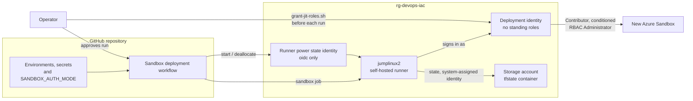
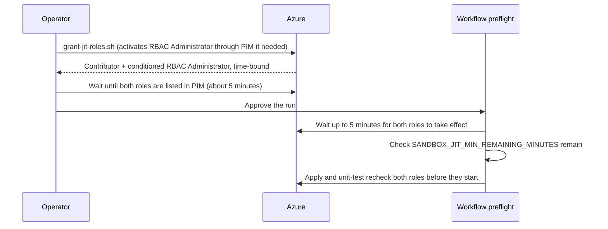
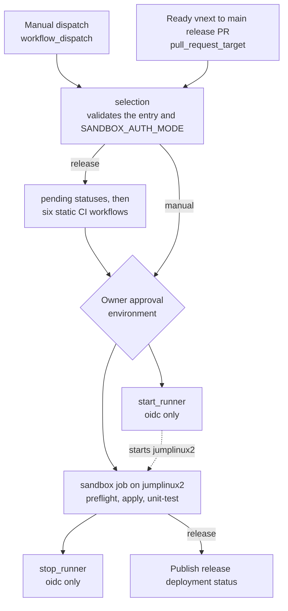

# DevOps IaC Configuration (rg-devops-iac)

## Contents

* [Architecture](#architecture)
* [Overview](#overview)
* [Features](#features)
* [Prerequisites](#prerequisites)
* [Getting Started](#getting-started)
* [Documentation](#documentation)

## Architecture


## Overview

This configuration provides a minimal set of resources to function as a Terraform execution environment, which is often a critical part of a DevOps pipeline. It is a useful starting point for DevOps / Infrastructure-As-Code (IaC) projects that require a secure and isolated environment for deploying and managing infrastructure using Terraform. The root module creates network, storage and security prerequisites. The virtual machine used as a Terraform execution environment is implemented in a child module which can be repurposed in other environments (such as a platform landing zone) where the resources defined in the root module already exist. The virtual machine has no public IP address: operators reach it only through Azure Bastion and sign in with their Microsoft Entra ID identity, so access is governed by Azure RBAC and Conditional Access rather than long-lived SSH keys.

## Features

* **Pre-configured DevOps VM for IaC** (Terraform)
  * Pre-installed and pre-configured environment for Terraform init / plan / apply operations.
  * Managed-identity access to a pre-configured Terraform state backend (Azure Blob Storage).
  * Pre-installed Azure CLI and PowerShell + Azure PowerShell for custom automation.
* **Network isolation**
  * Virtual network and subnets and NSGs for bastion, VMs and private endpoints.
  * NAT gateway for outbound internet access.
  * Private endpoints and private DNS zones for blob storage, key vault and Azure Monitor. Public network access is disabled.
* **Secure access**
  * Azure Bastion (Standard SKU) is the only inbound path to the virtual machine.
  * Microsoft Entra ID sign-in with Azure RBAC (passwordless).
  * Break-glass local admin credentials stored in Key Vault.
  * Role separation follows principle of least privilege for Azure RBAC role assignments.
* **Observability**
  * Log Analytics workspace reachable only through AMPLS.
  * AMA pre-configured on VM for logging syslog and performance counters.
  * Pre-configured diagnostic settings for security-sensitive resources (Bastion, Key Vault and Storage).
* **Optional features** (disabled by default)
  * Deployment identity for sandbox applies, either attached to the virtual machine (`managed_identity`) or federated with GitHub Actions (`oidc`), with time-bound deployment roles granted before each apply.
  * See [Optional: GitHub Self-Hosted Runner Configuration](#optional-github-self-hosted-runner-configuration)

## Prerequisites

This section describes the prerequisites required in order to provision this configuration.

* [Microsoft Entra ID Tenant and Azure Subscription](#microsoft-entra-id-tenant-and-azure-subscription)
* [Other Prerequisites](#other-prerequisites)
* [Terraform Execution Environment](#terraform-execution-environment)

### Microsoft Entra ID Tenant and Azure Subscription

* Identify the [Microsoft Entra ID](https://learn.microsoft.com/en-us/entra/fundamentals/whatis) tenant to be used for identity and access management, or create a new tenant using [Quickstart: Set up a tenant](https://learn.microsoft.com/en-us/entra/identity-platform/quickstart-create-new-tenant).
* Identify a single Azure [subscription](https://learn.microsoft.com/azure/cloud-adoption-framework/ready/considerations/fundamental-concepts#azure-terminology) or create a new Azure subscription. See [Azure Offer Details](https://azure.microsoft.com/support/legal/offer-details/) and [Associate or add an Azure subscription to your Microsoft Entra tenant](https://learn.microsoft.com/entra/fundamentals/how-subscriptions-associated-directory) for more information.
* Identify the operator who will provision this configuration. The operator needs the following Azure RBAC role assignments scoped to the subscription. See [Steps to assign an Azure role](https://learn.microsoft.com/azure/role-based-access-control/role-assignments-steps) for more information.
  * [Contributor](https://learn.microsoft.com/azure/role-based-access-control/built-in-roles#contributor).
  * [Role Based Access Control Administrator](https://learn.microsoft.com/en-us/azure/role-based-access-control/built-in-roles/privileged#role-based-access-control-administrator).

### Other Prerequisites

* Some Azure subscriptions may have low quota limits for specific Azure resources which may cause failures. See [Resolve errors for resource quotas](https://learn.microsoft.com/azure/azure-resource-manager/templates/error-resource-quota) for more information.
* Some Azure subscriptions may not have the required resource providers registered. Terraform is configured to automatically register the required resource providers, but this may take some time on first use.
* Some Azure subscriptions may not have the required features enabled which may cause failures. Monitor your plan application for errors related to specific subscription features and enable them as needed.
* Some organizations may institute [Azure policy](https://learn.microsoft.com/azure/governance/policy/overview) which may cause failures. This can be addressed by using custom settings which pass the policy checks, or by disabling the policies on the Azure subscription being used for the configurations.
* Additional prerequisites are required when using the [Optional: GitHub Self-Hosted Runner Configuration](#optional-github-self-hosted-runner-configuration).

### Terraform Execution Environment

A variety of Terraform execution environments can be used to provision this configuration interactively, including:

* **Windows-Only Client**: A Windows-only client can be used to run Terraform. The following software should be installed:
  * git
  * PowerShell 7.x
  * Azure CLI
  * Terraform
  * Visual Studio Code

* **Windows Subsystem for Linux (WSL) Client**: WSL offers the best of Windows and Linux in the same client environment and was used to develop this project. The following software should be installed:
  * Linux (WSL) software
    * Linux Distro: Ubuntu 24.04 LTS (Noble Numbat)
    * git
    * Azure CLI
    * Terraform
  * Windows software
    * Visual Studio Code configured for [Remote development in WSL](https://code.visualstudio.com/docs/remote/wsl-tutorial)

* **Linux / MacOs Client**: A Linux or MacOS client can be used to run Terraform. The following software should be installed:
  * git
  * Azure CLI
  * Terraform
  * Visual Studio Code

## Getting Started

This section covers the steps to get started with this configuration using an interactive Terraform execution environment.

* [Step 0: Login](#step-0-login)
* [Step 1: Clone the Repository](#step-1-clone-the-repository)
* [Step 2: Initialize Terraform](#step-2-initialize-terraform)
* [Step 3: Configure Variables](#step-3-configure-variables)
* [Step 4: Validate and Apply Configuration](#step-4-validate-and-apply-configuration)
* [Step 5: Complete Smoke Testing](#step-5-complete-smoke-testing)
* [Step 6: Use The Environment](#step-6-use-the-environment)
* [Step 7: Clean Up](#step-7-clean-up)

### Step 0: Login

Before you can provision this configuration interactively, you need to log in to your Azure account.

* Open a terminal window and run the following command to log in to Azure CLI:

  ```bash
  az login --use-device-code
  ```

  If you will use the PowerShell bootstrap script, also run:

  ```pwsh
  Connect-AzAccount -UseDeviceAuthentication
  ```

* Check the terminal for a message like this:

  ```text
  To sign in, use a web browser to open the page https://microsoft.com/devicelogin and enter the code XXXXXXXXX to authenticate.
  ```

* Open a browser and navigate to the URL provided in the terminal. Enter the code displayed in the terminal to authenticate your Azure account.
* Sign in with an account that has an Azure RBAC `Owner` role assignment on the subscription you will be using to provision this configuration.
* Depending upon how your Entra ID tenant is configured, you may be prompted to enter your password and/or approve a sign-in request on your mobile device.
* Click **Continue** when asked if you are trying to sign in to Azure.
* Check the terminal for a prompt like this:

  ```text
  Retrieving tenants and subscriptions for the selection...

  [Tenant and subscription selection]

  No     Subscription name               Subscription ID                       Tenant
  -----  ------------------------------  ------------------------------------  ----------------
  [1] *  SUBSCRIPTION1-NAME-HERE         SUBSCRIPTION1-ID-HERE                 TENANT-NAME-HERE
  [2]    SUBSCRIPTION2-NAME-HERE         SUBSCRIPTION2-ID-HERE                 TENANT-NAME-HERE

  The default is marked with an *; the default tenant is 'TENANT-NAME-HERE' and subscription is 'SUBSCRIPTION1-NAME-HERE' (SUBSCRIPTION1-ID-HERE).

  Select a subscription and tenant (Type a number or Enter for no changes):
  ```

* Select the subscription you will be using to provision this configuration by entering the number next to it. If you only have one subscription, just press Enter.

### Step 1: Clone the Repository

Clone the Azure Sandbox repository to the Terraform execution environment using the following command:

```bash
git clone https://github.com/Azure-Samples/azuresandbox
```

### Step 2: Initialize Terraform

After cloning the repository, navigate to the `rg-devops-iac` directory and initialize Terraform. This step downloads the necessary provider plugins and modules.

```bash
cd azuresandbox/extras/configurations/rg-devops-iac
terraform init
```

**WARNING:** By default this configuration assumes you will be using a local Terraform state file which includes sensitive information. This is by design since the configuration creates the storage account to be used as a Terraform state backend for other configurations.

### Step 3: Configure Variables

Follow these steps to configure the variables for this configuration:

* Create a `terraform.tfvars` file in the root directory of the project. This file should set the necessary variables for your deployment. Here is an example of what the `terraform.tfvars` file might look like:

  ```hcl
  entra_tenant_id = "<entra-tenant-id-here>"
  location        = "<azure-region-here>"
  subscription_id = "<subscription-id-here>"

  tags = {
    project     = "devops",
    costcenter  = "mycostcenter",
    environment = "dev"
  }
  ```

  Helper scripts are provided to generate the `terraform.tfvars` file:

  ```bash
  # Bash bootstrap script, run from the root directory of the project
  ./scripts/bootstrap.sh
  ```

  ```pwsh
  # PowerShell bootstrap script, run from the root directory of the project
  ./scripts/bootstrap.ps1
  ```

#### **Overriding Defaults**

The variable defaults set in this configuration can be overridden by customizing the `terraform.tfvars` file or modifying the module block in `main.tf`. For example, the default value for the `vm_jumpbox_linux_name` variable in the vm-jumpbox-linux module is `jumplinux2`. You can override this value by adding the following to the vnet-shared module block in `main.tf`:

```hcl
module "vm_jumpbox_linux" {
  source = "./modules/vm-jumpbox-linux"

  key_vault_id        = azurerm_key_vault.this.id
  location            = azurerm_resource_group.this.location
  resource_group_name = azurerm_resource_group.this.name
  storage_account_id  = azurerm_storage_account.this.id
  subnet_id           = azurerm_subnet.subnets[var.subnet_devops_name].id
  tags                = var.tags

  depends_on = [time_sleep.wait_for_roles]

  # Override defaults here
  vm_jumpbox_linux_name = "devopsagent1"
}
```

### Step 4: Validate and Apply Configuration

Follow these steps to validate and apply the configuration:

* First, validate that the configuration is syntactically correct:

  ```bash
  terraform validate
  ```

* Next, create a plan to see what resources will be created:

  ```bash
  terraform plan
  ```

* Finally, apply the configuration to create the resources:

  ```bash
  terraform apply
  ```

* Monitor the progress of the apply operation in the console. If errors occur, that may not be reflected in the console immediately. Terraform will try to apply as much of the plan as possible first, then will show the errors when it is done. It can take up to 15 minutes to provision this configuration. If everything goes well you should see a message like this:

  ```text
  Apply complete! Resources: XX added, XX changed, XX destroyed.
  ```

### Step 5: Complete Smoke Testing

See [Smoke Testing](./modules/vm-jumpbox-linux/README.md#smoke-testing) in the `vm-jumpbox-linux` module.

### Step 6: Use The Environment

You now have a fully provisioned Terraform execution environment you can use to interactively deploy the [Azure Sandbox](https://github.com/Azure-Samples/azuresandbox) Terraform configuration, or other Terraform configurations of your choosing.

If you are interested in enabling automated deployments of the Azure Sandbox configuration, see [Optional: GitHub Self-Hosted Runner Configuration](#optional-github-self-hosted-runner-configuration).

### Step 7: Clean Up

Don't forget to delete your DevOps IaC environment when you're done. You don't want to have to explain to your boss why you left an unused resources laying around that costs your company money. The quickest way to clean up is to delete the DevOps IaC resource group. Do this with care because data loss will occur, including any Terraform state files in the Azure Blob Storage container.

## Documentation

This section provides documentation regarding the overall structure of the root module for this configuration. See the README.md files in each module directory for more information about that module.

* [Root Module Structure](#root-module-structure)
* [Root Module Input Variables](#root-module-input-variables)
* [Root Module Resources](#root-module-resources)
* [Root Module Output Variables](#root-module-output-variables)
* [Child Modules](#child-modules)
* [Virtual Network Design](#virtual-network-design)
* [Dependencies](#dependencies)
* [Optional: GitHub Self-Hosted Runner Configuration](#optional-github-self-hosted-runner-configuration)

### Root Module Structure

This configuration is organized into the following structure:

```plaintext
├── images/                               # Diagrams
│   └── rg-devops-iac-diagram.drawio.svg  # Architecture diagram
├── modules/                              # Child modules
│   └── vm-jumpbox-linux/                 # Linux jumpbox virtual machine module (jumplinux2)
├── scripts/                              # Helper scripts
│   ├── bootstrap.ps1                     # PowerShell: generates terraform.tfvars
│   ├── bootstrap.sh                      # Bash: generates terraform.tfvars
│   ├── cleanterraformtemp.sh             # Bash: removes Terraform temp/local files
│   ├── Connect-Jumplinux2.ps1            # PowerShell: connects to jumplinux2 through a Bastion tunnel with Entra ID
│   ├── connect-jumplinux2.sh             # Bash: connects to jumplinux2 through a Bastion tunnel with Entra ID
│   ├── delete-tfstate.sh                 # Bash: deletes Terraform state blob(s) from the storage backend
│   └── enable-public-access.sh           # Bash: re-enables public access on the key vault and storage account (not the AMPLS or workspace)
├── locals.tf                             # Local variables
├── main.tf                               # Resource configurations
├── network.tf                            # Network resource blocks
├── outputs.tf                            # Output variables
├── providers.tf                          # Provider configuration blocks
├── storage.tf                            # Storage resource blocks
├── terraform.tf                          # Terraform configuration block
└── variables.tf                          # Variable definitions
```

There are additional scripts used for optional use cases. See [Optional: GitHub Self-Hosted Runner Configuration](#optional-github-self-hosted-runner-configuration).

### Root Module Input Variables

This section lists input variables used in the root module. Defaults can be overridden by specifying a different value in terraform.tfvars. This table lists input variables that are common to all the scenarios this configuration supports.

Variable | Default | Description
--- | --- | ---
entra_tenant_id | | The Microsoft Entra tenant id.
location | | The name of the Azure Region where resources will be provisioned.
log_analytics_workspace_retention_days | 30 | The retention period in days for the Log Analytics workspace. Must be one of 30, 31, 60, 90, 120, 180, 270, 365, 550 or 730.
storage_access_tier | Hot | The access tier for the storage account.
storage_container_name | tfstate | The name of the blob storage container used by Terraform state backend.
storage_replication_type | LRS | The type of replication for the storage account.
subnet_bastion_address_prefix | 10.0.0.0/26 | The address prefix for the `AzureBastionSubnet`.
subnet_devops_address_prefix | 10.0.1.0/29 | The address prefix for the devops subnet.
subnet_devops_name | snet-devops-01 | The name of the devops subnet, which hosts `jumplinux2`.
subnet_privatelink_address_prefix | 10.0.2.0/27 | The address prefix for the private link subnet, which hosts the private endpoints.
subnet_privatelink_name | snet-privatelink-03 | The name of the private link subnet.
subscription_id | | The Azure subscription id used to provision resources.
tags | | The tags in map format to be used when creating new resources.
vm_jumpbox_linux_size | `Standard_D2ls_v6` | The size of the Linux virtual machine (`jumplinux2`).
vnet_address_space | 10.0.0.0/16 | The address space in CIDR notation for the virtual network.

There are additional input variables used for optional use cases. See [Optional: GitHub Self-Hosted Runner Configuration](#optional-github-self-hosted-runner-configuration).

### Root Module Resources

The root module includes a resource group, key vault and storage account used by the child modules. It also grants the operator who runs Terraform data-plane roles on the key vault and storage account.

Address | Name | Notes
--- | --- | ---
azapi_update_resource.ampls_disable_public_access | | Sets the AMPLS ingestion and query access modes to `PrivateOnly` after the AMPLS barrier.
azapi_update_resource.key_vault_disable_public_access | | Disables key vault public network access after the key vault barrier.
azapi_update_resource.log_analytics_disable_public_access | | Disables public ingestion and query on the Log Analytics workspace after the AMPLS barrier.
azapi_update_resource.storage_disable_public_access | | Disables storage account public network access after the storage barrier.
azurerm_bastion_host.this | bas-devops-dev | Bastion host for secure remote access to `jumplinux2`.
azurerm_key_vault.this | kv-devops-dev-xxx | Key vault for secure secret storage.
azurerm_log_analytics_workspace.this | log-devops-dev-xxx | Azure Monitor LAW workspace for observability (diagnostic logs and metrics).
azurerm_monitor_data_collection_endpoint.this | dcedevopsdevxxx | Data collection endpoint used by the Azure Monitor Agent on `jumplinux2`.
azurerm_monitor_data_collection_rule.linux | dcrdevopsdev-linux | Linux data collection rule: syslog (`auth` and `authpriv` at `Info` and above, other facilities at `Warning` and above) and performance counters.
azurerm_monitor_diagnostic_setting.bastion | Diagnostic Logs | Sends `BastionAuditLogs` and metrics for the Bastion host to the workspace.
azurerm_monitor_diagnostic_setting.data_collection_rule_linux | Diagnostic Logs | Sends data collection errors (`allLogs`) and metrics for the Linux data collection rule to the workspace.
azurerm_monitor_diagnostic_setting.key_vault | Audit Logs | Sends key vault `audit` logs (including secret reads) and metrics to the workspace.
azurerm_monitor_diagnostic_setting.storage_account | Diagnostic Logs | Sends storage account `Transaction` metrics to the workspace.
azurerm_monitor_diagnostic_setting.storage_blob | Diagnostic Logs | Sends blob service `StorageRead`, `StorageWrite` and `StorageDelete` logs (Terraform state access) and `Transaction` metrics to the workspace.
azurerm_monitor_private_link_scope.this | ampls-devops-dev | Azure Monitor Private Link Scope. Starts in `Open` mode and is set to `PrivateOnly` by the AMPLS barrier.
azurerm_monitor_private_link_scoped_service.dce | ampls-scope-dce | Adds the data collection endpoint to the AMPLS.
azurerm_monitor_private_link_scoped_service.log_analytics | ampls-scope-log-analytics | Adds the Log Analytics workspace to the AMPLS.
azurerm_nat_gateway.this | ngdevopsdev | NAT gateway for outbound internet connectivity.
azurerm_nat_gateway_public_ip_association.this | | Associates the NAT gateway with the public IP address.
azurerm_network_security_group.groups[*] | | One NSG for each subnet in `local.subnets` that has NSG rules. The private link subnet has no NSG.
azurerm_network_security_rule.rules[*] | | NSG rules from `local.nsg_rules`. See [Virtual Network Design](#virtual-network-design).
azurerm_private_dns_zone.zones[*] | | Private DNS zones from `local.private_dns_zones`. See [Virtual Network Design](#virtual-network-design).
azurerm_private_dns_zone_virtual_network_link.zones[*] | | Links each private DNS zone to the virtual network. See [Virtual Network Design](#virtual-network-design).
azurerm_private_endpoint.ampls | pep-devops-dev-ampls | Private endpoint for the AMPLS (`azuremonitor` subresource)
azurerm_private_endpoint.key_vault | pep-devops-dev-key-vault | Private endpoint for Azure key vault
azurerm_private_endpoint.storage_blob | pep-devops-dev-storage-blob | Private endpoint for Azure blob storage
azurerm_public_ip.bastion | pip-devops-dev-bastion | Public IP address for the Bastion host.
azurerm_public_ip.this | pip-devops-dev-nat | Public IP address for the NAT gateway.
azurerm_resource_group.this | rg-devops-dev-xxx | Resource group for all resources in this configuration.
azurerm_role_assignment.key_vault_secrets_officer | | Assigns `Key Vault Secrets Officer` on the key vault to the operator signed in to Azure CLI.
azurerm_role_assignment.storage_blob_data_contributor | | Assigns `Storage Blob Data Contributor` on the storage account to the operator signed in to Azure CLI.
azurerm_storage_account.this | stdevopsdevxxx | Storage account for storing Terraform state files.
azurerm_storage_container.this | tfstate | Storage container for storing Terraform state files.
azurerm_subnet.subnets[*] | | Subnets from `local.subnets`. See [Virtual Network Design](#virtual-network-design).
azurerm_subnet_nat_gateway_association.devops | | Associates the NAT gateway with the subnet.
azurerm_subnet_network_security_group_association.associations[*] | | Associates each NSG with its subnet.
azurerm_virtual_network.this | vnet-devops-dev | Virtual network for the Linux virtual machine.

There are additional resources used for optional use cases. See [Optional: GitHub Self-Hosted Runner Configuration](#optional-github-self-hosted-runner-configuration).

### Root Module Output Variables

This section includes a list of output variables returned by the root module.

Name | Comments
--- | ---
resource_ids | A map of resource IDs for key resources in the configuration.
resource_names | A map of resource names for key resources in the configuration.

There are additional output variables for optional use cases. See [Optional: GitHub Self-Hosted Runner Configuration](#optional-github-self-hosted-runner-configuration).

### Child Modules

The following [modules](./modules/) are included in this configuration:

Name | Required | Depends On | Description
--- | --- | --- | ---
[vm-jumpbox-linux](./modules/vm-jumpbox-linux/) | No | Root module | Creates a preconfigured Linux jumpbox VM in the DevOps virtual network.

### Virtual Network Design

This configuration implements a virtual network and network-isolated Azure services. A barrier pattern is used to ensure public access is disabled for key vault, blob storate and AMPLS when deployment completes. AMPLS is used to ensure Azure Monitor-related traffic is network isolated. Default address ranges are set artificially high for readability and can be overridden with smaller ranges to meet specific requirements.

VNet Property | Default Value | Notes
--- | --- | ---
Name | `vnet-devops-dev` | N/A
Address Space | `10.0.0.0/16` | Minimum /25 required (128 IP addresses) when subnets are contiguous.
DNS Server | `168.63.129.16` | Azure DNS with private DNS zones.

The virtual network contains the following subnets.

Subnet | Address Prefix | IP Addresses | Notes
--- | --- | :-: | ---
`AzureBastionSubnet` (name required) | `10.0.0.0/26` | 64 | Requires a `/26` minimum. NSG attached as per [Secure your Azure Bastion deployment](https://learn.microsoft.com/azure/bastion/secure-bastion#network-security).
`snet-devops-01` (default name) | `10.0.1.0/29` | 8 | Requires a `/29` minimum. NSG attached allowing inbound SSH only. Egress via NAT gateway.
`snet-privatelink-03` (default name) | `10.0.2.0/27` | 32 | Requires a `/27` minimum for AMPLS. No NSG is attached. Hosts private endpoints for key vault, blob storage and AMPLS.

The following private DNS zones are linked to the virtual network and are configured for internet fallback (`NxDomainRedirect`).

Private DNS Zone | Notes
--- | ---
`privatelink.vaultcore.azure.net` | Configured with an A record for the key vault private endpoint.
`privatelink.blob.core.windows.net` | Configured with an A record for the blob storage private endpoint.
`privatelink.monitor.azure.com` | AMPLS: global Azure Monitor endpoints (Application Insights ingestion and live metrics, data collection endpoints, profiler).
`privatelink.oms.opinsights.azure.com` | AMPLS: Log Analytics workspace onboarding and configuration endpoints.
`privatelink.ods.opinsights.azure.com` | AMPLS: Log Analytics workspace data ingestion endpoints.
`privatelink.agentsvc.azure-automation.net` | AMPLS: Log Analytics agent service and automation endpoints.

### Dependencies

This section covers the dependencies in this configuration.

* [Source Control](#source-control)
* [Terraform](#terraform)
* [Scripting Technologies](#scripting-technologies)
* [Configuration Management Technologies](#configuration-management-technologies)
* [Operating Systems](#operating-systems)

#### **Source Control**

The configuration is hosted on GitHub and uses Git for source control. The repository is organized into configurations and modules, making it easy to navigate and understand the structure of the project. The [vm-jumpbox-linux] module can be repurposed for use in other configurations.

#### **Terraform**

This project is built built using Terraform, a cross platform, open-source Infrastructure as Code (IaC) tool that allows users to define, provision and version cloud infrastructure using a declarative configuration language called HCL (HashiCorp Configuration Language).

* **Providers**: The following Terraform providers are used in the project:
  * **azurerm**: Used to manage Azure resources.
  * **cloudinit**: Used to configure Linux virtual machines.
  * **random**: Used to generate random values for resource attributes.
  * **time**: Used to implement wait cycles and other time based operations.
  * **tls**: Used to generate the break-glass SSH key pair for the Linux virtual machine's local admin account.
* **Modules**: The following Terraform modules are used in this project:
  * **Azure/avm-utl-naming**: The Azure Verified Module naming utility, used to generate consistent and compliant Azure resource names from its `names` output (replaces the archived `Azure/naming/azurerm` module).

#### **Scripting Technologies**

The following cross-platform scripting technologies are used in this project:

* **PowerShell**:  Used for general purpose scripting and to implement Terraform provisioners and Azure custom script extensions.
* **Az PowerShell Module**: Used to connect to and configure Azure resources from PowerShell scripts.
* **Bash**: Used for general purpose scripting.
* **Azure CLI**: Used for connecting to Azure resources from Bash scripts.

#### **Configuration Management Technologies**

The following configuration management technologies are used in this project to configure virtual machines:

* **cloud-init**: Used to configure Linux virtual machines.

#### **Operating Systems**

The following operating systems are used for the various virtual machines in the sandbox:

Virtual Machine | Role | Module | Operating System
--- | --- | --- | ---
jumplinux2 | Jumpbox / DevOps agent | `vm-jumpbox-linux` | Ubuntu Server LTS 24.04 (Nobel Numbat)

### Optional: GitHub Self-Hosted Runner Configuration

`rg-devops-iac` can optionally be configured as a self-hosted runner for [Azure Sandbox](https://github.com/Azure-Samples/azuresandbox) GitHub Actions deployment workflows. This section describes how to deploy `rg-devops-iac` as a self-hosted runner, and also documents the specific GitHub Actions deployment workflows that it supports.

* [Root Module Structure (Optional)](#root-module-structure-optional)
* [Root Module Input Variables (Optional)](#root-module-input-variables-optional)
* [Root Module Resources (Optional)](#root-module-resources-optional)
* [Root Module Output Variables (Optional)](#root-module-output-variables-optional)
* [GitHub Actions Workflow Design](#github-actions-workflow-design)

#### Root Module Structure (Optional)

```plaintext
└── scripts/                              # Helper scripts
    ├── Connect-SandboxRunner.ps1         # Workflow: signs in as the deployment identity and runs the sandbox unit tests
    ├── grant-graph-permissions.sh        # Bash: grants Microsoft Graph permissions to a deployment identity
    ├── grant-jit-roles.sh                # Bash: grants the deployment identity its time-bound deployment roles
    ├── Invoke-RunnerPowerState.sh        # Workflow: starts and deallocates jumplinux2 for a workflow run
    ├── Invoke-SandboxDeployment.ps1      # Workflow: runs the preflight, apply, unit-test and summary stages on the runner
    ├── Invoke-SandboxDeployment.sh       # Workflow: Bash entry point for Invoke-SandboxDeployment.ps1
    ├── new-runner-registration-token.sh  # Bash (sourced): sets TF_VAR_github_runner_token to a new runner registration token
    ├── SandboxOidc.ps1                   # Workflow: shared GitHub Actions OIDC sign-in helpers
    ├── SandboxProgress.ps1               # Workflow: shared apply and unit test progress parsing helpers
    ├── SandboxRedaction.ps1              # Workflow: redacts ids and tags from everything published to the job log and summary
    └── SandboxTerraformError.ps1         # Workflow: extracts Terraform errors from a failed preflight or apply for the job log and summary
```

#### Root Module Input Variables (Optional)

These variables apply only to self-hosted runner mode deployments.

Variable | Default | Description
--- | --- | ---
deployment_identity | `none` | Deployment identity for Azure Sandbox applies: `none`, `managed_identity` (attached to `jumplinux2`) or `oidc` (federated with GitHub Actions). See [Deployment Identity](#deployment-identity).
deployment_identity_github_environments | `["sandbox-deployment", "sandbox-release-gate"]` | The GitHub Actions environments whose jobs can sign in as the deployment identity. One federated identity credential is created per environment. Only used when `deployment_identity` is `oidc`.
enable_github_runner | false | Set to true to install and register the GitHub Actions self-hosted runner agent on `jumplinux2`. See [Self-Hosted Runner Registration](#self-hosted-runner-registration).
github_repository_id | | The numeric id of the GitHub repository, e.g. from `gh api repos/OWNER/NAME --jq .id`. Only used when `deployment_identity` is `oidc`. When empty, it is looked up from the repository in `github_runner_url`, which works only for public repositories.
github_repository_owner_id | | The numeric id of the user or organization that owns the GitHub repository, e.g. from `gh api repos/OWNER/NAME --jq .owner.id`. Only used when `deployment_identity` is `oidc`. When empty, it is looked up from the repository in `github_runner_url`, which works only for public repositories.
github_runner_labels | `["azuresandbox"]` | Additional labels to apply to the GitHub Actions self-hosted runner. Only used when `enable_github_runner` is true.
github_runner_power_state_environment | `sandbox-runner-power-state` | The GitHub Actions environment whose jobs can sign in as the runner power state identity, which starts and deallocates `jumplinux2` for workflow runs. Must not be one of `deployment_identity_github_environments`. Only used when `deployment_identity` is `oidc`.
github_runner_token | | Ephemeral. The runner registration token used to register the self-hosted runner (expires after 1 hour), e.g. from `scripts/new-runner-registration-token.sh`. Set using the environment variable `TF_VAR_github_runner_token` for both `terraform plan` and `terraform apply`. Never stored in Terraform state or the saved plan. Required only when the runner is registered (on first deployment or when `github_runner_token_version` changes).
github_runner_token_version | 1 | Increment to send a new `github_runner_token` to the VM and re-run runner registration, e.g. after a failed registration. Only used when `enable_github_runner` is true.
github_runner_url | `https://github.com/Azure-Samples/azuresandbox` | The GitHub repository URL to register the self-hosted runner with. Defaults to the Azure Sandbox repository. Used when `enable_github_runner` is true, or when `deployment_identity` is `oidc` and the repository ids are not set.

#### Root Module Resources (Optional)

These resources are created only when `deployment_identity` is `managed_identity` or `oidc`.

Address | Name | Notes
--- | --- | ---
azurerm_federated_identity_credential.deployment_identity_github[*] | github-sandbox-deployment, github-sandbox-release-gate | Trusts GitHub Actions OIDC tokens for the deployment identity, one per environment in `deployment_identity_github_environments`. Created only when `deployment_identity` is `oidc`.
azurerm_federated_identity_credential.runner_power_state_github[0] | github-sandbox-runner-power-state | Trusts GitHub Actions OIDC tokens for the runner power state identity from the `github_runner_power_state_environment` environment. Created only when `deployment_identity` is `oidc`.
azurerm_role_assignment.runner_power_state[0] | | Assigns `Desktop Virtualization Power On Off Contributor` on `jumplinux2` to the runner power state identity. Created only when `deployment_identity` is `oidc`.
azurerm_user_assigned_identity.deployment[0] | id-devops-dev-deployment | Deployment identity for Azure Sandbox applies. Attached to `jumplinux2` when `deployment_identity` is `managed_identity`; unattached and federated with GitHub Actions when it is `oidc`. Not created when `deployment_identity` is `none`.
azurerm_user_assigned_identity.runner_power_state[0] | id-devops-dev-runner | Runner power state identity that starts and deallocates `jumplinux2` for workflow runs. Unattached and federated with GitHub Actions. Created only when `deployment_identity` is `oidc`.

#### Root Module Output Variables (Optional)

Name | Comments
--- | ---
deployment_identity | The deployment identity, or `null` when `deployment_identity` is `none`. An object with `client_id` (used as `client_id` for Azure Sandbox applies with `auth_mode = "managed_identity"` or `"oidc"`), `github_subjects` (the GitHub OIDC subjects accepted by its federated identity credentials, keyed by environment, or an empty map unless `deployment_identity` is `oidc`), `jit_condition` (the condition, version 2.0, to apply to its time-bound `Role Based Access Control Administrator` assignment before each apply) and `principal_id` (the principal (object) id, used to grant Microsoft Graph application permissions).
github_runner | The GitHub Actions self-hosted runner, or `null` when `enable_github_runner` is false. An object with `name` (the name the runner is registered with), `power_state_identity_client_id` (the client id of the runner power state identity, which the Sandbox deployment workflow uses to start and deallocate `jumplinux2`, or `null` unless `deployment_identity` is `oidc`) and `power_state_identity_github_subject` (the GitHub OIDC subject accepted by the runner power state identity's federated identity credential, or `null` unless `deployment_identity` is `oidc`).

#### GitHub Actions Workflow Design

This section describes the [Sandbox deployment workflow](../../../.github/workflows/sandbox-deployment.yml) and the rg-devops-iac and Azure Sandbox configuration it needs. The workflow deploys a new sandbox from `jumplinux2`, registered as a self-hosted runner, and runs its unit and integration tests.

* [Workflow Overview](#workflow-overview)
* [Authentication Modes](#authentication-modes)
* [Deployment Identity](#deployment-identity)
* [Deployment Identity Permissions](#deployment-identity-permissions)
* [Workflow Prerequisites](#workflow-prerequisites)
* [Workflow Configuration](#workflow-configuration)
* [Workflow Setup](#workflow-setup)
* [Self-Hosted Runner Registration](#self-hosted-runner-registration)
* [Just-in-Time Deployment Roles](#just-in-time-deployment-roles)
* [Runner Power State Identity](#runner-power-state-identity)
* [Sandbox Deployment Workflow](#sandbox-deployment-workflow)
* [Terraform State](#terraform-state)
* [Operator Access](#operator-access)
* [Security Considerations](#security-considerations)
* [Removing the Runner](#removing-the-runner)

##### Workflow Overview



Component | Provided by | Purpose
--- | --- | ---
`jumplinux2` runner | rg-devops-iac (`enable_github_runner = true`) | Runs the `sandbox` job with the pre-installed IaC toolchain, inside the private network.
Deployment identity | rg-devops-iac (`deployment_identity`) | The identity the Azure Sandbox providers authenticate as. No standing Azure RBAC roles, only time-bound deployment roles granted per run.
Runner power state identity | rg-devops-iac, `oidc` only | Starts and deallocates `jumplinux2` around a run, from GitHub-hosted jobs.
Storage account | rg-devops-iac | Holds each sandbox's Terraform state, reached with `jumplinux2`'s system-assigned identity.
Environments, secrets and variables | GitHub repository settings | Supply the sandbox's `backend.tf` and `terraform.tfvars`, require owner approval, and select the authentication mode.

##### Authentication Modes

The Azure Sandbox `auth_mode` variable selects how Terraform authenticates the `azurerm`, `azapi` and `azuread` providers. Every provider uses the same settings, derived in the `provider_auth` local in the Azure Sandbox [`locals.tf`](../../../locals.tf). This configuration itself always authenticates as the [operator](#operator-access) signed in to Azure CLI.

`auth_mode` | Identity (`client_id`) | Credential | Where it works
--- | --- | --- | ---
`client_secret` (default) | Service principal `appId` | `TF_VAR_client_secret` environment variable | Any client. See [Service Principal](../../../README.md#service-principal) in the Azure Sandbox README.
`managed_identity` | User-assigned managed identity attached to `jumplinux2` | `jumplinux2`'s managed identity endpoint. No secret. | A terminal on `jumplinux2`, or the workflow on its runner.
`oidc` | Unattached user-assigned managed identity with GitHub Actions federated identity credentials | GitHub Actions OIDC token for the job. No secret. | Only the workflow, in a job with `id-token: write`.

Variable | Description
--- | ---
`auth_mode` | `client_secret`, `managed_identity` or `oidc`. Defaults to `client_secret`.
`client_id` | The client id of the identity Terraform authenticates as.
`client_secret` | Required only for `client_secret`. Set it with `TF_VAR_client_secret`; never store it in a file.
`entra_tenant_id` | The Microsoft Entra tenant id.

Provider authentication and [state backend authentication](#terraform-state) are independent.

##### Deployment Identity

Set `deployment_identity` in this configuration's `terraform.tfvars` to create the identity for `managed_identity` or `oidc`. It is **disabled by default** (`none`).

Aspect | `managed_identity` | `oidc`
--- | --- | ---
Identity | User-assigned identity attached to `jumplinux2`, in addition to its system-assigned identity | User-assigned identity, not attached to any virtual machine
How the `sandbox` job signs in | `jumplinux2`'s managed identity endpoint, by client id | A GitHub Actions OIDC token, through a federated identity credential per environment
Who can use it while a grant is active | Anything on `jumplinux2`: any job on the runner and any signed-in user | Only jobs in `deployment_identity_github_environments`
Terminal applies on `jumplinux2` | Supported | Not supported
Runner VM power state | `jumplinux2` must be running before the run | Started after approval and deallocated afterwards by the [runner power state identity](#runner-power-state-identity)
Extra GitHub setup | None | OIDC subject claim template, `sandbox-runner-power-state` environment and its secrets
Standing roles | None | None
Per-run roles | [Time-bound deployment roles](#just-in-time-deployment-roles) | [Time-bound deployment roles](#just-in-time-deployment-roles)

Things to know:

* `deployment_identity` takes one value. Switching between `managed_identity` and `oidc` keeps the same identity, client id and roles, and attaches or detaches it from `jumplinux2` in place. The VM is not replaced.
* With `managed_identity`, the system-assigned identity stays the VM's default, so cloud-init, `az login --identity` and the state backend keep using it. Use the deployment identity explicitly, e.g. `az login --identity --client-id <client-id>` or `Connect-AzAccount -Identity -AccountId <client-id>`.
* With `oidc`, each federated credential has issuer `https://token.actions.githubusercontent.com`, audience `api://AzureADTokenExchange` and a subject such as `repository_owner_id:987654321:repository_id:123456789:environment:sandbox-deployment`. `github_subjects` in the `deployment_identity` output lists them.
* With `oidc`, the unit-test stage signs in once. A GitHub Actions OIDC token expires after 5 minutes, after which the session can't get a token for a new audience. So `Connect-SandboxRunner.ps1` gets the Azure Resource Manager and Key Vault tokens the tests use right after sign-in. If a later token request still fails because the OIDC token has expired, the test signs in again once with a new OIDC token and retries.
* The `oidc` subjects use numeric repository and owner ids, which don't change on a rename. Terraform looks them up anonymously from the GitHub API on each plan, which works only for public repositories. For a private repository, set `github_repository_id` (`gh api repos/OWNER/NAME --jq .id`) and `github_repository_owner_id` (`gh api repos/OWNER/NAME --jq .owner.id`).
* Managed identities have no app registration, so grant Microsoft Graph permissions with `grant-graph-permissions.sh`, not the Entra admin center **API permissions** page. The grant is removed when the identity is deleted.

##### Deployment Identity Permissions

The identity Terraform authenticates as needs the same permissions in every authentication mode. None of them is `Owner`.

Permission | Scope | `client_secret` | `managed_identity` / `oidc` | Why
--- | --- | --- | --- | ---
`Contributor` | Subscription | Standing | [Time-bound](#just-in-time-deployment-roles) | Creates and manages the sandbox resources.
`Role Based Access Control Administrator`, with a condition | Subscription | Standing | [Time-bound](#just-in-time-deployment-roles) | Creates and removes the sandbox's role assignments. The condition allows only the sandbox's roles, so the identity can't grant `Owner`, `User Access Administrator` or `Role Based Access Control Administrator`.
`Group.Create`, `GroupMember.Read.All`, `User.Read.All`, `Application.Read.All` (Microsoft Graph application permissions) | Tenant | Standing | Standing | Creates the SQL administrators group. Required only with the `mssql` module. Graph permissions can't be time-bound.

The allowed roles are listed in two places that must match: `ROLES` in the Azure Sandbox README's [Service Principal](../../../README.md#service-principal) commands, and `deployment_identity_assignable_roles` in [`locals.tf`](./locals.tf). When a module assigns a new role, add it to both, then:

Mode | Re-grant
--- | ---
`client_secret` | Delete the existing assignment (`az role assignment delete --assignee "$SPN_APP_ID" --role "Role Based Access Control Administrator" --scope "$SCOPE"`), then re-run the [Service Principal](../../../README.md#service-principal) commands.
`managed_identity` / `oidc` | Re-apply this configuration. The next grant uses the updated `jit_condition` from the `deployment_identity` output.

##### Workflow Prerequisites

Arrange these **before** provisioning. Some need privileged roles the operator may not hold.

Requirement | Needed for | Modes | When
--- | --- | --- | ---
GitHub repository administrator | Runner registration token; environments, secrets and variables | Both | Before the rg-devops-iac apply
GitHub repository administrator | OIDC subject claim template, unless the repository already uses it | `oidc` | Once, after the federated credentials exist
Microsoft Entra Privileged Role Administrator | Microsoft Graph permissions. The least privileged role that can grant them; Global Administrator also works. `Owner`, Cloud Application Administrator and Global Reader can't. | Both, `mssql` only | Once, after the identity is created
Microsoft Entra ID P2 or Microsoft Entra ID Governance | Time-bound role assignments | Both | Before the first run
Subscription `Owner`, ideally PIM eligible | Applying this configuration | Both | Each apply
Subscription `Role Based Access Control Administrator`, ideally PIM eligible | Granting the time-bound roles | Both | Each run

##### Workflow Configuration

rg-devops-iac `terraform.tfvars` (see [Root Module Input Variables (Optional)](#root-module-input-variables-optional)):

Variable | `managed_identity` | `oidc`
--- | --- | ---
`enable_github_runner` | `true` | `true`
`deployment_identity` | `"managed_identity"` | `"oidc"`
`deployment_identity_github_environments` | Not used | Default
`github_runner_power_state_environment` | Not used | Default
`github_repository_id`, `github_repository_owner_id` | Not used | Set for a private repository
`github_runner_url`, `github_runner_labels` | Default | Default

GitHub repository settings (protection rules are in [CONTRIBUTING.md](../../../CONTRIBUTING.md#deployment-environments-and-identities)):

Setting | Type | Value | Modes
--- | --- | --- | ---
`SANDBOX_AUTH_MODE` | Repository variable | `managed_identity` or `oidc`. Must match `auth_mode` in `SANDBOX_TFVARS_HCL`. Runs fail without it. | Both
`SANDBOX_JIT_MIN_REMAINING_MINUTES` | Repository or environment variable, optional | Minutes that must remain on the grant at preflight. Default `150`, range `0`-`1440`; `0` skips the check. | Both
`SANDBOX_BACKEND_HCL` | Secret in `sandbox-deployment` and `sandbox-release-gate` | Azure Sandbox `backend.tf`, as below | Both
`SANDBOX_TFVARS_HCL` | Secret in `sandbox-deployment` and `sandbox-release-gate` | Azure Sandbox `terraform.tfvars`, as below | Both
`RUNNER_POWER_STATE_CLIENT_ID`, `AZURE_TENANT_ID`, `RUNNER_VM_ID` | Secrets in `sandbox-runner-power-state` | See [Runner Power State Identity](#runner-power-state-identity) | `oidc`
OIDC subject claim template | Repository setting | `use_default: false`, `include_claim_keys` `repository_owner_id`, `repository_id`, `context` | `oidc`

`SANDBOX_BACKEND_HCL` uses this configuration's storage account and `jumplinux2`'s system-assigned identity. Preflight requires each value as a literal, and rejects `key` and any credential, because each run sets its own state key:

```hcl
terraform {
  backend "azurerm" {
    use_azuread_auth     = true
    use_msi              = true
    tenant_id            = "YOUR-ENTRA-TENANT-ID-HERE"
    subscription_id      = "YOUR-AZURE-SUBSCRIPTION-ID-HERE"
    storage_account_name = "YOUR-STORAGE-ACCOUNT-NAME-HERE"
    container_name       = "tfstate"
  }
}
```

`SANDBOX_TFVARS_HCL` is a normal Azure Sandbox `terraform.tfvars` with:

Setting | Value
--- | ---
`auth_mode` | `"managed_identity"` or `"oidc"`, matching `SANDBOX_AUTH_MODE`
`client_id` | `client_id` from the `deployment_identity` output
`entra_tenant_id`, `subscription_id` | The same values as in `SANDBOX_BACKEND_HCL`
`enable_module_*` (base) | Release runs: all six `true`. Manual runs: any, with `enable_module_vnet_app = true`.
`enable_module_*` (extras) | All disabled

##### Workflow Setup

Step | Task | Who | Modes | Details
--- | --- | --- | --- | ---
1 | Create a runner registration token | Operator, as a repository administrator | Both | [Self-Hosted Runner Registration](#self-hosted-runner-registration)
2 | Apply this configuration with the [workflow configuration](#workflow-configuration) | Operator, with `Owner` | Both | [Getting Started](#getting-started)
3 | Grant Microsoft Graph permissions | Privileged Role Administrator | Both, `mssql` only | `./scripts/grant-graph-permissions.sh`, below
4 | Check or set the OIDC subject claim template | Repository administrator | `oidc` | Below
5 | Add the power state secrets to `sandbox-runner-power-state` | Repository administrator | `oidc` | [Runner Power State Identity](#runner-power-state-identity)
6 | Set `SANDBOX_BACKEND_HCL`, `SANDBOX_TFVARS_HCL` and `SANDBOX_AUTH_MODE` | Repository administrator | Both | [Workflow Configuration](#workflow-configuration)
7 | Before each run, grant the time-bound roles | Operator, with `Role Based Access Control Administrator` | Both | [Just-in-Time Deployment Roles](#just-in-time-deployment-roles)
8 | Start a manual run or mark a release PR ready, then approve | Owner | Both | [Sandbox Deployment Workflow](#sandbox-deployment-workflow)

Grant the Microsoft Graph permissions from this configuration's directory, signed in to Azure CLI as a Privileged Role Administrator. If you activated the role just before, sign in again with `az login` so your token includes it:

```bash
./scripts/grant-graph-permissions.sh
```

The script reads `principal_id` from the `deployment_identity` output (requires `jq`), or takes a client id or object id as its first argument. It skips permissions already granted, so it's safe to re-run, and warns if the identity still has `Group.ReadWrite.All` from an earlier setup.

Check the OIDC subject claim template:

```bash
gh api repos/OWNER/NAME/actions/oidc/customization/sub
```

If it shows `"use_default":false` with the three keys, don't change it. If it shows `"use_default":true`, set it once, **after** the federated credentials exist, because it changes the subject of every OIDC token the repository issues. If the repository uses a different template, follow your organization's policy instead.

```bash
gh api --method PUT repos/OWNER/NAME/actions/oidc/customization/sub --input - <<'EOF'
{"use_default":false,"include_claim_keys":["repository_owner_id","repository_id","context"]}
EOF
```

If a sign-in fails with `AADSTS70021`, compare the subject in the error with `github_subjects` in the `deployment_identity` output.

##### Self-Hosted Runner Registration

`enable_github_runner = true` installs the runner agent on `jumplinux2` and registers it with `github_runner_url` (default: the Azure Sandbox repository) and `github_runner_labels` (default `["azuresandbox"]`, the label the workflow targets). See [vm-jumpbox-linux](./modules/vm-jumpbox-linux/README.md#optional-github-self-hosted-runner-configuration). It's **disabled by default**.

Right before [Step 4](#step-4-validate-and-apply-configuration), in the shell that runs Terraform, create a registration token. The script must be sourced. It uses the [GitHub CLI](https://cli.github.com) signed in as a repository administrator, reads `github_runner_url` from `terraform.tfvars`, and sets `TF_VAR_github_runner_token` without displaying it:

```bash
source ./scripts/new-runner-registration-token.sh
```

The token expires after one hour and can only register runners. Run `terraform plan` and `terraform apply` in the same shell within the hour. It's an ephemeral variable passed to a Run Command through a write-only argument, so it's never stored in state, the saved plan, custom data or Key Vault.

Because Terraform can't detect changes to an ephemeral value, the token is sent only when the Run Command is created or `github_runner_token_version` changes:

Situation | What to do
--- | ---
Later applies | Leave `github_runner_token_version` unchanged and don't set the token. Ignore the `github_runner_token is empty` plan warning. Changes to the runner's name or labels aren't applied to a registered runner; [remove the runner](#removing-the-runner) and register it again.
Plan creates or replaces `module.vm_jumpbox_linux.azapi_resource.github_runner[0]` (e.g. `jumplinux2` is replaced) | Source the token script before `terraform plan`.
Registration failed (e.g. the token expired) | Source the token script, increment `github_runner_token_version` and apply. The VM isn't replaced.

The runner service account has command-scoped passwordless `sudo` for the `vwan` point-to-site VPN integration tests ([Elevated Permissions for Integration Tests](./modules/vm-jumpbox-linux/README.md#elevated-permissions-for-integration-tests)) and for a wrapper that installs a specific Terraform version ([Terraform Version on the Runner](./modules/vm-jumpbox-linux/README.md#terraform-version-on-the-runner)).

##### Just-in-Time Deployment Roles

Before each `managed_identity` or `oidc` apply, from the workflow or a terminal on `jumplinux2`, the operator grants the deployment identity its deployment roles for a limited time:

```bash
./scripts/grant-jit-roles.sh             # grant both roles for 8 hours
./scripts/grant-jit-roles.sh --hours 6   # grant a different window (1-24 hours)
./scripts/grant-jit-roles.sh --force     # replace assignments that are already active
./scripts/grant-jit-roles.sh --revoke    # remove both assignments after the run
```



The script:

1. Reads the identity, subscription and `jit_condition` from this configuration's outputs. Run it as the operator, from any directory, with Azure CLI signed in.
1. Activates your eligible subscription `Role Based Access Control Administrator` through PIM for 1 hour, unless it's already active. If PIM requires approval or multifactor authentication that Azure CLI can't satisfy, activate the role in the portal and run it again.
1. Assigns `Contributor`, and `Role Based Access Control Administrator` constrained by `jit_condition`, as time-bound active assignments. Existing active assignments are kept unless you pass `--force`.
1. Lists the end times, warns if less than `SANDBOX_JIT_MIN_REMAINING_MINUTES` remains, and checks that the applied condition matches `jit_condition`.

Things to know:

* Assignments can take about 5 minutes to appear in PIM's active list after they show in *Access control (IAM)*. Preflight reads end times from that list and fails with "Could not find an active assignment" if they aren't listed. Check with:

  ```bash
  az rest --method get \
    --url "https://management.azure.com/subscriptions/$(az account show --query id -o tsv)/providers/Microsoft.Authorization/roleAssignmentScheduleInstances?api-version=2020-10-01&\$filter=principalId+eq+'$(terraform output -json deployment_identity | jq -r .principal_id)'" \
    --query "value[].properties.{role: expandedProperties.roleDefinition.displayName, end: endDateTime}" -o table
  ```

* Preflight accepts a permanent assignment with a warning.
* The 8-hour grant and 150-minute minimum cover preflight, a full apply and unit testing, with time left for a manual teardown. With `oidc`, the window also covers `jumplinux2` booting.
* To grant in the portal instead, activate `Role Based Access Control Administrator`, then use the subscription's *Access control (IAM)* > *Add role assignment* with *Assignment type* *Active* and *Time bound*. For `Role Based Access Control Administrator`, paste `terraform output -json deployment_identity | jq -r .jit_condition` into the condition editor's code view.
* After the run, revoke the assignments with `--revoke` or let them expire.

##### Runner Power State Identity

With `deployment_identity = "oidc"`, this configuration also creates a separate identity that starts `jumplinux2` before an approved run and deallocates it afterwards, from GitHub-hosted jobs. It can't deploy anything.

Property | Value
--- | ---
Attachment | None
Role | `Desktop Virtualization Power On Off Contributor` on `jumplinux2` only. It allows reading the VM and changing its power state, but not running commands, changing extensions or deleting it. `Virtual Machine Contributor` would allow all of those.
Federated credential | One, for `github_runner_power_state_environment` (default `sandbox-runner-power-state`). Its subject is `power_state_identity_github_subject` in the `github_runner` output.
Environment | Must not be in `deployment_identity_github_environments`, so neither identity accepts the other's tokens. Restrict it to `main`, with no required reviewers. The workflow uses this name, so keep the default unless you change the workflow too.

Add these environment secrets. They're secrets so they're masked in public run logs:

Secret | Value
--- | ---
`RUNNER_POWER_STATE_CLIENT_ID` | `terraform output -json github_runner \| jq -r .power_state_identity_client_id`
`AZURE_TENANT_ID` | The Microsoft Entra tenant id
`RUNNER_VM_ID` | `terraform output -json resource_ids \| jq -r .virtual_machine_jumplinux2`

Job | Runs when | Behavior
--- | --- | ---
`start_runner` | `SANDBOX_AUTH_MODE` is `oidc`, alongside the `sandbox` job | Waits up to 60 minutes for the deployment's approval; ends without starting anything if it's rejected, and cancels the run on timeout. Then starts `jumplinux2` if it's stopped or deallocated, and waits up to 20 minutes for the runner to pick up the `sandbox` job, cancelling the run if it doesn't.
`stop_runner` | After the `sandbox` job, however it ended | Deallocates `jumplinux2` only if `start_runner` started it. A VM that was already running stays running.

Both jobs run `scripts/Invoke-RunnerPowerState.sh` from the trusted workflow commit, never from the deployed branch. With `managed_identity`, the identity isn't created and both jobs are skipped; keep `jumplinux2` running. The environment and its secrets can stay in place for a later switch to `oidc`.

##### Sandbox Deployment Workflow



Entry path | Manual dispatch | Release PR
--- | --- | ---
Trigger | `workflow_dispatch` | `pull_request_target` for a ready, same-repository `vnext` → `main` PR
Environment | `sandbox-deployment` | `sandbox-release-gate`
Source | Tip of `source_branch`: `main` (default) or `vnext` | Exact PR head SHA
Stages | `run_through`: `preflight`, `apply` (default) or `unit-test` | All three
Sandboxes | `sandbox_count`: 1 (default) to 20, deployed in parallel; above 1, `preflight` or `apply` only. See [Deploying Several Sandboxes](#deploying-several-sandboxes) | 1
Base modules | Any, with `vnet_app` enabled | All six
Static CI | Not run | Six static CI workflows must pass before approval is requested
PR statuses | Not published | `release-static-ci` and `sandbox-deployment-gate`; see [Releasing to `main`](../../../CONTRIBUTING.md#releasing-to-main)

Stage | What it does
--- | ---
`preflight` | Confirms the trusted `main` workflow context and `jumplinux2`. Checks the backend and tfvars secrets, that `auth_mode` matches `SANDBOX_AUTH_MODE`, the module scope, and that the run's state key is unused. Installs a Terraform version that satisfies the deployed `required_version` if the runner's doesn't. Signs in as the deployment identity and waits for the time-bound roles.
`apply` | Rechecks the roles, then applies the saved plan from preflight.
`unit-test` | Rechecks the roles, starts every sandbox VM, runs the unit and integration tests, and publishes the full JSON results, redacted the same way as the job log, as a workflow artifact, pass or fail.

Things to know:

* **New sandboxes only.** Each run uses its own state key, `sandboxes/<deployment id>/terraform.tfstate`. The workflow never updates, recovers or destroys a sandbox. Tear down manually.
* **One run at a time.** Runs share a concurrency group, and an active apply isn't cancelled.
* **Private logs.** Raw logs and plans stay on the runner. The job summary shows the stage results, the deployed commit and the sandbox resource group name after a successful apply. When `preflight` or `apply` fails with a Terraform error, each `Error:` block is also shown in full, in red in the job log, as an error annotation and in a caution alert in the job summary. Everything the runner publishes (status messages, progress, errors, annotations, the job summary and the unit-test evidence artifact) is redacted the same way: Microsoft Entra ID ids (tenant, client and object ids) and subscription ids are redacted, along with any other GUID. All tag values are redacted, and so are tag names other than the `project`, `costcenter` and `environment` names in the root `tags` design. Resource names and other details are kept for troubleshooting.
* **Retry.** **Re-run failed jobs** isn't supported for release PRs. Start a new manual run, or mark the release PR as a draft and ready again.

###### Deploying Several Sandboxes

For a class or hackathon, set `sandbox_count` on a manual run to deploy up to 20 identical sandboxes in parallel, with one approval. Each sandbox is independent, with its own deployment id `sandbox-<run id>-<n>`, state key `sandboxes/sandbox-<run id>-<n>/terraform.tfstate`, resource group and private records on the runner. All of them use the same `SANDBOX_TFVARS_HCL`. With a count of 1 the run works as described above, with deployment id `sandbox-<run id>`.

How it works:

* **Preflight or apply only.** The tests use host-wide network state on the runner, such as the Virtual WAN point-to-site test's VPN tunnel and routes, so `unit-test` needs a count of 1. Release PRs always deploy one sandbox.
* **Parallel processes in one job.** The `preflight` step checks the Terraform version and downloads the providers once, into a cache shared by the run. It then runs each sandbox's preflight in its own process, from its own copy of the source (a git worktree), starting one every 10 seconds. The `apply` step then applies every sandbox. The `Report stage results` step removes the source copies and the provider cache.
* **Failures.** If any sandbox fails preflight, no sandbox is applied. During apply, a failed sandbox doesn't stop the others, but the job fails. Each failed sandbox gets an error annotation.
* **Reporting.** The job log shows each sandbox's status lines prefixed with its deployment id, and a run-wide heartbeat every 2 minutes. The job summary has a table of every sandbox's resource group and stage results, with a details section per sandbox, including any Terraform errors.
* **Shared limits.** All sandboxes share the job's 180-minute timeout, the just-in-time grant and the deployment identity's [Azure Resource Manager request limits](https://learn.microsoft.com/azure/azure-resource-manager/management/request-limits-and-throttling). Throttled requests are retried, so a larger run takes longer than a single sandbox.

Plan capacity before the event. Figures are per sandbox with all base modules; fewer modules need less.

Resource | Per sandbox | Notes
--- | --- | ---
Runner memory | Up to 1.5 GB during plan and apply | The runner itself uses about 1 GB. A measured run with `vnet_app` and `mssql` used about 0.9 GB per sandbox, rising slowly during apply.
Runner CPU | About 1 vCPU during preflight | `terraform init` and `plan` keep the CPU busy for about 5 minutes. Apply mostly waits on Azure and uses under 10%. Fewer vCPUs than sandboxes only slows preflight.
Runner disk | About 40 MB kept per sandbox, plus a provider cache of about 730 MB removed at the end of the run | The default 30 GB Standard SSD is enough. Its bandwidth peaks briefly while the cache fills, which only slows preflight.
Regional vCPUs | 10: 2 each for `adds1`, `jumpwin1` and `jumplinux1`, and 4 for `mssqlwin1` | 200 for 20 sandboxes. Check *Total Regional vCPUs* and the VM family quotas under the subscription's *Usage + quotas*, and request an increase if needed.
Public IP addresses | 2 Standard | For Azure Firewall and Bastion.
Cost | Dominated by Azure Firewall, the Virtual WAN hub and point-to-site gateway, and Bastion | Billed hourly whether or not the sandbox is used. Disable modules the event doesn't need, such as `vwan`, and tear down promptly.

Size the runner with `vm_jumpbox_linux_size` before the event, apply this configuration, and size it back down afterwards:

Sandboxes | Runner size
--- | ---
Up to 2 | `Standard_D2ls_v6` (2 vCPUs, 4 GiB), the default
Up to 8 | `Standard_D4s_v6` (4 vCPUs, 16 GiB)
Up to 20 | `Standard_D8s_v6` (8 vCPUs, 32 GiB)

The sandbox VMs keep running after the run, unless an Azure Policy in the subscription shuts them down.

To tear down, delete each sandbox's resource group, listed in the job summary, and its state blob. Run this on `jumplinux2`, from this directory, signed in to Azure CLI with access to both:

```bash
RUN_ID=YOUR-RUN-ID-HERE
COUNT=YOUR-SANDBOX-COUNT-HERE
for rg in YOUR-RESOURCE-GROUP-NAMES-HERE; do az group delete --name "$rg" --yes --no-wait; done
for n in $(seq 1 "$COUNT"); do ./scripts/delete-tfstate.sh --yes "sandboxes/sandbox-$RUN_ID-$n/terraform.tfstate"; done
```

With `mssql` enabled, also delete each sandbox's `grp-sql-admins-*` Microsoft Entra group. The group name ends with the same suffix as the sandbox's resource group.

##### Terraform State

Workflows on this runner always use the `azurerm` backend in this configuration's storage account. `jumplinux2`'s system-assigned identity has `Storage Blob Data Contributor` on it, so no secrets are needed. A local state file on a disposable runner is an anti-pattern:

Concern | `azurerm` backend | Local file on the runner
--- | --- | ---
Locking | Blob lease across runs and interactive applies | Only within a single Terraform invocation
Durability | Versioning and soft delete | Lost when the VM is resized, reimaged or replaced
Secrets at rest | Encrypted, Azure RBAC, private endpoint only | Plain file readable by the runner account and any compromised job
Source of truth | Shared by interactive and workflow runs | Diverges

The `vm-jumpbox-linux` module therefore doesn't create a persistent local state directory, and `actions/checkout` cleans the workspace between jobs. Local state is used only for this configuration's own bootstrap apply, which creates the storage account, from a workstation or another Terraform execution environment.

For a terminal apply on `jumplinux2`, use the same backend with a fixed `key`:

```hcl
# backend.tf
terraform {
  backend "azurerm" {
    use_azuread_auth     = true
    use_msi              = true
    tenant_id            = "YOUR-ENTRA-TENANT-ID-HERE"
    subscription_id      = "YOUR-AZURE-SUBSCRIPTION-ID-HERE"
    storage_account_name = "YOUR-STORAGE-ACCOUNT-NAME-HERE"
    container_name       = "tfstate"
    key                  = "YOUR-STATE-FILE-NAME-HERE.tfstate"
  }
}
```

##### Operator Access

The operator is the signed-in user who provisions a configuration. It is separate from the deployment identity.

Configuration | How the operator is used
--- | ---
rg-devops-iac | Terraform authenticates as the operator signed in to Azure CLI (`use_cli = true` in [`providers.tf`](./providers.tf)). Needs `Owner`, or `Contributor` plus an unconditioned role-assignment role such as `User Access Administrator`, during the apply. The operator is granted `Key Vault Secrets Officer`, `Storage Blob Data Contributor` and `Virtual Machine Administrator Login` on `jumplinux2`.
Azure Sandbox | `operator_object_id` is granted data-plane roles, such as Key Vault and Storage roles, on the sandbox resources. The bootstrap scripts default it to the signed-in user.

###### Least-Privilege Operator Access with Privileged Identity Management

Day-to-day use of `jumplinux2` needs only `Reader` on the VM, its network interface and the Bastion host, plus `Virtual Machine Administrator Login`. Use [Microsoft Entra Privileged Identity Management](https://learn.microsoft.com/entra/id-governance/privileged-identity-management/pim-configure) (PIM) so the operator holds `Owner` only when needed:

Access | How it's granted
--- | ---
Azure RBAC `Reader` on the subscription | Standing
Azure RBAC `Owner` on the subscription | PIM eligible, activated for `terraform plan` and `terraform apply`
Azure RBAC `Role Based Access Control Administrator` on the subscription | PIM eligible, activated for `grant-jit-roles.sh`. Narrower than `Owner`: it can manage role assignments but not resources.
Microsoft Entra Privileged Role Administrator | PIM eligible, activated for `grant-graph-permissions.sh`
Other Microsoft Entra directory roles, such as Global Administrator | PIM eligible, activated only when needed
`User Access Administrator` at root scope (`/`) | Removed

Apply it in the Azure portal in this order, so you don't lock yourself out:

1. Confirm the prerequisites: Microsoft Entra ID P2, at least two multifactor authentication methods, and an [emergency access account](https://learn.microsoft.com/entra/identity/role-based-access-control/security-emergency-access) with permanent Global Administrator.
1. Go to *PIM* > *Azure resources* > your subscription > *Settings* > *Owner*. Set the activation duration to 4-8 hours, require multifactor authentication and a justification, don't require approval, and allow permanent eligible assignments.
1. Add **eligible** `Owner` and `Role Based Access Control Administrator` assignments for the operator on the subscription, and a standing `Reader` assignment. Configure the `Role Based Access Control Administrator` role settings the same way as `Owner`.
1. Test activation and deactivation **before** removing any standing access.
1. Remove the operator's standing `Owner` assignment, including any inherited from a management group such as the Tenant Root Group.
1. Remove the standing root-scope `User Access Administrator`: activate Global Administrator, then go to *Microsoft Entra ID* > *Properties* > *Access management for Azure resources* and select *No*. This grant persists after Global Administrator is deactivated.
1. Verify with read-only checks. With `Owner` active, the permissions output includes `"actions": ["*"]`; with only standing access, the only entry is `*/read`:

   ```bash
   OID=$(az ad signed-in-user show --query id -o tsv)
   SUB=$(az account show --query id -o tsv)
   az role assignment list --assignee "$OID" --scope "/subscriptions/$SUB" --include-inherited -o table
   az rest --method get --url "https://management.azure.com/subscriptions/$SUB/providers/Microsoft.Authorization/permissions?api-version=2022-04-01"
   ```

Things to know:

* Activate Azure resource roles in the Azure portal under *PIM* > *My roles* > *Azure resources*. The Microsoft Entra admin center's PIM pages show only Microsoft Entra roles and groups.
* Azure RBAC activations don't need a new `az login`; allow about a minute to propagate. Microsoft Entra directory roles and PIM for Groups do need a new token.
* PIM may skip the multifactor authentication prompt if the portal session already has the claim. Use a Conditional Access authentication context to require it on every activation.
* The *Check access* current view hides eligible assignments. Check the *Eligible assignments* tab.
* Recovery path: activate Global Administrator, turn on *Access management for Azure resources*, grant `Owner`, then turn it back off. The emergency access account is the last resort.
* In managed tenants, provider automation may re-add standing assignments, so check again after a day.

##### Security Considerations

Risk | Applies to | Mitigation
--- | --- | ---
While a grant is active, anything on `jumplinux2` can use the deployment identity, including against this configuration's resource group | `managed_identity` | Keep grants short and revoke them after the run. Prefer `oidc`.
The federated subjects don't name a workflow file, so any workflow in an allowed environment can federate | `oidc` | Restrict the environments to `main` and require owner approval. See [CONTRIBUTING.md](../../../CONTRIBUTING.md#deployment-environments-and-identities).
The time-bound roles belong to the identity, not a run, so another approved run in the same window can use them | Both | The concurrency group runs one deployment at a time.
Microsoft Graph permissions are standing and usable by any approved run, or anything on `jumplinux2` with `managed_identity` | Both | Grant Graph permissions only when `mssql` is used.
The job's federated token is passed to Azure CLI on the command line, where other processes on `jumplinux2` can see it | `oidc` | Sign-in to `jumplinux2` requires Microsoft Entra ID through Bastion. Limit who has `Virtual Machine Administrator Login` or `Virtual Machine User Login`.

##### Removing the Runner

Deleting the VM doesn't deregister the runner from GitHub. Remove it from the VM first, or delete the offline runner afterwards from GitHub > *Settings* > *Actions* > *Runners*:

```bash
# Run on jumplinux2
sudo /opt/actions-runner/svc.sh stop
sudo /opt/actions-runner/svc.sh uninstall
sudo -u githubrunner /opt/actions-runner/config.sh remove --token YOUR-REMOVAL-TOKEN-HERE
```
