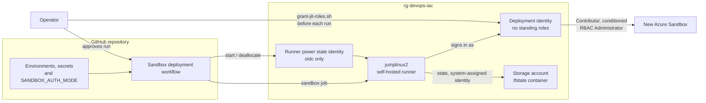
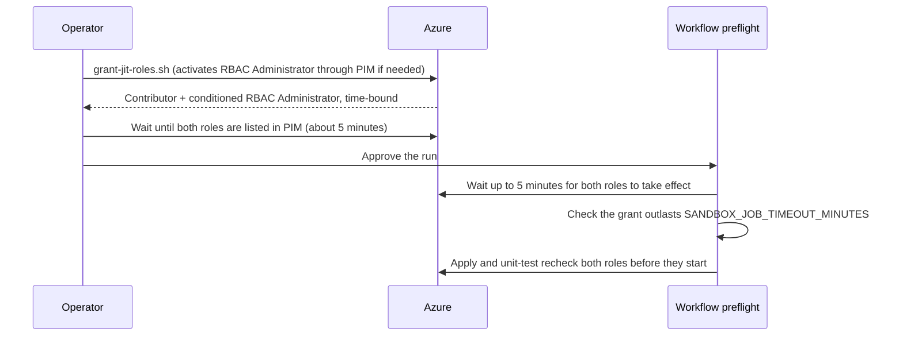
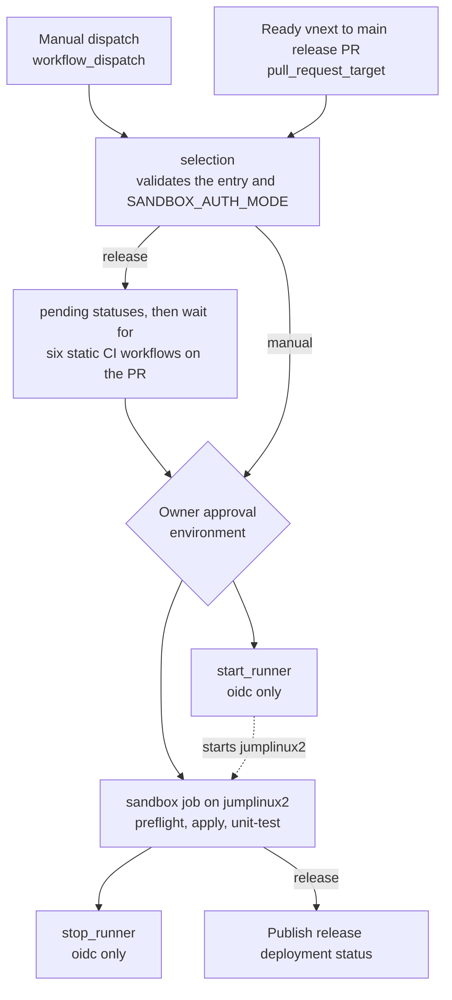

# GitHub Runner Module (github-runner)

## Contents

* [Overview](#overview)
* [Smoke Testing](#smoke-testing)
* [Documentation](#documentation)

## Overview

This optional module adds the GitHub Actions functionality to `rg-devops-iac`, so `jumplinux2` can run the [Sandbox deployment workflow](../../../../../.github/workflows/sandbox-deployment.yml) for the [Azure Sandbox](https://github.com/Azure-Samples/azuresandbox) repository. The root module creates it when `enable_github_runner` is true or `deployment_identity` is not `none`. Without it, `rg-devops-iac` is a basic Terraform execution environment.

The module creates, depending on its inputs:

* The [GitHub Actions runner](https://github.com/actions/runner) agent on `jumplinux2`, installed and registered by a managed Run Command, when `enable_github_runner` is true. See [Runner Installation](#runner-installation).
* A deployment identity for Azure Sandbox applies, with no standing Azure RBAC roles, when `deployment_identity` is `managed_identity` or `oidc`. With `managed_identity`, the root module attaches it to `jumplinux2`. See [Deployment Identity](#deployment-identity).
* GitHub Actions federated identity credentials for the deployment identity, and a separate runner power state identity, when `deployment_identity` is `oidc`. See [Runner Power State Identity](#runner-power-state-identity).

It also holds the scripts the operator and the workflow use: registration tokens, just-in-time role grants, Microsoft Graph permissions, and the workflow stages.

## Smoke Testing

* Navigate to the target repository on GitHub > *Settings* > *Actions* > *Runners* and verify that a runner named *jumplinux2* is listed with an *Idle* status and the expected labels.
* With `deployment_identity` set, `terraform output -json deployment_identity` shows the identity's `client_id`, `principal_id` and `jit_condition`, and `github_subjects` when it is `oidc`.
* With `deployment_identity = "oidc"`, `terraform output -json github_runner` shows `power_state_identity_client_id` and `power_state_identity_github_subject`.
* `./modules/github-runner/scripts/grant-jit-roles.sh` grants the time-bound roles, and a [Sandbox deployment workflow](#sandbox-deployment-workflow) run passes preflight.

## Documentation

This section provides additional information on various aspects of this module.

* [Dependencies](#dependencies)
* [Module Structure](#module-structure)
* [Input Variables](#input-variables)
* [Module Resources](#module-resources)
* [Output Variables](#output-variables)
* [Runner Installation](#runner-installation)
* [Elevated Permissions for Integration Tests](#elevated-permissions-for-integration-tests)
* [Terraform Version on the Runner](#terraform-version-on-the-runner)
* [GitHub Actions Workflow Design](#github-actions-workflow-design)

### Dependencies

This module depends upon resources provisioned in the following modules:

* Root module (rg-devops-iac): resource group, and the [vm-jumpbox-linux](../vm-jumpbox-linux/README.md) module's `jumplinux2` VM, the parent of the runner Run Command and the scope of the runner power state identity's role assignment.

The root module passes the VM id from the `vm-jumpbox-linux` module's `virtual_machine_extensions_complete` output, which is available only after the VM's extensions are installed, so installing the runner doesn't contend with them for the apt locks. With `deployment_identity = "managed_identity"`, the root module passes this module's `deployment_identity_id` output back to the `vm-jumpbox-linux` module, which attaches it to the VM.

The runner Run Command reads [vwan-tunnel.sh](../../../../../scripts/vwan-tunnel.sh) and [install-vwan-tunnel.sh](../../../../../scripts/install-vwan-tunnel.sh) from the root repo's `scripts/` directory. See [Elevated Permissions for Integration Tests](#elevated-permissions-for-integration-tests).

### Module Structure

This module is organized as follows:

```plaintext
├── scripts/                              # Runner, operator and workflow scripts
│   ├── configure-github-runner.sh        # Managed Run Command script: installs and registers the runner on jumplinux2
│   ├── Connect-SandboxRunner.ps1         # Workflow: signs in as the deployment identity and runs the sandbox unit tests
│   ├── grant-graph-permissions.sh        # Bash: grants Microsoft Graph permissions to a deployment identity
│   ├── grant-jit-roles.sh                # Bash: grants the deployment identity its time-bound deployment roles
│   ├── Invoke-RunnerPowerState.sh        # Workflow: starts and deallocates jumplinux2 for a workflow run
│   ├── Invoke-SandboxDeployment.ps1      # Workflow: runs the preflight, apply, unit-test and summary stages on the runner
│   ├── Invoke-SandboxDeployment.sh       # Workflow: Bash entry point for Invoke-SandboxDeployment.ps1
│   ├── new-runner-registration-token.sh  # Bash (sourced): sets TF_VAR_github_runner_token to a new runner registration token
│   ├── SandboxOidc.ps1                   # Workflow: shared GitHub Actions OIDC sign-in helpers
│   ├── SandboxProgress.ps1               # Workflow: shared apply and unit test progress parsing helpers
│   ├── SandboxRedaction.ps1              # Workflow: redacts ids and tags from everything published to the job log and summary
│   └── SandboxTerraformError.ps1         # Workflow: extracts Terraform errors from a failed preflight or apply for the job log and summary
├── compute.tf                            # Runner Run Command
├── locals.tf                             # Deployment identity role allow-list and condition, GitHub OIDC subjects
├── main.tf                               # Data sources, naming, identities, federated identity credentials and checks
├── outputs.tf                            # Output variables
├── terraform.tf                          # Terraform configuration block
└── variables.tf                          # Input variables
```

Run the operator scripts from the rg-devops-iac directory, e.g. `./modules/github-runner/scripts/grant-jit-roles.sh`. They read `terraform.tfvars` and the root module's outputs from there.

### Input Variables

This section lists the input variables used in this module. All of them except `github_runner_version` are set by the root module, which documents them in [Optional: GitHub Self-Hosted Runner Configuration](../../README.md#optional-github-self-hosted-runner-configuration).

Variable | Default | Description
--- | --- | ---
deployment_identity | | `none`, `managed_identity` or `oidc`. See [Deployment Identity](#deployment-identity).
deployment_identity_github_environments | | The GitHub Actions environments whose jobs can sign in as the deployment identity. Only used when `deployment_identity` is `oidc`.
enable_github_runner | | Set to true to install and register the runner agent on `jumplinux2`.
github_repository_id | | The numeric id of the GitHub repository. Only used when `deployment_identity` is `oidc`. When empty, it is looked up from the repository in `github_runner_url`.
github_repository_owner_id | | The numeric id of the repository's owner. Only used when `deployment_identity` is `oidc`. When empty, it is looked up from the repository in `github_runner_url`.
github_runner_labels | | Additional labels to apply to the runner. Only used when `enable_github_runner` is true.
github_runner_power_state_environment | | The GitHub Actions environment whose jobs can sign in as the runner power state identity. Only used when `deployment_identity` is `oidc`.
github_runner_token | `""` | Ephemeral. The runner registration token. Passed to the Run Command through a write-only protected parameter, so it never lands in Terraform state or the saved plan. Required only when the runner is registered (when the Run Command is created or `github_runner_token_version` changes).
github_runner_token_version | 1 | Increment to send a new `github_runner_token` to the VM and re-run runner registration, for example after a failed registration.
github_runner_url | `""` | The GitHub repository URL to register the runner with, e.g. `https://github.com/myorg/myrepo`. Required when `enable_github_runner` is true.
github_runner_version | `2.338.2` | The version of the GitHub Actions runner agent to install, without the leading `v`.
location | | The Azure region where the resources will be created.
resource_group_name | | The name of the resource group.
subscription_id | | The Azure subscription id, used to look up the role definition ids in the deployment identity's condition.
tags | | The tags from the root module.
virtual_machine_id | | The id of `jumplinux2`, from the `vm-jumpbox-linux` module's `virtual_machine_extensions_complete` output.
virtual_machine_name | | The name of `jumplinux2`. The runner is registered with this name.

### Module Resources

Address | Name | Notes
--- | --- | ---
module.github_runner[0].azapi_resource.github_runner[0] | | Managed Run Command on `jumplinux2` that installs and registers the GitHub Actions runner after the VM's extensions. The runner registration token is a write-only protected parameter. Created only when `enable_github_runner` is true. See [Runner Installation](#runner-installation).
module.github_runner[0].azurerm_federated_identity_credential.deployment_identity_github[*] | github-sandbox-deployment, github-sandbox-release-gate | Trusts GitHub Actions OIDC tokens for the deployment identity, one per environment in `deployment_identity_github_environments`. Created only when `deployment_identity` is `oidc`.
module.github_runner[0].azurerm_federated_identity_credential.runner_power_state_github[0] | github-sandbox-runner-power-state | Trusts GitHub Actions OIDC tokens for the runner power state identity from the `github_runner_power_state_environment` environment. Created only when `deployment_identity` is `oidc`.
module.github_runner[0].azurerm_role_assignment.runner_power_state[0] | | Assigns `Desktop Virtualization Power On Off Contributor` on `jumplinux2` to the runner power state identity. Created only when `deployment_identity` is `oidc`.
module.github_runner[0].azurerm_user_assigned_identity.deployment[0] | id-devops-dev-deployment | Deployment identity for Azure Sandbox applies. Attached to `jumplinux2` when `deployment_identity` is `managed_identity`; unattached and federated with GitHub Actions when it is `oidc`. Not created when `deployment_identity` is `none`.
module.github_runner[0].azurerm_user_assigned_identity.runner_power_state[0] | id-devops-dev-runner | Runner power state identity that starts and deallocates `jumplinux2` for workflow runs. Unattached and federated with GitHub Actions. Created only when `deployment_identity` is `oidc`.

### Output Variables

The root module returns `deployment_identity` and `github_runner` unchanged, and merges `resource_ids` and `resource_names` into its own.

Name | Description
--- | ---
deployment_identity | The deployment identity, or `null` when `deployment_identity` is `none`. An object with `client_id`, `github_subjects`, `jit_condition` and `principal_id`. See [Optional: GitHub Self-Hosted Runner Configuration](../../README.md#optional-github-self-hosted-runner-configuration).
deployment_identity_id | The deployment identity's resource id, or `null` when `deployment_identity` is `none`. The root module attaches it to `jumplinux2` when `deployment_identity` is `managed_identity`.
github_runner | The runner, or `null` when `enable_github_runner` is false. An object with `name`, `power_state_identity_client_id` and `power_state_identity_github_subject`.
resource_ids | A map with `deployment_identity` when `deployment_identity` isn't `none`, and `runner_power_state_identity` when it is `oidc`.
resource_names | A map with `deployment_identity` when `deployment_identity` isn't `none`, and `runner_power_state_identity` when it is `oidc`.

### Runner Installation

The module can optionally install the [GitHub Actions runner](https://github.com/actions/runner) agent to allow `jumplinux2` to be used as a self-hosted runner for GitHub Actions associated with the [Azure Sandbox](https://github.com/Azure-Samples/azuresandbox) repository. See [Self-Hosted Runner Registration](#self-hosted-runner-registration) for how to enable it.

* **Installation**
  * A managed Run Command (`ConfigureGitHubRunner`) runs [configure-github-runner.sh](./scripts/configure-github-runner.sh).
  * It runs after cloud-init and the VM extensions finish.
* **Token**
  * `github_runner_token` is an [ephemeral](https://developer.hashicorp.com/terraform/language/values/variables#exclude-values-from-state) input.
  * It is passed as a protected parameter through the write-only `sensitive_body` argument.
  * It is never stored in Terraform state, the saved plan, VM custom data or Key Vault.
  * It is sent only when the Run Command is created or `github_runner_token_version` changes.
  * The token is a runner registration token for the repository in `github_runner_url`.
* **Errors**
  * Registration errors fail `terraform apply` (`treatFailureAsDeploymentFailure`).
  * Script output is in the Run Command instance view.
* **Runner service**
  * Installed to `/opt/actions-runner`.
  * Named using the VM name (*jumplinux2*).
  * Registered with the configured URL and labels.
  * Runs as a systemd service (`actions.runner.*`) that starts on boot.
  * Runs as the non-root service account `githubrunner`.
  * Agent automatically updates itself.
* **Azure access**
  * `terraform`, `az` and `pwsh` (with Az modules) are on the runner `PATH`.
  * `ARM_USE_MSI` and `ARM_TENANT_ID` are set in `/opt/actions-runner/.env`.
  * Workflows authenticate with the VM managed identity. No Azure secrets are stored on the VM.
* **Terraform state**
  * No local state directory is provisioned. Workflows should use the remote state backend.

### Elevated Permissions for Integration Tests

The runner service account is unprivileged. The `vwan` integration tests in [Test-Integration-VwanConnectivity.ps1](../../../../../scripts/Test-Integration-VwanConnectivity.ps1) establish a point-to-site VPN tunnel, which requires root to create the `tun` device and update the routing table.

The configuration script runs the root repo's [install-vwan-tunnel.sh](../../../../../scripts/install-vwan-tunnel.sh), the same installer developers use on their workstations. Terraform reads the installer and [vwan-tunnel.sh](../../../../../scripts/vwan-tunnel.sh) from the root repo's `scripts/` directory and passes them to the Run Command, so this configuration keeps no copy of either. The installer:

* Installs the wrapper as `/usr/local/libexec/azuresandbox/vwan-tunnel`, owned by `root` with `0755` permissions, in a directory only `root` can write to.
* Writes the sudoers drop-in `/etc/sudoers.d/azuresandbox-vwan`, granting the runner service account passwordless `sudo` for that installed wrapper only. The drop-in is written with `0440` permissions and validated with `visudo -cf` before it takes effect. If validation fails, it's removed and the Run Command fails rather than leaving `sudo` broken.

The wrapper is the only thing the tests run as root. It accepts only an allowlisted OpenVPN configuration, rejects options that run scripts or plugins or point at arbitrary files, and can start, check, read the log of, and stop only its own tunnel.

The installed wrapper is a copy taken at deployment time. The configuration script skips setup on a VM where the runner is already configured, so redeploy the VM to pick up changes to `vwan-tunnel.sh`. If the tests in a workflow run need a newer wrapper than the one installed, they fail and say so.

### Terraform Version on the Runner

Cloud-init installs the latest Terraform from the HashiCorp apt repository, which may not satisfy the `required_version` of the branch a workflow run deploys. Preflight in the [Sandbox deployment workflow](../../../../../.github/workflows/sandbox-deployment.yml) checks compatibility and, only when the runner's Terraform doesn't satisfy the constraint, installs the version static CI uses.

To allow this without broader root access, the configuration script always installs a root-owned wrapper, `/usr/local/sbin/azuresandbox-install-terraform` (`0755`), and a separate sudoers drop-in, `/etc/sudoers.d/azuresandbox-github-runner-terraform`, granting the runner service account passwordless `sudo` for that wrapper only. The drop-in is written with `0440` permissions and validated with `visudo -cf`, with the same fail-closed handling as the `azuresandbox-vwan` drop-in. The wrapper:

* Accepts exactly one argument in `X.Y.Z` form and rejects anything else.
* Refreshes only the HashiCorp apt source, then installs the matching `terraform` package version, downgrading if needed.
* Waits up to 10 minutes for the apt lock, since the VM may have just booted and automatic updates may be running.

**IMPORTANT:** This is a privilege grant, limited to installing a HashiCorp-signed `terraform` package version from the configured repository. It changes the system-wide Terraform, so attended sessions on *jumplinux2* use whichever version the last workflow run installed.

### GitHub Actions Workflow Design

This section describes the [Sandbox deployment workflow](../../../../../.github/workflows/sandbox-deployment.yml) and the rg-devops-iac and Azure Sandbox configuration it needs. The workflow deploys a new sandbox from `jumplinux2`, registered as a self-hosted runner, and runs its unit and integration tests.

* [Workflow Overview](#workflow-overview)
* [Authentication Modes](#authentication-modes)
* [Deployment Identity](#deployment-identity)
* [Deployment Identity Permissions](#deployment-identity-permissions)
* [Workflow Prerequisites](#workflow-prerequisites)
* [Workflow Configuration](#workflow-configuration)
* [Workflow Setup](#workflow-setup)
* [Self-Hosted Runner Registration](#self-hosted-runner-registration)
* [Just-in-Time Deployment Roles](#just-in-time-deployment-roles)
* [Runner Power State Identity](#runner-power-state-identity)
* [Sandbox Deployment Workflow](#sandbox-deployment-workflow)
* [Runner Records](#runner-records)
* [Terraform State](#terraform-state)
* [Operator Access](#operator-access)
* [Security Considerations](#security-considerations)
* [Removing the Runner](#removing-the-runner)

#### Workflow Overview



Component | Provided by | Purpose
--- | --- | ---
`jumplinux2` runner | rg-devops-iac (`enable_github_runner = true`) | Runs the `sandbox` job with the pre-installed IaC toolchain, inside the private network.
Deployment identity | rg-devops-iac (`deployment_identity`) | The identity the Azure Sandbox providers authenticate as. No standing Azure RBAC roles, only time-bound deployment roles granted per run.
Runner power state identity | rg-devops-iac, `oidc` only | Starts and deallocates `jumplinux2` around a run, from GitHub-hosted jobs.
Storage account | rg-devops-iac | Holds each sandbox's Terraform state, reached with `jumplinux2`'s system-assigned identity.
Environments, secrets and variables | GitHub repository settings | Supply the sandbox's `backend.tf` and `terraform.tfvars`, require owner approval, and select the authentication mode.

#### Authentication Modes

The Azure Sandbox `auth_mode` variable selects how Terraform authenticates the `azurerm`, `azapi` and `azuread` providers. Every provider uses the same settings, derived in the `provider_auth` local in the Azure Sandbox [`locals.tf`](../../../../../locals.tf). This configuration itself always authenticates as the [operator](#operator-access) signed in to Azure CLI.

`auth_mode` | Identity (`client_id`) | Credential | Where it works
--- | --- | --- | ---
`client_secret` (default) | Service principal `appId` | `TF_VAR_client_secret` environment variable | Any client. See [Service Principal](../../../../../README.md#service-principal) in the Azure Sandbox README.
`managed_identity` | User-assigned managed identity attached to `jumplinux2` | `jumplinux2`'s managed identity endpoint. No secret. | A terminal on `jumplinux2`, or the workflow on its runner.
`oidc` | Unattached user-assigned managed identity with GitHub Actions federated identity credentials | GitHub Actions OIDC token for the job. No secret. | Only the workflow, in a job with `id-token: write`.

Variable | Description
--- | ---
`auth_mode` | `client_secret`, `managed_identity` or `oidc`. Defaults to `client_secret`.
`client_id` | The client id of the identity Terraform authenticates as.
`client_secret` | Required only for `client_secret`. Set it with `TF_VAR_client_secret`; never store it in a file.
`entra_tenant_id` | The Microsoft Entra tenant id.

Provider authentication and [state backend authentication](#terraform-state) are independent.

#### Deployment Identity

Set `deployment_identity` in this configuration's `terraform.tfvars` to create the identity for `managed_identity` or `oidc`. It is **disabled by default** (`none`).

Aspect | `managed_identity` | `oidc`
--- | --- | ---
Identity | User-assigned identity attached to `jumplinux2`, in addition to its system-assigned identity | User-assigned identity, not attached to any virtual machine
How the `sandbox` job signs in | `jumplinux2`'s managed identity endpoint, by client id | A GitHub Actions OIDC token, through a federated identity credential per environment
Who can use it while a grant is active | Anything on `jumplinux2`: any job on the runner and any signed-in user | Only jobs in `deployment_identity_github_environments`
Terminal applies on `jumplinux2` | Supported | Not supported
Runner VM power state | `jumplinux2` must be running before the run | Started after approval and deallocated afterwards by the [runner power state identity](#runner-power-state-identity)
Extra GitHub setup | None | OIDC subject claim template, `sandbox-runner-power-state` environment and its secrets
Standing roles | None | None
Per-run roles | [Time-bound deployment roles](#just-in-time-deployment-roles) | [Time-bound deployment roles](#just-in-time-deployment-roles)

Things to know:

* `deployment_identity` takes one value. Switching between `managed_identity` and `oidc` keeps the same identity, client id and roles, and attaches or detaches it from `jumplinux2` in place. The VM is not replaced.
* With `managed_identity`, the system-assigned identity stays the VM's default, so cloud-init, `az login --identity` and the state backend keep using it. Use the deployment identity explicitly, e.g. `az login --identity --client-id <client-id>` or `Connect-AzAccount -Identity -AccountId <client-id>`.
* With `oidc`, each federated credential has issuer `https://token.actions.githubusercontent.com`, audience `api://AzureADTokenExchange` and a subject such as `repository_owner_id:987654321:repository_id:123456789:environment:sandbox-deployment`. `github_subjects` in the `deployment_identity` output lists them.
* With `oidc`, the unit-test stage signs in once. A GitHub Actions OIDC token expires after 5 minutes, after which the session can't get a token for a new audience. So `Connect-SandboxRunner.ps1` gets the Azure Resource Manager and Key Vault tokens the tests use right after sign-in. If a later token request still fails because the OIDC token has expired, the test signs in again once with a new OIDC token and retries.
* The `oidc` subjects use numeric repository and owner ids, which don't change on a rename. Terraform looks them up anonymously from the GitHub API on each plan, which works only for public repositories. For a private repository, set `github_repository_id` (`gh api repos/OWNER/NAME --jq .id`) and `github_repository_owner_id` (`gh api repos/OWNER/NAME --jq .owner.id`).
* Managed identities have no app registration, so grant Microsoft Graph permissions with `grant-graph-permissions.sh`, not the Entra admin center **API permissions** page. The grant is removed when the identity is deleted.

#### Deployment Identity Permissions

The identity Terraform authenticates as needs the same permissions in every authentication mode. None of them is `Owner`.

Permission | Scope | `client_secret` | `managed_identity` / `oidc` | Why
--- | --- | --- | --- | ---
`Contributor` | Subscription | Standing | [Time-bound](#just-in-time-deployment-roles) | Creates and manages the sandbox resources.
`Role Based Access Control Administrator`, with a condition | Subscription | Standing | [Time-bound](#just-in-time-deployment-roles) | Creates and removes the sandbox's role assignments. The condition allows only the sandbox's roles, so the identity can't grant `Owner`, `User Access Administrator` or `Role Based Access Control Administrator`.
`Group.Create`, `GroupMember.Read.All`, `User.Read.All`, `Application.Read.All` (Microsoft Graph application permissions) | Tenant | Standing | Standing | Creates the SQL administrators group. Required only with the `mssql` module. Graph permissions can't be time-bound.

The allowed roles are listed in two places that must match: `ROLES` in the Azure Sandbox README's [Service Principal](../../../../../README.md#service-principal) commands, and `deployment_identity_assignable_roles` in [`locals.tf`](./locals.tf). When a module assigns a new role, add it to both, then:

Mode | Re-grant
--- | ---
`client_secret` | Delete the existing assignment (`az role assignment delete --assignee "$SPN_APP_ID" --role "Role Based Access Control Administrator" --scope "$SCOPE"`), then re-run the [Service Principal](../../../../../README.md#service-principal) commands.
`managed_identity` / `oidc` | Re-apply this configuration. The next grant uses the updated `jit_condition` from the `deployment_identity` output.

#### Workflow Prerequisites

Arrange these **before** provisioning. Some need privileged roles the operator may not hold.

Requirement | Needed for | Modes | When
--- | --- | --- | ---
GitHub repository administrator | Runner registration token; environments, secrets and variables | Both | Before the rg-devops-iac apply
GitHub repository administrator | OIDC subject claim template, unless the repository already uses it | `oidc` | Once, after the federated credentials exist
Microsoft Entra Privileged Role Administrator | Microsoft Graph permissions. The least privileged role that can grant them; Global Administrator also works. `Owner`, Cloud Application Administrator and Global Reader can't. | Both, `mssql` only | Once, after the identity is created
Microsoft Entra ID P2 or Microsoft Entra ID Governance | Time-bound role assignments | Both | Before the first run
Subscription `Owner`, ideally PIM eligible | Applying this configuration | Both | Each apply
Subscription `Role Based Access Control Administrator`, ideally PIM eligible | Granting the time-bound roles | Both | Each run

#### Workflow Configuration

rg-devops-iac `terraform.tfvars` (see [Optional: GitHub Self-Hosted Runner Configuration](../../README.md#optional-github-self-hosted-runner-configuration)):

Variable | `managed_identity` | `oidc`
--- | --- | ---
`enable_github_runner` | `true` | `true`
`deployment_identity` | `"managed_identity"` | `"oidc"`
`deployment_identity_github_environments` | Not used | Default
`github_runner_power_state_environment` | Not used | Default
`github_repository_id`, `github_repository_owner_id` | Not used | Set for a private repository
`github_runner_url`, `github_runner_labels` | Default | Default

GitHub repository settings (protection rules are in [CONTRIBUTING.md](../../../../../CONTRIBUTING.md#deployment-environments-and-identities)):

Setting | Type | Value | Modes
--- | --- | --- | ---
`SANDBOX_AUTH_MODE` | Repository variable | `managed_identity` or `oidc`. Must match `auth_mode` in `SANDBOX_TFVARS_HCL`. Runs fail without it. | Both
`SANDBOX_JOB_TIMEOUT_MINUTES` | Repository variable, optional | Timeout of the `sandbox` job, which runs preflight, apply and unit tests. Preflight also requires the just-in-time grant to have at least this many minutes left. Default `360`, range `60`-`1440`. | Both
`SANDBOX_RETAINED_DEPLOYMENTS` | Repository or environment variable, optional | Previous runs whose private records stay on the runner, besides the current run. Default `3`, range `1`-`10`. Preflight purges older runs' records and state blobs; see [Runner Records](#runner-records). | Both
`SANDBOX_BACKEND_HCL` | Secret in `sandbox-deployment` and `sandbox-release-gate` | Azure Sandbox `backend.tf`, as below | Both
`SANDBOX_TFVARS_HCL` | Secret in `sandbox-deployment` and `sandbox-release-gate` | Azure Sandbox `terraform.tfvars`, as below | Both
`RUNNER_POWER_STATE_CLIENT_ID`, `AZURE_TENANT_ID`, `RUNNER_VM_ID` | Secrets in `sandbox-runner-power-state` | See [Runner Power State Identity](#runner-power-state-identity) | `oidc`
OIDC subject claim template | Repository setting | `use_default: false`, `include_claim_keys` `repository_owner_id`, `repository_id`, `context` | `oidc`

`SANDBOX_BACKEND_HCL` uses this configuration's storage account and `jumplinux2`'s system-assigned identity. Preflight requires each value as a literal, and rejects `key` and any credential, because each run sets its own state key:

```hcl
terraform {
  backend "azurerm" {
    use_azuread_auth     = true
    use_msi              = true
    tenant_id            = "YOUR-ENTRA-TENANT-ID-HERE"
    subscription_id      = "YOUR-AZURE-SUBSCRIPTION-ID-HERE"
    storage_account_name = "YOUR-STORAGE-ACCOUNT-NAME-HERE"
    container_name       = "tfstate"
  }
}
```

`SANDBOX_TFVARS_HCL` is a normal Azure Sandbox `terraform.tfvars` with:

Setting | Value
--- | ---
`auth_mode` | `"managed_identity"` or `"oidc"`, matching `SANDBOX_AUTH_MODE`
`client_id` | `client_id` from the `deployment_identity` output
`entra_tenant_id`, `subscription_id` | The same values as in `SANDBOX_BACKEND_HCL`
`enable_module_*` (base) | Release runs: all six `true`. Manual runs: any, with `enable_module_vnet_app = true`.
`enable_module_*` (extras) | All disabled

#### Workflow Setup

Step | Task | Who | Modes | Details
--- | --- | --- | --- | ---
1 | Create a runner registration token | Operator, as a repository administrator | Both | [Self-Hosted Runner Registration](#self-hosted-runner-registration)
2 | Apply this configuration with the [workflow configuration](#workflow-configuration) | Operator, with `Owner` | Both | [Getting Started](../../README.md#getting-started)
3 | Grant Microsoft Graph permissions | Privileged Role Administrator | Both, `mssql` only | `./modules/github-runner/scripts/grant-graph-permissions.sh`, below
4 | Check or set the OIDC subject claim template | Repository administrator | `oidc` | Below
5 | Add the power state secrets to `sandbox-runner-power-state` | Repository administrator | `oidc` | [Runner Power State Identity](#runner-power-state-identity)
6 | Set `SANDBOX_BACKEND_HCL`, `SANDBOX_TFVARS_HCL` and `SANDBOX_AUTH_MODE` | Repository administrator | Both | [Workflow Configuration](#workflow-configuration)
7 | Before each run, grant the time-bound roles | Operator, with `Role Based Access Control Administrator` | Both | [Just-in-Time Deployment Roles](#just-in-time-deployment-roles)
8 | Start a manual run or mark a release PR ready, then approve | Owner | Both | [Sandbox Deployment Workflow](#sandbox-deployment-workflow)

Grant the Microsoft Graph permissions from the rg-devops-iac directory, signed in to Azure CLI as a Privileged Role Administrator. If you activated the role just before, sign in again with `az login` so your token includes it:

```bash
./modules/github-runner/scripts/grant-graph-permissions.sh
```

The script reads `principal_id` from the `deployment_identity` output (requires `jq`), or takes a client id or object id as its first argument. It skips permissions already granted, so it's safe to re-run, and warns if the identity still has `Group.ReadWrite.All` from an earlier setup.

Check the OIDC subject claim template:

```bash
gh api repos/OWNER/NAME/actions/oidc/customization/sub
```

If it shows `"use_default":false` with the three keys, don't change it. If it shows `"use_default":true`, set it once, **after** the federated credentials exist, because it changes the subject of every OIDC token the repository issues. If the repository uses a different template, follow your organization's policy instead.

```bash
gh api --method PUT repos/OWNER/NAME/actions/oidc/customization/sub --input - <<'EOF'
{"use_default":false,"include_claim_keys":["repository_owner_id","repository_id","context"]}
EOF
```

If a sign-in fails with `AADSTS70021`, compare the subject in the error with `github_subjects` in the `deployment_identity` output.

#### Self-Hosted Runner Registration

`enable_github_runner = true` installs the runner agent on `jumplinux2` and registers it with `github_runner_url` (default: the Azure Sandbox repository) and `github_runner_labels` (default `["azuresandbox"]`, the label the workflow targets). See [Runner Installation](#runner-installation). It's **disabled by default**.

Right before [Step 4](../../README.md#step-4-validate-and-apply-configuration), in the shell that runs Terraform, create a registration token. The script must be sourced. It uses the [GitHub CLI](https://cli.github.com) signed in as a repository administrator, reads `github_runner_url` from `terraform.tfvars`, and sets `TF_VAR_github_runner_token` without displaying it:

```bash
source ./modules/github-runner/scripts/new-runner-registration-token.sh
```

The token expires after one hour and can only register runners. Run `terraform plan` and `terraform apply` in the same shell within the hour. It's an ephemeral variable passed to a Run Command through a write-only argument, so it's never stored in state, the saved plan, custom data or Key Vault.

Because Terraform can't detect changes to an ephemeral value, the token is sent only when the Run Command is created or `github_runner_token_version` changes:

Situation | What to do
--- | ---
Later applies | Leave `github_runner_token_version` unchanged and don't set the token. Ignore the `github_runner_token is empty` plan warning. Changes to the runner's name or labels aren't applied to a registered runner; [remove the runner](#removing-the-runner) and register it again.
Plan creates or replaces `module.github_runner[0].azapi_resource.github_runner[0]` (e.g. `jumplinux2` is replaced) | Source the token script before `terraform plan`.
Registration failed (e.g. the token expired) | Source the token script, increment `github_runner_token_version` and apply. The VM isn't replaced.

The runner service account has command-scoped passwordless `sudo` for the `vwan` point-to-site VPN integration tests ([Elevated Permissions for Integration Tests](#elevated-permissions-for-integration-tests)) and for a wrapper that installs a specific Terraform version ([Terraform Version on the Runner](#terraform-version-on-the-runner)).

#### Just-in-Time Deployment Roles

Before each `managed_identity` or `oidc` apply, from the workflow or a terminal on `jumplinux2`, the operator grants the deployment identity its deployment roles for a limited time:

```bash
./modules/github-runner/scripts/grant-jit-roles.sh             # grant both roles for 8 hours
./modules/github-runner/scripts/grant-jit-roles.sh --hours 10  # grant a different window (1-24 hours)
./modules/github-runner/scripts/grant-jit-roles.sh --force     # replace assignments that are already active
./modules/github-runner/scripts/grant-jit-roles.sh --revoke    # remove both assignments after the run
```



The script:

1. Reads the identity, subscription and `jit_condition` from this configuration's outputs. Run it as the operator, from any directory, with Azure CLI signed in.
1. Activates your eligible subscription `Role Based Access Control Administrator` through PIM for 1 hour, unless it's already active. If PIM requires approval or multifactor authentication that Azure CLI can't satisfy, activate the role in the portal and run it again.
1. Assigns `Contributor`, and `Role Based Access Control Administrator` constrained by `jit_condition`, as time-bound active assignments. Existing active assignments are kept unless you pass `--force`.
1. Lists the end times, warns if less than the job timeout remains (`SANDBOX_JOB_TIMEOUT_MINUTES`, default `360`; export it if the repository variable overrides the default), and checks that the applied condition matches `jit_condition`.

Things to know:

* Assignments can take about 5 minutes to appear in PIM's active list after they show in *Access control (IAM)*. Preflight reads end times from that list and fails with "Could not find an active assignment" if they aren't listed. Check with:

  ```bash
  az rest --method get \
    --url "https://management.azure.com/subscriptions/$(az account show --query id -o tsv)/providers/Microsoft.Authorization/roleAssignmentScheduleInstances?api-version=2020-10-01&\$filter=principalId+eq+'$(terraform output -json deployment_identity | jq -r .principal_id)'" \
    --query "value[].properties.{role: expandedProperties.roleDefinition.displayName, end: endDateTime}" -o table
  ```

* Preflight accepts a permanent assignment with a warning.
* The 8-hour grant leaves about 2 hours after granting to approve the run before less than the 360-minute job timeout remains. The timeout covers preflight, a full apply and unit testing, and the rest of the grant leaves time for a manual teardown. With `oidc`, the approval window also covers `jumplinux2` booting. The script refuses a `--hours` value shorter than the job timeout.
* To grant in the portal instead, activate `Role Based Access Control Administrator`, then use the subscription's *Access control (IAM)* > *Add role assignment* with *Assignment type* *Active* and *Time bound*. For `Role Based Access Control Administrator`, paste `terraform output -json deployment_identity | jq -r .jit_condition` into the condition editor's code view.
* After the run, revoke the assignments with `--revoke` or let them expire.

#### Runner Power State Identity

With `deployment_identity = "oidc"`, this configuration also creates a separate identity that starts `jumplinux2` before an approved run and deallocates it afterwards, from GitHub-hosted jobs. It can't deploy anything.

Property | Value
--- | ---
Attachment | None
Role | `Desktop Virtualization Power On Off Contributor` on `jumplinux2` only. It allows reading the VM and changing its power state, but not running commands, changing extensions or deleting it. `Virtual Machine Contributor` would allow all of those.
Federated credential | One, for `github_runner_power_state_environment` (default `sandbox-runner-power-state`). Its subject is `power_state_identity_github_subject` in the `github_runner` output.
Environment | Must not be in `deployment_identity_github_environments`, so neither identity accepts the other's tokens. Restrict it to `main`, with no required reviewers. The workflow uses this name, so keep the default unless you change the workflow too.

Add these environment secrets. They're secrets so they're masked in public run logs:

Secret | Value
--- | ---
`RUNNER_POWER_STATE_CLIENT_ID` | `terraform output -json github_runner \| jq -r .power_state_identity_client_id`
`AZURE_TENANT_ID` | The Microsoft Entra tenant id
`RUNNER_VM_ID` | `terraform output -json resource_ids \| jq -r .virtual_machine_jumplinux2`

Job | Runs when | Behavior
--- | --- | ---
`start_runner` | `SANDBOX_AUTH_MODE` is `oidc`, alongside the `sandbox` job | Waits up to 60 minutes for the deployment's approval; ends without starting anything if it's rejected, and cancels the run on timeout. Then starts `jumplinux2` if it's stopped or deallocated, and waits up to 20 minutes for the runner to pick up the `sandbox` job, cancelling the run if it doesn't.
`stop_runner` | After the `sandbox` job, however it ended | Deallocates `jumplinux2` only if `start_runner` started it. A VM that was already running stays running.

Both jobs run [Invoke-RunnerPowerState.sh](./scripts/Invoke-RunnerPowerState.sh) from the trusted workflow commit, never from the deployed branch. With `managed_identity`, the identity isn't created and both jobs are skipped; keep `jumplinux2` running. The environment and its secrets can stay in place for a later switch to `oidc`.

#### Sandbox Deployment Workflow



Entry path | Manual dispatch | Release PR
--- | --- | ---
Trigger | `workflow_dispatch` | `pull_request_target` for a ready, same-repository `vnext` → `main` PR
Environment | `sandbox-deployment` | `sandbox-release-gate`
Source | Tip of `source_branch`: `main` (default) or `vnext` | Exact PR head SHA
Stages | `run_through`: `preflight`, `apply` (default) or `unit-test` | All three
Sandboxes | `sandbox_count`: 1 (default) to 20, deployed in parallel; above 1, `preflight` or `apply` only. See [Deploying Several Sandboxes](#deploying-several-sandboxes) | 1
Base modules | Any, with `vnet_app` enabled | All six
Static CI | Not run | The six static CI workflows run on the PR as `pull_request` CI and must pass on the exact head SHA before approval is requested
PR statuses | Not published | `release-static-ci` and `sandbox-deployment-gate`; see [Releasing to `main`](../../../../../CONTRIBUTING.md#releasing-to-main)

Stage | What it does
--- | ---
`preflight` | Confirms the trusted `main` workflow context and `jumplinux2`. Checks the backend and tfvars secrets, that `auth_mode` matches `SANDBOX_AUTH_MODE`, the module scope, and that the run's state key is unused. Installs a Terraform version that satisfies the deployed `required_version` if the runner's doesn't. Purges runs older than `SANDBOX_RETAINED_DEPLOYMENTS` from the runner and the state backend. Signs in as the deployment identity and waits for the time-bound roles.
`apply` | Rechecks the roles, then applies the saved plan from preflight.
`unit-test` | Rechecks the roles, starts every sandbox VM, runs the unit and integration tests, and publishes the full JSON results, redacted the same way as the job log, as a workflow artifact, pass or fail. A failed upload doesn't fail the job; the results stay on the runner.

Things to know:

* **New sandboxes only.** Each run uses its own state key, `sandboxes/<deployment id>/terraform.tfstate`. The workflow never updates, recovers or destroys a sandbox. Tear down manually.
* **One run at a time.** Runs share a concurrency group, and an active apply isn't cancelled.
* **Private logs.** Raw logs and plans stay on the runner. The job summary shows the stage results, the deployed commit and the sandbox resource group name after a successful apply. When `preflight` or `apply` fails with a Terraform error, each `Error:` block is also shown in full, in red in the job log, as an error annotation and in a caution alert in the job summary. Everything the runner publishes (status messages, progress, errors, annotations, the job summary and the unit-test evidence artifact) is redacted the same way: Microsoft Entra ID ids (tenant, client and object ids) and subscription ids are redacted, along with any other GUID. All tag values are redacted, and so are tag names other than the `project`, `costcenter` and `environment` names in the root `tags` design. Resource names and other details are kept for troubleshooting.
* **Runner records.** Older runs are purged at preflight; see [Runner Records](#runner-records).
* **Retry.** **Re-run failed jobs** isn't supported for release PRs. Start a new manual run, or mark the release PR as a draft and ready again.

##### Deploying Several Sandboxes

For a class or hackathon, set `sandbox_count` on a manual run to deploy up to 20 identical sandboxes in parallel, with one approval. Each sandbox is independent, with its own deployment id `sandbox-<run id>-<n>`, state key `sandboxes/sandbox-<run id>-<n>/terraform.tfstate`, resource group and private records on the runner. All of them use the same `SANDBOX_TFVARS_HCL`. With a count of 1 the run works as described above, with deployment id `sandbox-<run id>`.

How it works:

* **Preflight or apply only.** The tests use host-wide network state on the runner, such as the Virtual WAN point-to-site test's VPN tunnel and routes, so `unit-test` needs a count of 1. Release PRs always deploy one sandbox.
* **Parallel processes in one job.** The `preflight` step checks the Terraform version and downloads the providers once, into a cache shared by the run. It then runs each sandbox's preflight in its own process, from its own copy of the source (a git worktree), starting one every 10 seconds. The `apply` step then applies every sandbox. The `Report stage results` step removes the source copies and the provider cache. A single-sandbox run uses the same kind of provider cache.
* **Failures.** If any sandbox fails preflight, no sandbox is applied. During apply, a failed sandbox doesn't stop the others, but the job fails. Each failed sandbox gets an error annotation.
* **Reporting.** The job log shows each sandbox's status lines prefixed with its deployment id, and a run-wide heartbeat every 2 minutes. The job summary has a table of every sandbox's resource group and stage results, with a details section per sandbox, including any Terraform errors.
* **Shared limits.** All sandboxes share the job's timeout (`SANDBOX_JOB_TIMEOUT_MINUTES`, default 360 minutes), the just-in-time grant and the deployment identity's [Azure Resource Manager request limits](https://learn.microsoft.com/azure/azure-resource-manager/management/request-limits-and-throttling). Throttled requests are retried, so a larger run takes longer than a single sandbox.

Plan capacity before the event. Figures are per sandbox with all base modules; fewer modules need less.

Resource | Per sandbox | Notes
--- | --- | ---
Runner memory | Up to 1.5 GB during plan and apply | The runner itself uses about 1 GB. A measured run with `vnet_app` and `mssql` used about 0.9 GB per sandbox, rising slowly during apply.
Runner CPU | About 1 vCPU during preflight | `terraform init` and `plan` keep the CPU busy for about 5 minutes. Apply mostly waits on Azure and uses under 10%. Fewer vCPUs than sandboxes only slows preflight.
Runner disk | About 40 MB kept per sandbox, plus a provider cache of about 730 MB removed at the end of the run. Records of runs older than `SANDBOX_RETAINED_DEPLOYMENTS` are purged at preflight | The default 30 GB Standard SSD is enough. Its bandwidth peaks briefly while the cache fills, which only slows preflight.
Regional vCPUs | 10: 2 each for `adds1`, `jumpwin1` and `jumplinux1`, and 4 for `mssqlwin1` | 200 for 20 sandboxes. Check *Total Regional vCPUs* and the VM family quotas under the subscription's *Usage + quotas*, and request an increase if needed.
Public IP addresses | 2 Standard | For Azure Firewall and Bastion.
Cost | Dominated by Azure Firewall, the Virtual WAN hub and point-to-site gateway, and Bastion | Billed hourly whether or not the sandbox is used. Disable modules the event doesn't need, such as `vwan`, and tear down promptly.

Size the runner with `vm_jumpbox_linux_size` before the event, apply this configuration, and size it back down afterwards:

Sandboxes | Runner size
--- | ---
Up to 2 | `Standard_D2ls_v6` (2 vCPUs, 4 GiB), the default
Up to 8 | `Standard_D4s_v6` (4 vCPUs, 16 GiB)
Up to 20 | `Standard_D8s_v6` (8 vCPUs, 32 GiB)

The sandbox VMs keep running after the run, unless an Azure Policy in the subscription shuts them down.

To tear down, delete each sandbox's resource group, listed in the job summary, and its state blob. Once the run is older than `SANDBOX_RETAINED_DEPLOYMENTS` allows, preflight has already deleted its state blobs; only the resource groups remain. Run this on `jumplinux2`, from the rg-devops-iac directory, signed in to Azure CLI with access to both:

```bash
RUN_ID=YOUR-RUN-ID-HERE
COUNT=YOUR-SANDBOX-COUNT-HERE
for rg in YOUR-RESOURCE-GROUP-NAMES-HERE; do az group delete --name "$rg" --yes --no-wait; done
for n in $(seq 1 "$COUNT"); do ./scripts/delete-tfstate.sh --yes "sandboxes/sandbox-$RUN_ID-$n/terraform.tfstate"; done
```

With `mssql` enabled, also delete each sandbox's `grp-sql-admins-*` Microsoft Entra group. The group name ends with the same suffix as the sandbox's resource group.

#### Runner Records

Each deployment's private records (logs, plan, receipts and Terraform data) stay on `jumplinux2` in `~/.local/state/azuresandbox/deployments/<deployment id>/`. Terraform data links each provider to a per-run cache of about 730 MB, which the `Report stage results` step removes, so a deployment keeps about 40 MB. A run cancelled before that step leaves its cache behind until the run is purged.

At preflight, the runner keeps the current run plus the `SANDBOX_RETAINED_DEPLOYMENTS` most recent previous runs (default `3`, range `1`-`10`), ordered by run id, and purges every older run:

* A run is purged as a whole, including every sandbox of a multi-sandbox run.
* Each purged deployment's state blob, `sandboxes/<deployment id>/terraform.tfstate`, is deleted from the backend first, breaking any leftover state lock. Only then are its records deleted, so a failure leaves them to retry on the next run. The `tfstate` container has no versioning or soft delete, so this is permanent.
* Purging doesn't touch Azure resources. A sandbox that wasn't torn down keeps running; delete its resource group as described in [Deploying Several Sandboxes](#deploying-several-sandboxes).
* Deployments recorded against another storage account or container are purged from the runner only, and reported, so their state blobs can be deleted manually with `delete-tfstate.sh`.
* Entries in the folder that aren't deployment records are left in place, and reported.
* Any error fails preflight.

Preflight reports the result in the job log and the job summary, for example:

```text
preflight: runner records: kept the current run and 3 previous runs (SANDBOX_RETAINED_DEPLOYMENTS = 3); purged 2 runs: 3 deployments, 2 state blobs deleted, 2.3 GB freed.
```

#### Terraform State

Workflows on this runner always use the `azurerm` backend in this configuration's storage account. `jumplinux2`'s system-assigned identity has `Storage Blob Data Contributor` on it, so no secrets are needed. A local state file on a disposable runner is an anti-pattern:

Concern | `azurerm` backend | Local file on the runner
--- | --- | ---
Locking | Blob lease across runs and interactive applies | Only within a single Terraform invocation
Durability | Versioning and soft delete | Lost when the VM is resized, reimaged or replaced
Secrets at rest | Encrypted, Azure RBAC, private endpoint only | Plain file readable by the runner account and any compromised job
Source of truth | Shared by interactive and workflow runs | Diverges

The `vm-jumpbox-linux` module therefore doesn't create a persistent local state directory, and `actions/checkout` cleans the workspace between jobs. Local state is used only for this configuration's own bootstrap apply, which creates the storage account, from a workstation or another Terraform execution environment.

For a terminal apply on `jumplinux2`, use the same backend with a fixed `key`:

```hcl
# backend.tf
terraform {
  backend "azurerm" {
    use_azuread_auth     = true
    use_msi              = true
    tenant_id            = "YOUR-ENTRA-TENANT-ID-HERE"
    subscription_id      = "YOUR-AZURE-SUBSCRIPTION-ID-HERE"
    storage_account_name = "YOUR-STORAGE-ACCOUNT-NAME-HERE"
    container_name       = "tfstate"
    key                  = "YOUR-STATE-FILE-NAME-HERE.tfstate"
  }
}
```

#### Operator Access

The operator is the signed-in user who provisions a configuration. It is separate from the deployment identity.

Configuration | How the operator is used
--- | ---
rg-devops-iac | Terraform authenticates as the operator signed in to Azure CLI (`use_cli = true` in [`providers.tf`](../../providers.tf)). Needs `Owner`, or `Contributor` plus an unconditioned role-assignment role such as `User Access Administrator`, during the apply. The operator is granted `Key Vault Secrets Officer`, `Storage Blob Data Contributor` and `Virtual Machine Administrator Login` on `jumplinux2`.
Azure Sandbox | `operator_object_id` is granted data-plane roles, such as Key Vault and Storage roles, on the sandbox resources. The bootstrap scripts default it to the signed-in user.

##### Least-Privilege Operator Access with Privileged Identity Management

Day-to-day use of `jumplinux2` needs only `Reader` on the VM, its network interface and the Bastion host, plus `Virtual Machine Administrator Login`. Use [Microsoft Entra Privileged Identity Management](https://learn.microsoft.com/entra/id-governance/privileged-identity-management/pim-configure) (PIM) so the operator holds `Owner` only when needed:

Access | How it's granted
--- | ---
Azure RBAC `Reader` on the subscription | Standing
Azure RBAC `Owner` on the subscription | PIM eligible, activated for `terraform plan` and `terraform apply`
Azure RBAC `Role Based Access Control Administrator` on the subscription | PIM eligible, activated for `grant-jit-roles.sh`. Narrower than `Owner`: it can manage role assignments but not resources.
Microsoft Entra Privileged Role Administrator | PIM eligible, activated for `grant-graph-permissions.sh`
Other Microsoft Entra directory roles, such as Global Administrator | PIM eligible, activated only when needed
`User Access Administrator` at root scope (`/`) | Removed

Apply it in the Azure portal in this order, so you don't lock yourself out:

1. Confirm the prerequisites: Microsoft Entra ID P2, at least two multifactor authentication methods, and an [emergency access account](https://learn.microsoft.com/entra/identity/role-based-access-control/security-emergency-access) with permanent Global Administrator.
1. Go to *PIM* > *Azure resources* > your subscription > *Settings* > *Owner*. Set the activation duration to 4-8 hours, require multifactor authentication and a justification, don't require approval, and allow permanent eligible assignments.
1. Add **eligible** `Owner` and `Role Based Access Control Administrator` assignments for the operator on the subscription, and a standing `Reader` assignment. Configure the `Role Based Access Control Administrator` role settings the same way as `Owner`.
1. Test activation and deactivation **before** removing any standing access.
1. Remove the operator's standing `Owner` assignment, including any inherited from a management group such as the Tenant Root Group.
1. Remove the standing root-scope `User Access Administrator`: activate Global Administrator, then go to *Microsoft Entra ID* > *Properties* > *Access management for Azure resources* and select *No*. This grant persists after Global Administrator is deactivated.
1. Verify with read-only checks. With `Owner` active, the permissions output includes `"actions": ["*"]`; with only standing access, the only entry is `*/read`:

   ```bash
   OID=$(az ad signed-in-user show --query id -o tsv)
   SUB=$(az account show --query id -o tsv)
   az role assignment list --assignee "$OID" --scope "/subscriptions/$SUB" --include-inherited -o table
   az rest --method get --url "https://management.azure.com/subscriptions/$SUB/providers/Microsoft.Authorization/permissions?api-version=2022-04-01"
   ```

Things to know:

* Activate Azure resource roles in the Azure portal under *PIM* > *My roles* > *Azure resources*. The Microsoft Entra admin center's PIM pages show only Microsoft Entra roles and groups.
* Azure RBAC activations don't need a new `az login`; allow about a minute to propagate. Microsoft Entra directory roles and PIM for Groups do need a new token.
* PIM may skip the multifactor authentication prompt if the portal session already has the claim. Use a Conditional Access authentication context to require it on every activation.
* The *Check access* current view hides eligible assignments. Check the *Eligible assignments* tab.
* Recovery path: activate Global Administrator, turn on *Access management for Azure resources*, grant `Owner`, then turn it back off. The emergency access account is the last resort.
* In managed tenants, provider automation may re-add standing assignments, so check again after a day.

#### Security Considerations

Risk | Applies to | Mitigation
--- | --- | ---
While a grant is active, anything on `jumplinux2` can use the deployment identity, including against this configuration's resource group | `managed_identity` | Keep grants short and revoke them after the run. Prefer `oidc`.
The federated subjects don't name a workflow file, so any workflow in an allowed environment can federate | `oidc` | Restrict the environments to `main` and require owner approval. See [CONTRIBUTING.md](../../../../../CONTRIBUTING.md#deployment-environments-and-identities).
The time-bound roles belong to the identity, not a run, so another approved run in the same window can use them | Both | The concurrency group runs one deployment at a time.
Microsoft Graph permissions are standing and usable by any approved run, or anything on `jumplinux2` with `managed_identity` | Both | Grant Graph permissions only when `mssql` is used.
The job's federated token is passed to Azure CLI on the command line, where other processes on `jumplinux2` can see it | `oidc` | Sign-in to `jumplinux2` requires Microsoft Entra ID through Bastion. Limit who has `Virtual Machine Administrator Login` or `Virtual Machine User Login`.

#### Removing the Runner

Deleting the VM doesn't deregister the runner from GitHub. Remove it from the VM first, or delete the offline runner afterwards from GitHub > *Settings* > *Actions* > *Runners*:

```bash
# Run on jumplinux2
sudo /opt/actions-runner/svc.sh stop
sudo /opt/actions-runner/svc.sh uninstall
sudo -u githubrunner /opt/actions-runner/config.sh remove --token YOUR-REMOVAL-TOKEN-HERE
```
