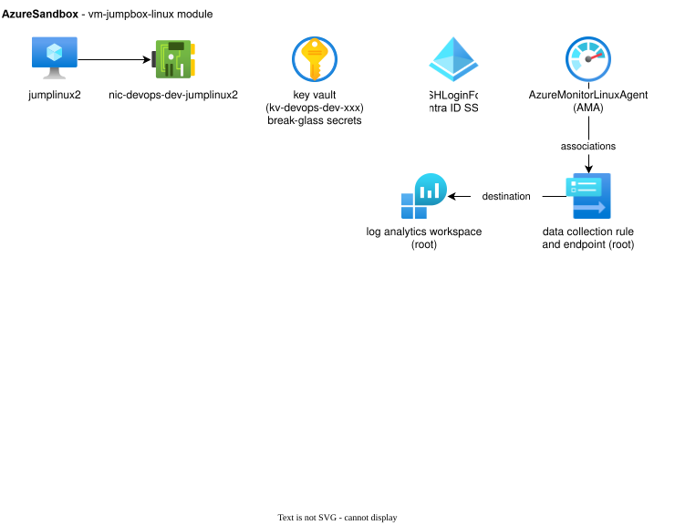

# Linux Jumpbox Virtual Machine Module (vm-jumpbox-linux)

## Contents

* [Architecture](#architecture)
* [Overview](#overview)
* [Smoke Testing](#smoke-testing)
* [Documentation](#documentation)

## Architecture



## Overview

This module implements a stand-alone Linux virtual machine for use as a general purpose Terraform execution environment. The VM is pre-configured with the following capabilities:

* Automatic swapfile provisioning sized to the VM's memory (larger VMs get no swap).
* Pre-installed software packages, including:
  * azure-cli
  * bind9-dnsutils
  * jp
  * openvpn
  * powershell (and Azure PowerShell)
  * python3-pip
  * terraform
  * yq
* Pre-configured environment variables for using Azure Blob Storage as a Terraform state backend.
* Self-managed patching. See [Patching](#patching).
* `AzureMonitorLinuxAgent` VM extension is pre-installed and pre-configured.
* `AADSSHLoginForLinux` VM extension is pre-installed and pre-configured.
* A system-assigned managed identity with role assignments to an Azure Blob Storage container to be used as a Terraform state backend.

The optional [github-runner](../github-runner/README.md) module installs the GitHub Actions self-hosted runner agent on the VM. With the `managed_identity` [deployment identity](../../README.md#optional-deployment-identity), the root module attaches that identity to the VM through `user_assigned_identity_ids`.

## Smoke Testing

Use Bastion to connect to *jumplinux2* with your Microsoft Entra ID credentials. After connecting, verify the VM is fully configured for use as a Terraform execution environment:

```bash
# Check provisioning and the Ubuntu release
cloud-init status --long

# Check software versions
lsb_release -a
az --version
terraform --version
pwsh -NoProfile -NonInteractive -Command 'Get-InstalledPSResource -Name Az, Az.* -Scope AllUsers | Sort-Object Name | Format-Table Name, Version'

# Check Terraform environment variables
echo $ARM_USE_MSI
echo $ARM_TENANT_ID
```

Confirm that cloud-init reports `done` with no errors, the OS is Ubuntu 26.04 LTS, and PowerShell and the Az modules are installed.

## Documentation

This section provides additional information on various aspects of this module.

* [Dependencies](#dependencies)
* [Module Structure](#module-structure)
* [Input Variables](#input-variables)
* [Module Resources](#module-resources)
* [Outputs](#outputs)
* [Patching](#patching)

### Dependencies

This module depends upon resources provisioned in the following modules:

* Root module (rg-devops-iac)

### Module Structure

This module is organized as follows:

```plaintext
├── images/
|   └── vm-jumpbox-linux-diagram.drawio.svg # Architecture diagram
├── scripts/
|   ├── configure-powershell.ps1            # cloud-init shell script to configure PowerShell
|   ├── configure-vm-jumpbox-linux.yaml     # cloud-init cloud-config file to configure the VM
|   └── wait-for-cloud-init.sh              # Managed Run Command completion and package-manager wait
├── compute.tf                              # Compute resource configurations
├── main.tf                                 # Resource configurations
├── network.tf                              # Network resource configurations
├── outputs.tf                              # Output values
├── terraform.tf                            # Terraform configuration block
└── variables.tf                            # Input variables
```

### Input Variables

This section lists the default values for the input variables used in this module.
Defaults can be overridden by specifying a different value in the root module.

Variable | Default | Description
--- | --- | ---
admin_username | `devopsbootstrapadmin` | The user name for the admin account on the VM.
admin_username_secret | adminuser | The name of the key vault secret that contains the user name for the break-glass admin account.
data_collection_endpoint_id | | The ID of the data collection endpoint (DCE) defined in the root module, associated with the VM.
data_collection_rule_linux_id | | The ID of the Linux data collection rule (DCR) defined in the root module, associated with the VM.
key_vault_id | | The ID of the key vault defined in the root module.
location | | The Azure region where the resources will be created. Defined in the root module.
resource_group_name | | The name of the resource group defined in the root module.
ssh_private_key_version | 1 | Increment to rewrite the break-glass `ssh_private_key` key vault secret, for example after replacing `tls_private_key.ssh_key`.
storage_account_id | | The resource ID of the storage account defined in the root module.
subnet_id | | The resource ID of the subnet where the VM will be deployed. Defined in the root module.
tags | | The tags from the root module.
user_assigned_identity_ids | `[]` | The resource ids of user-assigned managed identities to attach to the VM in addition to its system-assigned identity, which remains the default identity on the VM.
vm_jumpbox_linux_image_offer | `ubuntu-26_04-lts` | The offer type of the virtual machine image used to create the VM.
vm_jumpbox_linux_image_publisher | `Canonical` | The publisher for the virtual machine image used to create the VM.
vm_jumpbox_linux_image_sku | `server` | The SKU of the virtual machine image used to create the VM.
vm_jumpbox_linux_image_version | `Latest` | The version of the virtual machine image used to create the VM.
vm_jumpbox_linux_name | jumplinux2 | The name of the VM.
vm_jumpbox_linux_size | | The size of the virtual machine. Defined by the root module's `vm_jumpbox_linux_size` variable. Must be a v6 D-series size (`Standard_D<vCPU>[a][l][d]s_v6`), which supports Trusted Launch, the NVMe disk controller and Accelerated Networking.
vm_jumpbox_linux_storage_account_type | `StandardSSD_LRS` | The storage type to be used for the VM's OS disk. Standard HDD (`Standard_LRS`) is not permitted because Azure is retiring Standard HDD OS disks on September 8, 2028.

### Module Resources

This section lists the resources included in this configuration.

Address | Name | Notes
--- | --- | ---
module.vm_jumpbox_linux.azurerm_key_vault_secret.adminuser | adminuser | The Key Vault secret containing the break-glass admin username for the Linux virtual machine.
module.vm_jumpbox_linux.azurerm_key_vault_secret.ssh_private_key | jumplinux2&#8209;ssh&#8209;private&#8209;key | The break-glass private SSH key for the admin account, stored in Azure Key Vault.
module.vm_jumpbox_linux.azurerm_linux_virtual_machine.this | jumplinux2 | The Linux virtual machine resource. Configured with NVMe disk controller, encryption at host, secure boot and vTPM (Trusted Launch).
module.vm_jumpbox_linux.azurerm_network_interface.this | nic&#8209;devops&#8209;dev&#8209;jumplinux2 | The network interface associated with the Linux virtual machine. Configured with accelerated networking enabled.
module.vm_jumpbox_linux.azurerm_monitor_data_collection_rule_association.dce | configurationAccessEndpoint | Associates the VM with the data collection endpoint so the Azure Monitor Agent retrieves its configuration through the AMPLS private endpoint.
module.vm_jumpbox_linux.azurerm_monitor_data_collection_rule_association.dcr | dcradevopsdev&#8209;jumplinux2 | Associates the VM with the Linux data collection rule.
module.vm_jumpbox_linux.azurerm_role_assignment.operator_vm_admin_login | | Grants `Virtual Machine Administrator Login` role on jumplinux2 to the devops administrator applying the configuration, enabling Microsoft Entra ID SSH sign-in with passwordless `sudo`.
module.vm_jumpbox_linux.azurerm_role_assignment.this | | Grants `Storage Blob Data Contributor` role to the managed identity of jumplinux2. This is intended to be used for accessing a Terraform state backend hosted in Azure Blob Storage.
module.vm_jumpbox_linux.azurerm_virtual_machine_extension.aad_ssh_login | | The `AADSSHLoginForLinux` extension that enables Microsoft Entra ID SSH sign-in. Installed after `wait_for_cloud_init` to avoid apt lock contention.
module.vm_jumpbox_linux.azurerm_virtual_machine_extension.ama | AzureMonitorLinuxAgent | The Azure Monitor Agent. Installed after `aad_ssh_login` to avoid apt lock contention.
module.vm_jumpbox_linux.azurerm_virtual_machine_run_command.wait_for_cloud_init | | Waits for cloud-init termination and dpkg/apt idle checks.
module.vm_jumpbox_linux.terraform_data.log_analytics_operations_complete | | Dependency signal for the root module's AMPLS barrier.
module.vm_jumpbox_linux.tls_private_key.ssh_key | | The break-glass SSH key pair for the admin account.

### Outputs

This section includes a list of output values returned by the module.

Name | Description
--- | ---
resource_ids | A map of resource IDs for key resources in the module.
resource_names | A map of resource names for key resources in the module.
virtual_machine_extensions_complete | Dependency signal: the VM id, available only after cloud-init and the VM extensions are complete. The root module passes it to the optional [github-runner](../github-runner/README.md) module, so installing the runner doesn't contend with the extensions for the apt locks.

### Patching

`jumplinux2` doesn't follow the Azure Sandbox [Patching](../../../../../README.md#patching) model, and isn't assigned to a maintenance configuration:

* **Updates:** Ubuntu's `unattended-upgrades`, enabled by default, installs security updates daily. Updates that need a restart, such as a new kernel, take effect at the next restart.
* **Assessment:** Azure Update Manager assesses the VM every 24 hours (`patch_assessment_mode = "AutomaticByPlatform"`), so missing updates show in Update Manager.

This is intentional. rg-devops-iac is the Terraform execution environment that deploys other configurations, including Azure Sandbox and its maintenance configuration, so `jumplinux2` patches itself rather than depending on infrastructure it deploys.
