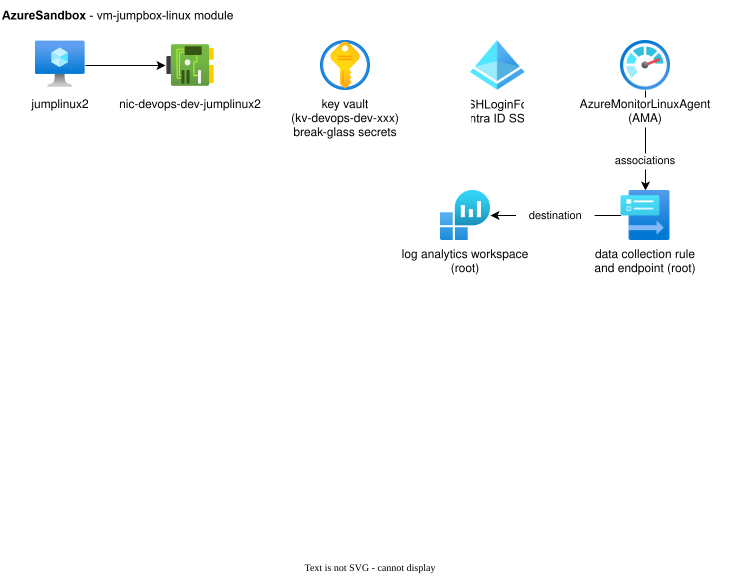

# Linux Jumpbox Virtual Machine Module (vm-jumpbox-linux)

## Contents

* [Architecture](#architecture)
* [Overview](#overview)
* [Smoke Testing](#smoke-testing)
* [Documentation](#documentation)

## Architecture



## Overview

This module implements a stand-alone Linux virtual machine for use as a general purpose Terraform execution environment. The VM is pre-configured with the following capabilities:

* Automatic swapfile provisioning sized to the VM's memory (larger VMs get no swap).
* Pre-installed software packages, including:
  * azure-cli
  * dnsutils
  * jp
  * openvpn
  * powershell (and Azure PowerShell)
  * python3-pip
  * terraform
* Pre-configured environment variables for using Azure Blob Storage as a Terraform state backend.
* Pre-configured platform patch assesssment.
* `AzureMonitorLinuxAgent` VM extension is pre-installed and pre-configured.
* `AADSSHLoginForLinux` VM extension is pre-installed and pre-configured.
* A system-assigned managed identity with role assignents to an Azure Blob Storage container to be used as a Terraform state backend.

See [Optional: GitHub Self-Hosted Runner Configuration](#optional-github-self-hosted-runner-configuration) for additional use cases.

## Smoke Testing

Use Bastion to connect to *jumplinux2* with your Microsoft Entra ID credentials. After connecting, verify the VM is fully configured for use as a Terraform execution environment:

```bash
# Check software versions
lsb_release -a
az --version
terraform --version
pwsh --version
pwsh -c "Get-InstalledPSResource Az -Scope AllUsers"

# Check Terraform environment variables
echo $ARM_USE_MSI
echo $ARM_TENANT_ID
```

## Documentation

This section provides additional information on various aspects of this module.

* [Dependencies](#dependencies)
* [Module Structure](#module-structure)
* [Input Variables](#input-variables)
* [Module Resources](#module-resources)
* [Output Variables](#output-variables)
* [Optional: GitHub Self-Hosted Runner Configuration](#optional-github-self-hosted-runner-configuration)

### Dependencies

This module depends upon resources provisioned in the following modules:

* Root module (rg-devops-iac)

### Module Structure

This module is organized as follows:

```plaintext
├── images/
|   └── vm-jumpbox-linux-diagram.drawio.svg # Architecture diagram
├── scripts/
|   ├── configure-github-runner.sh          # Managed Run Command script to install/register the GitHub Actions runner
|   ├── configure-powershell.ps1            # cloud-init shell script to configure PowerShell
|   ├── configure-vm-jumpbox-linux.yaml     # cloud-init cloud-config file to configure the VM
|   └── wait-for-cloud-init.sh              # Managed Run Command completion and package-manager wait
├── compute.tf                              # Compute resource configurations
├── locals.tf                               # Local values
├── main.tf                                 # Resource configurations
├── network.tf                              # Network resource configurations
├── outputs.tf                              # Output variables
├── terraform.tf                            # Terraform configuration block
└── variables.tf                            # Input variables
```

### Input Variables

This section lists the default values for the input variables used in this module.
Defaults can be overridden by specifying a different value in the root module.

Variable | Default | Description
--- | --- | ---
admin_username | `devopsbootstrapadmin` | The user name for the admin account on the VM.
admin_username_secret | adminuser | The name of the key vault secret that contains the user name for the break-glass admin account.
data_collection_endpoint_id | | The ID of the data collection endpoint (DCE) defined in the root module, associated with the VM.
data_collection_rule_linux_id | | The ID of the Linux data collection rule (DCR) defined in the root module, associated with the VM.
key_vault_id | | The ID of the key vault defined in the root module.
location | | The Azure region where the resources will be created. Defined in the root module.
resource_group_name | | The name of the resource group defined in the root module.
ssh_private_key_version | 1 | Increment to rewrite the break-glass `ssh_private_key` key vault secret, for example after replacing `tls_private_key.ssh_key`.
storage_account_id | | The resource ID of the storage account defined in the root module.
subnet_id | | The resource ID of the subnet where the VM will be deployed. Defined in the root module.
tags | | The tags from the root module.
user_assigned_identity_ids | `[]` | The resource ids of user-assigned managed identities to attach to the VM in addition to its system-assigned identity, which remains the default identity on the VM.
vm_jumpbox_linux_image_offer | `ubuntu-24_04-lts` | The offer type of the virtual machine image used to create the VM.
vm_jumpbox_linux_image_publisher | `Canonical` | The publisher for the virtual machine image used to create the VM.
vm_jumpbox_linux_image_sku | `server` | The SKU of the virtual machine image used to create the VM.
vm_jumpbox_linux_image_version | `Latest` | The version of the virtual machine image used to create the VM.
vm_jumpbox_linux_name | jumplinux2 | The name of the VM.
vm_jumpbox_linux_size | | The size of the virtual machine.
vm_jumpbox_linux_storage_account_type | `StandardSSD_LRS` | The storage type to be used for the VM's OS disk. Standard HDD (`Standard_LRS`) is not permitted because Azure is retiring Standard HDD OS disks on September 8, 2028.

These variables are used only when `enable_github_runner` is `true`, except `enable_github_runner` itself.
See [Optional GitHub Self-Hosted Runner Configuration](#optional-github-self-hosted-runner-configuration).

Variable | Default | Description
--- | --- | ---
enable_github_runner | false | When enabled the GitHub Actions self-hosted runner agent is installed on the VM and registered with the repository specified in `github_runner_url`. When disabled nothing is installed.
github_runner_labels | | Additional labels to apply to the self-hosted runner.
github_runner_token | | Ephemeral. The runner registration token used to register the runner (expires after 1 hour). Passed to the Run Command through a write-only protected parameter, so it never lands in Terraform state or the saved plan. Required only when the runner is registered (when the Run Command is created or `github_runner_token_version` changes).
github_runner_token_version | 1 | Increment to send a new `github_runner_token` to the VM and re-run runner registration, for example after a failed registration.
github_runner_url | | The GitHub repository URL to register the runner with, e.g. `https://github.com/myorg/myrepo`. Required when `enable_github_runner` is true.
github_runner_version | `2.338.0` | The version of the GitHub Actions runner agent to install, without the leading `v`.

### Module Resources

This section lists the resources included in this configuration.

Address | Name | Notes
--- | --- | ---
module.vm_jumpbox_linux.azapi_resource.github_runner[0] | | Managed Run Command that installs and registers the GitHub Actions runner after `ama`. The runner registration token is a write-only protected parameter. Created only when `var.enable_github_runner` is enabled.
module.vm_jumpbox_linux.azurerm_key_vault_secret.adminuser | adminuser | The Key Vault secret containing the break-glass admin username for the Linux virtual machine.
module.vm_jumpbox_linux.azurerm_key_vault_secret.ssh_private_key | jumplinux2&#8209;ssh&#8209;private&#8209;key | The break-glass private SSH key for the admin account, stored in Azure Key Vault.
module.vm_jumpbox_linux.azurerm_linux_virtual_machine.this | jumplinux2 | The Linux virtual machine resource.
module.vm_jumpbox_linux.azurerm_network_interface.this | nic&#8209;devops&#8209;dev&#8209;jumplinux2 | The network interface associated with the Linux virtual machine.
module.vm_jumpbox_linux.azurerm_monitor_data_collection_rule_association.dce | configurationAccessEndpoint | Associates the VM with the data collection endpoint so the Azure Monitor Agent retrieves its configuration through the AMPLS private endpoint.
module.vm_jumpbox_linux.azurerm_monitor_data_collection_rule_association.dcr | dcradevopsdev&#8209;jumplinux2 | Associates the VM with the Linux data collection rule.
module.vm_jumpbox_linux.azurerm_role_assignment.operator_vm_admin_login | | Grants `Virtual Machine Administrator Login` role on jumplinux2 to the operator applying the configuration, enabling Microsoft Entra ID SSH sign-in with passwordless `sudo`.
module.vm_jumpbox_linux.azurerm_role_assignment.this | | Grants `Storage Blob Data Contributor` role to the managed identity of jumplinux2. This is intended to be used for accessing a Terraform state backend hosted in Azure Blob Storage.
module.vm_jumpbox_linux.azurerm_virtual_machine_extension.aad_ssh_login | | The `AADSSHLoginForLinux` extension that enables Microsoft Entra ID SSH sign-in. Installed after `wait_for_cloud_init` to avoid apt lock contention.
module.vm_jumpbox_linux.azurerm_virtual_machine_extension.ama | AzureMonitorLinuxAgent | The Azure Monitor Agent. Installed after `aad_ssh_login` to avoid apt lock contention.
module.vm_jumpbox_linux.azurerm_virtual_machine_run_command.wait_for_cloud_init | | Waits for cloud-init termination and dpkg/apt idle checks.
module.vm_jumpbox_linux.terraform_data.log_analytics_operations_complete | | Dependency signal for the root module's AMPLS barrier.
module.vm_jumpbox_linux.tls_private_key.ssh_key | | The break-glass SSH key pair for the admin account.

### Output Variables

This section includes a list of output variables returned by the module.

Name | Description
--- | ---
resource_ids | A map of resource IDs for key resources in the module.
resource_names | A map of resource names for key resources in the module.

### Optional: GitHub Self-Hosted Runner Configuration

The module can optionally install the [GitHub Actions runner](https://github.com/actions/runner) agent to allow the VM to be used as a self-hosted runner for GitHub Actions associated with the [Azure Sandbox](https://github.com/Azure-Samples/azuresandbox) repository.

* **Installation**
  * A managed Run Command (`ConfigureGitHubRunner`) runs [configure-github-runner.sh](./scripts/configure-github-runner.sh).
  * It runs after cloud-init and the VM extensions finish.
* **Token**
  * `github_runner_token` is an [ephemeral](https://developer.hashicorp.com/terraform/language/values/variables#exclude-values-from-state) input.
  * It is passed as a protected parameter through the write-only `sensitive_body` argument.
  * It is never stored in Terraform state, the saved plan, VM custom data or Key Vault.
  * It is sent only when the Run Command is created or `github_runner_token_version` changes.
  * The token is a runner registration token for the repository in `github_runner_url`.
* **Errors**
  * Registration errors fail `terraform apply` (`treatFailureAsDeploymentFailure`).
  * Script output is in the Run Command instance view.
* **Runner service**
  * Installed to `/opt/actions-runner`.
  * Named using the VM name (*jumplinux2*).
  * Registered with the configured URL and labels.
  * Runs as a systemd service (`actions.runner.*`) that starts on boot.
  * Runs as the non-root service account `githubrunner`.
  * Agent automatically updates itself.
* **Azure access**
  * `terraform`, `az` and `pwsh` (with Az modules) are on the runner `PATH`.
  * `ARM_USE_MSI` and `ARM_TENANT_ID` are set in `/opt/actions-runner/.env`.
  * Workflows authenticate with the VM managed identity. No Azure secrets are stored on the VM.
* **Terraform state**
  * No local state directory is provisioned. Workflows should use the remote state backend.

#### Elevated Permissions for Integration Tests

The runner service account is unprivileged. The `vwan` integration tests in [Test-Integration-VwanConnectivity.ps1](../../../../../scripts/Test-Integration-VwanConnectivity.ps1) establish a point-to-site VPN tunnel, which requires root to create the `tun` device and update the routing table.

The configuration script installs a command scoped sudoers drop-in at `/etc/sudoers.d/azuresandbox-github-runner` granting the runner service account passwordless `sudo` for only the binaries those tests invoke: `openvpn`, `cat`, `tail`, `kill` and `pkill`. The drop-in is written with `0440` permissions, owned by `root`, and validated with `visudo -cf` before it takes effect. If validation fails it is removed and the Run Command fails rather than leaving `sudo` broken.

**IMPORTANT:** This is a privilege grant. Passwordless root `cat`, `tail`, `kill` and `pkill` allow the runner service account to read any file on the VM and signal any process, which means any workflow job that runs on this runner inherits that capability.

#### Terraform Version on the Runner

Cloud-init installs the latest Terraform from the HashiCorp apt repository, which may not satisfy the `required_version` of the branch a workflow run deploys. Preflight in the [Sandbox deployment workflow](../../../../../.github/workflows/sandbox-deployment.yml) checks compatibility and, only when the runner's Terraform doesn't satisfy the constraint, installs the version static CI uses.

To allow this without broader root access, the configuration script always installs a root-owned wrapper, `/usr/local/sbin/azuresandbox-install-terraform` (`0755`), and a separate sudoers drop-in, `/etc/sudoers.d/azuresandbox-github-runner-terraform`, granting the runner service account passwordless `sudo` for that wrapper only. The drop-in is written with `0440` permissions and validated with `visudo -cf`, with the same fail-closed handling as the `vwan` drop-in. The wrapper:

* Accepts exactly one argument in `X.Y.Z` form and rejects anything else.
* Refreshes only the HashiCorp apt source, then installs the matching `terraform` package version, downgrading if needed.
* Waits up to 10 minutes for the apt lock, since the VM may have just booted and automatic updates may be running.

**IMPORTANT:** This is a privilege grant, limited to installing a HashiCorp-signed `terraform` package version from the configured repository. It changes the system-wide Terraform, so attended sessions on *jumplinux2* use whichever version the last workflow run installed.

#### Verify the GitHub Actions self-hosted runner

* Navigate to the target repository on GitHub > *Settings* > *Actions* > *Runners* and verify that a runner named *jumplinux2* is listed with an *Idle* status and the expected labels.
