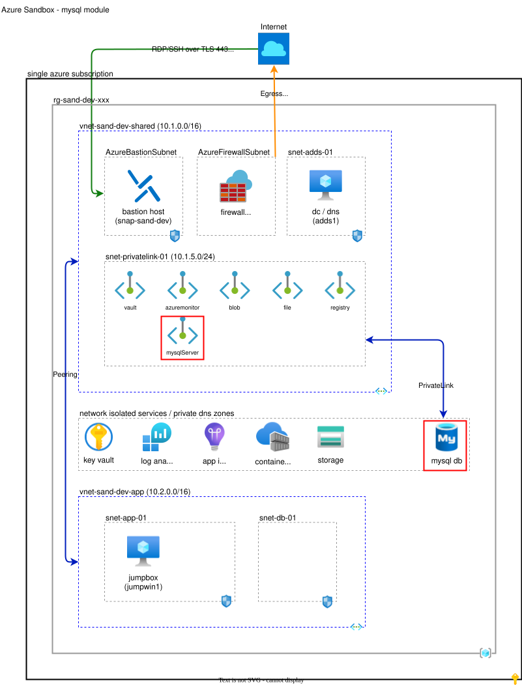

# Azure MySQL Database Module (mysql)

## Contents

* [Architecture](#architecture)
* [Overview](#overview)
* [Smoke Testing](#smoke-testing)
* [Documentation](#documentation)

## Architecture



## Overview

This configuration implements a network isolated Azure Database for MySQL Flexible Server using private endpoints and Microsoft Entra ID-only authentication (`aad_auth_only = ON`).

Enabling this module also causes the *vnet-app* module to install MySQL Workbench on *jumpwin1*. MySQL Workbench is not uninstalled if this module is later disabled.

Enabling this module creates (or reuses, when *mssql* is also enabled) the `grp-sql-admins-*` Microsoft Entra security group in the root module and assigns it as the MySQL Flexible Server Entra administrator.

> **Prerequisite (Microsoft Entra permissions):** The server's user-assigned managed identity must hold either the **Directory Readers** Entra ID role or the Microsoft Graph application permissions `User.Read.All`, `GroupMember.Read.All`, and `Application.Read.All` to resolve Entra users and groups. Only a **Privileged Role Administrator** (or Global Administrator) can grant these permissions. You can pass a pre-authorized identity resource ID via `mysql_entra_identity_id`, or grant the permissions to the identity created by this module.

The estimated provisioning time for this module is 10 minutes.

## Smoke Testing

This section describes how to test the module after deployment.

* Test DNS queries for Azure Database for MySQL private endpoint
  * From *jumpwin1*, execute the following PowerShell command:

    ```powershell
    Resolve-DnsName <mysql-server-name-here>.mysql.database.azure.com
    ```

  * Verify the *IP4Address* returned is within the subnet IP address prefix for the centralized private endpoint subnet *vnet_shared.subnets["snet-privatelink-01"]*, e.g. `10.1.5.*`.
* From *jumpwin1*, test network isolated MySQL connectivity using a Microsoft Entra access token.
  * Sign in with Azure CLI using a member of `grp-sql-admins-*` and retrieve a token for Azure Database for MySQL:

    ```powershell
    $token = az account get-access-token --resource-type oss-rdbms --query accessToken -o tsv
    ```

  * Connect with MySQL Workbench or MySQL Shell using the Entra group login name (`grp-sql-admins-*`) and `$token` as the password, with SSL required.
  * Create a table, insert some data and run some sample queries to verify functionality.

## Documentation

This section provides additional information on various aspects of this module.

* [Dependencies](#dependencies)
* [Module Structure](#module-structure)
* [Input Variables](#input-variables)
* [Module Resources](#module-resources)
* [Output Variables](#output-variables)

### Dependencies

This module depends upon resources provisioned in the following modules:

* Root module
* vnet-shared module
* vnet-app module

### Module Structure

The module is organized as follows:

```plaintext
├── images/
│   └── mysql-diagram.drawio.svg  # Architecture diagram
├── scripts/
│   └── Test-Mysql.ps1            # Unit test script
├── main.tf                       # Resource configurations
├── network.tf                    # Network resource configurations
├── outputs.tf                    # Output variables
├── terraform.tf                  # Terraform configuration block
└── variables.tf                  # Input variables
```

### Input Variables

This section lists input variables used in this module. Defaults can be overridden by specifying a different value in the root module.

Variable | Default | Description
--- | --- | ---
admin_password |  | A strong password used for the initial server login (native auth is disabled by `aad_auth_only = ON`). Defined in the vnet-shared module.
admin_username | bootstrapadmin | The initial server login name (native auth is disabled by `aad_auth_only = ON`). Defined in the vnet-shared module.
location | | The name of the Azure Region where resources will be provisioned. Defined in the root module.
log_analytics_workspace_id | | The ID of the Log Analytics workspace where MySQL diagnostic logs and metrics will be sent. Defined in the vnet-shared module.
mysql_admin_login_name | | The display name of the Entra ID group to be set as the MySQL Flexible Server administrator.
mysql_admin_object_id | | The object ID of the Entra ID group to be set as the MySQL Flexible Server administrator.
mysql_database_name | testdb | The name of the Azure MySQL Database to be provisioned.
mysql_entra_identity_id | `null` | Optional resource ID of a pre-authorized user-assigned managed identity for Microsoft Entra authentication. When `null`, the module creates a user-assigned managed identity.
mysql_sku_name | B_Standard_B1ms | The SKU name for the Azure MySQL Flexible Server.
private_dns_zone_id | | The ID of the private DNS zone for Azure Database for MySQL. Defined in the vnet-app module.
resource_group_name | | The name of the resource group defined in the root module.
subnet_id | | The subnet ID defined in the vnet-app module.
tags | | The tags from the root module.
unique_seed | | The unique seed used to generate unique names for resources. Defined in the root module.

### Module Resources

This section lists the resources included in this module.

Address | Name | Notes
--- | --- | ---
module.mysql[0].azurerm_monitor_diagnostic_setting.this | Diagnostic Logs | The diagnostic setting that sends MySQL slow/audit logs and metrics to the Log Analytics workspace.
module.mysql[0].azurerm_mysql_flexible_database.this | testdb | The Azure MySQL Database.
module.mysql[0].azurerm_mysql_flexible_server.this | mysql&#8209;sand&#8209;dev&#8209;xxxxxxxx | The Azure MySQL flexible server with a user-assigned managed identity.
module.mysql[0].azurerm_mysql_flexible_server_active_directory_administrator.this | | Configures the `grp-sql-admins-*` Entra ID group as the MySQL Flexible Server administrator.
module.mysql[0].azurerm_mysql_flexible_server_configuration.aad_auth_only | aad_auth_only | Enables Microsoft Entra-only authentication (`ON`).
module.mysql[0].azurerm_mysql_flexible_server_configuration.audit_log_enabled | audit_log_enabled | Enables audit logging so the *MySqlAuditLogs* diagnostic category produces data.
module.mysql[0].azurerm_mysql_flexible_server_configuration.audit_log_events | audit_log_events | Selects the audit event classes (CONNECTION, DML, DDL, DCL) to be logged.
module.mysql[0].azurerm_mysql_flexible_server_configuration.slow_query_log | slow_query_log | Enables slow query logging so the *MySqlSlowLogs* diagnostic category produces data.
module.mysql[0].azurerm_private_endpoint.this | pep&#8209;sand&#8209;dev&#8209;mysql&#8209;server | The private endpoint for the Azure MySQL flexible server.
module.mysql[0].azurerm_user_assigned_identity.this[0] | id&#8209;sand&#8209;dev&#8209;mysql | User-assigned managed identity for MySQL Entra authentication (created when `mysql_entra_identity_id` is `null`).

### Output Variables

This section includes a list of output variables returned by the module.

Name | Comments
--- | ----
fqdns | A map of fqdns for resources provisioned in the module.
resource_ids | A map of resource IDs for key resources in the module.
resource_names | A map of resource names for key resources in the module.
