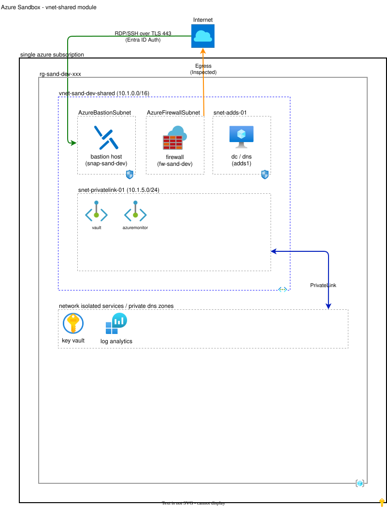

# Shared Services Virtual Network Module (vnet-shared)

## Contents

* [Architecture](#architecture)
* [Overview](#overview)
* [Smoke testing](#smoke-testing)
* [Documentation](#documentation)

## Architecture



## Overview

This module implements a virtual network with shared services used by all the configurations including:

* A virtual network for hosting virtual machines, bastion hosts and firewalls.
* An Azure Bastion for secure RDP and SSH access to virtual machines in the sandbox environment.
* An Azure Firewall for network security.
* A network isolated Azure Key Vault for storing secrets.
* A Log Analytics workspace for collecting logs and metrics from Azure resources.
* A Windows virtual machine configured as an Active Directory Domain Services domain controller and DNS server.

The estimated provisioning time for this module is 30 - 60 minutes depending upon how recentiy the Windows Server Core platform image was built which can impact patching freshness.

Before any run command or VM extension touches *adds1*, Terraform first waits for the Windows guest agent to be ready, then installs pending Critical and Security Windows updates on it using the platform [installPatches](https://learn.microsoft.com/en-us/rest/api/compute/virtual-machines/install-patches) action and reboots it if required (wait for agent → patch → reboot → configure). This keeps an update-driven reboot from interrupting later configuration steps. The readiness wait is a run command (*Wait-GuestAgentReady.ps1*): it can't run while a new VM's guest agent is self-updating, so patching never starts mid-update, when the platform would fail it. Patching runs for up to 2 hours. If the patch run reports a status of `Failed` (a patch failed to install, or the window ran out with patches outstanding), the apply fails instead of configuring a partially patched VM. The patch result is also surfaced in the `patch_install_result` output. Because the failed result stays in Terraform state, later plans fail too until you re-run patching with `terraform apply -replace='module.vnet_shared.azapi_resource_action.install_patches'`. Patching adds time to provisioning that varies with the number of pending updates. Adding this step to an existing sandbox patches and may reboot *adds1* on the next apply.

After deployment, *adds1* is patched by the sandbox's Azure Update Manager schedule, and Microsoft Update is enabled so other Microsoft products are patched too. See [Patching](../../README.md#patching).

When the root module's `vm_image_gallery_id` is set, *adds1* uses the latest version of the `adds` custom image instead of a platform image. The image is patched only; AD DS installation and promotion still run at deployment time. See [Custom images](../../README.md#custom-images).

> [!IMPORTANT]
> **OS disk type change (Standard HDD retirement).** The default for `vm_adds_storage_account_type` is now `StandardSSD_LRS` and Standard HDD (`Standard_LRS`) is no longer permitted, because [Azure is retiring Standard HDD OS disks on September 8, 2028](https://learn.microsoft.com/en-us/azure/virtual-machines/disks-hdd-os-retirement). Fresh deployments are unaffected. For an **existing** deployment created with `Standard_LRS`, changing `os_disk.storage_account_type` forces Terraform to **replace the VM** (destroy and recreate). This VM is the Active Directory domain controller and DNS server that other modules depend on, so its replacement causes an AD/DNS outage that will disrupt domain-joined VMs and dependent modules until it re-provisions. To avoid replacement and downtime, deallocate the VM and change its OS disk SKU in place (Azure portal/CLI) *before* applying, then set the variable to the new SKU so Terraform detects no change. If you allow a replacement instead, schedule a maintenance window and expect dependent VMs to require domain re-join/re-provisioning.

## Smoke testing

* Explore your newly provisioned resources in the Azure portal:
  * Key vault
    * Temporarily enable public access to the key vault by navigating to *portal.azure.com* > *Key vaults* > *kv-sand-dev-xxxx* > *Networking* > *Firewalls and virtual networks* > *Allow access from:* > *Allow public access from all networks*.
    * Navigate to *portal.azure.com* > *Key vaults* > *kv-sand-dev-xxxx* > *Objects* > *Secrets* > *adminpassword* > *CURRENT VERSION* > *00000000-0000-0000-0000-000000000000* > *Show Secret Value*
    * Make a note of the *Secret value*. This is a strong password associated with the *adminuser* key vault secret. Together these credentials are used to set up initial administrative access to resources in Azure Sandbox.
    * Disable public access to the key vault by navigating to *portal.azure.com* > *Key vaults* > *kv-sand-dev-xxxx* > *Networking* > *Firewalls and virtual networks* > *Allow access from:* > *Disable public access*.
  * Bastion host
    * Navigate to *portal.azure.com* > *Bastions* > *bas-sand-dev*.
    * Review the information in the *Overview* section.
  * Firewall
    * Navigate to *portal.azure.com* > *Firewalls* > *afw-sand-dev*.
    * Review the information in the *Overview* section.

## Documentation

This section provides additional information on various aspects of this module.

* [Dependencies](#dependencies)
* [Module Structure](#module-structure)
* [Input Variables](#input-variables)
* [Module Resources](#module-resources)
* [Output Variables](#output-variables)

### Dependencies

This module depends upon resources provisioned in the root module.

### Module Structure

The module is organized as follows:

```plaintext
vnet-shared/
├── images/                        
│   └── vnet-shared-diagram.drawio.svg  # Architecture diagram
├── scripts/                                    
│   ├── Configure-Adds.ps1              # Configures Active Directory Domain Services
│   ├── Configure-AddsDns.ps1           # Configures AD Integrated DNS Server
│   ├── Enable-MicrosoftUpdate.ps1      # Registers Microsoft Update so other Microsoft products are patched
│   ├── Test-VnetShared.ps1             # Module unit test script
│   └── Wait-GuestAgentReady.ps1        # Waits for the guest agent to finish any self-update before patching
├── compute.tf                          # Compute resource configurations
├── locals.tf                           # Local variables
├── main.tf                             # Resource configurations
├── network.tf                          # Network resource configurations 
├── outputs.tf                          # Output variables
├── terraform.tf                        # Terraform configuration block
└── variables.tf                        # Input variables
```

### Input Variables

This section documents default values for module variables as defined in `variables.tf`. Defaults can be overridden by passing values to the module when it is called.

Variable | Default | Description
--- | --- | ---
adds_domain_name | mysandbox.local | The AD DS domain name.
admin_password_secret | adminpassword | The name of the key vault secret containing the admin password.
admin_password_secret_version | 1 | Increment to create a new admin password secret.
admin_username | bootstrapadmin | The default admin username used when configuring services.
admin_username_secret | adminuser | The name of the key vault secret containing the admin username.
location | | The Azure region defined in the root module.
log_analytics_workspace_retention_days | 30 | The retention period for the new log analytics workspace.
operator_object_id | | The Microsoft Entra object id of the operator. Defined in the root module.
patch_schedule | `{}` | Scheduled patching settings for the sandbox maintenance configuration: `start_time`, `time_zone`, `recurrence`, `duration`, `reboot`, `windows_classifications` and `linux_classifications`. Defined by the root module's `patch_schedule_*` variables; module defaults match the root defaults.
resource_group_name | | The resource group defined in the root module.
subnet_adds_address_prefix | 10.1.1.0/24 | The address prefix for the AD Domain Services subnet.
subnet_AzureBastionSubnet_address_prefix | 10.1.0.0/26 | The address prefix for the AzureBastionSubnet subnet. `/26` is the minimum size required for the Bastion Standard SKU (host scaling).
subnet_AzureFirewallSubnet_address_prefix | 10.1.4.0/26 | The address prefix for the AzureFirewallSubnet subnet.
subnet_misc_address_prefix | 10.1.2.0/24 | The address prefix for the miscellaneous subnet.
subnet_misc_02_address_prefix | 10.1.3.0/24 | The address prefix for the miscellaneous 2 subnet.
subnet_privatelink_address_prefix | 10.1.5.0/24 | The address prefix for the PrivateLink subnet, which hosts the private endpoints for the entire sandbox environment.
tags | | The tags defined in the root module.
unique_seed | | The random seed generated by the root module's naming module. Its first characters are added to globally unique names so they share the resource group's random suffix.
vm_adds_image_offer | WindowsServer | The offer type of the virtual machine image used to create the VM.
vm_adds_image_publisher | MicrosoftWindowsServer | The publisher for the virtual machine image used to create the VM.
vm_adds_image_sku | 2025-datacenter-azure-edition-core | The SKU of the virtual machine image used to create the VM.
vm_adds_image_version | Latest | The version of the virtual machine image used to create the VM.
vm_adds_name | adds1 | The name of the VM.
vm_adds_size | `Standard_D2ls_v6` | The size of the virtual machine. Defined by the root module's `vm_jumpbox_size` variable.
vm_adds_storage_account_type | `StandardSSD_LRS` | The storage type to be used for the VM's OS disk. Standard HDD (`Standard_LRS`) is not permitted because Azure is retiring Standard HDD OS disks on September 8, 2028.
vm_image_gallery_id | `null` | Resource ID of the Azure Compute Gallery with custom images, or `null` for platform images. Defined by the root module's `vm_image_gallery_id` variable and checked there. When set, the `*_image_*` variables are ignored.
vnet_address_space | 10.1.0.0/16 | The address range for the virtual network.
vnet_name | shared | The name of the new virtual network.

### Module Resources

Address | Name | Notes
--- | --- | ---
module.vnet_shared.azapi_resource_action.install_patches | | Installs Critical and Security updates on *adds1* (rebooting if required) within a 2-hour window, failing the apply if the patch run reports `Failed`, after the guest agent readiness wait and before any run command or extension runs on it.
module.vnet_shared.azurerm_bastion_host.this | bas&#8209;sand&#8209;dev | The Azure Bastion used for secure RDP/SSH access to sandbox VMs. Uses the `Standard` SKU, which is required to emit `BastionAuditLogs` via a diagnostic setting.
module.vnet_shared.azurerm_firewall.this | afw&#8209;sand&#8209;dev | The Azure Firewall used for network security.
module.vnet_shared.azurerm_firewall_policy.this | awfp&#8209;sand&#8209;dev | The firewall policy. Threat intelligence mode is set to `Deny`.
module.vnet_shared.azurerm_firewall_policy_rule_collection_group.this | fwprcg&#8209;sand&#8209;dev | The firewall rules. Allows all outbound traffic for ports `80`, `443` and `1688` (Windows Activation).
module.vnet_shared.azurerm_key_vault.this | kv&#8209;sand&#8209;dev | The Azure Key Vault used to store secrets.
module.vnet_shared.azurerm_key_vault_secret.adminpassword | adminpassword | Randomly generated admin password used for sandbox VMs and services.
module.vnet_shared.azurerm_key_vault_secret.adminusername | adminuser | Admin username used for sandbox VMs and services, default is *bootstrapadmin*.
module.vnet_shared.azurerm_log_analytics_workspace.this | log&#8209;sand&#8209;dev&#8209;xxxx | The Log Analytics workspace used to collect logs and metrics from Azure resources.
module.vnet_shared.azurerm_maintenance_assignment_virtual_machine.this | | Assigns *adds1* to the sandbox maintenance configuration for scheduled patching. Created as the last step of the VM's deployment so scheduled installs and reboots can't interrupt configuration.
module.vnet_shared.azurerm_maintenance_configuration.this | mc&#8209;sand&#8209;dev | The Azure Update Manager maintenance configuration (scope `InGuestPatch`) used for scheduled patching of every sandbox VM. Exposed as `maintenance_configuration` in `resource_ids` and `resource_names`. See [Patching](../../README.md#patching).
module.vnet_shared.azurerm_monitor_data_collection_endpoint.this | dcesanddevxxxx | The data collection endpoint (DCE) for Azure Monitor.
module.vnet_shared.azurerm_monitor_data_collection_rule.linux | dcrsanddev&#8209;linux | The data collection rules (DCR) for Linux VMs.
module.vnet_shared.azurerm_monitor_data_collection_rule.windows | dcrsanddev&#8209;windows | The data collection rules (DCR) for Windows VMs.
module.vnet_shared.azurerm_monitor_data_collection_rule_association.adds1_dce | configurationAccessEndpoint | Associates the DCE with adds1.
module.vnet_shared.azurerm_monitor_data_collection_rule_association.adds1_dcr | dcrasanddev&#8209;adds1 | Associates the DCR with adds1.
module.vnet_shared.azurerm_monitor_diagnostic_setting.bastion | Diagnostic Logs | The Azure Monitor diagnostic setting that streams Azure Bastion audit logs (`BastionAuditLogs`) and `AllMetrics` to the Log Analytics workspace. `BastionAuditLogs` only ever writes to the resource-specific `MicrosoftAzureBastionAuditLogs` table and requires the Bastion `Standard` SKU.
module.vnet_shared.azurerm_monitor_diagnostic_setting.firewall | Diagnostic Logs | The Azure Monitor diagnostic setting that streams Azure Firewall structured (resource-specific) logs (`AZFWApplicationRule`, `AZFWNetworkRule`, `AZFWNatRule`, `AZFWThreatIntel`, `AZFWDnsQuery`) and `AllMetrics` to the Log Analytics workspace. Uses `Dedicated` destination tables. High-volume aggregation/flow-trace categories and Premium-only IDPS logs are intentionally omitted to control ingestion cost.
module.vnet_shared.azurerm_monitor_diagnostic_setting.this | Audit Logs | The Azure Monitor diagnostic setting used to send key vault logs and metrics to the Log Analytics workspace.
module.vnet_shared.azurerm_monitor_private_link_scope.this | ampls&#8209;sand&#8209;dev | The Azure Monitor Private Link Scope (AMPLS) resource.
module.vnet_shared.azurerm_monitor_private_link_scoped_service.dce | ampls&#8209;scope&#8209;dce | Associates the AMPLS with the DCE.
module.vnet_shared.azurerm_monitor_private_link_scoped_service.log_analytics | ampls&#8209;scope&#8209;log&#8209;analytics | Associates the AMPLS with the shared log analytics workspace.
module.vnet_shared.azurerm_network_interface.this | nic&#8209;sand&#8209;dev&#8209;adds1 | Nic for *adds1* VM.
module.vnet_shared.azurerm_network_security_group.groups[*] | | NSGs for each subnet except *AzureFirewallSubnet*.
module.vnet_shared.azurerm_network_security_rule.rules[*] | | NSG rules for each NSG. See *locals.tf* for rule definitions.
module.vnet_shared.azurerm_private_dns_zone.zones["privatelink.agentsvc.azure-automation.net"] | | Private DNS zone for Azure Monitor Agent.
module.vnet_shared.azurerm_private_dns_zone.zones["privatelink.azurecr.io"] | | Private DNS zone for Azure Container Registry, consumed by the *vnet-app* module.
module.vnet_shared.azurerm_private_dns_zone.zones["privatelink.blob.core.windows.net"] | | Private DNS zone for Azure Blob Storage, consumed by the *vnet-app* module.
module.vnet_shared.azurerm_private_dns_zone.zones["privatelink.database.windows.net"] | | Private DNS zone for Azure SQL Database, consumed by the *mssql* module.
module.vnet_shared.azurerm_private_dns_zone.zones["privatelink.file.core.windows.net"] | | Private DNS zone for Azure Files, consumed by the *vnet-app* module.
module.vnet_shared.azurerm_private_dns_zone.zones["privatelink.monitor.azure.com"] | | Private DNS zone for Azure Monitor.
module.vnet_shared.azurerm_private_dns_zone.zones["privatelink.mysql.database.azure.com"] | | Private DNS zone for Azure Database for MySQL, consumed by the *mysql* module.
module.vnet_shared.azurerm_private_dns_zone.zones["privatelink.ods.opinsights.azure.com"] | | Private DNS zone for Log Analytics data ingestion.
module.vnet_shared.azurerm_private_dns_zone.zones["privatelink.oms.opinsights.azure.com"] | | Private DNS zone for Log Analytics agent onboarding.
module.vnet_shared.azurerm_private_dns_zone.zones["privatelink.vaultcore.azure.net"] | | Private DNS zone for the key vault.
module.vnet_shared.azurerm_private_dns_zone.zones["privatelink.&lt;location&gt;.azurecontainerapps.io"] | | Private DNS zone for Azure Container Apps, consumed by the *petstore* configuration.
module.vnet_shared.azurerm_private_dns_zone_virtual_network_link.zones[*] | | Links each private DNS zone to *vnet-sand-dev-shared* with [fallback to internet](https://learn.microsoft.com/azure/dns/private-dns-fallback) (`resolution_policy = "NxDomainRedirect"`) enabled. Zones are linked to the shared services virtual network only; see the root README section on Private Endpoints and Private DNS.
module.vnet_shared.azurerm_private_endpoint.ampls | pep&#8209;sand&#8209;dev&#8209;ampls | The private endpoint for Azure Monitor.
module.vnet_shared.azurerm_private_endpoint.key_vault | pep&#8209;sand&#8209;dev&#8209;key&#8209;vault | The private endpoint for the key vault.
module.vnet_shared.azurerm_public_ip.bastion | pip&#8209;sand&#8209;dev&#8209;bastion | Public IP for Azure Bastion.
module.vnet_shared.azurerm_public_ip.firewall | pip&#8209;sand&#8209;dev&#8209;firewall | Public IP for Azure Firewall.
module.vnet_shared.azurerm_role_assignment.roles[*] | | Assigns `Key Vault Secrets Officer` role to the service principal and user for managing key vault secrets.
module.vnet_shared.azurerm_route_table.this | rt&#8209;sand&#8209;dev | Configures next hop for default route to go to Azure Firewall for all sandbox subnets.
module.vnet_shared.azurerm_subnet.subnets["AzureBastionSubnet"] | | Dedicated subnet Azure Bastion.
module.vnet_shared.azurerm_subnet.subnets["AzureFirewallSubnet"] | | Dedicated subnet for Azure Firewall.
module.vnet_shared.azurerm_subnet.subnets["snet-adds-01"] | | Dedicated subnet for *adds1* Domain Controller / DNS Server VM.
module.vnet_shared.azurerm_subnet.subnets["snet-misc-01"] | | Reserved for use by optional configurations.
module.vnet_shared.azurerm_subnet.subnets["snet-misc-02"] | | Reserved for use by optional configurations.
module.vnet_shared.azurerm_subnet.subnets["snet-privatelink-01"] | | Dedicated subnet for Private Link, hosting the private endpoints for every module in the sandbox environment.
module.vnet_shared.azurerm_subnet_network_security_group_association.associations[*] | | NSGs are associated with all subnets except *AzureFirewallSubnet* and *snet-privatelink-01*.
module.vnet_shared.azurerm_subnet_route_table_association.associations[*] | | The *rt-sand-dev* route table is associated with all subnets except *AzureFirewallSubnet*,*AzureBastionSubnet* and *snet-privatelink-01*.
module.vnet_shared.azurerm_virtual_machine_run_command.enable_microsoft_update | EnableMicrosoftUpdate | Registers Microsoft Update on *adds1* so Windows Update and Azure Update Manager also patch other Microsoft products. Runs after the guest agent readiness wait and before `install_patches`.
module.vnet_shared.azurerm_virtual_machine_run_command.wait_for_guest_agent | WaitForGuestAgent | Waits until the guest agent on *adds1* has finished any self-update and is processing goal states, logging the agent version, before `install_patches` runs.
module.vnet_shared.azurerm_virtual_network.this | vnet&#8209;sand&#8209;dev&#8209;shared | The shared services virtual network.
module.vnet_shared.azurerm_windows_virtual_machine.this | adds1 | The AD DS Domain Controller / DNS Server VM.
module.vnet_shared.time_static.patch_schedule | | Records the creation time used to set the maintenance window's first start date (48 hours later, so it is always in the future).

### Output Variables

This section lists the output variables returned by the module.

Output Variable | Default | Description
--- | --- | ---
adds_domain_name | mysandbox.local | The Active Directory Domain Services (AD DS) domain name.
admin_password | | The strong password used for provisioning administrator accounts. Marked sensitive to prevent accidental exposure.
admin_password_secret | adminpassword | The name of the key vault secret where the admin password is stored.
admin_username | bootstrapadmin | The user name for provisioning administrator accounts.
admin_username_secret | adminuser | The name of the key vault secret containing the admin username.
dns_server | 10.1.1.4 | The primary DNS server IP address for the virtual network.
fqdns | | A map of fqdns for resources provisioned in the module.
patch_install_result | | The result of the *adds1* patch installation (status, rebootStatus, installed/failed/pending patch counts, maintenanceWindowExceeded).
private_dns_zone_links_complete | | A dependency signal indicating all private DNS zone virtual network links have been created. Consumed by modules that provision private endpoints.
private_dns_zones | | A map of all private DNS zones used by the sandbox environment, keyed by zone name. Consumed by modules that provision private endpoints.
resource_ids | | A map of resource IDs for key resources in the module.
resource_names | | A map of resource names for key resources in the module.
subnets | | A list of subnets in the shared virtual network.
